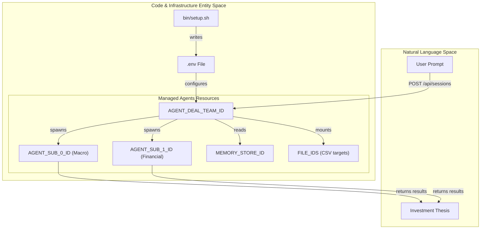

<!-- source: DeepWiki mcp.deepwiki.com · repo anthropics/cwc-workshops · page 4 Production-Ready Agent Workshop (Deal Desk) · fetched 2026-10-26 -->

# Production-Ready Agent Workshop (Deal Desk)

Relevant source files

The following files were used as context for generating this wiki page:

- [production-ready-agent/README.md](production-ready-agent/README.md)
- [production-ready-agent/bin/setup.sh](production-ready-agent/bin/setup.sh)

The **Deal Desk** workshop is a comprehensive exercise in building a production-grade, chat-first interface for a multi-agent M&A (Mergers and Acquisitions) research team. Participants use the **Claude Managed Agents (CMA)** API to orchestrate a sophisticated "Coordinator" agent that delegates research tasks to four specialized sub-agents.

The application is built with **Next.js** and features real-time event streaming, persistent memory, and integration with external tools via MCP and Vault.

## System Architecture

The workshop implements a hub-and-spoke multi-agent pattern. The **Coordinator Agent** (`deal-team`) acts as the primary interface for the user, utilizing a `multiagent` roster to spawn and manage sub-agents in parallel.

### Agent Roster
The team consists of five distinct agents defined in YAML configurations within the `seed/agents/` directory:

| Agent Name | Role | Source File |
| :--- | :--- | :--- |
| **Coordinator** | Orchestrates the research process and synthesizes the final investment thesis. | [production-ready-agent/seed/agents/deal-team.yaml:1-30]() |
| **Macro Trends** | Analyzes broad market conditions and industry tailwinds. | [production-ready-agent/seed/agents/macro-trends.yaml:1-15]() |
| **Financial Analyst** | Processes target company financials and historical performance. | [production-ready-agent/seed/agents/financial-analyst.yaml:1-15]() |
| **Competitive Positioning** | Evaluates market share, moats, and competitor landscapes. | [production-ready-agent/seed/agents/competitive-positioning.yaml:1-15]() |
| **Valuation Comps** | Performs relative valuation analysis against industry peers. | [production-ready-agent/seed/agents/valuation-comps.yaml:1-15]() |

### Resource Mapping
The following diagram bridges the logical agent roles to their physical resource IDs and provisioning logic.

**Figure 1: Deal Desk Entity Mapping**

**Sources:** [production-ready-agent/bin/setup.sh:38-97](), [production-ready-agent/README.md:81-89]()

## Workshop Structure

The workshop is divided into a `starter/` and `solution/` directory. Both are identical Next.js applications, but the `starter/` app contains `TODO` stubs in the API route handlers that participants must implement to bring the agent to life.

### Key Implementation Tasks
1.  **Session Management**: Implementing `sessions.list`, `sessions.create`, and `sessions.delete`.
2.  **Interaction Loop**: Handling `user.message` and `user.define_outcome` via `sessions.events.send`.
3.  **Streaming**: Bridging the CMA `sessions.events.stream` to a Server-Sent Events (SSE) stream for the UI.
4.  **Human-in-the-loop**: Implementing `user.tool_confirmation` for gated tool calls.

For a detailed walkthrough of these API implementations, see **[Deal Desk: API Routes and Event Streaming](#4.1)**.

## Data and Provisioning

The workshop includes a robust provisioning system to ensure all participants have identical environments.

*   **Idempotent Setup**: The `bin/setup.sh` script handles the creation of the Environment, Memory Store, Files, and Agents, writing the resulting IDs back to a shared `.env` file [production-ready-agent/bin/setup.sh:13-36]().
*   **Seed Data**: The `seed/` directory contains fictional target company financials in CSV format and a memory store of "lessons learned" from prior (fictional) deals [production-ready-agent/seed/memories/:1-5]().
*   **Multi-Agent Evolution**: The workshop demonstrates how to update an agent's roster. The Coordinator is initially created without sub-agents (v1) and then upgraded to v2 via `bin/enable-multiagent.sh` [production-ready-agent/bin/setup.sh:59-67]().

For more information on the UI components and the provisioning logic, see **[Deal Desk: UI, Seed Data, and Provisioning](#4.2)**.

## Technical Components Overview

| Component | Responsibility | Key Files |
| :--- | :--- | :--- |
| **Event Reducer** | Converts raw CMA events into a UI-friendly chat history state. | `lib/chat.ts` |
| **SSE Encoder** | Manages the streaming connection between the server and the browser. | `lib/sse.ts` |
| **Sandbox** | Provides the execution environment where sub-agents process CSV data. | `seed/environments/research.yaml` |
| **Linear/MCP** | (Optional) Allows the agent to read issues from a real Linear team. | `bin/seed-linear.sh` |

**Sources:** [production-ready-agent/README.md:91-102](), [production-ready-agent/README.md:103-110]()

---

