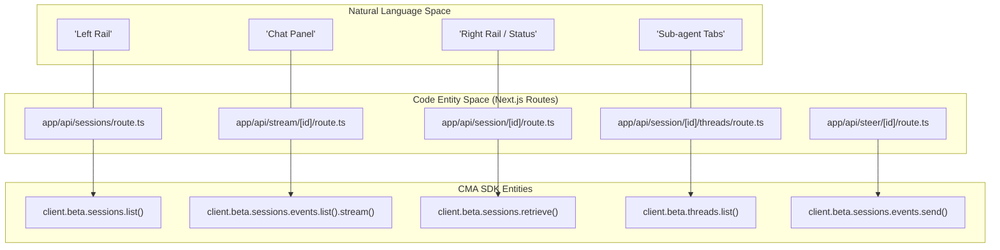
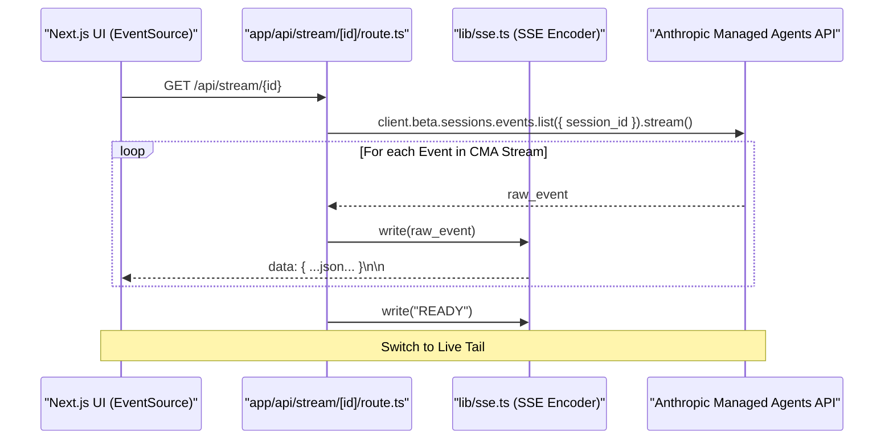

<!-- source: DeepWiki mcp.deepwiki.com · repo anthropics/cwc-workshops · page 4.1 Deal Desk: API Routes and Event Streaming · fetched 2026-10-26 -->

# Deal Desk: API Routes and Event Streaming

Relevant source files

The following files were used as context for generating this wiki page:

- [production-ready-agent/solution/README.md](production-ready-agent/solution/README.md)
- [production-ready-agent/solution/lib/anthropic.ts](production-ready-agent/solution/lib/anthropic.ts)
- [production-ready-agent/starter/README.md](production-ready-agent/starter/README.md)
- [production-ready-agent/starter/lib/anthropic.ts](production-ready-agent/starter/lib/anthropic.ts)

This page provides a technical walkthrough of the Deal Desk backend architecture, focusing on the seven core API routes that interface with the Claude Managed Agents (CMA) platform. It covers session lifecycle management, the Server-Sent Events (SSE) streaming pipeline, and the transformation of raw agent events into a structured chat UI.

## API Architecture Overview

The Deal Desk application uses a Next.js App Router backend to proxy requests to the Anthropic SDK. The backend is organized into functional routes that handle session orchestration, steering (sending messages), and real-time event streaming.

### Natural Language to Code Entity Mapping

The following diagram bridges the conceptual "Deal Desk" workspace to the specific code entities and API routes defined in the repository.

**Diagram: Deal Desk System Mapping**

Sources: [production-ready-agent/solution/README.md:13-26](), [production-ready-agent/starter/README.md:47-102]()

---

## Core Route Handlers (The Seven TODOs)

The workshop tasks involve implementing seven specific route handlers to enable full agent functionality.

### 1. Session Orchestration (`sessions.list` & `sessions.create`)
Located in `app/api/sessions/route.ts`, these handlers manage the high-level session lifecycle.

*   **List**: Fetches the 30 most recent sessions for the UI sidebar using `client.beta.sessions.list({ limit: 30 })` [production-ready-agent/starter/README.md:49-52]().
*   **Create**: Initializes a new Managed Agent session. This is the most complex call, requiring the integration of several resource IDs [production-ready-agent/starter/README.md:54-59]():
    *   `agent_id`: Set to `ids.agent` [production-ready-agent/starter/README.md:67-69]().
    *   `environment_id`: Set to `ids.environment` [production-ready-agent/starter/README.md:31-31]().
    *   `resources`: A collection including `memory_store` (if enabled) and `file` mounts for target CSV data [production-ready-agent/starter/README.md:61-64]().
    *   `vault_ids`: Included if MCP credentials are required [production-ready-agent/starter/README.md:65-65]().

### 2. Steering and Interaction (`events.send`)
Interaction with a running session occurs through the `events.send` method.

*   **User Messages**: Sent via `app/api/steer/[id]/route.ts`. The first `user.message` transitions a session from `idle` to `running` [production-ready-agent/starter/README.md:71-77]().
*   **Outcome Definition**: Users can define a "success rubric" using `user.define_outcome`. This triggers the CMA grader to emit `agent.outcome_evaluated` events [production-ready-agent/starter/README.md:75-77]().
*   **Tool Confirmation**: Located in `app/api/confirm/[id]/route.ts`. This handles `user.tool_confirmation` for tools protected by an `always_ask` policy [production-ready-agent/starter/README.md:93-97]().

### 3. Status and Deletion (`sessions.retrieve` & `sessions.delete`)
Located in `app/api/session/[id]/route.ts`.

*   **Retrieve**: Polled by the UI to update the session status, tool definitions, and outcome evaluations [production-ready-agent/starter/README.md:79-83]().
*   **Delete**: Permanently removes the session resource [production-ready-agent/starter/README.md:99-102]().

Sources: [production-ready-agent/starter/README.md:47-102](), [production-ready-agent/starter/lib/anthropic.ts:27-35]()

---

## Event Streaming and SSE Pipeline

Real-time updates are delivered via Server-Sent Events (SSE). The application bridges the Anthropic `stream()` API to a standard web `ReadableStream`.

### Streaming Flow
The stream route (`app/api/stream/[id]/route.ts`) utilizes a specialized SSE encoder in `lib/sse.ts` to handle protocol framing and event deduplication.

**Diagram: Event Streaming Pipeline**

Sources: [production-ready-agent/solution/README.md:19-21](), [production-ready-agent/starter/README.md:85-91]()

### Per-Thread Sub-Agent Streams
When multi-agent mode is enabled, the coordinator agent spawns sub-agents in separate threads. The UI discovers these via `app/api/session/[id]/threads/route.ts` [production-ready-agent/solution/README.md:24-24](). Each thread has its own dedicated SSE endpoint at `app/api/stream/[id]/thread/[threadId]/route.ts`, which follows the same streaming logic as the main session [production-ready-agent/solution/README.md:20-20]().

---

## Data Transformation: Event to Chat

Raw events from the CMA API are not directly renderable as a chat history. The application uses a reducer pattern in `lib/chat.ts` to transform the stream of events into a coherent list of chat messages.

| Event Type | Chat Transformation |
| --- | --- |
| `user.message` | Added as a "user" bubble. |
| `agent.message` | Added as an "assistant" bubble. |
| `agent.tool_call` | Rendered as a pending or completed tool execution block. |
| `agent.outcome_evaluated` | Rendered as the final "Thesis" or graded result. |

Sources: [production-ready-agent/solution/README.md:25-25](), [production-ready-agent/starter/README.md:75-77]()

---

## Environment and Client Configuration

The application initializes the `Anthropic` client using IDs and keys managed in `lib/anthropic.ts`.

*   **API Key Management**: The client reads from a local `.env` file, prioritizing it over shell-exported variables to prevent environment shadowing [production-ready-agent/starter/lib/anthropic.ts:5-20]().
*   **Resource IDs**: The `ids` object exports critical identifiers for the Agent, Environment, Memory Store, and Vault, which are populated during the `bin/setup.sh` provisioning process [production-ready-agent/starter/lib/anthropic.ts:29-35]().

Sources: [production-ready-agent/starter/lib/anthropic.ts:1-35]()

---

