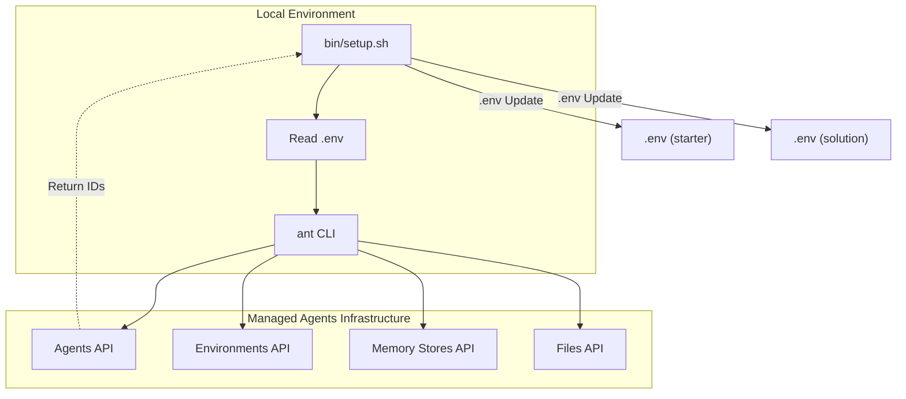
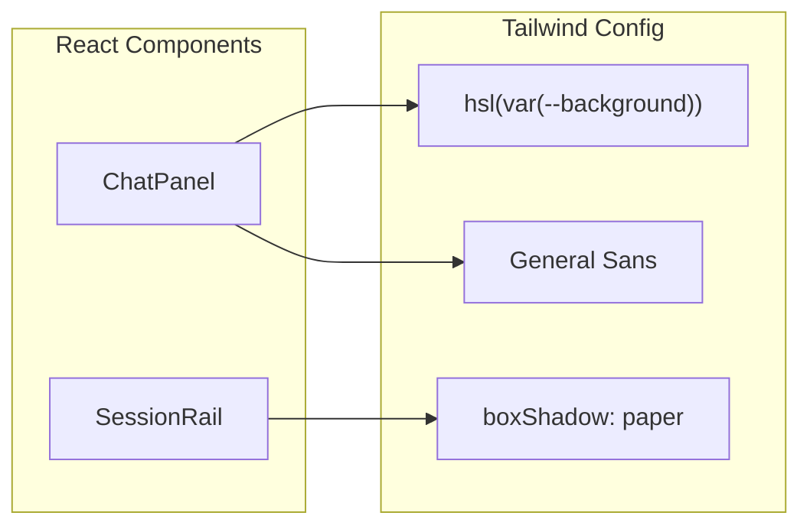

<!-- source: DeepWiki mcp.deepwiki.com · repo anthropics/cwc-workshops · page 4.2 Deal Desk: UI, Seed Data, and Provisioning · fetched 2026-10-26 -->

# 4.2 Deal Desk: UI, Seed Data, and Provisioning

Relevant source files

The following files were used as context for generating this wiki page:

- [production-ready-agent/.env.example](production-ready-agent/.env.example)
- [production-ready-agent/bin/setup.sh](production-ready-agent/bin/setup.sh)
- [production-ready-agent/solution/tailwind.config.ts](production-ready-agent/solution/tailwind.config.ts)
- [production-ready-agent/starter/tailwind.config.ts](production-ready-agent/starter/tailwind.config.ts)

This page details the frontend architecture, the idempotent provisioning system, and the static seed data that defines the multi-agent Deal Desk environment. The Deal Desk application is a Next.js-based research platform where a coordinator agent orchestrates four specialized sub-agents to perform M&A (Mergers and Acquisitions) due diligence.

## Provisioning and Setup

The Deal Desk environment is provisioned using a Bash-based orchestration script that interacts with the `ant` CLI. This process is designed to be idempotent, allowing developers to re-run the setup to update agent definitions without duplicating resources.

### Idempotent Resource Creation
The script `bin/setup.sh` manages the lifecycle of several Managed Agent resources:
1.  **Environments**: Creates a shared `research` environment defined in `seed/environments/research.yaml` [production-ready-agent/bin/setup.sh:38-45]().
2.  **Sub-Agents**: Iterates through specialized agent configurations (`macro-trends`, `financial-analyst`, `competitive-positioning`, `valuation-comps`) and uses an `upsert_agent` function to either update an existing agent or create a new one [production-ready-agent/bin/setup.sh:47-57]().
3.  **Coordinator Agent**: Provisions the primary "Deal Team" agent. It initially strips the `multiagent` block to ensure a clean state before the workshop participant enables multi-agent capabilities via `enable-multiagent.sh` [production-ready-agent/bin/setup.sh:59-67]().
4.  **Memory Stores**: Initializes a `deal-priors` memory store and populates it with Markdown files from `seed/memories/` [production-ready-agent/bin/setup.sh:69-84]().
5.  **Files**: Uploads target financial CSVs from `seed/targets/` to the Managed Agents Files API, making them available for agent analysis [production-ready-agent/bin/setup.sh:86-97]().

### Configuration Syncing
Once resources are provisioned, their unique IDs (e.g., `agent_...`, `env_...`, `memstore_...`) are written back to the root `.env` file and then synchronized into the `starter/` and `solution/` directories to ensure both environments are ready for local development [production-ready-agent/bin/setup.sh:99-105]().

**Resource Provisioning Flow**

Sources: [production-ready-agent/bin/setup.sh:1-109](), [production-ready-agent/.env.example:1-25]()

## Seed Data and Configuration

The `seed/` directory contains the declarative definitions of the Deal Desk's knowledge and behavior.

### Agent Configurations
Agents are defined via YAML files that specify their `system_prompt`, `model`, and available tools.
*   **Specialized Sub-Agents**: Located in `seed/agents/`. Each sub-agent is focused on a specific domain (e.g., `financial-analyst.yaml` handles spreadsheet analysis) [production-ready-agent/bin/setup.sh:50-57]().
*   **Coordinator**: The `deal-team.yaml` acts as the orchestrator, delegating tasks to sub-agents [production-ready-agent/bin/setup.sh:64-65]().

### Data Assets
*   **Memory Store**: Markdown files in `seed/memories/` provide "lessons learned" from prior deals, which the agent can query to avoid repeating past mistakes [production-ready-agent/bin/setup.sh:76-81]().
*   **Target Financials**: CSV files in `seed/targets/` represent the raw data for analysis, such as `bridgewell.csv` or `norwood.csv` [production-ready-agent/bin/setup.sh:89-94]().

| Resource Type | Source Path | Managed Agent Entity |
| :--- | :--- | :--- |
| Agent Configs | `seed/agents/*.yaml` | `Agent` |
| Environment | `seed/environments/research.yaml` | `Environment` |
| Past Lessons | `seed/memories/*.md` | `MemoryStore` |
| Raw Data | `seed/targets/*.csv` | `File` |

Sources: [production-ready-agent/bin/setup.sh:38-97]()

## UI Architecture and Design System

The Deal Desk UI is built with Next.js and styled using a custom Tailwind CSS configuration designed to look like professional financial research software.

### Tailwind Configuration
The design system extends the default Tailwind palette with specific semantic colors and custom font families:
*   **Colors**: Includes `teal`, `violet`, and `lavender` for agent-specific branding, alongside standard `primary` and `accent` HSL variables [production-ready-agent/solution/tailwind.config.ts:9-28]().
*   **Typography**: Uses `General Sans` for the UI, `Fraunces` (serif) for editorial-style headers, and `JetBrains Mono` for data and code [production-ready-agent/solution/tailwind.config.ts:29-33]().
*   **Shadows**: Custom `paper` and `paper-lg` shadows are used to create a layered, document-centric aesthetic [production-ready-agent/solution/tailwind.config.ts:39-44]().

### Key UI Components
*   **ChatPanel**: The primary interface for interacting with the Coordinator Agent. It handles the display of the message stream and the rendering of tool calls.
*   **SessionRail**: A sidebar component that manages the list of active research sessions and allows users to switch between different deal threads.
*   **Agent Visuals**: The UI uses the custom color palette to visually distinguish between different sub-agents when they are contributing to a thread.

**UI Style to Code Mapping**

Sources: [production-ready-agent/solution/tailwind.config.ts:1-49](), [production-ready-agent/starter/tailwind.config.ts:1-49]()

## Multi-Agent Activation

The workshop includes a specific script, `bin/enable-multiagent.sh`, which is used to transition the coordinator agent from a single-agent mode to a multi-agent mode. 

1.  **Version Control**: The `setup.sh` script creates the agent at `v1` without sub-agents [production-ready-agent/bin/setup.sh:60-63]().
2.  **Roster Attachment**: `enable-multiagent.sh` (referenced in comments) updates the agent definition to include the `multiagent` roster, creating `v2` [production-ready-agent/bin/setup.sh:60-63]().
3.  **Routing**: Once enabled, the coordinator can use the `spawn_subagent` tool (or similar) to delegate work to the IDs stored in `AGENT_SUB_IDS` [production-ready-agent/.env.example:10]().

Sources: [production-ready-agent/bin/setup.sh:59-68](), [production-ready-agent/.env.example:5-10]()

---

