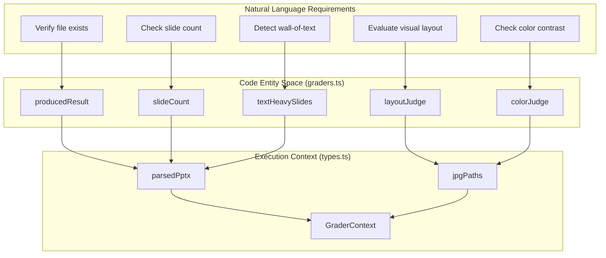
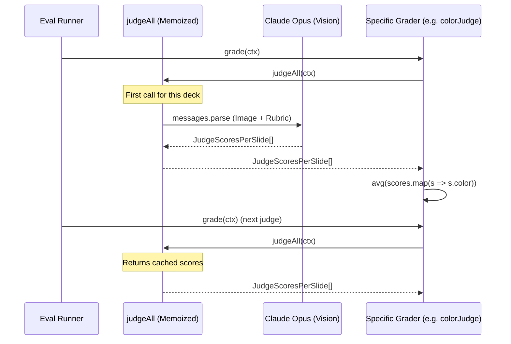

<!-- source: DeepWiki mcp.deepwiki.com · repo anthropics/cwc-workshops · page 5.1 PPTX Workshop: Grader System · fetched 2026-10-26 -->

# PPTX Workshop: Grader System

<details>
<summary>Relevant source files</summary>

The following files were used as context for generating this wiki page:

- [eval-driven-agent-development/src/graders.ts](eval-driven-agent-development/src/graders.ts)
- [eval-driven-agent-development/src/graders/all.ts](eval-driven-agent-development/src/graders/all.ts)
- [eval-driven-agent-development/src/graders/code/cluttered-slides.ts](eval-driven-agent-development/src/graders/code/cluttered-slides.ts)
- [eval-driven-agent-development/src/graders/code/emoji-count.ts](eval-driven-agent-development/src/graders/code/emoji-count.ts)
- [eval-driven-agent-development/src/graders/code/produced-result.ts](eval-driven-agent-development/src/graders/code/produced-result.ts)
- [eval-driven-agent-development/src/graders/code/slide-count.ts](eval-driven-agent-development/src/graders/code/slide-count.ts)
- [eval-driven-agent-development/src/graders/code/slides-with-image.ts](eval-driven-agent-development/src/graders/code/slides-with-image.ts)
- [eval-driven-agent-development/src/graders/code/small-font-slides.ts](eval-driven-agent-development/src/graders/code/small-font-slides.ts)
- [eval-driven-agent-development/src/graders/code/text-heavy-slides.ts](eval-driven-agent-development/src/graders/code/text-heavy-slides.ts)
- [eval-driven-agent-development/src/graders/judge/color-judge.ts](eval-driven-agent-development/src/graders/judge/color-judge.ts)
- [eval-driven-agent-development/src/graders/judge/image-judge.ts](eval-driven-agent-development/src/graders/judge/image-judge.ts)
- [eval-driven-agent-development/src/graders/judge/judge.ts](eval-driven-agent-development/src/graders/judge/judge.ts)
- [eval-driven-agent-development/src/graders/judge/layout-judge.ts](eval-driven-agent-development/src/graders/judge/layout-judge.ts)
- [eval-driven-agent-development/src/graders/judge/text-judge.ts](eval-driven-agent-development/src/graders/judge/text-judge.ts)
- [eval-driven-agent-development/src/graders/judge/title-body-coherence-judge.ts](eval-driven-agent-development/src/graders/judge/title-body-coherence-judge.ts)
- [eval-driven-agent-development/src/graders/types.ts](eval-driven-agent-development/src/graders/types.ts)

</details>


The PPTX Workshop utilizes a two-layer grader architecture to evaluate the quality of generated slide decks. This system combines deterministic **Code Graders**, which extract structural metrics directly from the `.pptx` XML, and **LLM-as-Judge Graders**, which use vision-capable models to assess aesthetic and semantic qualities.

## Grader Architecture Overview

The system is designed to provide a comprehensive scorecard for every agent run. The evaluation pipeline follows a "Prepare-then-Grade" pattern: the harness first processes the raw `.pptx` file into a `GraderContext`, which is then passed to a collection of independent `Grader` objects.

### Data Flow and Lifecycle

1.  **Artifact Generation**: The agent produces a `.pptx` file.
2.  **Context Preparation**: The harness parses the PPTX structure and renders slides into JPG images via LibreOffice.
3.  **Grader Execution**: The `GraderContext` is passed to all registered graders in `GRADERS` [eval-driven-agent-development/src/graders.ts:19-36]().
4.  **Result Aggregation**: Scores are collected into a scorecard for the leaderboard.

### System Entity Mapping: Grader Logic to Code
The following diagram maps the conceptual grading requirements to the specific TypeScript entities that implement them.

**Grader Implementation Map**

Sources: [eval-driven-agent-development/src/graders/all.ts:20-37](), [eval-driven-agent-development/src/graders/types.ts:1-20]()

---

## Programmatic Code Graders

Code graders are deterministic functions that inspect the `parsedPptx` object. They are used for objective metrics like element counts, font sizes, and file validity.

| Grader Name | Implementation | Logic Description |
| :--- | :--- | :--- |
| **Produced result** | `producedResult` | Checks `exists` and `validZip` flags [eval-driven-agent-development/src/graders/code/produced-result.ts:10-19](). |
| **Slide count** | `slideCount` | Returns `ctx.parsedPptx.slideCount` against a target of 5 [eval-driven-agent-development/src/graders/code/slide-count.ts:12-14](). |
| **Emoji count** | `emojiCount` | Aggregates `s.emojiCount` across all slides [eval-driven-agent-development/src/graders/code/emoji-count.ts:11-13](). |
| **Cluttered slides** | `clutteredSlides` | Counts slides where `shapeCount > 20` [eval-driven-agent-development/src/graders/code/cluttered-slides.ts:11-13](). |
| **Small-font slides** | `smallFontSlides` | Filters slides where any `fontSizesPt < 14` [eval-driven-agent-development/src/graders/code/small-font-slides.ts:11-15](). |
| **Text-heavy slides** | `textHeavySlides` | Counts slides where `textChars > 300` [eval-driven-agent-development/src/graders/code/text-heavy-slides.ts:11-13](). |
| **Slides with image** | `slidesWithImage` | Calculates the ratio of slides containing at least one picture [eval-driven-agent-development/src/graders/code/slides-with-image.ts:12-17](). |

Sources: [eval-driven-agent-development/src/graders/all.ts:20-28](), [eval-driven-agent-development/src/graders/code/produced-result.ts:6-20](), [eval-driven-agent-development/src/graders/code/slide-count.ts:6-15]()

---

## LLM-as-Judge Graders

Aesthetic and qualitative metrics are handled by `claude-opus-4-7` via vision analysis. To optimize cost and latency, the system uses a **memoized batching strategy**.

### The `judgeAll` Pipeline
Instead of each judge (Color, Layout, Text) making its own API call, the `judgeAll` function [eval-driven-agent-development/src/graders/judge/judge.ts:50-59]() is memoized. The first judge to execute triggers a vision call for every slide in the deck. Subsequent judges read from this cached result.

**Vision Grading Data Flow**

Sources: [eval-driven-agent-development/src/graders/judge/judge.ts:50-125](), [eval-driven-agent-development/src/graders/judge/color-judge.ts:13-16]()

### Grading Rubrics
The vision judge uses `zodOutputFormat` to ensure structured responses [eval-driven-agent-development/src/graders/judge/judge.ts:89-97](). The prompt instructs the model to score four criteria on a 0-5 scale:
1.  **Text**: Clarity, conciseness, and font consistency [eval-driven-agent-development/src/graders/judge/judge.ts:79]().
2.  **Image**: Quality and proportion [eval-driven-agent-development/src/graders/judge/judge.ts:81]().
3.  **Layout**: Alignment, margins, and lack of overlap [eval-driven-agent-development/src/graders/judge/judge.ts:83]().
4.  **Color**: Contrast and readability [eval-driven-agent-development/src/graders/judge/judge.ts:85]().

Sources: [eval-driven-agent-development/src/graders/judge/judge.ts:19-43](), [eval-driven-agent-development/src/graders/judge/judge.ts:77-87]()

---

## Extending the Grader System

To add a new metric, a developer must implement the `Grader` interface and register it in the central list.

### 1. The Grader Interface
Every grader must define its `kind` (code vs judge), a `grade` method, and optional `scale` metadata for color-coding the UI.

```typescript
export interface Grader {
    name: string;
    kind: "code" | "judge";
    description: string;
    scale?: { min: number; max: number; good: number | "high" | "low" };
    format?: (val: any) => string;
    grade: (ctx: GraderContext) => Promise<number | string>;
}
```
Sources: [eval-driven-agent-development/src/graders/types.ts:7-14]()

### 2. Registration
New graders are added to `allCodeGraders` or `allModelJudgeEvals` in `src/graders/all.ts` [eval-driven-agent-development/src/graders/all.ts:20-37](). This automatically includes them in the evaluation runner and the final scorecard output.

Sources: [eval-driven-agent-development/src/graders/all.ts:1-38](), [eval-driven-agent-development/src/graders.ts:1-36]()

---

