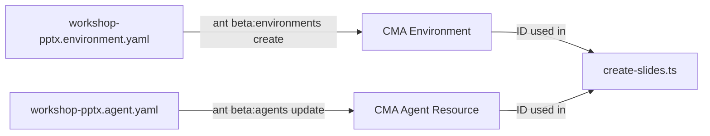

<!-- source: DeepWiki mcp.deepwiki.com · repo anthropics/cwc-workshops · page 5.2 PPTX Workshop: Agent Pipeline and Tooling · fetched 2026-10-26 -->

# PPTX Workshop: Agent Pipeline and Tooling

<details>
<summary>Relevant source files</summary>

The following files were used as context for generating this wiki page:

- [eval-driven-agent-development/package.json](eval-driven-agent-development/package.json)
- [eval-driven-agent-development/resources/workshop-pptx.environment.yaml](eval-driven-agent-development/resources/workshop-pptx.environment.yaml)
- [eval-driven-agent-development/src/batch.ts](eval-driven-agent-development/src/batch.ts)
- [eval-driven-agent-development/src/create-slides.ts](eval-driven-agent-development/src/create-slides.ts)
- [eval-driven-agent-development/src/eval-runner.ts](eval-driven-agent-development/src/eval-runner.ts)
- [eval-driven-agent-development/src/lib.ts](eval-driven-agent-development/src/lib.ts)
- [eval-driven-agent-development/src/parse-pptx.ts](eval-driven-agent-development/src/parse-pptx.ts)
- [eval-driven-agent-development/src/render.ts](eval-driven-agent-development/src/render.ts)
- [eval-driven-agent-development/tasks.json](eval-driven-agent-development/tasks.json)

</details>


This page details the technical infrastructure and execution pipeline for the PPTX Workshop. It covers the lifecycle of a slide-generation session, the structural extraction of metrics from OOXML, and the rendering of slide artifacts for visual evaluation.

## Pipeline Overview

The agent pipeline bridges the gap between natural language prompts and verifiable slide artifacts. It utilizes the **Claude Managed Agents (CMA)** API to execute agent logic within a sandboxed environment, then pulls the results into a local processing pipeline for grading.

### Agent Execution and Data Flow

The following diagram illustrates the flow from a task definition to a rendered, graded artifact.

**Slide Generation Pipeline**
```mermaid
graph TD
    subgraph "Local Workspace"
        [tasks.json] -- "selectTasks()" --> Runner["create-slides.ts"]
        Runner -- "fs.writeFile()" --> SessionRecord["session.json"]
        Runner -- "client.beta.files.download()" --> Artifacts["output.pptx"]
    end

    subgraph "Claude Managed Agents (CMA)"
        Agent["Agent Resource"] -- "instantiates" --> Session["Session"]
        Env["workshop-pptx.environment.yaml"] -- "provisions" --> Sandbox["Sandbox Container"]
        Session -- "executes in" --> Sandbox
        Sandbox -- "python-pptx" --> Output[".pptx File"]
    end

    Runner -- "client.beta.sessions.create()" --> Session
    Runner -- "events.stream()" --> Session
    Output -- "Files API" --> Runner
```
**Sources:** `eval-driven-agent-development/src/create-slides.ts:40-154`(), `eval-driven-agent-development/src/lib.ts:29-45`(), `eval-driven-agent-development/resources/workshop-pptx.environment.yaml:1-12`()

---

## Core Components

### 1. Session Runner (`create-slides.ts`)
The `create-slides.ts` script is the primary entry point for executing agent tasks. It manages the full lifecycle of a CMA session:
*   **Initialization**: Creates a session using a pre-configured `AGENT_ID` and `ENVIRONMENT_ID` [eval-driven-agent-development/src/create-slides.ts:40-44]().
*   **Streaming**: Opens an SSE stream via `client.beta.sessions.events.stream()` before sending the user message to ensure no initial thinking or tool events are missed [eval-driven-agent-development/src/create-slides.ts:58-66]().
*   **Event Handling**: Consumes the stream, logging `agent.message` content and `agent.tool_use` indicators until the session reaches `session.status_idle` with a valid stop reason [eval-driven-agent-development/src/create-slides.ts:72-102]().
*   **Artifact Retrieval**: Uses `p-retry` to poll the Files API, accounting for the indexing lag after a session completes [eval-driven-agent-development/src/create-slides.ts:107-119]().

### 2. Structural Parser (`parse-pptx.ts`)
The `parsePptx` function extracts objective metrics from the `.pptx` file without using LLMs. It treats the file as a zip archive and parses the underlying XML [eval-driven-agent-development/src/parse-pptx.ts:67-118]().

| Entity | Implementation Detail |
| :--- | :--- |
| **Archive Handling** | Uses `JSZip` to extract `ppt/slides/slideN.xml` files [eval-driven-agent-development/src/parse-pptx.ts:81-90](). |
| **XML Parsing** | Uses `fast-xml-parser` with attribute preservation (`@_` prefix) to access font sizes and placeholder types [eval-driven-agent-development/src/parse-pptx.ts:95-98](). |
| **Shape Analysis** | Counts `p:sp`, `p:pic`, `p:graphicFrame`, `p:grpSp`, and `p:cxnSp` elements [eval-driven-agent-development/src/parse-pptx.ts:130-136](). |
| **Text Extraction** | Recursively walks DrawingML text runs (`a:r`) to collect literal text (`a:t`) and font sizes (`a:rPr@sz`) [eval-driven-agent-development/src/parse-pptx.ts:186-200](). |

**Sources:** `eval-driven-agent-development/src/parse-pptx.ts:15-55`(), `eval-driven-agent-development/src/parse-pptx.ts:124-158`()

### 3. Visual Renderer (`render.ts`)
To support vision-based grading, `render.ts` converts the agent's PPTX output into high-resolution JPGs.
*   **Docker Integration**: Spawns a container using the `cwc-pptx-render` image [eval-driven-agent-development/src/render.ts:19-21]().
*   **Conversion Pipeline**: Executes a two-step shell command inside the container:
    1.  `soffice` (LibreOffice) converts `.pptx` to `.pdf` [eval-driven-agent-development/src/render.ts:49]().
    2.  `pdftoppm` (Poppler) rasterizes the PDF into one JPG per slide at 120 DPI [eval-driven-agent-development/src/render.ts:49]().
*   **Ordering**: Sorts output files using numeric collation (e.g., `slide-10.jpg` follows `slide-9.jpg`) [eval-driven-agent-development/src/render.ts:57-62]().

**Sources:** `eval-driven-agent-development/src/render.ts:38-53`()

---

## Batch Execution and Environment

### Batch Runner (`batch.ts`)
For large-scale evaluations across multiple agent variants, `batch.ts` performs a full sweep.
*   **Sequential Rounds**: Runs agent variants (e.g., `00-naive` through `04-model-swap`) one after another [eval-driven-agent-development/src/batch.ts:23-29]().
*   **Parallel Tasks**: Within a round, it executes all tasks from `tasks.json` in parallel [eval-driven-agent-development/src/batch.ts:96-98]().
*   **Resume Support**: Checks for existing `output.pptx` files on disk to skip already-completed runs if the process is interrupted [eval-driven-agent-development/src/batch.ts:38-42]().

### Environment Configuration
The agent's runtime environment is defined in `workshop-pptx.environment.yaml`.
*   **System Packages**: Provisions `libreoffice` and `poppler-utils` for the agent to potentially use for its own verification [eval-driven-agent-development/resources/workshop-pptx.environment.yaml:7-9]().
*   **Python Libraries**: Installs `python-pptx` to enable programmatic slide generation [eval-driven-agent-development/resources/workshop-pptx.environment.yaml:10-11]().

**Sources:** `eval-driven-agent-development/src/batch.ts:5-12`(), `eval-driven-agent-development/resources/workshop-pptx.environment.yaml:1-12`()

---

## Workflow Integration

The workshop uses the `ant` CLI for resource management and `tsx` for local execution.

**Agent Resource Management**

**Sources:** `eval-driven-agent-development/src/create-slides.ts:16-20`(), `eval-driven-agent-development/package.json:7-12`()

### Utility Scripts (`lib.ts`)
The `lib.ts` file provides shared utilities for the pipeline:
*   **Task Selection**: `selectTasks` resolves task IDs from CLI arguments or the `--all` flag, validating them against `tasks.json` [eval-driven-agent-development/src/lib.ts:29-45]().
*   **Path Resolution**: Defines `ROOT` and `RUNS_DIR` to ensure consistent file IO across different scripts [eval-driven-agent-development/src/lib.ts:8-12]().

**Sources:** `eval-driven-agent-development/src/lib.ts:1-46`(), `eval-driven-agent-development/tasks.json:1-8`()

---

