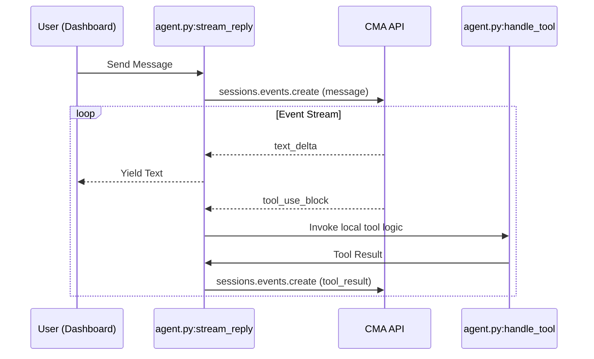

<!-- source: DeepWiki mcp.deepwiki.com · repo anthropics/cwc-workshops · page 6.1 SRE Agent: Implementation Guide · fetched 2026-10-26 -->

# SRE Agent: Implementation Guide

<details>
<summary>Relevant source files</summary>

The following files were used as context for generating this wiki page:

- [README.md](README.md)

</details>


The **SRE Agent** workshop focuses on transforming an offline dashboard into a functional AI-driven incident response system. The core task is to implement seven specific functions in `agent.py` that interface with the **Claude Managed Agents (CMA)** API. This implementation allows the agent to interact with a sandboxed environment, process large-scale logs, and execute local tools to diagnose a simulated production incident.

### System Architecture

The SRE Agent operates within a lifecycle that bridges the participant's local machine (the dashboard) and the Anthropic-hosted Managed Agents infrastructure.

#### Data Flow and Entity Mapping
The following diagram maps the relationship between the local dashboard components and the CMA cloud resources.

**Figure 1: SRE Agent System Entity Mapping**
```mermaid
graph TD
    subgraph "Local Dashboard (Code Space)"
        [app.py] -- "calls" --> [agent.py]
        [agent.py] -- "uses" --> [provided.py]
        [provided.py] -- "defines" --> SCHEMA["Tool Schemas & Prompts"]
    end

    subgraph "Claude Managed Agents (Cloud Space)"
        AGENT_RES["Agent Resource"]
        ENV_RES["Environment Resource"]
        SESS_RES["Session Resource"]
        SANDBOX["Sandbox File System"]
    end

    [agent.py] -- "setup_agent()" --> AGENT_RES
    [agent.py] -- "setup_environment()" --> ENV_RES
    [agent.py] -- "upload_log()" --> SANDBOX
    [agent.py] -- "start_session()" --> SESS_RES
    
    SESS_RES -- "references" --> AGENT_RES
    SESS_RES -- "mounts" --> ENV_RES
```
Sources: [ship-your-first-managed-agent/README.md:15-15](), [ship-your-first-managed-agent/agent.py:1-10]()

---

### Step-by-step Implementation Walkthrough

The implementation is contained within `agent.py`, utilizing the `anthropic` Python client.

#### 1. Agent and Environment Setup
The first phase involves provisioning the persistent resources on the CMA platform.

*   **`setup_agent()`**: Creates the Agent resource. It requires a `name`, `model` (e.g., Claude 3.5 Sonnet), and the `system_prompt` provided in `provided.py`.
*   **`setup_environment()`**: Creates an Environment resource. This acts as a template for the containerized sandbox where the agent will execute code.

Sources: [ship-your-first-managed-agent/agent.py:20-40]()

#### 2. Log Ingestion: `upload_log()`
The incident involves a 70k-line log file (`app.log`). Instead of passing this massive text in the prompt context, the agent uses the Sandbox.
*   **Mechanism**: The `upload_log()` function uses the `files.create` API to push `data/app.log` into the Environment resource.
*   **Data Flow**: `Local Disk` -> `CMA Environment Resource` -> `Mounted in Session Sandbox`.

Sources: [ship-your-first-managed-agent/agent.py:45-55](), [ship-your-first-managed-agent/README.md:15-15]()

#### 3. Session Management: `start_session()` and `delete_session()`
Sessions are stateful instances of an Agent.
*   **`start_session()`**: Initializes a session using the `agent_id` and `environment_id`. This is where the agent gains access to the uploaded logs and the ability to execute code.
*   **`delete_session()`**: Ensures resource cleanup after the incident is resolved or the dashboard is closed.

Sources: [ship-your-first-managed-agent/agent.py:60-75]()

#### 4. The Interaction Loop: `stream_reply()` and `handle_tool()`
This is the core execution logic where the agent's reasoning meets the dashboard's data.

**Figure 2: Agent Interaction Pipeline**


*   **`stream_reply()`**: Uses `anthropic.beta.messages.create` with the `stream=True` parameter. It iterates through the event stream, yielding text to the Streamlit UI and intercepting tool calls.
*   **`handle_tool()`**: A dispatcher that routes tool calls from Claude to local Python functions. The workshop includes schemas for tools like `query_metrics` or `get_deployments`.

Sources: [ship-your-first-managed-agent/agent.py:80-120](), [ship-your-first-managed-agent/provided.py:1-50]()

---

### Incident Data Fixtures

The agent's sandbox is populated with four key files located in the `data/` directory. These serve as the ground truth for the SRE investigation:

| File | Purpose | Key Content |
| :--- | :--- | :--- |
| `app.log` | High-volume logs | 70k lines containing a `NullPointerException` triggered by specific user IDs. |
| `metrics.json` | Performance data | Time-series data showing a spike in 500-errors starting at 14:02 UTC. |
| `deploys.json` | Change log | History of deployments, including a "v1.2.4-hotfix" that coincides with the error spike. |
| `diff.txt` | Code changes | The git diff of the suspect deployment, showing a logic error in the `UserContext` handler. |

Sources: [ship-your-first-managed-agent/README.md:15-15]()

---

### Testing and Validation

The implementation is verified using two primary methods:

1.  **`e2e.py`**: A standalone test script that simulates a full incident resolution flow. It calls the functions in `agent.py` sequentially, verifying that the agent can successfully identify the root cause in the logs and propose a fix.
2.  **Streamlit Dashboard**: The visual interface (`app.py`) that uses the implemented `agent.py` functions to provide a chat interface alongside metrics visualizations.

**Function Inventory in `agent.py`**
| Function | CMA Resource | Role |
| :--- | :--- | :--- |
| `setup_agent` | `Agent` | Defines identity and system prompt. |
| `setup_environment` | `Environment` | Defines the runtime sandbox template. |
| `upload_log` | `File` | Places data inside the environment. |
| `start_session` | `Session` | Creates a live instance of the agent. |
| `stream_reply` | `Event` | Manages the conversation and tool loop. |
| `handle_tool` | Local | Executes logic requested by the agent. |
| `delete_session` | `Session` | Terminates the instance. |

Sources: [ship-your-first-managed-agent/agent.py:1-150](), [ship-your-first-managed-agent/provided.py:1-10]()

---

