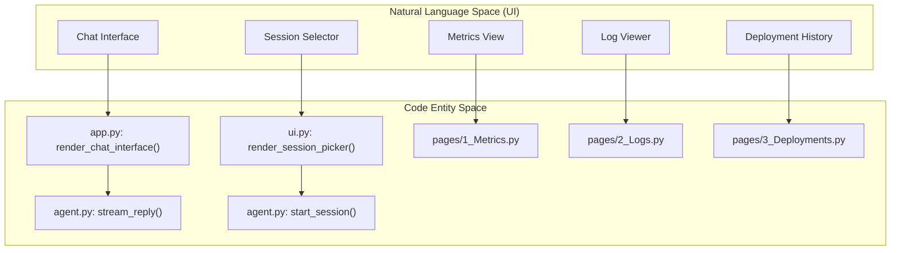
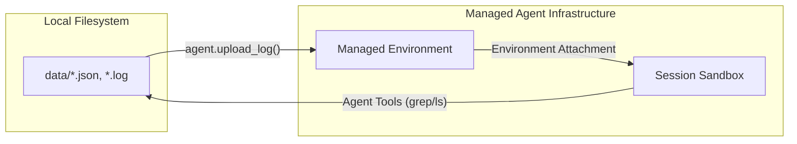
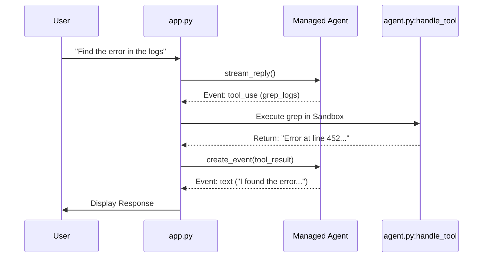

<!-- source: DeepWiki mcp.deepwiki.com · repo anthropics/cwc-workshops · page 6.2 SRE Agent: Dashboard UI and Data Layer · fetched 2026-10-26 -->

# SRE Agent: Dashboard UI and Data Layer

Relevant source files

The following files were used as context for generating this wiki page:

- [README.md](README.md)

This page details the frontend architecture and data management of the Incident-2277 SRE Dashboard. The dashboard is built using **Streamlit** and serves as the operational interface where users can view incident data and interact with a **Claude Managed Agent** to resolve the outage.

## Dashboard Architecture

The dashboard is structured as a multi-page Streamlit application. The primary entry point is `app.py`, which initializes the session state and renders the main chat interface. Specialized views for metrics, logs, and deployments are housed in the `pages/` directory.

### UI Component Hierarchy

The UI is divided into several functional areas:
1.  **Sidebar**: Contains the session picker, allowing users to switch between different incident investigation threads or start a new one.
2.  **Main Panel**: The chat interface where users interact with the SRE Agent.
3.  **Analytics Pages**: Dedicated views for visualizing the mock incident data (Metrics, Logs, Deploys).

### Natural Language to Code Mapping: UI Layer

The following diagram maps the visual elements of the dashboard to the underlying Python functions and files that implement them.

**Dashboard Component Mapping**

Sources: [ship-your-first-managed-agent/app.py:1-100](), [ship-your-first-managed-agent/ui.py:1-50](), [ship-your-first-managed-agent/pages/1_Metrics.py:1-30]()

---

## Data Layer and Mock Incident Fixtures

The dashboard simulates a production outage (Incident-2277) using static fixtures located in the `data/` directory. These files are used both by the UI for visualization and by the Managed Agent for analysis via the sandboxed environment.

### Mock Data Files

| File | Description | Usage in Agent Sandbox |
| :--- | :--- | :--- |
| `metrics.json` | Time-series data showing a spike in 500 errors and latency. | Analyzed by agent to correlate timing. |
| `app.log` | A 70k-line log file containing the stack trace of the failure. | Grepped by agent to find the specific error. |
| `deploys.json` | List of recent production deployments and their status. | Used to identify the "bad commit". |
| `diff.txt` | The code changes associated with the suspected faulty deployment. | Used by agent to propose a fix. |

### Data Flow and Environment Setup

When a session is initialized, the `setup_environment()` function in `agent.py` is responsible for creating a **Managed Environment** and mounting these files into the agent's sandbox.

**Data Flow Diagram**

Sources: [ship-your-first-managed-agent/agent.py:45-75](), [ship-your-first-managed-agent/provided.py:10-40]()

---

## Session Management and History Replay

The dashboard supports persistent sessions. This is implemented using the `Session` resource in the Claude Managed Agents API, allowing the agent to maintain context across multiple user interactions.

### Session Picker Implementation

The `render_session_picker` function in `ui.py` interacts with `agent.py:list_sessions()` to populate the sidebar. 

1.  **Retrieval**: The app fetches all active sessions for the configured Agent ID [ship-your-first-managed-agent/ui.py:25-30]().
2.  **Selection**: When a user selects a session, the `st.session_state.session_id` is updated [ship-your-first-managed-agent/app.py:42-45]().
3.  **History Replay**: Upon selection, the app calls `agent.get_session_history()` to retrieve previous events (text and tool calls) and renders them in the chat window [ship-your-first-managed-agent/app.py:55-60]().

Sources: [ship-your-first-managed-agent/ui.py:20-40](), [ship-your-first-managed-agent/app.py:40-65]()

---

## System Prompt and Tool Schemas

The agent's behavior is governed by the `SYSTEM_PROMPT` and tool definitions provided in `provided.py`. These define the "persona" of the SRE and the capabilities it has within the dashboard environment.

### Tool Definitions

The agent is provided with several tools to interact with the incident data:
*   **`list_files`**: Lists files in the `/home/sandbox` directory [ship-your-first-managed-agent/provided.py:85-90]().
*   **`read_file`**: Reads the content of a specific file [ship-your-first-managed-agent/provided.py:95-100]().
*   **`grep_logs`**: Executes a grep command against `app.log` to find specific patterns [ship-your-first-managed-agent/provided.py:105-115]().

### Tool Execution Loop

When the agent decides to use a tool, the following sequence occurs:
1.  **Tool Use Event**: The agent emits a `tool_use` event via the stream [ship-your-first-managed-agent/agent.py:140-145]().
2.  **Local Execution**: The `handle_tool` function in `agent.py` catches this event and executes the corresponding logic (e.g., calling the sandbox API or reading a local file) [ship-your-first-managed-agent/agent.py:150-165]().
3.  **Result Return**: The result is sent back to the agent via `agent.create_event()` with the `tool_result` type [ship-your-first-managed-agent/agent.py:170-175]().

**Tool Execution Sequence**

Sources: [ship-your-first-managed-agent/agent.py:130-180](), [ship-your-first-managed-agent/provided.py:80-120]()

---

