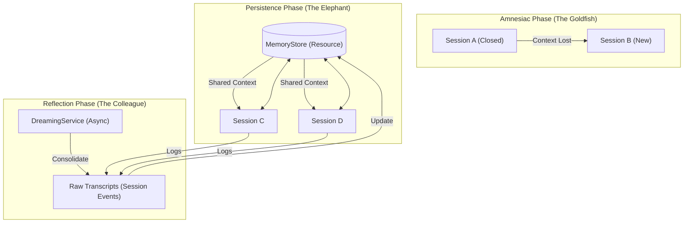

<!-- source: DeepWiki mcp.deepwiki.com · repo anthropics/cwc-workshops · page 7 Agents That Remember Workshop · fetched 2026-10-26 -->

# Agents That Remember Workshop

Relevant source files

The following files were used as context for generating this wiki page:

- [README.md](README.md)

The **Agents That Remember** workshop provides a hands-on exploration of memory primitives within the Claude Managed Agents (CMA) ecosystem. The workshop guides participants through the evolution of an agent from a "goldfish" (no memory across sessions) to a "colleague" (capable of long-term persistence and reflection). 

The curriculum focuses on three distinct stages of memory implementation:
1.  **Amnesiac Baseline**: Demonstrating how standard agent sessions lose context once closed.
2.  **Memory Stores**: Implementing a persistent key-value and natural language storage layer that survives session termination.
3.  **Dreaming Service**: Using asynchronous background processing to consolidate raw session transcripts into structured, high-density memories.

### Workshop Architecture

The workshop uses the `ant` CLI tool to bootstrap resources and manage the lifecycle of agents and their associated memory structures. The transition from amnesia to persistence is achieved by attaching a `memory_store` resource to a CMA session, allowing the agent to read and write to a dedicated storage volume.

#### From Goldfish to Colleague
The following diagram illustrates the transition from isolated sessions to a unified memory architecture using the `MemoryStore` and `DreamingService`.

**Memory Progression Architecture**

Sources: [README.md:17-17]()

### Core Components

| Component | Code Entity / Resource | Role |
| :--- | :--- | :--- |
| **Memory Store** | `memory_store` | A persistent resource that stores memories as text/JSON. It is attached to sessions via the `memory_stores` configuration. |
| **Dreaming Service** | `dream` | An asynchronous service that processes session logs and updates a memory store based on "steering instructions." |
| **Bootstrap Script** | `ant` CLI | The primary interface for creating agents, environments, and memory stores for the workshop. |
| **Transcript** | `session_events` | The raw history of a session used by the Dreaming Service to extract salient information. |

### Memory Stores: Cross-Session Persistence
The first upgrade to the agent is the attachment of a **Memory Store**. Unlike session history, which is ephemeral, a Memory Store is a standalone resource. It allows an agent to maintain a "notebook" that it can query or update across different interactions. This enables use cases like remembering user preferences, tracking the status of long-running projects, or maintaining a "to-do" list that persists even if the agent's underlying session is deleted.

For details on resource types, access patterns, and the `prompt` field that shapes how agents use their memory, see [Memory Stores: Cross-Session Persistence](#7.1).

### Dreaming Service: Transcript Consolidation
While Memory Stores provide persistence, they can become cluttered if the agent is responsible for manual updates during active conversation. The **Dreaming Service** introduces a "sleep" cycle for the agent. It takes raw transcripts from previous sessions and runs a background process to synthesize them. This process follows specific steering instructions to update the Memory Store, ensuring that the most important insights are preserved while noise is discarded.

For details on creating dreams, input sources, and swapping consolidated stores into new sessions, see [Dreaming Service: Transcript Consolidation](#7.2).

Sources: [README.md:17-17]()

---

