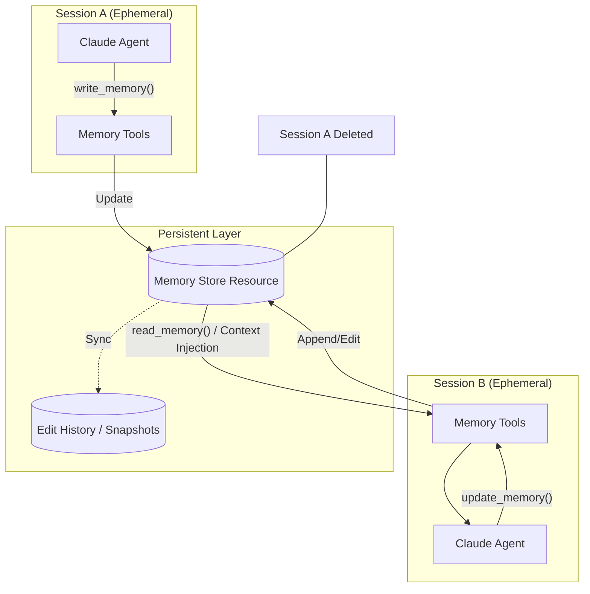
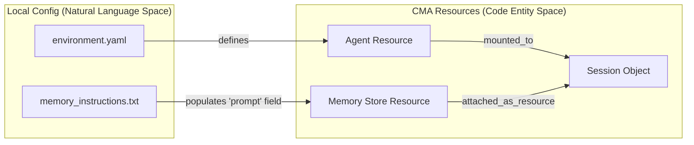

<!-- source: DeepWiki mcp.deepwiki.com · repo anthropics/cwc-workshops · page 7.1 Memory Stores: Cross-Session Persistence · fetched 2026-10-26 -->

# Memory Stores: Cross-Session Persistence

Relevant source files

The following files were used as context for generating this wiki page:

- [README.md](README.md)

Memory stores are a fundamental primitive in the Claude Managed Agents (CMA) architecture designed to provide long-term, cross-session persistence. While standard agent sessions are ephemeral—losing all context once the session is deleted—attaching a memory store allows an agent to persist facts, preferences, and learned behaviors across multiple distinct interactions.

## Architectural Overview

In the CMA ecosystem, a **Memory Store** is a standalone resource that exists independently of any specific agent or session. When a session is created, a memory store can be "mounted" to it. During the session, the agent can read from and write to this store using specialized internal tools.

### Data Flow: Session to Store

The following diagram illustrates how memory persists beyond the lifecycle of a single session.

**CMA Memory Persistence Lifecycle**

**Sources:**
- [agents-that-remember/README.md:17-17]()
- [README.md:17-17]()

## The Memory Store Resource

A memory store is defined by a configuration object that governs how the agent interacts with the stored data. When creating or attaching a memory store via the API or the `ant` CLI, the following fields are critical:

| Field | Type | Description |
| :--- | :--- | :--- |
| `memory_store_id` | String | Unique identifier for the resource. |
| `type` | String | Must be set to `memory_store`. |
| `prompt` | String | The "Meta-Instruction" for the memory. This shapes how the agent organizes information. |
| `access` | String | Defines permissions (e.g., `read_write` or `read_only`). |

### The `prompt` Field: Shaping Memory Organization
The `prompt` field within a memory store resource is not a system prompt for the agent, but rather a set of instructions for the **memory itself**. It tells Claude how to categorize information, what schema to use (e.g., Markdown headers, JSON blocks), and what level of detail to preserve. 

Iterating on this field is the primary way developers control "memory drift" and ensure the agent doesn't clutter the store with irrelevant transcripts.

**Sources:**
- [agents-that-remember/README.md:17-17]()

## Implementation and Attachment

To enable persistence, the memory store must be referenced during the session creation phase. This creates a link between the ephemeral execution environment and the persistent storage.

### Code Entity Relationship
The following diagram maps the relationship between the configuration files and the CMA resources used in the `agents-that-remember` workshop.

**Resource Association Mapping**

**Sources:**
- [agents-that-remember/README.md:17-17]()
- [production-ready-agent/README.md:19-19]()

## Inspecting and Iterating

Persistence introduces the need for debugging tools to inspect what the agent has "remembered." The `ant` CLI and the Anthropic Console provide interfaces for:

1.  **Memory Inspection**: Viewing the current state of the memory store as a single document.
2.  **Edit History**: Reviewing the chronological changes made by the agent. This is crucial for understanding why an agent might have misinterpreted a past interaction.
3.  **Manual Overrides**: Developers can manually edit the memory store to "correct" the agent's memories or seed it with specific knowledge.

### The "Goldfish to Colleague" Progression
In the workshop, this transition is achieved through three stages:
1.  **Amnesiac Baseline**: A session with no memory store attached.
2.  **Naive Persistence**: Attaching a memory store with a generic prompt, allowing the agent to save facts.
3.  **Structured Memory**: Refining the `prompt` field to enforce a "Colleague" persona—prioritizing project constraints, user preferences, and architectural decisions over raw chat history.

**Sources:**
- [agents-that-remember/README.md:17-17]()
- [README.md:17-17]()

---

