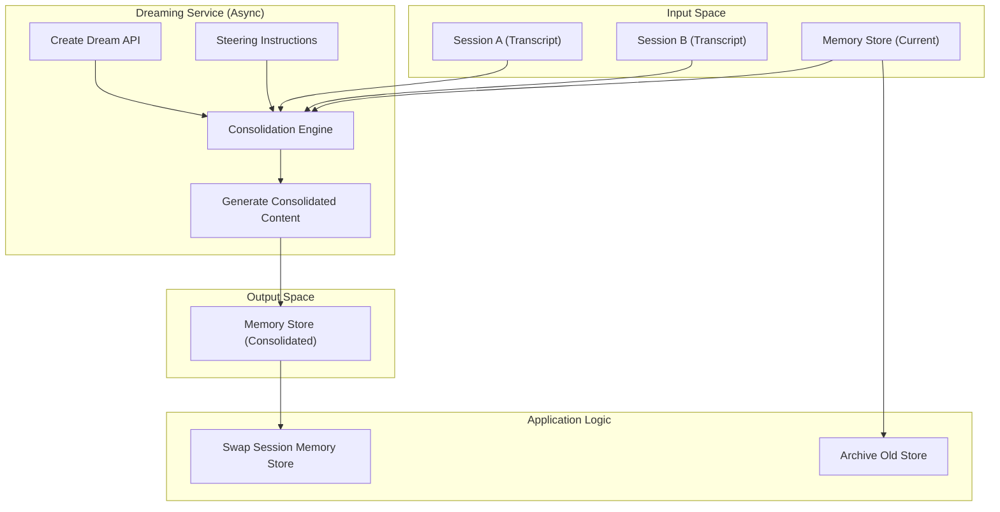

<!-- source: DeepWiki mcp.deepwiki.com · repo anthropics/cwc-workshops · page 7.2 Dreaming Service: Transcript Consolidation · fetched 2026-10-26 -->

# Dreaming Service: Transcript Consolidation

<details>
<summary>Relevant source files</summary>

The following files were used as context for generating this wiki page:

- [README.md](README.md)

</details>


The Dreaming Service is a Claude Managed Agents (CMA) primitive designed to solve the "context window bloat" and "relevance decay" problems inherent in long-lived agentic workflows. While a Memory Store provides a persistent scratchpad for an agent, the Dreaming Service automates the synthesis of raw interaction history into structured knowledge. It processes past session transcripts and existing memory entries to produce a new, consolidated Memory Store.

## Architecture Overview

The "Dreaming" process is an asynchronous operation that bridges raw session data with the long-term Memory Store. Instead of an agent manually updating its memory during a conversation (which consumes output tokens and increases latency), the Dreaming Service runs out-of-band to "reflect" on previous interactions.

### Data Flow: Transcript to Knowledge

The service takes three primary inputs:
1.  **Input Sources**: A collection of `session_ids` (raw transcripts) and/or an existing `memory_store_id`.
2.  **Steering Instructions**: Natural language guidance on what the agent should prioritize during consolidation (e.g., "Extract user preferences for coding style" or "Summarize project milestones").
3.  **Target Store**: The output destination where the synthesized knowledge is saved.

### Dreaming Service Workflow

Title: Dreaming Service Execution Pipeline

Sources: [README.md:17-17]()

## Implementation and API

The Dreaming Service is accessed via the Managed Agents API. The lifecycle of a "Dream" involves creation, polling for completion, and then utilizing the resulting resource.

### Creating a Dream
To trigger consolidation, a request is sent to the Dreaming endpoint. The payload specifies the `input_sources`, which are a list of objects referencing either sessions or memory stores.

| Parameter | Type | Description |
| :--- | :--- | :--- |
| `input_sources` | Array | List of `{ type: "session" | "memory_store", id: string }` |
| `instructions` | String | Steering prompt for the consolidation logic. |
| `output_memory_store_id` | String | (Optional) The ID of a store to overwrite, or a new ID. |

### Steering Instructions
Steering instructions allow developers to shape the "personality" of the memory. For example:
> "Focus on extracting specific technical constraints mentioned by the user and ignore small talk. Organize the memory by project name."

## Session Swapping and Lifecycle

Once a dream is complete, the resulting Memory Store contains a synthesized version of the agent's history. To transition an agent from "learning" to "using," the application logic must swap the Memory Store associated with new sessions.

### Memory Store Migration Pattern
1.  **Bootstrap**: Create a session with an initial `memory_store_id` (Goldfish stage).
2.  **Interact**: Conduct multiple sessions, accumulating raw history.
3.  **Dream**: Call the Dreaming Service with the `session_ids` from step 2.
4.  **Swap**: For the next session, provide the `memory_store_id` generated by the Dreaming Service.
5.  **Archive**: Delete or flag the old, unconsolidated Memory Store and the processed sessions to save costs and reduce clutter.

### Code Entity Mapping: Memory Primitives

The following diagram maps the conceptual "Dreaming" process to the resource entities managed by the CMA infrastructure.

Title: Resource Entity Mapping
```mermaid
classDiagram
    class "Session" {
        +string session_id
        +string memory_store_id
        +Transcript transcript
    }
    class "MemoryStore" {
        +string memory_store_id
        +string prompt
        +Object content
    }
    class "Dream" {
        +string dream_id
        +string status
        +create(sources, instructions)
    }

    Session --> MemoryStore : "references for context"
    Dream ..> Session : "consumes transcripts"
    Dream ..> MemoryStore : "updates or creates"
    MemoryStore --> Session : "injected into prompt"
```
Sources: [README.md:17-17]()

## Technical Considerations

### Async Execution
Consolidation is not instantaneous. Depending on the volume of transcripts (e.g., hundreds of turns across multiple sessions), the "Dream" may take several seconds to minutes. Applications should implement a polling mechanism or webhook listener to detect when the `status` of a dream transitions to `completed`.

### Inspecting the Output
The output of a Dream is a standard Memory Store resource. Developers can inspect the results using the `ant` CLI or the Anthropic Console to verify that the consolidation logic followed the steering instructions correctly. If the output is suboptimal, the steering instructions should be iterated upon, similar to prompt engineering.

### Retention and Archiving
After successful consolidation, the source sessions often become redundant for the agent's immediate context. Archiving these sessions ensures that the agent's context window remains focused on the high-signal synthesized memory rather than noisy raw transcripts.

Sources: [README.md:17-17]()

---

