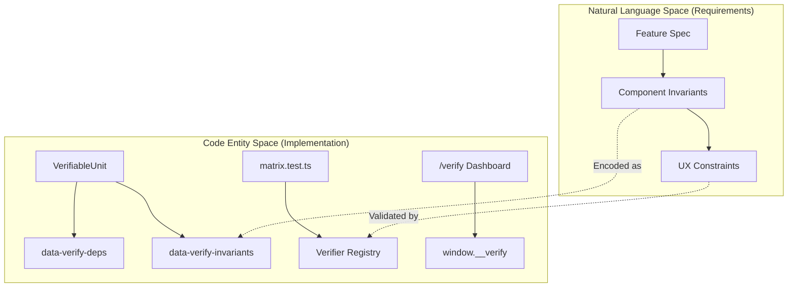

<!-- source: DeepWiki mcp.deepwiki.com · repo anthropics/cwc-workshops · page 8 How We Claude Code Workshop · fetched 2026-10-26 -->

# How We Claude Code Workshop

Relevant source files

The following files were used as context for generating this wiki page:

- [README.md](README.md)

The **How We Claude Code** workshop demonstrates a rigorous, AI-assisted product development lifecycle. It moves from ambiguous requirements to a production-grade Vite + React application featuring a "Verifiable Component" architecture. This workflow is designed to leverage Claude not just as a code generator, but as a design partner and quality assurance agent.

Sources: [README.md:14-14]()

## The Three-Phase Workflow

The workshop is structured into three distinct phases, mirroring the evolution of a real-world feature from conception to deployment.

### Phase 1: Interview-Driven Specification
In this phase, the developer uses Claude to extract requirements through an interactive interview. Rather than writing a static PRD, the developer and AI collaborate to produce a technical specification that serves as the "ground truth" for the subsequent design and implementation phases.

### Phase 2: Divergent Design Explorations
Before committing to a specific framework or architecture, Phase 2 focuses on rapid, divergent exploration. The goal is to generate multiple high-fidelity static HTML/CSS mockups to explore different UX patterns.
*   **Rapid Prototyping**: Creating standalone HTML files to visualize layout and interaction.
*   **Design Selection**: Evaluating the trade-offs between different UX approaches before writing any React code.

### Phase 3: Verifiable Implementation
The final phase moves into the `phase-3-verify` directory, where the chosen design is implemented as a Vite + React application. This phase introduces the concept of **Verifiable React**, where components are not just visually tested, but emit machine-readable contracts into the DOM for automated verification.

Sources: [README.md:14-14]()

## System Architecture: Natural Language to Code Entity

The following diagram illustrates how the workshop bridges the gap between high-level requirements (Natural Language Space) and the concrete implementation of the verification system (Code Entity Space).

**Verification System Bridge**

## Verifiable React Architecture

The core innovation of this workshop is the **Verifiable Component Architecture**. This system ensures that as an AI agent (like Claude Code) or a CI pipeline modifies the codebase, the structural and functional integrity of the UI is maintained through a machine-readable "contract."

### Key Concepts
*   **DOM as Machine-Readable Surface**: Components use `data-verify-*` attributes to export their internal state and dependencies to the DOM.
*   **VerifiableUnit**: A wrapper or pattern that associates a component with its fixtures and invariants.
*   **Verification Matrix**: A centralized registry that tracks the status of all components across different states (fixtures).
*   **Unified Verdict Taxonomy**: A standardized set of results (`PASS`, `FAIL`, `BLOCKED`, `SKIP`) used by both the web dashboard and CI tests.

| Concept | Implementation Detail | Role |
| :--- | :--- | :--- |
| **Contract** | `data-verify-invariants` | Defines what must be true about the component's DOM state. |
| **Fixtures** | `Probe` data | Adversarial or edge-case inputs used to stress-test components. |
| **Verifiers** | Pluggable Logic | Functions that validate Schema, A11y, and DOM Contracts. |
| **Agent Handle** | `window.__verify` | A global hook allowing Claude or Playwright to trigger validations. |

## Child Pages

For a deep dive into the implementation of the verification system, see the following child pages:

*   **[Verifiable React: Component Architecture](#8.1)**: Details the six core ideas of the architecture, the use of Zod schemas for prop validation, and the isolated render targets for components.
*   **[Verifiable React: Verifier System and Testing](#8.2)**: Covers the four built-in verifiers (schema, invariants, dom-contract, a11y), the `matrix.test.ts` CI integration, and the `/verify` dashboard.

Sources: [README.md:14-14]()

---

