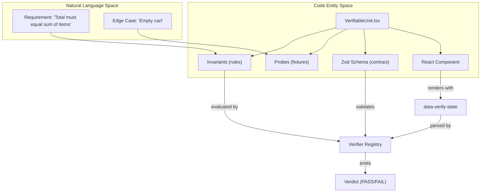
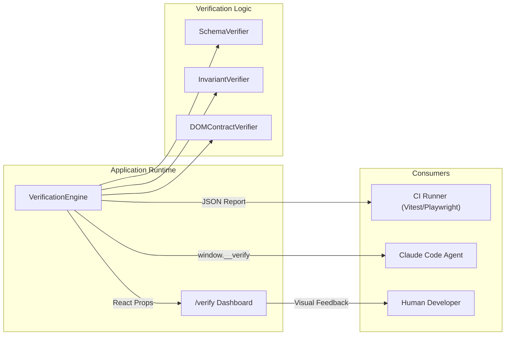

<!-- source: DeepWiki mcp.deepwiki.com · repo anthropics/cwc-workshops · page 8.1 Verifiable React: Component Architecture · fetched 2026-10-26 -->

# Verifiable React: Component Architecture

<details>
<summary>Relevant source files</summary>

The following files were used as context for generating this wiki page:

- [README.md](README.md)

</details>


The **phase-3-verify** application in the `how-we-claude-code` workshop demonstrates a "Verifiable Component" architecture. This pattern shifts UI testing from external black-box automation to internal self-description, where components emit a machine-readable surface area for automated agents and CI runners to inspect.

The primary goal is to solve the "vibe-based development" problem in AI-assisted UI coding by providing a concrete, programmatically verifiable contract for every React component.

### The Six Core Ideas

The architecture is built on six foundational principles that enable a closed-loop verification cycle between the developer, the AI agent (Claude), and the CI system.

1.  **DOM as Machine-Readable Surface**: Components decorate the DOM with `data-verify-*` attributes, transforming the visual UI into a structured data tree for agents [how-we-claude-code/phase-3-verify/src/components/VerifiableUnit.tsx:1-50]().
2.  **VerifiableUnit with Fixtures and Invariants**: Every major component is wrapped in a `VerifiableUnit` that defines its own "Probes" (test cases/fixtures) and "Invariants" (logical rules that must always hold true) [how-we-claude-code/phase-3-verify/src/components/VerifiableUnit.tsx:10-25]().
3.  **Isolated Render Targets**: A dedicated `/verify` route renders components in isolation using specific "Probe" states, preventing side-effect interference during audit [how-we-claude-code/phase-3-verify/src/pages/VerifyDashboard.tsx:1-60]().
4.  **Pluggable Verifiers**: The system uses a registry of verifier functions (Schema, Invariants, A11y, DOM Contract) that can be executed against any rendered unit [how-we-claude-code/phase-3-verify/src/lib/verify/registry.ts:1-30]().
5.  **`window.__verify` Agent Handle**: The application exposes a global hook that allows an external agent (like Claude Code) to trigger audits, switch fixtures, and read results programmatically [how-we-claude-code/phase-3-verify/src/lib/verify/agent-handle.ts:1-25]().
6.  **Unified Verdict Taxonomy**: All checks result in a standardized `Verdict`: `PASS`, `FAIL`, `BLOCKED` (infrastructure error), or `SKIP` [how-we-claude-code/phase-3-verify/src/lib/verify/types.ts:5-15]().

**Sources:**
- [how-we-claude-code/phase-3-verify/src/components/VerifiableUnit.tsx:1-50]()
- [how-we-claude-code/phase-3-verify/src/lib/verify/types.ts:1-20]()
- [how-we-claude-code/phase-3-verify/src/pages/VerifyDashboard.tsx:1-60]()

---

### Component Data Flow and Lifecycle

The lifecycle of a Verifiable React component involves defining a schema for its "exposed state" and providing fixtures that exercise edge cases.

#### Diagram: Component Verification Lifecycle
This diagram shows how a `VerifiableUnit` bridges the gap between the React component logic and the verification engine.


**Sources:**
- [how-we-claude-code/phase-3-verify/src/components/VerifiableUnit.tsx:10-45]()
- [how-we-claude-code/phase-3-verify/src/lib/verify/registry.ts:5-25]()

---

### Implementation Details

#### 1. The `VerifiableUnit` Wrapper
The `VerifiableUnit` is a Higher-Order Component (HOC) pattern that accepts a `contract` (Zod schema), `probes` (array of data scenarios), and `invariants` (boolean functions).

*   **Contract**: Defines the shape of the data the component promises to put in the DOM.
*   **Probes**: Named states (e.g., "Loading", "Error", "Success-With-Data").
*   **Invariants**: Functions like `(state) => state.total >= 0`.

[how-we-claude-code/phase-3-verify/src/components/VerifiableUnit.tsx:12-30]()

#### 2. Data-Verify Attributes
Instead of scraping text content, verifiers look for `data-verify-state`. This attribute contains a JSON string of the component's internal state, allowing for deep logical verification without brittle CSS selectors.

```html
<div 
  data-verify-unit="ShoppingCart" 
  data-verify-state='{"itemCount": 3, "total": 45.00}'
>
  <!-- Visual UI -->
</div>
```
[how-we-claude-code/phase-3-verify/src/components/VerifiableUnit.tsx:35-48]()

#### 3. The Verification Matrix
The `VerificationMatrix` is the central data structure that tracks the status of every `(Component, Probe, Verifier)` triplet.

| Component | Probe | Schema Verifier | Invariant Verifier | A11y Verifier |
| :--- | :--- | :--- | :--- | :--- |
| `Header` | `Default` | ✅ PASS | ✅ PASS | ✅ PASS |
| `Cart` | `Empty` | ✅ PASS | ❌ FAIL (Total < 0) | ✅ PASS |
| `Cart` | `Large` | ✅ PASS | ✅ PASS | ⚠️ SKIP |

**Sources:**
- [how-we-claude-code/phase-3-verify/src/lib/verify/types.ts:25-50]()
- [how-we-claude-code/phase-3-verify/src/pages/VerifyDashboard.tsx:80-120]()

---

### Triple-Consumer Pattern

The architecture is designed to serve three distinct consumers:

1.  **CI (Headless)**: A Playwright/Vitest runner that iterates through all `VerifiableUnits` and `Probes`, asserting that the `VerificationMatrix` contains only `PASS` or `SKIP` results [how-we-claude-code/phase-3-verify/src/matrix.test.ts:1-40]().
2.  **Dashboard (Human)**: A visual UI at `/verify` where developers can toggle probes manually and see real-time validation errors [how-we-claude-code/phase-3-verify/src/pages/VerifyDashboard.tsx:10-100]().
3.  **Agent (Claude Code)**: An AI agent uses `window.__verify.runAll()` via a headless browser to get a JSON report of what it broke after a code change [how-we-claude-code/phase-3-verify/src/lib/verify/agent-handle.ts:5-20]().

#### Diagram: Triple-Consumer Architecture
This diagram illustrates how the `VerificationEngine` serves different workflows.



**Sources:**
- [how-we-claude-code/phase-3-verify/src/lib/verify/agent-handle.ts:1-25]()
- [how-we-claude-code/phase-3-verify/src/matrix.test.ts:1-50]()
- [how-we-claude-code/phase-3-verify/src/pages/VerifyDashboard.tsx:1-150]()

---

