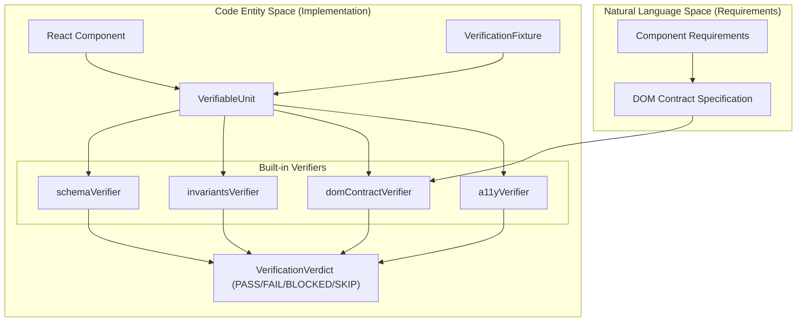
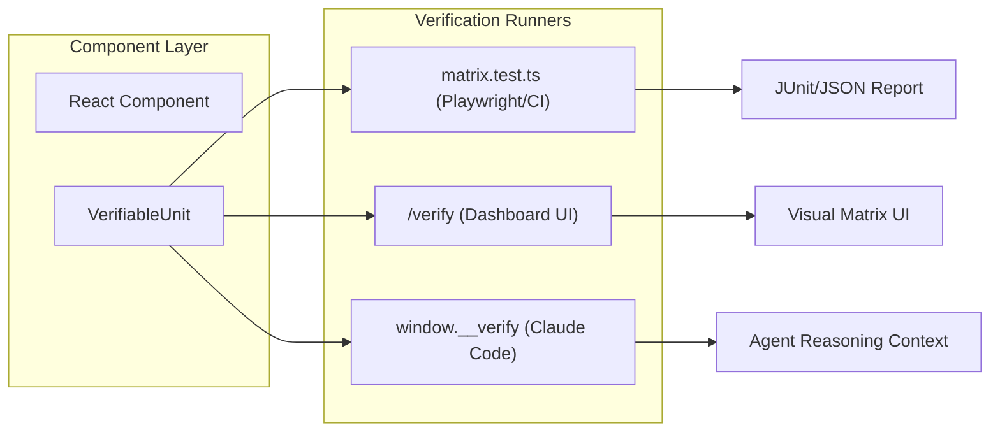

<!-- source: DeepWiki mcp.deepwiki.com · repo anthropics/cwc-workshops · page 8.2 Verifiable React: Verifier System and Testing · fetched 2026-10-26 -->

# Verifiable React: Verifier System and Testing

Relevant source files

The following files were used as context for generating this wiki page:

- [README.md](README.md)

The verification system in the `phase-3-verify` application provides a structured, machine-readable framework for asserting the correctness of React components. It moves beyond traditional unit testing by enabling components to self-verify at runtime via a unified verdict taxonomy. This system is consumed by three primary actors: the CI pipeline (via Playwright), a developer dashboard (`/verify`), and AI agents (via `window.__verify`).

## The Verifier Architecture

The system is built on a pluggable architecture where a `Verifier` is a function that accepts a `VerificationFixture` and returns a `VerificationVerdict`. This allows for heterogeneous checks—ranging from structural DOM validation to accessibility audits—to be aggregated into a single result matrix.

### Core Verdict Taxonomy
Every verification attempt results in one of four states, providing clear semantics for both human developers and automated agents:

| Verdict | Meaning |
| :--- | :--- |
| `PASS` | The component met all requirements for the given fixture. |
| `FAIL` | The component explicitly violated a requirement (e.g., missing data-attribute). |
| `BLOCKED` | The verifier could not run because a prerequisite was missing (e.g., DOM element not found). |
| `SKIP` | The verifier was intentionally bypassed for this specific fixture. |

### System Data Flow
The following diagram illustrates how the `Verifier` functions bridge the gap between the React component's DOM state and the final test results.

**Diagram: Verification Pipeline**

*Sources: [how-we-claude-code/README.md:14-14]()*

## The Four Built-in Verifiers

The system includes four specialized verifiers that target different aspects of component quality.

### 1. Schema Verifier (`schema`)
Validates that the `props` passed to the component via the `VerificationFixture` conform to a defined Zod schema. This ensures that the test data itself is valid before attempting to render.

### 2. Invariants Verifier (`invariants`)
Executes logic-based assertions defined within the `VerifiableUnit`. These are often used for "semantic" checks that cannot be easily expressed via DOM attributes, such as "total price must equal sum of line items."

### 3. DOM Contract Verifier (`dom-contract`)
This is the core of the "Verifiable React" philosophy. It scans the rendered output for specific `data-verify-*` attributes. By emitting these attributes, the component provides a stable, machine-readable surface area that decouples the verification logic from the volatile CSS classes or HTML structure.

### 4. Accessibility Verifier (`a11y`)
A pluggable wrapper around accessibility auditing tools (like `axe-core`) that checks the rendered fixture for WCAG compliance, ensuring that "verifiable" also means "accessible."

## Testing Surfaces: CI, Dashboard, and Probes

The verification system is exposed through multiple interfaces to support different workflows.

### The Matrix Test (`matrix.test.ts`)
The CI path uses Playwright to iterate through every `VerifiableUnit` in the codebase. It loads each component in an isolated render target, applies every associated `VerificationFixture`, and executes the verifier suite. This generates a "Verification Matrix" where rows are fixtures and columns are verifiers.

### The `/verify` Dashboard
A developer-facing route that renders the same Verification Matrix in the browser. It allows developers to:
1.  Visually inspect components in various states (loading, error, empty, populated).
2.  Trigger re-verifications manually.
3.  Debug `FAIL` or `BLOCKED` states using standard browser dev tools.

### Probe Fixtures as Adversarial Edge Cases
Unlike standard "happy path" fixtures, **Probes** are adversarial edge cases designed to stress-test the component's resilience. Examples include:
*   **Empty State Probe:** Verifies the component doesn't crash and shows a "No data" message when given an empty list.
*   **Overflow Probe:** Verifies that extremely long strings are truncated or wrapped correctly without breaking the layout.
*   **Error Probe:** Verifies that the component displays a graceful error boundary when given malformed data.

**Diagram: Verification Consumer Architecture**

*Sources: [how-we-claude-code/README.md:14-14]()*

## Implementation Details

### Data-Verify Attributes
Components implement the DOM contract by spreading specific attributes onto their elements.
*   `data-verify-root`: Identifies the component's boundary.
*   `data-verify-item`: Identifies repeating elements in a list.
*   `data-verify-state`: Communicates internal state (e.g., "loading", "error", "ready").

### Pluggable Verifier Architecture
The system is designed to be extensible. A new verifier (e.g., a performance verifier checking render times) can be added by implementing the `Verifier` interface and registering it in the global configuration. This allows the verification suite to grow with the project's requirements without modifying individual components.

*Sources: [how-we-claude-code/README.md:14-14]()*

---

