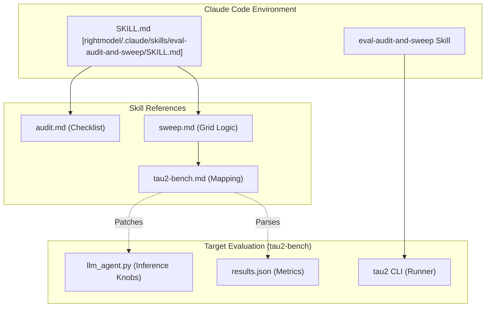
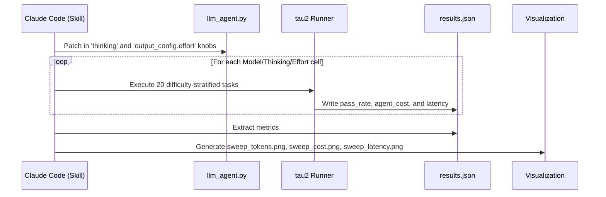

<!-- source: DeepWiki mcp.deepwiki.com · repo anthropics/cwc-workshops · page 9 Picking the Right Model Workshop · fetched 2026-10-26 -->

# Picking the Right Model Workshop

Relevant source files

The following files were used as context for generating this wiki page:

- [rightmodel/README.md](rightmodel/README.md)
- [rightmodel/TAU_BENCH_SETUP.md](rightmodel/TAU_BENCH_SETUP.md)

The **Picking the Right Model** workshop focuses on the critical engineering challenge of model selection and optimization. Participants learn to use a specialized Claude Code **SKILL** to perform two primary functions: auditing an existing LLM evaluation suite for reliability and sweeping that eval across various models and inference parameters (such as extended thinking and effort levels). The goal is to identify the optimal configuration for a specific task based on quality, cost, and latency.

## Workshop Structure

The workshop is divided into two distinct phases that transition from theoretical evaluation health to empirical performance measurement.

### Phase 1: Eval Audit
A model sweep is only as reliable as the underlying evaluation suite. This phase utilizes a comprehensive checklist to identify "gotchas" in task design, metrics hygiene, and grader design. It specifically addresses issues like LLM-judge biases that can provide false signals during model comparison.

*   **Entrypoint**: The audit is initiated via the `eval-audit-and-sweep` skill [rightmodel/README.md:16-17]().
*   **Checklist**: The `audit.md` file contains the framework-agnostic checklist for evaluating the health of the test suite [rightmodel/README.md:19-19]().

For details, see [Eval Audit and Sweep Skill](#9.1).

### Phase 2: Model Sweep
In this phase, participants wrap an evaluation suite in a grid of **Model × Thinking × Effort**. This allows for the instrumentation of per-cell pass rates, costs, and latencies. The output is a set of three comparison plots and a data-driven model recommendation.

*   **Instrumentation**: Grid logic and plotting instructions are defined in `sweep.md` [rightmodel/README.md:20-20]().
*   **Execution**: Participants can use their own eval or the provided **tau2-bench** airline domain benchmark [rightmodel/README.md:40-48]().

For details, see [Tau2-Bench Setup and Sweep Execution](#9.2).

## System Architecture and Code Entities

The following diagram illustrates how the Claude Code Skill interacts with the evaluation repository and the external benchmark.

### Workshop Component Mapping

**Sources:** [rightmodel/README.md:12-22](), [rightmodel/README.md:60-65](), [rightmodel/TAU_BENCH_SETUP.md:6-7]()

## Tau2-Bench Integration

For participants without a personal evaluation suite, the workshop uses **tau2-bench** (specifically the airline domain). This benchmark simulates an agent interacting with a user to perform tasks like flight changes and refunds [rightmodel/TAU_BENCH_SETUP.md:6-7]().

### Sweep Instrumentation Flow
The workshop automates the modification of the benchmark to support modern Claude features like extended thinking.

**Sources:** [rightmodel/README.md:56-65](), [rightmodel/TAU_BENCH_SETUP.md:21-21]()

## Key Files and Resources

| File | Purpose |
| :--- | :--- |
| `SKILL.md` | Entrypoint for Claude Code to understand the audit/sweep workflow [rightmodel/README.md:17-17](). |
| `audit.md` | Contains the reliability checklist for task and grader design [rightmodel/README.md:19-19](). |
| `sweep.md` | Instructions for instrumenting the model x thinking x effort grid [rightmodel/README.md:20-20](). |
| `tau2-bench.md` | Companion file with specific patch locations for the tau2-bench repo [rightmodel/README.md:21-21](). |
| `TAU_BENCH_SETUP.md` | Detailed installation guide for the airline domain benchmark [rightmodel/TAU_BENCH_SETUP.md:1-4](). |

## Setup and Requirements
The workshop requires:
*   **Claude Code** installed and configured [rightmodel/README.md:70-70]().
*   **Python 3.12 or 3.13** (Note: 3.13 requires `audioop-lts` for tau2-bench) [rightmodel/TAU_BENCH_SETUP.md:26-26](), [rightmodel/TAU_BENCH_SETUP.md:59-65]().
*   An `ANTHROPIC_API_KEY` [rightmodel/README.md:71-71]().

**Sources:**
- [rightmodel/README.md:1-73]()
- [rightmodel/TAU_BENCH_SETUP.md:1-75]()

---

