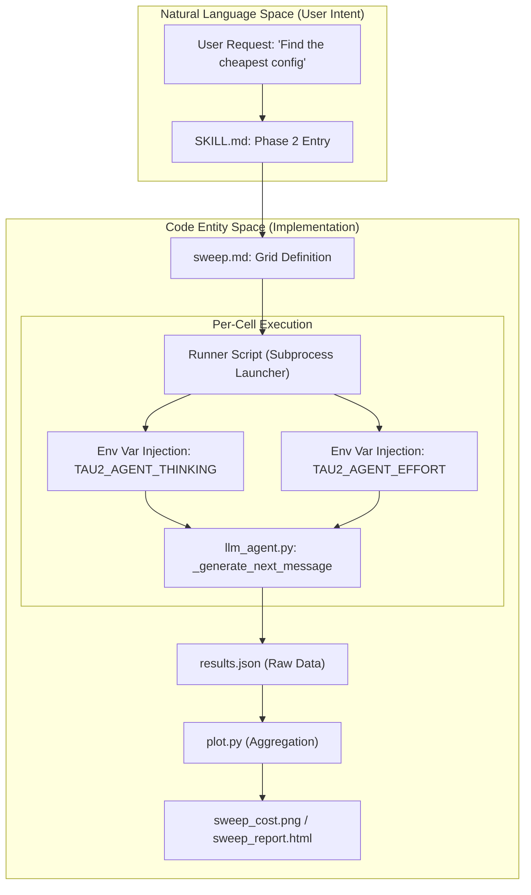
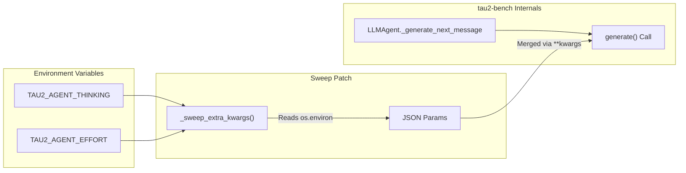

<!-- source: DeepWiki mcp.deepwiki.com · repo anthropics/cwc-workshops · page 9.1 Eval Audit and Sweep Skill · fetched 2026-10-26 -->

# Eval Audit and Sweep Skill

Relevant source files

The following files were used as context for generating this wiki page:

- [rightmodel/.claude/skills/eval-audit-and-sweep/SKILL.md](rightmodel/.claude/skills/eval-audit-and-sweep/SKILL.md)
- [rightmodel/.claude/skills/eval-audit-and-sweep/references/audit.md](rightmodel/.claude/skills/eval-audit-and-sweep/references/audit.md)
- [rightmodel/.claude/skills/eval-audit-and-sweep/references/sweep.md](rightmodel/.claude/skills/eval-audit-and-sweep/references/sweep.md)
- [rightmodel/.claude/skills/eval-audit-and-sweep/references/tau2-bench.md](rightmodel/.claude/skills/eval-audit-and-sweep/references/tau2-bench.md)

The **eval-audit-and-sweep** skill is a two-phase playbook designed to help developers extract trustworthy cost, quality, and performance metrics from LLM evaluation suites. It provides a framework-agnostic methodology to audit an existing evaluation for reliability issues and then perform a multi-dimensional parameter sweep across Claude model families and inference configurations (such as **extended thinking** and **effort**).

## Skill Structure and Entrypoint

The skill is organized into a main entrypoint that orchestrates two independent phases: **Phase 1 (Audit)** and **Phase 2 (Sweep)**. Because evaluation frameworks vary significantly (e.g., `tau-bench`, `inspect-ai`, or custom `pytest` harnesses), the skill provides guidance and reference patterns rather than a rigid script [rightmodel/.claude/skills/eval-audit-and-sweep/SKILL.md:9-13]().

| Component | File Path | Role |
| :--- | :--- | :--- |
| **Entrypoint** | `SKILL.md` | Logic for determining which phase to run and user check-in flow [rightmodel/.claude/skills/eval-audit-and-sweep/SKILL.md:15-28](). |
| **Audit Ref** | `references/audit.md` | Checklist for task design, harness scaffolding, and grader hygiene [rightmodel/.claude/skills/eval-audit-and-sweep/references/audit.md:4-8](). |
| **Sweep Ref** | `references/sweep.md` | Methodology for grid instrumentation, metric aggregation, and plotting [rightmodel/.claude/skills/eval-audit-and-sweep/references/sweep.md:4-10](). |
| **Companion** | `references/tau2-bench.md` | Specific implementation details for the `tau2-bench` airline domain [rightmodel/.claude/skills/eval-audit-and-sweep/references/tau2-bench.md:4-8](). |

**Sources:** [rightmodel/.claude/skills/eval-audit-and-sweep/SKILL.md:1-28](), [rightmodel/.claude/skills/eval-audit-and-sweep/references/audit.md:1-8](), [rightmodel/.claude/skills/eval-audit-and-sweep/references/sweep.md:1-10](), [rightmodel/.claude/skills/eval-audit-and-sweep/references/tau2-bench.md:1-8]()

---

## Phase 1: Eval Health Audit

The audit phase ensures that the evaluation is sound before resources are spent on a sweep. A broken eval produces "confident-looking numbers that point in the wrong direction" [rightmodel/.claude/skills/eval-audit-and-sweep/references/audit.md:4-6]().

### Audit Tiers
To handle large task sets, the audit follows a three-tiered approach:
1.  **Tier 1: Programmatic Checks:** Scripted analysis of the full set to find duplicates, category skew, and schema malformation [rightmodel/.claude/skills/eval-audit-and-sweep/references/audit.md:20-21]().
2.  **Tier 2: Stratified Sample:** A close human/LLM read of 20-50 tasks across difficulty levels [rightmodel/.claude/skills/eval-audit-and-sweep/references/audit.md:22-23]().
3.  **Tier 3: Per-Task LLM Auditor:** Using a cheap model to flag issues like ambiguity, "gold suspect" answers, or label leakage [rightmodel/.claude/skills/eval-audit-and-sweep/references/audit.md:24-50]().

### Audit Checklist
The audit evaluates four primary domains:
*   **Task Design:** Checking for unambiguous success criteria and ensuring a reference solution actually exists [rightmodel/.claude/skills/eval-audit-and-sweep/references/audit.md:56-59]().
*   **Harness Design:** Validating that the scaffolding doesn't introduce bias or artifacts.
*   **Metrics Hygiene:** Ensuring cost and latency are measured at the agent-generation level, excluding infrastructure overhead.
*   **Grader Design:** Identifying biases in LLM-as-a-judge (e.g., verbosity bias, position bias) [rightmodel/.claude/skills/eval-audit-and-sweep/references/audit.md:8]().

**Sources:** [rightmodel/.claude/skills/eval-audit-and-sweep/references/audit.md:4-60]()

---

## Phase 2: Parameter Sweep

The sweep determines the optimal "quality-per-dollar" and "quality-per-second" configuration by testing a cross-product grid of models and inference knobs [rightmodel/.claude/skills/eval-audit-and-sweep/references/sweep.md:9-11]().

### The Sweep Grid
The standard grid covers three model families and two reasoning dimensions [rightmodel/.claude/skills/eval-audit-and-sweep/references/sweep.md:13-21]():

| Model | Thinking Mode | Effort Levels |
| :--- | :--- | :--- |
| `claude-haiku-4-5` | `off`, `enabled` (budget) | N/A |
| `claude-sonnet-4-6` | `off`, `adaptive` | `low`, `medium`, `high` |
| `claude-opus-4-7` | `off`, `adaptive` | `low`, `medium`, `high` |

### Instrumentation and Metrics
For every cell in the grid, the runner captures raw usage and timing to calculate aggregate metrics [rightmodel/.claude/skills/eval-audit-and-sweep/references/sweep.md:38-52]():
*   **`pass_rate`**: Successful tasks / total tasks.
*   **`cost_per_success`**: Total cell cost / total passes.
*   **`seconds_per_success`**: Total agent generation time / total passes.

### Data Flow: Sweep Execution
The following diagram illustrates the flow from the parameter grid to the final visualization.

**Sweep Instrumentation Pipeline**

**Sources:** [rightmodel/.claude/skills/eval-audit-and-sweep/references/sweep.md:9-52](), [rightmodel/.claude/skills/eval-audit-and-sweep/references/tau2-bench.md:22-38](), [rightmodel/.claude/skills/eval-audit-and-sweep/references/tau2-bench.md:88-91]()

---

## Tau2-Bench Integration

The `tau2-bench.md` companion provides specific instructions for instrumenting Sierra's `tau2-bench` framework [rightmodel/.claude/skills/eval-audit-and-sweep/references/tau2-bench.md:4-8]().

### Difficulty Stratification
Instead of running the full 50-task suite, the workshop uses a 20-task subset stratified by difficulty based on a Haiku baseline [rightmodel/.claude/skills/eval-audit-and-sweep/references/tau2-bench.md:12-18]():
*   **5 Hard:** Solvable only by high-effort Opus.
*   **5 Medium-Hard:** Haiku passes 1/3 trials.
*   **8 Medium:** Haiku passes 2/3 trials.
*   **2 Easy:** Anchor tasks.

### Code Injection Pattern
Because `tau2-bench` does not expose `thinking` or `effort` via its CLI, the skill patches `src/tau2/agent/llm_agent.py` to intercept calls to the LLM [rightmodel/.claude/skills/eval-audit-and-sweep/references/tau2-bench.md:22-40]().

**Agent Call Interception Logic**

### Execution Strategy
*   **Backgrounding:** The sweep is launched as a background process to avoid session timeouts, using the `run_in_background: true` flag in the Bash tool [rightmodel/.claude/skills/eval-audit-and-sweep/references/tau2-bench.md:92-94]().
*   **Resumability:** The runner checks if a cell's `results.json` exists and contains the expected number of simulations before running, allowing for idempotent restarts [rightmodel/.claude/skills/eval-audit-and-sweep/references/tau2-bench.md:96-98]().

**Sources:** [rightmodel/.claude/skills/eval-audit-and-sweep/references/tau2-bench.md:12-40](), [rightmodel/.claude/skills/eval-audit-and-sweep/references/tau2-bench.md:92-98]()

---

