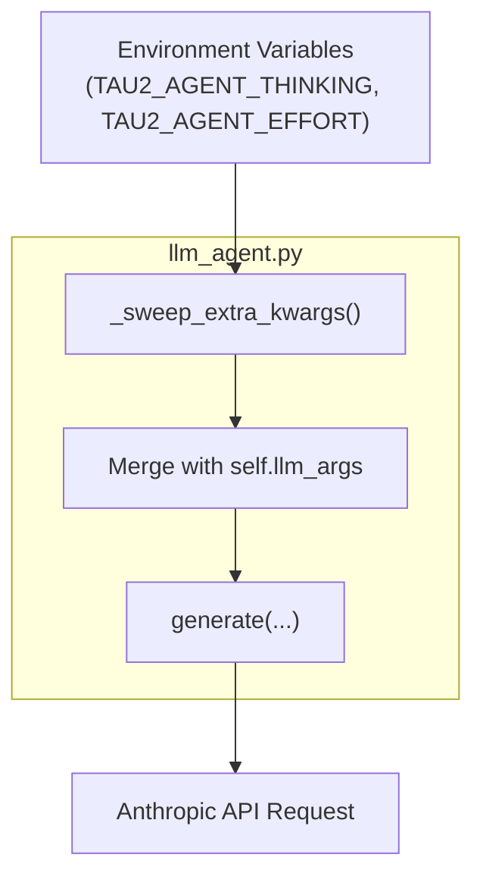
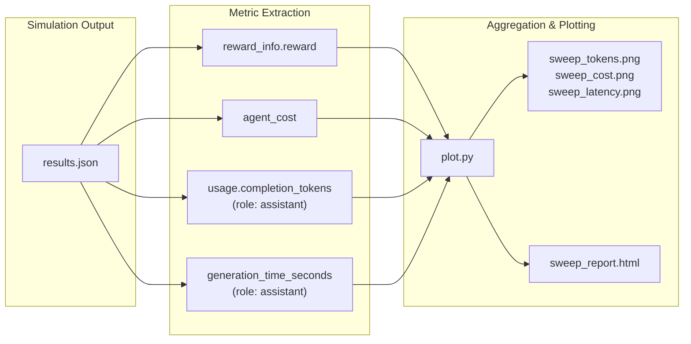

<!-- source: DeepWiki mcp.deepwiki.com · repo anthropics/cwc-workshops · page 9.2 Tau2-Bench Setup and Sweep Execution · fetched 2026-10-26 -->

# Tau2-Bench Setup and Sweep Execution

Relevant source files

The following files were used as context for generating this wiki page:

- [rightmodel/.claude/skills/eval-audit-and-sweep/references/tau2-bench.md](rightmodel/.claude/skills/eval-audit-and-sweep/references/tau2-bench.md)
- [rightmodel/TAU_BENCH_SETUP.md](rightmodel/TAU_BENCH_SETUP.md)

This page provides a technical guide for setting up the `tau2-bench` environment, instrumenting the agent code to support model-specific thinking and effort parameters, and executing a difficulty-stratified evaluation sweep. This process is used to generate performance-to-cost comparison plots across different Claude models and inference configurations.

## Environment Setup

The workshop utilizes `sierra-research/tau2-bench`, an open-source benchmark for agentic tool use in airline and retail domains [rightmodel/TAU_BENCH_SETUP.md:6-6](). The setup requires Python 3.12 or 3.13 and an `ANTHROPIC_API_KEY` [rightmodel/TAU_BENCH_SETUP.md:26-28]().

### Installation Steps

1.  **Clone and Initialize**: Clone the repository and create a virtual environment [rightmodel/TAU_BENCH_SETUP.md:35-40]().
2.  **Install Dependencies**: Install the package in editable mode. If using Python 3.13, the `audioop-lts` package must be installed manually as `audioop` was removed from the Python 3.13 standard library but is required by `tau2` [rightmodel/TAU_BENCH_SETUP.md:60-65]().
3.  **Plotting Requirements**: The sweep visualization scripts require `matplotlib`, which is not a default dependency of `tau2-bench` [rightmodel/.claude/skills/eval-audit-and-sweep/references/tau2-bench.md:6-6]().

### Task Stratification

To ensure efficient execution during the workshop, a 20-task subset is used instead of the full 50-task airline set. This subset is stratified by difficulty based on baseline Haiku pass rates [rightmodel/.claude/skills/eval-audit-and-sweep/references/tau2-bench.md:12-18]():

*   **Hard-but-solvable**: 5 tasks (Haiku 0/3, Opus-high 2-3/3).
*   **Medium**: 5 tasks (Haiku 1/3) and 8 tasks (Haiku 2/3).
*   **Easy Anchors**: 2 tasks.

Sources: [rightmodel/TAU_BENCH_SETUP.md:6-65](), [rightmodel/.claude/skills/eval-audit-and-sweep/references/tau2-bench.md:6-18]()

## Instrumentation: Injecting Thinking and Effort

The `tau2-bench` CLI does not natively expose Anthropic's `thinking` or `effort` parameters. To enable these for the sweep, the `LLMAgent` must be patched.

### Code Modification

The completion logic resides in `src/tau2/agent/llm_agent.py` within the `_generate_next_message` method [rightmodel/.claude/skills/eval-audit-and-sweep/references/tau2-bench.md:22-22](). A helper function `_sweep_extra_kwargs` is injected to read configuration from environment variables.

**Logic Flow for Parameter Injection:**
The following diagram illustrates how environment variables are intercepted and merged into the LLM request.

"Thinking and Effort Injection Flow"

Sources: [rightmodel/.claude/skills/eval-audit-and-sweep/references/tau2-bench.md:22-40]()

### Implementation Details
The patch involves:
1.  Defining `_sweep_extra_kwargs()` to parse `TAU2_AGENT_THINKING` (JSON) and `TAU2_AGENT_EFFORT` (string) [rightmodel/.claude/skills/eval-audit-and-sweep/references/tau2-bench.md:25-38]().
2.  Updating `LLMAgent`, `LLMGTAgent`, and `LLMSoloAgent` to pass these extra arguments into their respective `generate()` calls [rightmodel/.claude/skills/eval-audit-and-sweep/references/tau2-bench.md:40-40]().
3.  Setting `temperature: 1` and `max_tokens: 16000` whenever thinking or effort is enabled [rightmodel/.claude/skills/eval-audit-and-sweep/references/tau2-bench.md:34-36]().

Sources: [rightmodel/.claude/skills/eval-audit-and-sweep/references/tau2-bench.md:22-40]()

## Sweep Execution

The sweep script iterates through a matrix of models and configurations (the "Cells").

### Sweep Configuration Matrix
| Model | Thinking | Effort | Note |
| :--- | :--- | :--- | :--- |
| `claude-haiku-4-5` | Off / On (Budget) | N/A | Haiku rejects `adaptive` thinking and `effort` [rightmodel/.claude/skills/eval-audit-and-sweep/references/tau2-bench.md:52-55]() |
| `claude-sonnet-4-6` | Off / Adaptive | Low, Med, High | Full parameter support [rightmodel/.claude/skills/eval-audit-and-sweep/references/tau2-bench.md:57-62]() |
| `claude-opus-4-7` | Off / Adaptive | Low, Med, High | Full parameter support [rightmodel/.claude/skills/eval-audit-and-sweep/references/tau2-bench.md:57-62]() |

### Runner Orchestration
The runner script executes `tau2 run` as parallel subprocesses [rightmodel/.claude/skills/eval-audit-and-sweep/references/tau2-bench.md:69-69](). Key CLI arguments include:
*   `--agent-llm`: Set to `anthropic/claude-<id>` via LiteLLM [rightmodel/.claude/skills/eval-audit-and-sweep/references/tau2-bench.md:66-66]().
*   `--user-llm`: Fixed to `anthropic/claude-haiku-4-5` to ensure consistent simulation difficulty [rightmodel/.claude/skills/eval-audit-and-sweep/references/tau2-bench.md:67-67]().
*   `--save-to`: Uses a unique slug (e.g., `sonnet_ton_ehigh_tr0`) to avoid overwriting results [rightmodel/.claude/skills/eval-audit-and-sweep/references/tau2-bench.md:68-68]().

Sources: [rightmodel/.claude/skills/eval-audit-and-sweep/references/tau2-bench.md:48-71]()

## Data Processing and Visualization

After the sweep completes, results are aggregated from `results.json` files located in `data/simulations/<slug>/` [rightmodel/.claude/skills/eval-audit-and-sweep/references/tau2-bench.md:68-68]().

### Metrics Extraction
The following metrics are extracted for each simulation:
*   **Pass Rate**: Derived from `reward_info.reward` (1.0 = pass) [rightmodel/.claude/skills/eval-audit-and-sweep/references/tau2-bench.md:77-77]().
*   **Cost**: Read directly from `agent_cost` [rightmodel/.claude/skills/eval-audit-and-sweep/references/tau2-bench.md:78-78]().
*   **Token Usage**: Sum of `usage.completion_tokens` for messages where `role == "assistant"` [rightmodel/.claude/skills/eval-audit-and-sweep/references/tau2-bench.md:79-79]().
*   **Latency**: Sum of `generation_time_seconds` for assistant turns (excludes retry backoff and user simulation time) [rightmodel/.claude/skills/eval-audit-and-sweep/references/tau2-bench.md:80-81]().

### Results Pipeline
"Sweep Results Processing Pipeline"

Sources: [rightmodel/.claude/skills/eval-audit-and-sweep/references/tau2-bench.md:75-90]()

### Generating the Report
A final `plot.py` script globs all `sweep_results_<trial>.json` files, calculates averages, and generates the comparison plots [rightmodel/.claude/skills/eval-audit-and-sweep/references/tau2-bench.md:90-90](). The `sweep_report.html` serves as the primary deliverable, containing a data table and the three embedded PNG plots [rightmodel/.claude/skills/eval-audit-and-sweep/references/tau2-bench.md:90-90]().

Sources: [rightmodel/.claude/skills/eval-audit-and-sweep/references/tau2-bench.md:73-90]()

---

