# Page: Repository Overview

# Repository Overview

<details>
<summary>Relevant source files</summary>

The following files were used as context for generating this wiki page:

- [.gitignore](.gitignore)
- [LICENSE](LICENSE)
- [README.md](README.md)

</details>


The `cwc-workshops` repository is a monorepo containing materials and codebase structures for the **Code with Claude** workshop series by Anthropic [README.md:4-9](). Each directory within the repository represents a distinct, hands-on technical workshop focused on building, evaluating, or optimizing AI agents using the **Claude Managed Agents (CMA)** platform and associated developer tools.

## Monorepo Structure

The repository is organized into top-level directories, each functioning as an independent project with its own infrastructure, configuration, and evaluation harnesses [README.md:12-19]().

| Workshop Directory | Core Focus | Key Technologies |
|:---|:---|:---|
| `agent-battle/` | Competitive orchestration | MCP, Mineflayer, Python, Node.js |
| `agent-decomposition/` | Prompt engineering & sub-agents | CMA, CSV Code Execution, Python |
| `how-we-claude-code/` | AI-assisted product development | Vite, React, DOM Contracts, Zod |
| `ship-your-first-managed-agent/` | SRE/Infrastructure automation | Streamlit, CMA API, Python |
| `agents-that-remember/` | Long-term persistence | Memory Stores, Dreaming Service |
| `eval-driven-agent-development/` | Systematic agent optimization | PPTX XML, LLM-as-judge, TypeScript |
| `production-ready-agent/` | Multi-agent UI systems | Next.js, SSE, Memory Stores, MCP |
| `rightmodel/` | Model selection & Benchmarking | Claude Code SKILLs, tau2-bench |

Sources: [README.md:10-20]()

## Implementation and Data Flow

The workshops generally follow a pattern where a local environment (host) interacts with the Claude Managed Agents API to orchestrate sandboxed execution environments.

### General Agent Lifecycle
The following diagram illustrates the typical data flow between the participant's local machine and the Anthropic infrastructure across most workshops.

**System Interaction Flow**
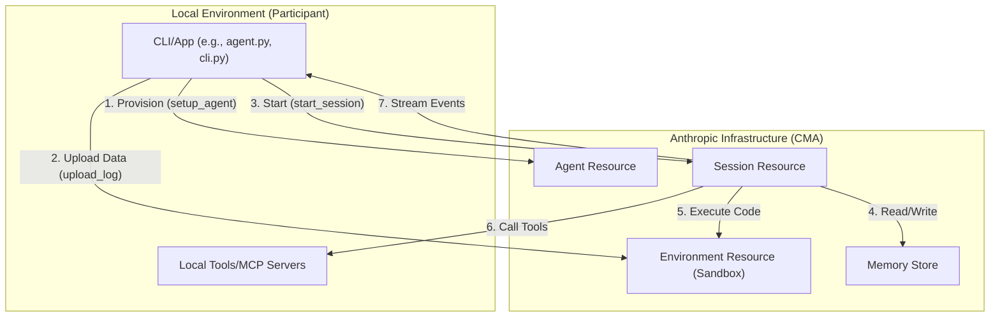
Sources: [README.md:15-17](), [README.md:19]()

## Workshop Directory Details

### 1. Agent Battle
A competition where participants configure a Managed Agent to drive a Minecraft bot. It emphasizes the use of **Model Context Protocol (MCP)** to bridge high-level agent reasoning with low-level game actions [README.md:16]().
*   **Key Entity:** `bot.js` (Mineflayer bot), `my_agent.py` (CMA Orchestrator).
*   **Go to:** [2. Agent Battle Workshop]()

### 2. Agent Decomposition (StockPilot)
Focuses on refactoring a monolithic "god-prompt" into a modular system of skills and sub-agents. It demonstrates the **compute-over-context** principle [README.md:13]().
*   **Key Entity:** `cma.py` (Deployment layer), `cli.py` (Eval harness).
*   **Go to:** [3. Agent Decomposition Workshop (StockPilot)]()

### 3. Production-Ready Agent (Deal Desk)
A complex multi-agent system for M&A research. It features a Next.js frontend that handles Server-Sent Events (SSE) from multiple parallel sub-agents [README.md:19]().
*   **Key Entity:** `lib/sse.ts` (Event streaming), `bin/setup.sh` (Provisioning).
*   **Go to:** [4. Production-Ready Agent Workshop (Deal Desk)]()

### 4. Eval-Driven Agent Development
A workshop dedicated to the "measure, don't vibe" philosophy. It uses a two-layer grader to evaluate the quality of generated PowerPoint files [README.md:18]().
*   **Key Entity:** `create-slides.ts` (Runner), `render.ts` (Visual verification).
*   **Go to:** [5. Eval-Driven Agent Development Workshop]()

### 5. Ship Your First Managed Agent
The entry-point workshop for understanding the CMA API. Participants implement the core lifecycle functions (Setup, Session, Tool Handling) for an SRE agent [README.md:15]().
*   **Key Entity:** `agent.py` (Implementation target), `provided.py` (Scaffolding).
*   **Go to:** [6. Ship Your First Managed Agent Workshop]()

### 6. Agents That Remember
Explores the evolution of agent memory, from stateless sessions to persistent Memory Stores and the **Dreaming Service** for transcript consolidation [README.md:17]().
*   **Key Entity:** `ant` (CLI tool), Memory Store API.
*   **Go to:** [7. Agents That Remember Workshop]()

### 7. How We Claude Code
Demonstrates a modern development workflow using **Claude Code**. It introduces the concept of "Verifiable React" where components emit machine-readable contracts [README.md:14]().
*   **Key Entity:** `VerifiableUnit`, `window.__verify`.
*   **Go to:** [8. How We Claude Code Workshop]()

### 8. Picking the Right Model
A meta-workshop using Claude Code SKILLs to audit other eval suites and perform parameter sweeps (Thinking, Effort) to optimize for cost and latency [README.md:12]().
*   **Key Entity:** `SKILL.md`, `tau2-bench` integration.
*   **Go to:** [9. Picking the Right Model Workshop]()

## Getting Started

For developers new to Claude Managed Agents, the recommended path is:
1.  **Ship Your First Managed Agent**: To learn the basic API primitives [README.md:15]().
2.  **Agent Decomposition**: To learn how to structure complex logic [README.md:13]().
3.  **Eval-Driven Agent Development**: To learn how to maintain quality as agents grow [README.md:18]().

## License
This repository is licensed under the **Apache License 2.0** [LICENSE:2-5](), [README.md:21-23]().

Sources: [README.md:1-24](), [LICENSE:1-130]()

---

# Page: Agent Battle Workshop

# Agent Battle Workshop

<details>
<summary>Relevant source files</summary>

The following files were used as context for generating this wiki page:

- [agent-battle/.env.event](agent-battle/.env.event)
- [agent-battle/HOST.md](agent-battle/HOST.md)
- [agent-battle/README.md](agent-battle/README.md)
- [agent-battle/setup.sh](agent-battle/setup.sh)

</details>


The **Agent Battle** is a 45-minute technical workshop where participants compete to build the most efficient diamond-mining agent in Minecraft using **Claude Managed Agents**. Unlike traditional coding competitions, the challenge lies in prompt engineering, tool orchestration, and managing the lifecycle of an autonomous agent within a dynamic, sandboxed environment.

## Overview

The workshop utilizes a three-layer architecture to bridge the gap between high-level agent logic and low-level game mechanics. Participants interact primarily with a single Python orchestrator to configure their agent's system prompt and toolset, while a background stack manages the Minecraft simulation and connectivity.

### Competition Mechanics
- **Objective**: Collect as many diamonds as possible within a fixed 5-minute window [agent-battle/README.md:78-85]().
- **Scoring**: Ranked by diamonds collected; ties are broken by token efficiency (diamonds per token) [agent-battle/README.md:11-15]().
- **Evaluation**: Participants can use a local `--eval` mode to test agent decision-making against single-turn probes without launching the full game [agent-battle/README.md:92-98]().

## System Architecture

The environment is divided into three distinct zones: the **Host Infrastructure** (shared across all participants), the **Participant Environment** (local to each user), and the **Agent Logic** (the code participants modify).

### High-Level Component Interaction

The following diagram illustrates how the local participant stack connects to the Anthropic Managed Agents cloud and the shared facilitator services.

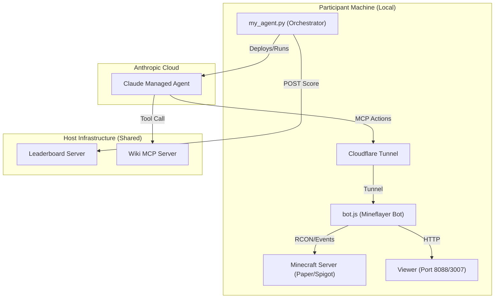
**Sources:** [agent-battle/README.md:136-148](), [agent-battle/setup.sh:34-44]()

## Core Components

### 1. Setup and Infrastructure
The workshop relies on `setup.sh` to orchestrate a complex local stack. This script handles dependency management (Java 17+, Node 18+, Python 3), process lifecycle management via PID files, and port-offsetting to allow multiple instances on a single machine. It also establishes a Cloudflare "Quick Tunnel" to allow the Anthropic cloud to communicate with the local `bot.js` instance.

For details, see [Agent Battle: Setup and Infrastructure](#2.1).

### 2. Bot and Agent Architecture
The "brain" of the operation is split between `my_agent.py` (which defines the `AGENT` configuration) and `bot.js` (a Mineflayer-based bot that translates LLM intents into Minecraft actions). The agent uses an MCP (Model Context Protocol) interface to query the world state (`/state`) and execute complex behaviors like `mine_block` or `craft_item`.

For details, see [Agent Battle: Bot and Agent Architecture](#2.2).

### 3. Scoring and Leaderboard
The facilitator runs `host.sh` to manage the shared leaderboard and Wiki MCP server. The leaderboard tracks participant progress in real-time, enforcing the 5-minute session limit and calculating efficiency metrics. A "Cast View" is provided for projectors to display the live competition standings.

For details, see [Agent Battle: Scoring, Leaderboard, and Harness](#2.3).

## Technical Map: Natural Language to Code Entities

The following diagram maps the conceptual "Agent Battle" entities to their specific implementations in the codebase.

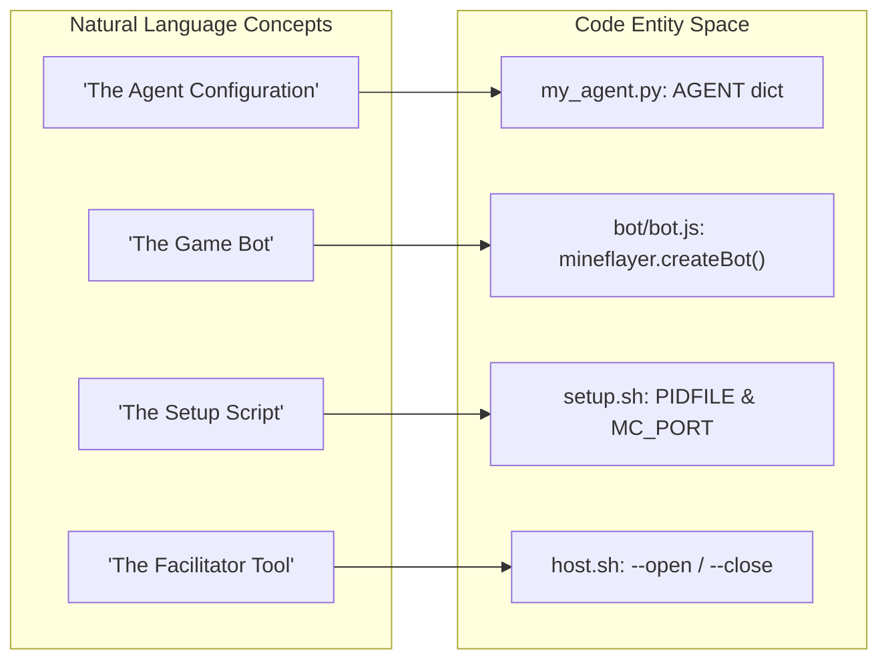
**Sources:** [agent-battle/my_agent.py:139-139](), [agent-battle/setup.sh:40-44](), [agent-battle/HOST.md:21-35]()

## Getting Started

Participants follow a streamlined workflow using `Claude Code` to automate the environment preparation:

| Step | Command | Description |
| :--- | :--- | :--- |
| **1. Clone** | `git clone ...` | Pull the repository. |
| **2. Configure** | `export PARTICIPANT="..."` | Set identity and API keys. |
| **3. Bootstrap** | `/cwc-setup` | Claude Code runs `setup.sh` to start the stack. |
| **4. Execute** | `python3 my_agent.py` | Launch the 5-minute competition run. |
| **5. Evaluate** | `python3 my_agent.py --eval` | Test prompt changes quickly. |

**Sources:** [agent-battle/README.md:20-98]()

---

# Page: Agent Battle: Setup and Infrastructure

# Agent Battle: Setup and Infrastructure

<details>
<summary>Relevant source files</summary>

The following files were used as context for generating this wiki page:

- [agent-battle/.claude/commands/cwc-setup.md](agent-battle/.claude/commands/cwc-setup.md)
- [agent-battle/.env.event](agent-battle/.env.event)
- [agent-battle/setup.sh](agent-battle/setup.sh)

</details>


The Agent Battle infrastructure is designed to provide a "one-click" experience for participants to deploy a complex stack consisting of a Minecraft server, a Mineflayer-based bot, a local leaderboard, and a Cloudflare tunnel for external MCP connectivity. The orchestration is handled primarily by `setup.sh`, which ensures idempotency and manages process lifecycles.

## The Orchestration Script (`setup.sh`)

`setup.sh` is the central entry point for the workshop environment. It handles dependency verification, environment configuration, and process management.

### Process Lifecycle and PID Management
The script tracks all background processes (Minecraft server, Node.js bot, Cloudflare tunnel) using a PID file located at `/tmp/agent-battle${SUFFIX}.pids` [agent-battle/setup.sh:44-44](). 

The script supports several operational modes:
*   **Standard Setup**: Detects missing dependencies, starts the Minecraft server, waits for the TCP port to open, then launches the bot and tunnel [agent-battle/setup.sh:19-19]().
*   **`--stop`**: Reads the PID file and uses `kill` to terminate the stack. It also uses `lsof` to target specific ports (`MC_PORT`, `HTTP_PORT`, `VIEWER_PORT`) to ensure no "zombie" processes remain [agent-battle/setup.sh:57-77]().
*   **`--restart`**: Performs a partial teardown but specifically preserves the Cloudflare tunnel. This is a critical optimization for workshops to avoid hitting Cloudflare's per-IP rate limits for "quick tunnels" [agent-battle/setup.sh:78-94]().

### Port-Offset Mechanism
To allow multiple participants or instances to run on a single host (e.g., during testing or shared server environments), the script uses an `INSTANCE` variable to calculate port offsets [agent-battle/setup.sh:34-42]().

| Service | Base Port | Formula |
| :--- | :--- | :--- |
| Minecraft Server | 25565 | `25565 + OFFSET` |
| Bot HTTP API | 8088 | `8088 + OFFSET` |
| Mineflayer Viewer | 3007 | `3007 + OFFSET` |

Sources: [agent-battle/setup.sh:34-44](), [agent-battle/setup.sh:57-94]()

## Configuration and Environment

The infrastructure relies on a tiered environment variable system where shell exports take precedence over file-based defaults.

### `.env.event` and Event-Day Defaults
During a live workshop, the facilitator provides a `.env.event` file containing shared infrastructure URLs and the world seed [agent-battle/.env.event:1-5](). The `_from_event` function in `setup.sh` reads these values only if they are not already set in the shell [agent-battle/setup.sh:145-153]().

Key variables include:
*   `LEADERBOARD_URL`: The endpoint for submitting scores [agent-battle/.env.event:1-1]().
*   `WIKI_MCP_URL`: A remote MCP server providing Minecraft game knowledge to the agents [agent-battle/.env.event:3-3]().
*   `MC_SEED`: Ensures all participants compete on the exact same terrain [agent-battle/.env.event:4-4]().

### Mandatory Participant Variables
The setup will fail (`die`) if the following are not provided:
1.  `ANTHROPIC_API_KEY`: Required for the agent to call Claude [agent-battle/setup.sh:154-154]().
2.  `PARTICIPANT`: A unique identifier for the leaderboard [agent-battle/.claude/commands/cwc-setup.md:23-23]().
3.  `MINECRAFT_EULA`: Must be set to `accept` by the user [agent-battle/.claude/commands/cwc-setup.md:24-28]().

Sources: [agent-battle/setup.sh:145-154](), [agent-battle/.env.event:1-5](), [agent-battle/.claude/commands/cwc-setup.md:12-36]()

## Infrastructure Components

The following diagram illustrates the relationship between the orchestration script and the processes it manages.

### System Infrastructure Diagram
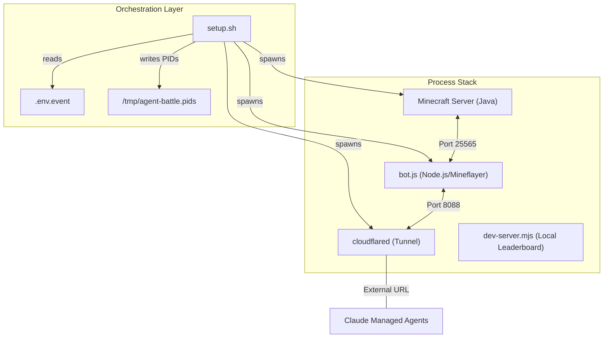
Sources: [agent-battle/setup.sh:40-44](), [agent-battle/setup.sh:101-138]()

## Data Flow: Setup to Execution

The setup process transitions the environment from a raw state to a "ready" state where `my_agent.py` can be executed.

### Code Entity Mapping
The following diagram maps the setup logic to the specific files and functions responsible for initializing the agent environment.

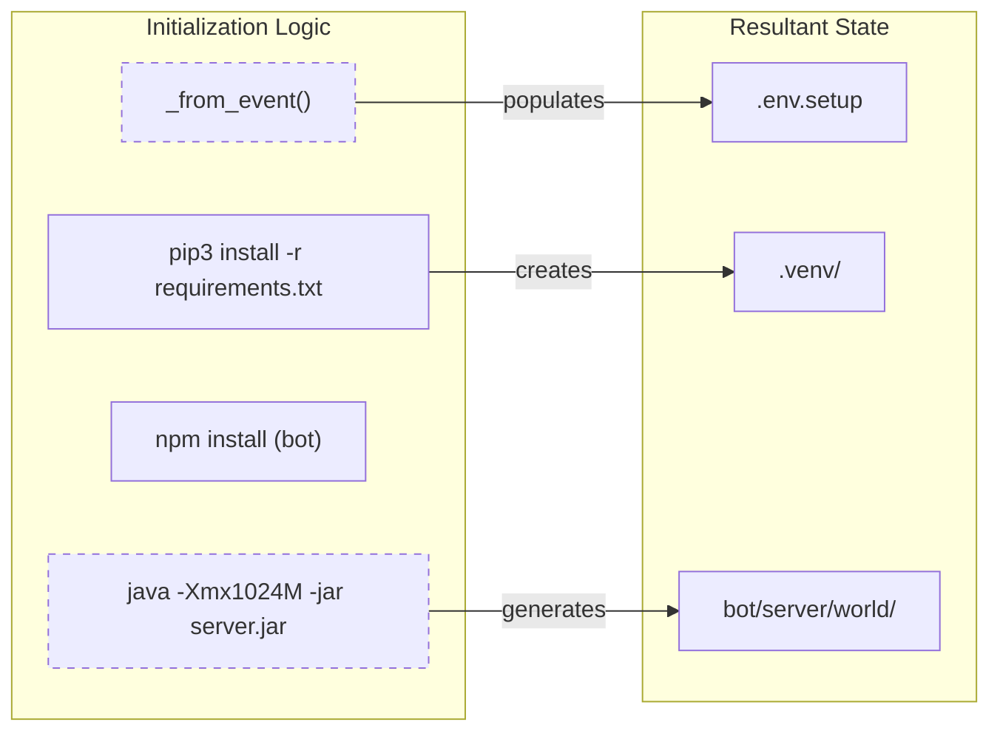
Sources: [agent-battle/setup.sh:110-134](), [agent-battle/setup.sh:145-153](), [agent-battle/setup.sh:195-215]()

## Facilitator Commands (`host.sh`)

While participants use `setup.sh`, the facilitator uses `host.sh` (referenced in the `setup.sh` comments) to manage the room-wide infrastructure [agent-battle/setup.sh:61-63]().

*   **Shared Leaderboard**: By default, `setup.sh` starts a local leaderboard. If `LEADERBOARD_URL` is set to a non-localhost address, it skips the local instance and points to the facilitator's shared server [agent-battle/setup.sh:48-53]().
*   **Tunnel Management**: The host tunnel on ports `:8888` and `:8077` is protected from the standard `--stop` command to prevent room-wide URL changes during local participant restarts [agent-battle/setup.sh:61-63]().

Sources: [agent-battle/setup.sh:45-53](), [agent-battle/setup.sh:60-64]()

---

# Page: Agent Battle: Bot and Agent Architecture

# Agent Battle: Bot and Agent Architecture

<details>
<summary>Relevant source files</summary>

The following files were used as context for generating this wiki page:

- [agent-battle/HOST.md](agent-battle/HOST.md)
- [agent-battle/README.md](agent-battle/README.md)
- [agent-battle/bot/bot.js](agent-battle/bot/bot.js)
- [agent-battle/my_agent.py](agent-battle/my_agent.py)

</details>


This page details the two primary components of the Agent Battle workshop: the **Mineflayer-based bot** (`bot.js`) which acts as the physical embodiment in Minecraft, and the **Python orchestrator** (`my_agent.py`) which configures and launches the Claude Managed Agent.

## System Overview

The architecture follows a three-tier model where the Claude Managed Agent (CMA) acts as the "brain," communicating via Model Context Protocol (MCP) to a local "body" (the Node.js bot).

### Data Flow and Entity Mapping

The following diagram illustrates how natural language goals are translated into game actions through specific code entities.

**Diagram: Natural Language to Minecraft Action Flow**
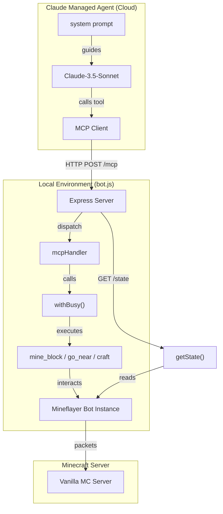
Sources: [agent-battle/my_agent.py:86-102](), [agent-battle/bot/bot.js:15-30](), [agent-battle/bot/bot.js:235-250]()

---

## The Node.js Bot (`bot.js`)

The bot is a Node.js application using the `mineflayer` library to interface with Minecraft. It provides a REST API and an MCP server interface for the agent to perceive and interact with the world.

### Concurrency and the `withBusy` Manager
To prevent the bot from attempting multiple physical actions simultaneously (which causes Mineflayer state corruption), all mutating actions are wrapped in the `withBusy` concurrency manager [agent-battle/bot/bot.js:338-356]().

- **Queueing**: If an action is requested while another is in progress, it is queued [agent-battle/bot/bot.js:25-27]().
- **State Flag**: The `busy` variable is set to `true` during execution and exposed via the `/state` endpoint [agent-battle/bot/bot.js:51](), [agent-battle/bot/bot.js:203]().
- **Timeout**: Actions have a default timeout to prevent the bot from hanging on unreachable goals [agent-battle/bot/bot.js:345-348]().

### Key API Endpoints
The bot exposes an Express server on port `8088` [agent-battle/bot/bot.js:41]().

| Endpoint | Method | Description |
| :--- | :--- | :--- |
| `/state` | GET | Returns a JSON snapshot of position, vitals, inventory, and nearby blocks [agent-battle/bot/bot.js:22](). |
| `/action` | POST | Executes a raw action (e.g., `mine_block`) via JSON payload [agent-battle/bot/bot.js:23](). |
| `/view` | GET | Serves a web UI containing the `prismarine-viewer` first-person stream [agent-battle/bot/bot.js:37-42](). |
| `/mcp` | POST | The entry point for the Claude Managed Agent's tool calls [agent-battle/bot/bot.js:46](). |

### Action Implementation
The bot implements high-level behaviors that simplify the task for the LLM:
- **`mine_block`**: Uses the `mineflayer-collectblock` plugin to navigate to and harvest a block [agent-battle/bot/bot.js:36](), [agent-battle/bot/bot.js:411-432]().
- **`go_near`**: Uses `mineflayer-pathfinder` to move within a specific range of coordinates [agent-battle/bot/bot.js:35](), [agent-battle/bot/bot.js:385-409]().
- **`craft`**: Resolves recipes and interacts with a crafting table if necessary [agent-battle/bot/bot.js:456-487]().

Sources: [agent-battle/bot/bot.js:32-113](), [agent-battle/bot/bot.js:195-233](), [agent-battle/bot/bot.js:338-487]()

---

## The Python Orchestrator (`my_agent.py`)

This script is the entry point for participants. It defines the agent's configuration and manages the session lifecycle with the Anthropic API.

### Managed Agent Configuration
The `AGENT` dictionary is the core "spec" for the agent [agent-battle/my_agent.py:86-100](). It includes:
- **Model**: Selection of Claude models (e.g., `claude-3-5-sonnet-latest`) [agent-battle/my_agent.py:88]().
- **System Prompt**: The primary instructions for the agent [agent-battle/my_agent.py:90]().
- **Skills**: Local directories (like `skills/mining`) that are bundled and uploaded to the agent's context [agent-battle/my_agent.py:67-70]().
- **MCP Servers**: Connections to external tools, such as the `WIKI_MCP_URL` for Minecraft game facts [agent-battle/my_agent.py:71-74]().

### Session Lifecycle
The script handles the transition from a local configuration to a running cloud session.

**Diagram: Session Lifecycle**
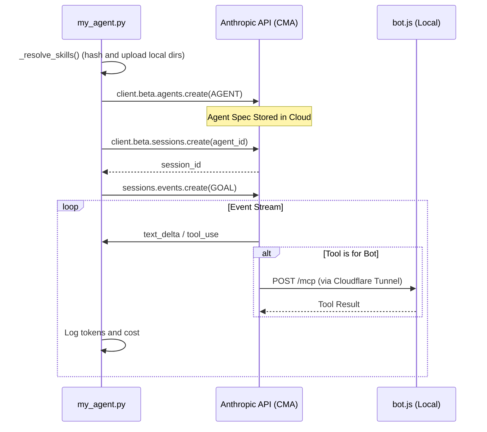
Sources: [agent-battle/my_agent.py:135-185](), [agent-battle/my_agent.py:228-285]()

### Skill Management
The `_resolve_skills` function automates the process of turning local text files into Managed Agent skills [agent-battle/my_agent.py:135-175]().
1. It scans the provided directory for a `SKILL.md` file [agent-battle/my_agent.py:148-150]().
2. It generates a hash of the content to determine if an upload is necessary [agent-battle/my_agent.py:153-155]().
3. It uses `client.beta.skills.create` to register the skill with Anthropic [agent-battle/my_agent.py:171]().
4. The resulting `skill_id` is cached in `.agent_cache.json` to avoid redundant uploads [agent-battle/my_agent.py:132](), [agent-battle/my_agent.py:173]().

### Execution Pipeline
The `main()` function orchestrates the 5-minute run [agent-battle/my_agent.py:228]().
- **Cost Tracking**: Uses `CostTracker` to monitor token usage and estimate USD cost [agent-battle/my_agent.py:60](), [agent-battle/my_agent.py:245]().
- **Streaming**: Consumes the session event stream, printing Claude's thoughts and tool calls to the console [agent-battle/my_agent.py:263-285]().
- **Automatic Retries**: The `_STREAM_RETRY` tuple defines network errors that trigger a reconnection to the SSE stream without failing the entire run [agent-battle/my_agent.py:125-129]().

Sources: [agent-battle/my_agent.py:135-185](), [agent-battle/my_agent.py:228-315]()

---

# Page: Agent Battle: Scoring, Leaderboard, and Harness

# Agent Battle: Scoring, Leaderboard, and Harness

<details>
<summary>Relevant source files</summary>

The following files were used as context for generating this wiki page:

- [agent-battle/HOST.md](agent-battle/HOST.md)
- [agent-battle/README.md](agent-battle/README.md)
- [agent-battle/bot/bot.js](agent-battle/bot/bot.js)
- [agent-battle/my_agent.py](agent-battle/my_agent.py)

</details>


This page details the evaluation and competitive infrastructure of the Agent Battle workshop. It covers how agents are scored based on diamond collection and token efficiency, the harness used for local verification and evaluation probes, and the centralized leaderboard system used by facilitators to track participant progress.

## Scoring System and Metrics

The primary objective of the Agent Battle is to collect as many diamonds as possible within a fixed 300-second window. The scoring system prioritizes outcomes but uses efficiency as a tie-breaker.

### Primary Metrics
*   **Diamonds Collected**: The count of diamond items picked up by the bot. This is tracked by `diamondsCollected` in the bot process [agent-battle/bot/bot.js:59-59]().
*   **Token Efficiency**: Total tokens consumed (Input + Output) during the run. In the event of a tie in diamond count, the agent with the lower token count ranks higher [agent-battle/bot/bot.js:57-58]().
*   **Run Duration**: Every competitive run is capped at 300 seconds (5 minutes). The leaderboard rejects any achievement reported with a timestamp past 305 seconds to prevent local clock drift exploits [agent-battle/my_agent.py:115-120]().

### Milestones and Quests
Beyond diamonds, the bot tracks "Achievements" to provide granular progress feedback.
*   **Quests**: Discrete tasks like `first_block` (triggered on `diggingCompleted`) [agent-battle/bot/bot.js:149-149]().
*   **Milestones**: Triggered when specific items enter the inventory (e.g., `iron_ingot`, `crafting_table`, `furnace`) [agent-battle/bot/bot.js:132-132]().
*   **Diamond Achievements**: Each diamond collected is reported as a unique achievement (e.g., `diamond_1`, `diamond_2`) to the leaderboard [agent-battle/bot/bot.js:140-143]().

**Sources:** [agent-battle/bot/bot.js:55-64](), [agent-battle/bot/bot.js:130-148](), [agent-battle/my_agent.py:115-120]()

---

## The Evaluation Harness

The `harness/` directory contains the logic for running agents, logging their behavior, and performing rapid evaluations without launching a full Minecraft session.

### --eval Mode
Running `python3 my_agent.py --eval` executes a "decision-probe" scorecard [agent-battle/my_agent.py:24-24](). This mode bypasses the 5-minute Minecraft run and instead tests the agent's `AGENT` configuration against a set of static scenarios (probes) to see if it makes the correct tactical decisions [agent-battle/README.md:92-98]().

### Logging and Cost Tracking
*   **RunLogger**: Manages session logs and event streaming [agent-battle/my_agent.py:61-61]().
*   **CostTracker**: Calculates the financial cost and token usage of the run based on the model used [agent-battle/my_agent.py:60-60]().
*   **verify.py**: A utility within the harness used to validate the environment and agent connectivity [agent-battle/README.md:146-146]().

### Data Flow: Agent to Leaderboard
The following diagram illustrates how performance data flows from the bot's actions to the host's leaderboard.

**Performance Tracking Flow**
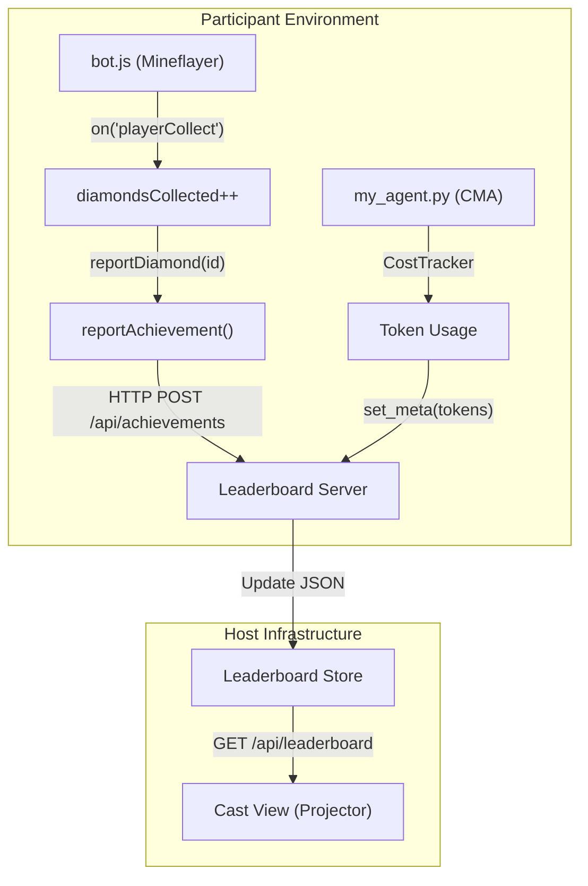
**Sources:** [agent-battle/bot/bot.js:130-148](), [agent-battle/my_agent.py:60-61](), [agent-battle/README.md:147-148]()

---

## Leaderboard and Host Infrastructure

The host runs a centralized server that aggregates results from all participants.

### The SHARE Block
When a host starts the infrastructure using `./host.sh`, it generates a **SHARE block**. This block contains the environment variables participants must export to connect to the shared resources:
*   `LEADERBOARD_URL`: The endpoint for posting scores.
*   `WIKI_MCP_URL`: The URL for the shared Minecraft Wiki MCP server [agent-battle/HOST.md:12-16]().
*   `LEADERBOARD_KEY`: A key authorizing participants to post scores (but not manage the session) [agent-battle/HOST.md:72-73]().

### Host Commands
| Command | Description |
| :--- | :--- |
| `./host.sh --open` | Opens the scoring window for a specified duration [agent-battle/HOST.md:22-22](). |
| `./host.sh --close` | Freezes the board, preventing further score submissions [agent-battle/HOST.md:34-34](). |
| `./host.sh --reset` | Wipes all scores but maintains the same tunnel URLs [agent-battle/HOST.md:22-22](). |

### Admin and Cast Views
*   **Cast View**: A projector-optimized version of the leaderboard accessible by appending `?cast=1` to the leaderboard URL [agent-battle/HOST.md:17-17]().
*   **Admin Session**: An endpoint (`/admin/session`) used by the facilitator to manage the competition state, protected by the `admin-key` found in `.host-state/` [agent-battle/HOST.md:69-74]().

**Host Entity Mapping**
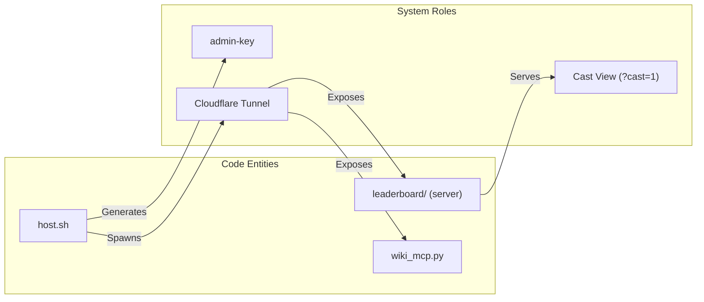
**Sources:** [agent-battle/HOST.md:1-87](), [agent-battle/README.md:147-148]()

---

# Page: Agent Decomposition Workshop (StockPilot)

# Agent Decomposition Workshop (StockPilot)

<details>
<summary>Relevant source files</summary>

The following files were used as context for generating this wiki page:

- [agent-decomposition/.claude/CLAUDE.md](agent-decomposition/.claude/CLAUDE.md)
- [agent-decomposition/README.md](agent-decomposition/README.md)

</details>


The **StockPilot** workshop focuses on the transition from monolithic, prompt-heavy agents to modular, high-performance systems using **Claude Managed Agents (CMA)**. Participants inherit a "legacy" inventory-management agent characterized by a 402-line system prompt and 12 stateless tools that often struggle with large-scale data processing and complex reasoning.

The core objective is to apply the **Tool → Skill → Subagent** decision framework to decompose this monolith into a more efficient architecture that leverages sandboxed code execution and on-demand context loading.

### Workshop Objectives
*   **Decompose the Monolith**: Break down a 402-line `LEGACY_PROMPT` into a 15-line `SHORT_PROMPT` using on-demand skills.
*   **Compute-over-Context**: Replace expensive "data-dumping" tools with Bash-based code execution over CSV files in the CMA sandbox.
*   **Dynamic Delegation**: Replace hardcoded subagent logic with callable subagents that are spawned only when specialized reasoning (like forecasting) is required.
*   **Evaluation-Driven Development**: Use a 12-task evaluation suite to measure improvements in accuracy, wall-clock time, and token efficiency.

### System Architecture Overview

The workshop transitions the agent from a local "Before" state (running on the raw Messages API) to a "Starter" state deployed on CMA infrastructure.

#### Logical Components to Code Entities
The following diagram bridges the conceptual decomposition strategy to the specific files and classes in the codebase.

**StockPilot System Mapping**
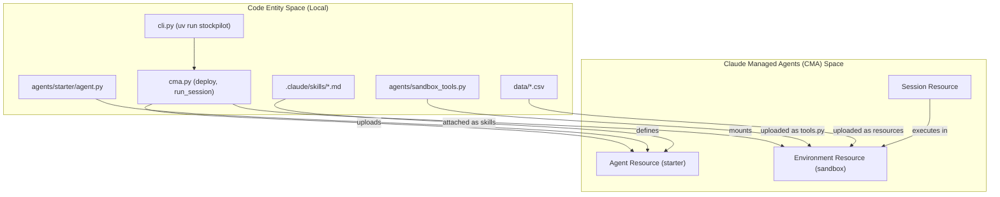
Sources: [agent-decomposition/README.md:156-164](), [agent-decomposition/agents/cma.py:20-50]()

### The Decision Framework
The workshop guides participants through three cycles of decomposition based on the following power-vs-cost spectrum:

| Entity | Definition | Use Case |
| :--- | :--- | :--- |
| **Tool Call** | One function, stateless, deterministic. | Basic API lookups or single-row writes. |
| **Skill** | Instructions the agent reads on demand. | Policies, templates, or "always do X" rules. |
| **Subagent** | Separate agent with its own context/goal. | Specialized, long-running, or high-reasoning tasks. |

**Smell Tests for Decomposition:**
*   **Tool returns >2k tokens?** → Use code execution (Bash/Python) instead [agent-decomposition/README.md:104-104]().
*   **Prompt says "Always do X"?** → Move to a Skill [agent-decomposition/README.md:105-105]().
*   **Subagent returns a single number?** → It shouldn't be a subagent [agent-decomposition/README.md:105-106]().

### Iteration Workflow
The workshop utilizes a tight feedback loop involving local code edits, remote deployment, and automated evaluation.

**Iteration Loop**
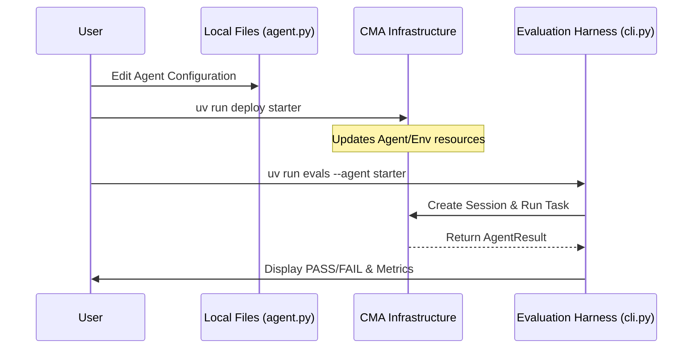
Sources: [agent-decomposition/README.md:71-78](), [agent-decomposition/evals/cli.py:128-150]()

### Key Components

#### 1. Architecture and Decomposition Strategy
Details the specific shifts from the `Before` agent to the `Starter` agent, including the use of `SHORT_PROMPT` and the transition of tools like `list_low_stock` to Bash scripts.
For details, see [StockPilot: Architecture and Decomposition Strategy](#3.1).

#### 2. CMA Deployment and Session Management
Explains the orchestration layer in `cma.py` that handles the idempotent creation of agents, environment provisioning, and the lifecycle of subagents.
For details, see [StockPilot: CMA Deployment and Session Management](#3.2).

#### 3. CLI, Evaluation Harness, and Metrics
Covers the `evals/` directory logic, including how tasks (R1-R9, F1-F3) are graded and how performance is compared between the monolithic and decomposed versions.
For details, see [StockPilot: CLI, Evaluation Harness, and Metrics](#3.3).

### Workshop Results
By the end of the workshop, the agent typically achieves a significant performance boost:
*   **Accuracy**: Score increases from ~71% to ~92% [agent-decomposition/README.md:144-144]().
*   **Efficiency**: The "Daily Sweep" task (F1) drops from 102 tool calls to ~3 scripts [agent-decomposition/README.md:145-145]().
*   **Maintainability**: The system prompt is reduced from 402 lines to 15 lines [agent-decomposition/README.md:146-146]().

Sources: [agent-decomposition/README.md:141-148](), [agent-decomposition/.claude/CLAUDE.md:51-60]()

---

# Page: StockPilot: Architecture and Decomposition Strategy

# StockPilot: Architecture and Decomposition Strategy

<details>
<summary>Relevant source files</summary>

The following files were used as context for generating this wiki page:

- [agent-decomposition/.claude/CLAUDE.md](agent-decomposition/.claude/CLAUDE.md)
- [agent-decomposition/README.md](agent-decomposition/README.md)
- [agent-decomposition/agents/cma.py](agent-decomposition/agents/cma.py)

</details>


This page details the architectural evolution of the StockPilot inventory-management agent. It covers the transition from a monolithic, prompt-heavy agent to a modular system utilizing **Skills**, **Code Execution**, and **Subagents** on the Claude Managed Agents (CMA) platform.

## The Decomposition Framework

StockPilot serves as a demonstration of the **Tool → Skill → Subagent** decision framework. The architecture is designed to optimize for the "compute-over-context" principle, ensuring the agent remains efficient as business logic complexity scales.

| Strategy | Mechanism | Best Use Case | Implementation in StockPilot |
| :--- | :--- | :--- | :--- |
| **Tool** | Stateless function calls | Deterministic, small-payload operations | `adjust_stock`, `create_purchase_order` |
| **Skill** | On-demand instructions | Policy-heavy logic or templating | `reorder-policy`, `notify-templates` |
| **Code Exec** | Bash/Python in sandbox | Data-heavy processing (>2k tokens) | CSV analysis via Bash/Python scripts |
| **Subagent** | Independent context | Parallelizable goals or high-reasoning tasks | `Forecaster` subagent for demand analysis |

**Sources:** [agent-decomposition/README.md:93-106](), [agent-decomposition/agents/starter/agent.py:10-40]()

## Architecture Evolution: Before vs. Starter

The workshop compares two distinct architectural states: the **Before** agent (monolithic) and the **Starter** agent (decomposed).

### 1. The "Before" Agent (Monolith)
The baseline agent operates via the raw Messages API. It relies on a 402-line system prompt that includes all business policies (reordering, forecasting, reporting) within the primary context window.
*   **Context Pressure:** High. Every turn includes the full policy set.
*   **Data Handling:** Uses 12 specialized tools that often return massive raw CSV dumps (e.g., `list_low_stock` returning 400+ rows), leading to token bloat and context overflow.

### 2. The "Starter" Agent (Decomposed)
The evolved agent uses a 15-line `SHORT_PROMPT` and offloads complexity to the CMA environment.
*   **Dynamic Context:** Skills are loaded only when relevant.
*   **Compute-over-Context:** Instead of reading 400 rows of CSV data, the agent writes a Python script to filter data within the CMA sandbox.

### System Flow: Natural Language to Code Entities

The following diagram illustrates how a user request flows through the CMA architecture, mapping high-level concepts to specific code implementations.

**StockPilot Request Execution Flow**
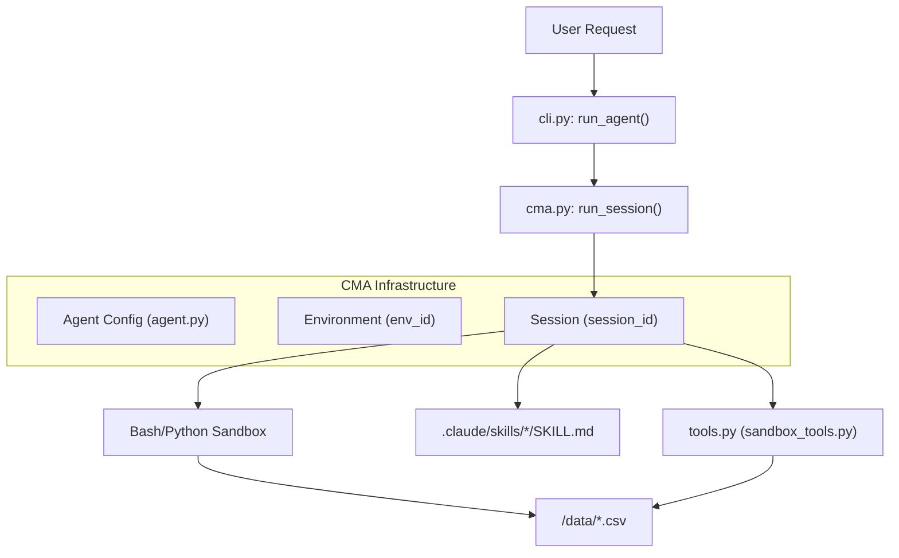
**Sources:** [agent-decomposition/agents/cma.py:168-210](), [agent-decomposition/agents/starter/agent.py:42-60](), [agent-decomposition/cli.py:45-65]()

## Core Components

### The CMA Sandbox and Data Layer
The agent operates within a sandboxed environment where data is mounted as read-only CSV files.
*   **Data Mounting:** Files like `products.csv` and `sales_history.csv` are uploaded via the Files API and mounted to `/data/` or `data/` in the sandbox [agents/cma.py:43-46](), [agents/cma.py:158-165]().
*   **CSV-Based Execution:** Instead of "data-dump" tools, the agent is encouraged to use `ls`, `grep`, or `python3` to process files locally. This reduces wall-time and token costs for tasks like the "Daily low-stock sweep" (F1) [agent-decomposition/README.md:141-147]().

### Skills: Policy-as-Skill
Skills are packaged as ZIP files containing a `SKILL.md` (instructions) and optional helper scripts [agents/cma.py:97-104]().
*   **`reorder-policy`**: Encapsulates the logic for when to trigger a restock.
*   **`notify-templates`**: Contains the specific formatting for Slack/Email alerts, removing 100+ lines of formatting examples from the main system prompt [agent-decomposition/README.md:116-117]().

### Subagent Strategy: The Forecaster
For high-reasoning tasks like demand forecasting (Task F2), the architecture employs a specialized **Forecaster** subagent.

**Subagent Decomposition Strategy**
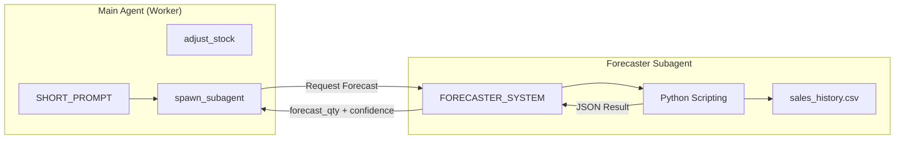
*   **Forecaster Role:** Defined by `FORECASTER_SYSTEM` in `cma.py`. It is strictly instructed to return a JSON object containing `forecast_qty`, `confidence`, and `method` [agents/cma.py:30-41]().
*   **Worker Role:** The main agent (Starter) acts as the orchestrator, delegating complex analysis to the Forecaster and then executing the physical inventory adjustments based on the returned data.

**Sources:** [agent-decomposition/agents/cma.py:30-41](), [agent-decomposition/agents/starter/agent.py:100-115]()

## Implementation Details

### Agent Configuration (`agent.py`)
The `starter/agent.py` file defines the CMA configuration. It uses a `config_builder` pattern to dynamically assemble the agent's capabilities.

```python
def config_builder(skill_ids: dict[str, str]):
    return {
        "name": agent_name_for("stockpilot-starter"),
        "model": MODEL,
        "system": SHORT_PROMPT,
        "tools": [
            # Tools are selected here based on the decomposition strategy
            {"type": "bash_20241022", "name": "bash", "sandbox": {"type": "cloud"}},
            # ... legacy tools
        ],
        "skill_ids": list(skill_ids.values()),
        "wants_forecaster": True # Triggers subagent provisioning in cma.py
    }
```
**Sources:** [agent-decomposition/agents/starter/agent.py:100-130](), [agent-decomposition/agents/cma.py:190-193]()

### Idempotent Deployment
The `deploy()` function in `cma.py` ensures that agent updates are efficient. It caches IDs in `.stockpilot_ids.json` to reuse existing resources rather than creating duplicates [agents/cma.py:5-8]().
1.  **Upload Skills:** Versions existing skills or creates new ones [agents/cma.py:97-127]().
2.  **Upload Data:** Syncs local CSVs to the CMA Files API [agents/cma.py:87-94]().
3.  **Update Agent:** Uses `beta.agents.update` to push prompt or tool changes without changing the Agent ID [agents/cma.py:140-155]().

**Sources:** [agent-decomposition/agents/cma.py:176-198]()

---

# Page: StockPilot: CMA Deployment and Session Management

# StockPilot: CMA Deployment and Session Management

<details>
<summary>Relevant source files</summary>

The following files were used as context for generating this wiki page:

- [agent-decomposition/agents/cma.py](agent-decomposition/agents/cma.py)
- [agent-decomposition/agents/common.py](agent-decomposition/agents/common.py)
- [agent-decomposition/agents/deploy_cli.py](agent-decomposition/agents/deploy_cli.py)

</details>


This page details the `cma.py` orchestration layer, which manages the lifecycle of Claude Managed Agents (CMA) for the StockPilot workshop. It covers idempotent deployment, skill packaging, resource mounting, and the execution of stateful agent sessions.

## Orchestration Overview

The `agents/cma.py` file serves as a shared utility layer designed to abstract the complexity of the Managed Agents API. It ensures that participant environments are provisioned consistently and that agents have access to the necessary data and tools.

### Key Responsibilities
*   **Idempotency**: Using `.stockpilot_ids.json` to track resource IDs (Agents, Environments, Skills, Files) across runs [agents/cma.py:5-8]().
*   **Skill Management**: Packaging local directories into zip files for upload as CMA Skills [agents/cma.py:97-104]().
*   **Resource Mounting**: Attaching CSV data and Python modules to agent sandboxes [agents/cma.py:158-166]().
*   **Session Lifecycle**: Creating sessions, streaming events, and handling subagent spawning [agents/cma.py:215-260]().

### Code Entity Mapping: Deployment Flow

The following diagram maps the logical deployment steps to the specific functions in `agents/cma.py`.

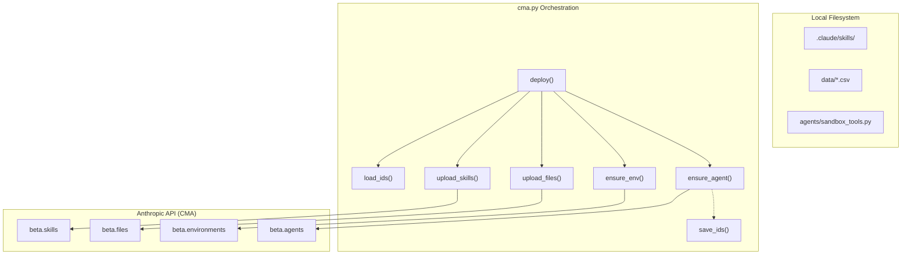
**Sources:** [agents/cma.py:176-200](), [agents/cma.py:56-61](), [agents/cma.py:87-94](), [agents/cma.py:97-127]()

---

## Idempotency and State Persistence

To avoid redundant uploads and "Name already taken" errors during workshop iterations, `cma.py` maintains a local cache of resource IDs in `.stockpilot_ids.json` [agents/cma.py:26]().

### Name Suffixing
The `agent_name_for()` function generates a unique 8-hex suffix for each participant [agents/cma.py:64-79](). This suffix is appended to agent and skill names (e.g., `stockpilot-starter-a1b2c3d4`), allowing multiple participants to use the same Anthropic Organization without namespace collisions.

### Resource Tracking
The `IDS_FILE` stores:
1.  `name_suffix`: The unique identifier for the attendee [agents/cma.py:75]().
2.  `skills`: A mapping of skill names to remote IDs [agents/cma.py:105]().
3.  `data_files`: Mapping of CSV filenames to File API IDs [agents/cma.py:185]().
4.  `agents`: Mapping of slots (e.g., `starter`) to Agent IDs [agents/cma.py:192]().

**Sources:** [agents/cma.py:26](), [agents/cma.py:56-79](), [agents/cma.py:179-195]()

---

## Skill Packaging and Uploads

Managed Agents use "Skills" to encapsulate logic. In StockPilot, skills are defined in `.claude/skills/` [agents/cma.py:25]().

### Zip Bundling
The `upload_skills()` function zips the entire directory for each skill [agents/cma.py:114](). This allows a skill to include not just the `SKILL.md` entry point, but also helper Python scripts or configuration files that the agent can execute within the sandbox.

### Versioning
If a skill ID already exists in the cache or on the server, `cma.py` creates a new version of the skill rather than a new skill object [agents/cma.py:116-120](). This preserves the skill's history and avoids cluttering the Anthropic Console.

**Sources:** [agents/cma.py:97-127](), [agents/cma.py:114-119]()

---

## Session Management and Execution

The `run_session()` function handles the real-time interaction with a provisioned agent [agents/cma.py:215]().

### Resource Mounting
When a session is created, local data files and sandbox modules are mounted into the agent's environment [agents/cma.py:158-166]().
*   **CSV Data**: Mounted at `/mnt/session/uploads/data/` [agents/cma.py:161]().
*   **Sandbox Tools**: `agents/sandbox_tools.py` is mounted as `tools.py` to provide a standard library for agent-driven scripts [agents/cma.py:47]().

### The Event Loop
`run_session()` initiates a session with `beta.sessions.create` and processes the resulting event stream [agents/cma.py:230-245](). It tracks:
*   **Input/Output Tokens**: Aggregated from `message_start` and `message_delta` events [agents/cma.py:252-253]().
*   **Agent Turns**: Incremented for each model response [agents/cma.py:251]().
*   **Subagent Spawning**: Detected via `spawn_subagent` tool calls [agents/cma.py:254-255]().

### Subagent Lifecycle
StockPilot utilizes "Callable Agents" to decompose tasks.
*   **Forecaster Subagent**: A specialized agent with a system prompt optimized for data processing [agents/cma.py:30-41]().
*   **Spawning**: When the primary agent calls the `spawn_subagent` tool, `cma.py` handles the recursive execution and returns the result to the parent agent [agents/cma.py:254-255]().

**Sources:** [agents/cma.py:158-166](), [agents/cma.py:215-260](), [agents/cma.py:30-41]()

---

## Infrastructure Resilience

Managed Agent infrastructure can occasionally experience transient errors (e.g., sandbox provisioning delays). `cma.py` implements resilience patterns to ensure reliable evaluation runs.

### Exponential Backoff
The deployment and session creation logic is wrapped in retry logic (implicitly via the Anthropic SDK and explicitly in workshop scripts) to handle `503 Service Unavailable` or `429 Too Many Requests` errors.

### Sink Management
To support parallel evaluation of tasks, `cma.py` uses "Sinks" for side effects (like creating Purchase Orders). Each session is assigned a `run_id`, and its outputs are isolated in `data/.runs/<run_id>/` [agents/common.py:41-44](). This prevents agents in concurrent threads from reading or overwriting each other's actions.

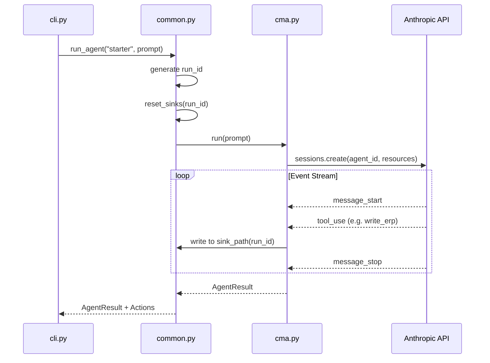
**Sources:** [agents/common.py:48-61](), [agents/common.py:104-117](), [agents/cma.py:215-230]()

### Error Handling
If an agent session fails (e.g., max turns exceeded or API error), the `AgentResult` object captures the error string and the partial transcript, allowing the evaluation harness to record a `FAIL` and provide debugging context [agents/common.py:22-30]().

**Sources:** [agents/common.py:22-30](), [agents/cma.py:256-260]()

---

# Page: StockPilot: CLI, Evaluation Harness, and Metrics

# StockPilot: CLI, Evaluation Harness, and Metrics

<details>
<summary>Relevant source files</summary>

The following files were used as context for generating this wiki page:

- [agent-decomposition/agents/cli.py](agent-decomposition/agents/cli.py)
- [agent-decomposition/agents/common.py](agent-decomposition/agents/common.py)
- [agent-decomposition/evals/reference_scores.json](agent-decomposition/evals/reference_scores.json)
- [agent-decomposition/evals/run.py](agent-decomposition/evals/run.py)

</details>


The StockPilot evaluation system provides a standardized interface for measuring the performance of agents across a suite of inventory management and forecasting tasks. It facilitates side-by-side comparisons between the monolithic "before" agent and the decomposed "starter" agent, tracking metrics such as token consumption, turn counts, and wall-clock time.

## CLI and Common Interface

The `stockpilot` CLI serves as the primary entry point for manual interaction with the agents. It abstracts the underlying implementation details (local Messages API for `before` vs. CMA sessions for `starter`) through a unified `run_agent` interface [agents/cli.py:15-15]().

### Data Flow: CLI to Agent Execution
The diagram below illustrates how a CLI command is dispatched to the appropriate runner and how results are collected into a standard dataclass.

**StockPilot CLI Execution Flow**
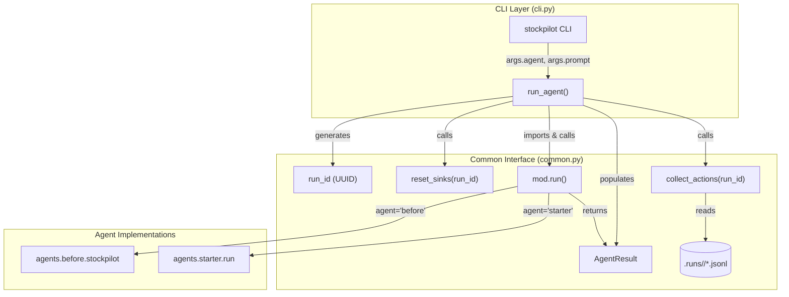
Sources: [agents/cli.py:8-21](), [agents/common.py:98-117]()

### The AgentResult Dataclass
All agent executions return an `AgentResult` object, which encapsulates the final output and execution telemetry [agents/common.py:21-30]().

| Field | Type | Description |
| :--- | :--- | :--- |
| `final_text` | `str` | The agent's terminal response to the user. |
| `actions` | `list[dict]` | Side effects captured from sinks (POs, notifications, ERP writes). |
| `turns` | `int` | Number of message exchanges between user and agent. |
| `tokens_in` | `int` | Total input tokens consumed. |
| `tokens_out` | `int` | Total output tokens generated. |
| `wall_ms` | `int` | Total execution time in milliseconds. |
| `error` | `str \| None` | Error message if the run failed. |

Sources: [agents/common.py:21-39]()

## Sink Isolation and Parallelism

To support parallel evaluation runs without data corruption, StockPilot uses "sink isolation." Each execution is assigned a unique `run_id` [agents/common.py:108-110]().

### Per-Run Directory Structure
Side effects (actions) are written to thread-local or environment-specific paths within `data/.runs/<run_id>/` [agents/common.py:57-61](). This ensures that if two agents are running the same task simultaneously, their Purchase Orders or ERP writes do not collide.

*   **Sinks tracked:** `purchase_orders.jsonl`, `outbox.jsonl`, `erp_writes.jsonl` [agents/common.py:44-44]().
*   **Collection:** After the agent finishes, `collect_actions()` reads these files and attaches them to the `AgentResult` [agents/common.py:90-95]().

Sources: [agents/common.py:40-95]()

## Evaluation Harness

The evaluation suite (run via `python -m evals.run`) automates the testing of agents against a 12-task suite defined in `tasks.yaml`.

### Evaluation Suite Components
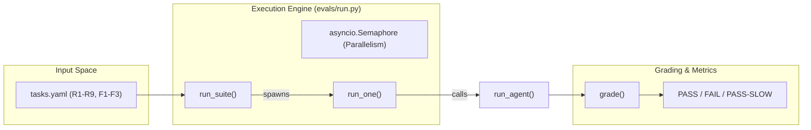
Sources: [evals/run.py:29-34](), [evals/run.py:51-81]()

### Task Categories
The suite consists of 12 tasks categorized by the type of logic required:
1.  **Reporting (R1-R9):** Tasks focused on data retrieval and aggregation (e.g., "Which SKU has the highest stock?").
2.  **Forecasting (F1-F3):** Complex tasks requiring trend analysis and inventory planning (e.g., "Will we run out of SKU-102 in the next 3 months?").

### Grading Logic and "PASS-SLOW"
The `grade()` function determines success based on task-specific criteria [evals/run.py:58-58]().
*   **PASS:** The agent provided the correct answer within the turn/token budget.
*   **FAIL:** The agent provided an incorrect answer or encountered a system error.
*   **PASS-SLOW:** The agent provided the correct answer but exceeded the "efficient" budget (defined in the grader), indicating suboptimal tool use [evals/run.py:23-23]().

The overall score is calculated as: `(PASS_count + 0.5 * SLOW_count) / Total_tasks` [evals/run.py:37-39]().

Sources: [evals/run.py:18-26](), [evals/run.py:37-39]()

## Reference Scores and Comparison

StockPilot maintains `reference_scores.json` to provide a baseline for both the `before` and `starter` agents [evals/reference_scores.json:1-4]().

### Comparing Agents
The `--compare` flag in the eval CLI allows developers to see the impact of decomposition [evals/run.py:148-149]().

| Metric | Goal for Decomposition |
| :--- | :--- |
| **Score** | Maintain or improve accuracy (target: 63%–75%) [evals/reference_scores.json:2-3](). |
| **Tokens** | Significant reduction (due to SHORT_PROMPT and subagents). |
| **Turns** | May increase slightly as the agent coordinates subagents. |
| **Wall Time** | May increase due to CMA session overhead and parallel subagent spawns. |

The CLI outputs a delta table showing transitions (e.g., `FAIL → PASS`) and the change in token consumption [evals/run.py:118-133]().

Sources: [evals/run.py:118-133](), [evals/reference_scores.json:1-5]()

---

# Page: Production-Ready Agent Workshop (Deal Desk)

# Production-Ready Agent Workshop (Deal Desk)

<details>
<summary>Relevant source files</summary>

The following files were used as context for generating this wiki page:

- [production-ready-agent/README.md](production-ready-agent/README.md)
- [production-ready-agent/bin/setup.sh](production-ready-agent/bin/setup.sh)

</details>


The **Deal Desk** workshop is a comprehensive exercise in building a production-grade, chat-first interface for a multi-agent M&A (Mergers and Acquisitions) research team. Participants use the **Claude Managed Agents (CMA)** API to orchestrate a sophisticated "Coordinator" agent that delegates research tasks to four specialized sub-agents.

The application is built with **Next.js** and features real-time event streaming, persistent memory, and integration with external tools via MCP and Vault.

## System Architecture

The workshop implements a hub-and-spoke multi-agent pattern. The **Coordinator Agent** (`deal-team`) acts as the primary interface for the user, utilizing a `multiagent` roster to spawn and manage sub-agents in parallel.

### Agent Roster
The team consists of five distinct agents defined in YAML configurations within the `seed/agents/` directory:

| Agent Name | Role | Source File |
| :--- | :--- | :--- |
| **Coordinator** | Orchestrates the research process and synthesizes the final investment thesis. | [production-ready-agent/seed/agents/deal-team.yaml:1-30]() |
| **Macro Trends** | Analyzes broad market conditions and industry tailwinds. | [production-ready-agent/seed/agents/macro-trends.yaml:1-15]() |
| **Financial Analyst** | Processes target company financials and historical performance. | [production-ready-agent/seed/agents/financial-analyst.yaml:1-15]() |
| **Competitive Positioning** | Evaluates market share, moats, and competitor landscapes. | [production-ready-agent/seed/agents/competitive-positioning.yaml:1-15]() |
| **Valuation Comps** | Performs relative valuation analysis against industry peers. | [production-ready-agent/seed/agents/valuation-comps.yaml:1-15]() |

### Resource Mapping
The following diagram bridges the logical agent roles to their physical resource IDs and provisioning logic.

**Figure 1: Deal Desk Entity Mapping**
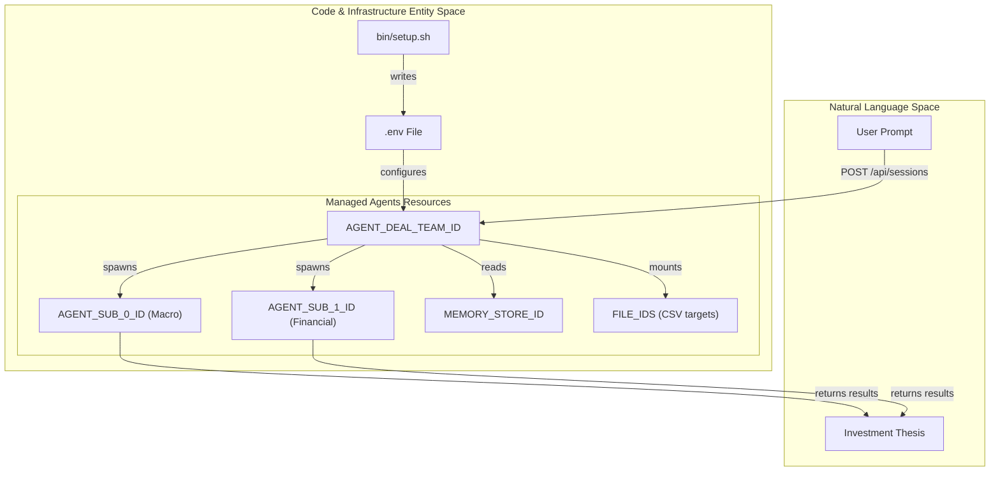
**Sources:** [production-ready-agent/bin/setup.sh:38-97](), [production-ready-agent/README.md:81-89]()

## Workshop Structure

The workshop is divided into a `starter/` and `solution/` directory. Both are identical Next.js applications, but the `starter/` app contains `TODO` stubs in the API route handlers that participants must implement to bring the agent to life.

### Key Implementation Tasks
1.  **Session Management**: Implementing `sessions.list`, `sessions.create`, and `sessions.delete`.
2.  **Interaction Loop**: Handling `user.message` and `user.define_outcome` via `sessions.events.send`.
3.  **Streaming**: Bridging the CMA `sessions.events.stream` to a Server-Sent Events (SSE) stream for the UI.
4.  **Human-in-the-loop**: Implementing `user.tool_confirmation` for gated tool calls.

For a detailed walkthrough of these API implementations, see **[Deal Desk: API Routes and Event Streaming](#4.1)**.

## Data and Provisioning

The workshop includes a robust provisioning system to ensure all participants have identical environments.

*   **Idempotent Setup**: The `bin/setup.sh` script handles the creation of the Environment, Memory Store, Files, and Agents, writing the resulting IDs back to a shared `.env` file [production-ready-agent/bin/setup.sh:13-36]().
*   **Seed Data**: The `seed/` directory contains fictional target company financials in CSV format and a memory store of "lessons learned" from prior (fictional) deals [production-ready-agent/seed/memories/:1-5]().
*   **Multi-Agent Evolution**: The workshop demonstrates how to update an agent's roster. The Coordinator is initially created without sub-agents (v1) and then upgraded to v2 via `bin/enable-multiagent.sh` [production-ready-agent/bin/setup.sh:59-67]().

For more information on the UI components and the provisioning logic, see **[Deal Desk: UI, Seed Data, and Provisioning](#4.2)**.

## Technical Components Overview

| Component | Responsibility | Key Files |
| :--- | :--- | :--- |
| **Event Reducer** | Converts raw CMA events into a UI-friendly chat history state. | `lib/chat.ts` |
| **SSE Encoder** | Manages the streaming connection between the server and the browser. | `lib/sse.ts` |
| **Sandbox** | Provides the execution environment where sub-agents process CSV data. | `seed/environments/research.yaml` |
| **Linear/MCP** | (Optional) Allows the agent to read issues from a real Linear team. | `bin/seed-linear.sh` |

**Sources:** [production-ready-agent/README.md:91-102](), [production-ready-agent/README.md:103-110]()

---

# Page: Deal Desk: API Routes and Event Streaming

# Deal Desk: API Routes and Event Streaming

<details>
<summary>Relevant source files</summary>

The following files were used as context for generating this wiki page:

- [production-ready-agent/solution/README.md](production-ready-agent/solution/README.md)
- [production-ready-agent/solution/lib/anthropic.ts](production-ready-agent/solution/lib/anthropic.ts)
- [production-ready-agent/starter/README.md](production-ready-agent/starter/README.md)
- [production-ready-agent/starter/lib/anthropic.ts](production-ready-agent/starter/lib/anthropic.ts)

</details>


This page provides a technical walkthrough of the Deal Desk backend architecture, focusing on the seven core API routes that interface with the Claude Managed Agents (CMA) platform. It covers session lifecycle management, the Server-Sent Events (SSE) streaming pipeline, and the transformation of raw agent events into a structured chat UI.

## API Architecture Overview

The Deal Desk application uses a Next.js App Router backend to proxy requests to the Anthropic SDK. The backend is organized into functional routes that handle session orchestration, steering (sending messages), and real-time event streaming.

### Natural Language to Code Entity Mapping

The following diagram bridges the conceptual "Deal Desk" workspace to the specific code entities and API routes defined in the repository.

**Diagram: Deal Desk System Mapping**
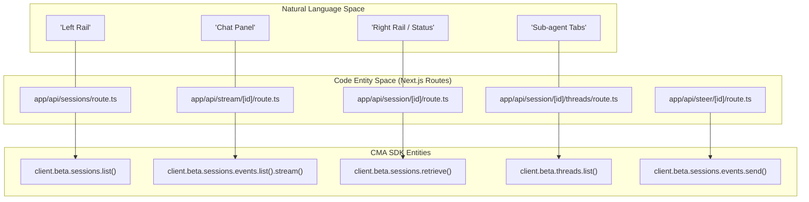
Sources: [production-ready-agent/solution/README.md:13-26](), [production-ready-agent/starter/README.md:47-102]()

---

## Core Route Handlers (The Seven TODOs)

The workshop tasks involve implementing seven specific route handlers to enable full agent functionality.

### 1. Session Orchestration (`sessions.list` & `sessions.create`)
Located in `app/api/sessions/route.ts`, these handlers manage the high-level session lifecycle.

*   **List**: Fetches the 30 most recent sessions for the UI sidebar using `client.beta.sessions.list({ limit: 30 })` [production-ready-agent/starter/README.md:49-52]().
*   **Create**: Initializes a new Managed Agent session. This is the most complex call, requiring the integration of several resource IDs [production-ready-agent/starter/README.md:54-59]():
    *   `agent_id`: Set to `ids.agent` [production-ready-agent/starter/README.md:67-69]().
    *   `environment_id`: Set to `ids.environment` [production-ready-agent/starter/README.md:31-31]().
    *   `resources`: A collection including `memory_store` (if enabled) and `file` mounts for target CSV data [production-ready-agent/starter/README.md:61-64]().
    *   `vault_ids`: Included if MCP credentials are required [production-ready-agent/starter/README.md:65-65]().

### 2. Steering and Interaction (`events.send`)
Interaction with a running session occurs through the `events.send` method.

*   **User Messages**: Sent via `app/api/steer/[id]/route.ts`. The first `user.message` transitions a session from `idle` to `running` [production-ready-agent/starter/README.md:71-77]().
*   **Outcome Definition**: Users can define a "success rubric" using `user.define_outcome`. This triggers the CMA grader to emit `agent.outcome_evaluated` events [production-ready-agent/starter/README.md:75-77]().
*   **Tool Confirmation**: Located in `app/api/confirm/[id]/route.ts`. This handles `user.tool_confirmation` for tools protected by an `always_ask` policy [production-ready-agent/starter/README.md:93-97]().

### 3. Status and Deletion (`sessions.retrieve` & `sessions.delete`)
Located in `app/api/session/[id]/route.ts`.

*   **Retrieve**: Polled by the UI to update the session status, tool definitions, and outcome evaluations [production-ready-agent/starter/README.md:79-83]().
*   **Delete**: Permanently removes the session resource [production-ready-agent/starter/README.md:99-102]().

Sources: [production-ready-agent/starter/README.md:47-102](), [production-ready-agent/starter/lib/anthropic.ts:27-35]()

---

## Event Streaming and SSE Pipeline

Real-time updates are delivered via Server-Sent Events (SSE). The application bridges the Anthropic `stream()` API to a standard web `ReadableStream`.

### Streaming Flow
The stream route (`app/api/stream/[id]/route.ts`) utilizes a specialized SSE encoder in `lib/sse.ts` to handle protocol framing and event deduplication.

**Diagram: Event Streaming Pipeline**
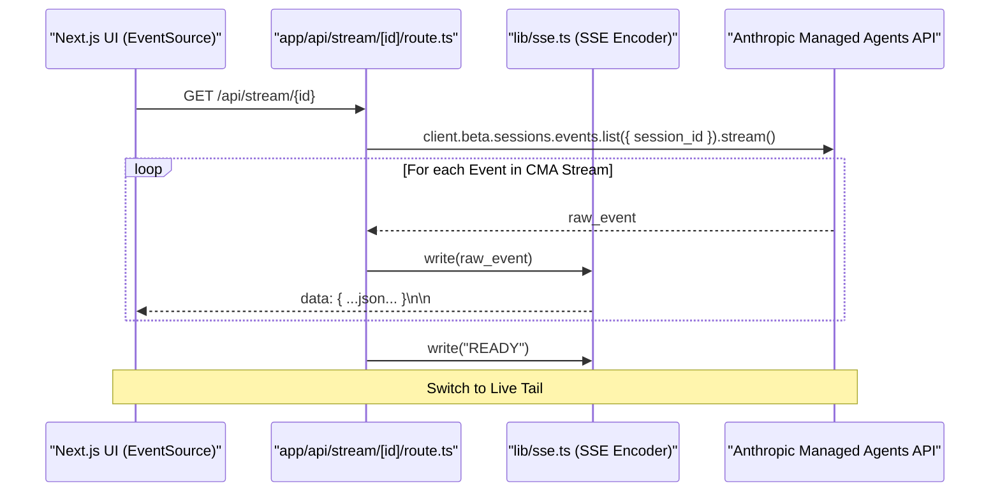
Sources: [production-ready-agent/solution/README.md:19-21](), [production-ready-agent/starter/README.md:85-91]()

### Per-Thread Sub-Agent Streams
When multi-agent mode is enabled, the coordinator agent spawns sub-agents in separate threads. The UI discovers these via `app/api/session/[id]/threads/route.ts` [production-ready-agent/solution/README.md:24-24](). Each thread has its own dedicated SSE endpoint at `app/api/stream/[id]/thread/[threadId]/route.ts`, which follows the same streaming logic as the main session [production-ready-agent/solution/README.md:20-20]().

---

## Data Transformation: Event to Chat

Raw events from the CMA API are not directly renderable as a chat history. The application uses a reducer pattern in `lib/chat.ts` to transform the stream of events into a coherent list of chat messages.

| Event Type | Chat Transformation |
| --- | --- |
| `user.message` | Added as a "user" bubble. |
| `agent.message` | Added as an "assistant" bubble. |
| `agent.tool_call` | Rendered as a pending or completed tool execution block. |
| `agent.outcome_evaluated` | Rendered as the final "Thesis" or graded result. |

Sources: [production-ready-agent/solution/README.md:25-25](), [production-ready-agent/starter/README.md:75-77]()

---

## Environment and Client Configuration

The application initializes the `Anthropic` client using IDs and keys managed in `lib/anthropic.ts`.

*   **API Key Management**: The client reads from a local `.env` file, prioritizing it over shell-exported variables to prevent environment shadowing [production-ready-agent/starter/lib/anthropic.ts:5-20]().
*   **Resource IDs**: The `ids` object exports critical identifiers for the Agent, Environment, Memory Store, and Vault, which are populated during the `bin/setup.sh` provisioning process [production-ready-agent/starter/lib/anthropic.ts:29-35]().

Sources: [production-ready-agent/starter/lib/anthropic.ts:1-35]()

---

# Page: Deal Desk: UI, Seed Data, and Provisioning

# 4.2 Deal Desk: UI, Seed Data, and Provisioning

<details>
<summary>Relevant source files</summary>

The following files were used as context for generating this wiki page:

- [production-ready-agent/.env.example](production-ready-agent/.env.example)
- [production-ready-agent/bin/setup.sh](production-ready-agent/bin/setup.sh)
- [production-ready-agent/solution/tailwind.config.ts](production-ready-agent/solution/tailwind.config.ts)
- [production-ready-agent/starter/tailwind.config.ts](production-ready-agent/starter/tailwind.config.ts)

</details>


This page details the frontend architecture, the idempotent provisioning system, and the static seed data that defines the multi-agent Deal Desk environment. The Deal Desk application is a Next.js-based research platform where a coordinator agent orchestrates four specialized sub-agents to perform M&A (Mergers and Acquisitions) due diligence.

## Provisioning and Setup

The Deal Desk environment is provisioned using a Bash-based orchestration script that interacts with the `ant` CLI. This process is designed to be idempotent, allowing developers to re-run the setup to update agent definitions without duplicating resources.

### Idempotent Resource Creation
The script `bin/setup.sh` manages the lifecycle of several Managed Agent resources:
1.  **Environments**: Creates a shared `research` environment defined in `seed/environments/research.yaml` [production-ready-agent/bin/setup.sh:38-45]().
2.  **Sub-Agents**: Iterates through specialized agent configurations (`macro-trends`, `financial-analyst`, `competitive-positioning`, `valuation-comps`) and uses an `upsert_agent` function to either update an existing agent or create a new one [production-ready-agent/bin/setup.sh:47-57]().
3.  **Coordinator Agent**: Provisions the primary "Deal Team" agent. It initially strips the `multiagent` block to ensure a clean state before the workshop participant enables multi-agent capabilities via `enable-multiagent.sh` [production-ready-agent/bin/setup.sh:59-67]().
4.  **Memory Stores**: Initializes a `deal-priors` memory store and populates it with Markdown files from `seed/memories/` [production-ready-agent/bin/setup.sh:69-84]().
5.  **Files**: Uploads target financial CSVs from `seed/targets/` to the Managed Agents Files API, making them available for agent analysis [production-ready-agent/bin/setup.sh:86-97]().

### Configuration Syncing
Once resources are provisioned, their unique IDs (e.g., `agent_...`, `env_...`, `memstore_...`) are written back to the root `.env` file and then synchronized into the `starter/` and `solution/` directories to ensure both environments are ready for local development [production-ready-agent/bin/setup.sh:99-105]().

**Resource Provisioning Flow**
```mermaid
graph TD
    subgraph "Local Environment"
        Setup["bin/setup.sh"] --> Env["Read .env"]
        Env --> Ant["ant CLI"]
    end

    subgraph "Managed Agents Infrastructure"
        Ant --> Agents["Agents API"]
        Ant --> Envs["Environments API"]
        Ant --> Mem["Memory Stores API"]
        Ant --> Files["Files API"]
    end

    Agents -.->|"Return IDs"| Setup
    Setup -->|".env Update"| Starter[".env (starter)"]
    Setup -->|".env Update"| Solution[".env (solution)"]
```
Sources: [production-ready-agent/bin/setup.sh:1-109](), [production-ready-agent/.env.example:1-25]()

## Seed Data and Configuration

The `seed/` directory contains the declarative definitions of the Deal Desk's knowledge and behavior.

### Agent Configurations
Agents are defined via YAML files that specify their `system_prompt`, `model`, and available tools.
*   **Specialized Sub-Agents**: Located in `seed/agents/`. Each sub-agent is focused on a specific domain (e.g., `financial-analyst.yaml` handles spreadsheet analysis) [production-ready-agent/bin/setup.sh:50-57]().
*   **Coordinator**: The `deal-team.yaml` acts as the orchestrator, delegating tasks to sub-agents [production-ready-agent/bin/setup.sh:64-65]().

### Data Assets
*   **Memory Store**: Markdown files in `seed/memories/` provide "lessons learned" from prior deals, which the agent can query to avoid repeating past mistakes [production-ready-agent/bin/setup.sh:76-81]().
*   **Target Financials**: CSV files in `seed/targets/` represent the raw data for analysis, such as `bridgewell.csv` or `norwood.csv` [production-ready-agent/bin/setup.sh:89-94]().

| Resource Type | Source Path | Managed Agent Entity |
| :--- | :--- | :--- |
| Agent Configs | `seed/agents/*.yaml` | `Agent` |
| Environment | `seed/environments/research.yaml` | `Environment` |
| Past Lessons | `seed/memories/*.md` | `MemoryStore` |
| Raw Data | `seed/targets/*.csv` | `File` |

Sources: [production-ready-agent/bin/setup.sh:38-97]()

## UI Architecture and Design System

The Deal Desk UI is built with Next.js and styled using a custom Tailwind CSS configuration designed to look like professional financial research software.

### Tailwind Configuration
The design system extends the default Tailwind palette with specific semantic colors and custom font families:
*   **Colors**: Includes `teal`, `violet`, and `lavender` for agent-specific branding, alongside standard `primary` and `accent` HSL variables [production-ready-agent/solution/tailwind.config.ts:9-28]().
*   **Typography**: Uses `General Sans` for the UI, `Fraunces` (serif) for editorial-style headers, and `JetBrains Mono` for data and code [production-ready-agent/solution/tailwind.config.ts:29-33]().
*   **Shadows**: Custom `paper` and `paper-lg` shadows are used to create a layered, document-centric aesthetic [production-ready-agent/solution/tailwind.config.ts:39-44]().

### Key UI Components
*   **ChatPanel**: The primary interface for interacting with the Coordinator Agent. It handles the display of the message stream and the rendering of tool calls.
*   **SessionRail**: A sidebar component that manages the list of active research sessions and allows users to switch between different deal threads.
*   **Agent Visuals**: The UI uses the custom color palette to visually distinguish between different sub-agents when they are contributing to a thread.

**UI Style to Code Mapping**
```mermaid
graph LR
    subgraph "Tailwind Config"
        BG["hsl(var(--background))"]
        Sans["General Sans"]
        Paper["boxShadow: paper"]
    end

    subgraph "React Components"
        CP["ChatPanel"]
        SR["SessionRail"]
    end

    CP --> BG
    CP --> Sans
    SR --> Paper
```
Sources: [production-ready-agent/solution/tailwind.config.ts:1-49](), [production-ready-agent/starter/tailwind.config.ts:1-49]()

## Multi-Agent Activation

The workshop includes a specific script, `bin/enable-multiagent.sh`, which is used to transition the coordinator agent from a single-agent mode to a multi-agent mode. 

1.  **Version Control**: The `setup.sh` script creates the agent at `v1` without sub-agents [production-ready-agent/bin/setup.sh:60-63]().
2.  **Roster Attachment**: `enable-multiagent.sh` (referenced in comments) updates the agent definition to include the `multiagent` roster, creating `v2` [production-ready-agent/bin/setup.sh:60-63]().
3.  **Routing**: Once enabled, the coordinator can use the `spawn_subagent` tool (or similar) to delegate work to the IDs stored in `AGENT_SUB_IDS` [production-ready-agent/.env.example:10]().

Sources: [production-ready-agent/bin/setup.sh:59-68](), [production-ready-agent/.env.example:5-10]()

---

# Page: Eval-Driven Agent Development Workshop

# Eval-Driven Agent Development Workshop

<details>
<summary>Relevant source files</summary>

The following files were used as context for generating this wiki page:

- [eval-driven-agent-development/CLAUDE.md](eval-driven-agent-development/CLAUDE.md)
- [eval-driven-agent-development/README.md](eval-driven-agent-development/README.md)

</details>


The **Eval-Driven Agent Development Workshop** is a hands-on guide to building and optimizing a **Claude Managed Agent (CMA)** capable of generating professional PowerPoint presentations (`.pptx`). The core philosophy of the workshop is that agentic behavior should not be tuned by "vibes," but by a rigorous, two-layer evaluation system that measures every iteration of the agent's system prompt and toolset.

Participants progress through six evolutionary stages of the agent—from a "naive" baseline to a sophisticated version with visual awareness and a self-correction QA loop—while using a programmatic and LLM-based grader to quantify improvements in layout, typography, and content coherence.

## Workshop Architecture

The workshop environment consists of a local TypeScript runner that orchestrates cloud-based Managed Agent sessions and a local Dockerized rendering engine for visual evaluation.

### Component Relationship
The following diagram illustrates how the local eval runner interacts with the Claude Managed Agents infrastructure and the local grading tools.

**CMA Eval-Driven Development Flow**
```mermaid
graph TD
    subgraph "Local Environment"
        [eval-runner.ts] --> [create-slides.ts]
        [eval-runner.ts] --> [render.ts]
        [eval-runner.ts] --> [graders.ts]
        [render.ts] --> ["Docker (cwc-pptx-render)"]
        [graders.ts] --> [parse-pptx.ts]
    end

    subgraph "Anthropic Cloud (CMA)"
        [create-slides.ts] -- "ant beta:agents" --> ["Agent (agent.yaml)"]
        ["Agent (agent.yaml)"] -- "Executes" --> ["Environment (environment.yaml)"]
        ["Environment (environment.yaml)"] -- "Produces" --> [presentation.pptx]
    end

    [presentation.pptx] -- "Download" --> [eval-runner.ts]
    ["Docker (cwc-pptx-render)"] -- "Output" --> [slide-JPGs]
    [slide-JPGs] -- "Visual Check" --> [graders.ts]
```
Sources: [eval-driven-agent-development/README.md:71-85](), [eval-driven-agent-development/CLAUDE.md:13-17]()

## Agent Iteration Path

The workshop guides developers through six specific variants of the agent, located in `resources/agents/` (and the `solutions/` directory). Each step addresses a specific failure mode identified by the evaluation harness.

| Variant | Focus | Key Change |
| :--- | :--- | :--- |
| **00-naive** | Baseline | Basic prompt to generate a `.pptx` file. |
| **01-visual** | Visuals | Adding image generation or placeholder logic. |
| **02-typography** | Design | Constraining font sizes and families for readability. |
| **03-palette** | Branding | Enforcing color schemes and professional themes. |
| **04-density** | Layout | Preventing "wall of text" slides via structural constraints. |
| **05-qa-loop** | Reliability | Implementing a multi-turn self-correction step. |

For details on how these agents are configured and deployed, see [PPTX Workshop: Agent Pipeline and Tooling](#5.2).

Sources: [eval-driven-agent-development/README.md:74-76](), [eval-driven-agent-development/CLAUDE.md:13-14]()

## The Two-Layer Grader System

To move beyond manual inspection, the workshop utilizes a robust grading system defined in `src/graders.ts`. This system combines two distinct approaches to ensure the generated slide decks meet both structural and aesthetic requirements:

1.  **Programmatic Graders**: Use `parse-pptx.ts` to extract raw XML data from the `.pptx` file. They check for objective metrics like slide count, font sizes, and text density.
2.  **LLM-as-Judge Graders**: Use Claude to inspect JPG renders of the slides (generated via a Dockerized LibreOffice instance in `render.ts`). These graders evaluate subjective qualities like color harmony, image relevance, and title-body coherence.

For a deep dive into the grading logic and how to add custom metrics, see [PPTX Workshop: Grader System](#5.1).

Sources: [eval-driven-agent-development/src/graders.ts:1-20](), [eval-driven-agent-development/README.md:60-65]()

## Core Workflow

The development cycle is driven by the `ant` CLI and a set of `npm` scripts that automate the "Build -> Run -> Grade" loop.

### Command Reference
| Action | Command | File Reference |
| :--- | :--- | :--- |
| **Provision Agent** | `ant beta:agents create < resources/agent.yaml` | [CLAUDE.md:21-25]() |
| **Run Agent** | `npm run create-slides -- <task_name>` | [src/create-slides.ts]() |
| **Render Slides** | `npm run render -- <task_name>` | [src/render.ts]() |
| **Evaluate** | `npm run eval -- <task_name>` | [src/eval-runner.ts]() |
| **Set Baseline** | `npm run eval -- --all --baseline` | [README.md:64-65]() |

### Data Mapping: Code Entities to Workshop Concepts
This diagram maps the conceptual "Natural Language" requirements to the specific TypeScript files and CLI resources that implement them.

**Code Entity Mapping**
```mermaid
graph LR
    subgraph "Natural Language Space"
        A["'Create a slide deck'"]
        B["'Is the font too small?'"]
        C["'Does it look professional?'"]
    end

    subgraph "Code Entity Space"
        A --> [tasks.json]
        A --> [create-slides.ts]
        B --> [parse-pptx.ts]
        B --> [graders.ts]
        C --> [render.ts]
        C --> [graders.ts]
    end

    subgraph "CMA Resource Space"
        [agent.yaml] -- "Defines" --> [AgentResource]
        [environment.yaml] -- "Defines" --> [EnvResource]
    end

    [create-slides.ts] -- "Uses" --> [AgentResource]
```
Sources: [eval-driven-agent-development/README.md:71-85](), [eval-driven-agent-development/CLAUDE.md:19-39]()

---

# Page: PPTX Workshop: Grader System

# PPTX Workshop: Grader System

<details>
<summary>Relevant source files</summary>

The following files were used as context for generating this wiki page:

- [eval-driven-agent-development/src/graders.ts](eval-driven-agent-development/src/graders.ts)
- [eval-driven-agent-development/src/graders/all.ts](eval-driven-agent-development/src/graders/all.ts)
- [eval-driven-agent-development/src/graders/code/cluttered-slides.ts](eval-driven-agent-development/src/graders/code/cluttered-slides.ts)
- [eval-driven-agent-development/src/graders/code/emoji-count.ts](eval-driven-agent-development/src/graders/code/emoji-count.ts)
- [eval-driven-agent-development/src/graders/code/produced-result.ts](eval-driven-agent-development/src/graders/code/produced-result.ts)
- [eval-driven-agent-development/src/graders/code/slide-count.ts](eval-driven-agent-development/src/graders/code/slide-count.ts)
- [eval-driven-agent-development/src/graders/code/slides-with-image.ts](eval-driven-agent-development/src/graders/code/slides-with-image.ts)
- [eval-driven-agent-development/src/graders/code/small-font-slides.ts](eval-driven-agent-development/src/graders/code/small-font-slides.ts)
- [eval-driven-agent-development/src/graders/code/text-heavy-slides.ts](eval-driven-agent-development/src/graders/code/text-heavy-slides.ts)
- [eval-driven-agent-development/src/graders/judge/color-judge.ts](eval-driven-agent-development/src/graders/judge/color-judge.ts)
- [eval-driven-agent-development/src/graders/judge/image-judge.ts](eval-driven-agent-development/src/graders/judge/image-judge.ts)
- [eval-driven-agent-development/src/graders/judge/judge.ts](eval-driven-agent-development/src/graders/judge/judge.ts)
- [eval-driven-agent-development/src/graders/judge/layout-judge.ts](eval-driven-agent-development/src/graders/judge/layout-judge.ts)
- [eval-driven-agent-development/src/graders/judge/text-judge.ts](eval-driven-agent-development/src/graders/judge/text-judge.ts)
- [eval-driven-agent-development/src/graders/judge/title-body-coherence-judge.ts](eval-driven-agent-development/src/graders/judge/title-body-coherence-judge.ts)
- [eval-driven-agent-development/src/graders/types.ts](eval-driven-agent-development/src/graders/types.ts)

</details>


The PPTX Workshop utilizes a two-layer grader architecture to evaluate the quality of generated slide decks. This system combines deterministic **Code Graders**, which extract structural metrics directly from the `.pptx` XML, and **LLM-as-Judge Graders**, which use vision-capable models to assess aesthetic and semantic qualities.

## Grader Architecture Overview

The system is designed to provide a comprehensive scorecard for every agent run. The evaluation pipeline follows a "Prepare-then-Grade" pattern: the harness first processes the raw `.pptx` file into a `GraderContext`, which is then passed to a collection of independent `Grader` objects.

### Data Flow and Lifecycle

1.  **Artifact Generation**: The agent produces a `.pptx` file.
2.  **Context Preparation**: The harness parses the PPTX structure and renders slides into JPG images via LibreOffice.
3.  **Grader Execution**: The `GraderContext` is passed to all registered graders in `GRADERS` [eval-driven-agent-development/src/graders.ts:19-36]().
4.  **Result Aggregation**: Scores are collected into a scorecard for the leaderboard.

### System Entity Mapping: Grader Logic to Code
The following diagram maps the conceptual grading requirements to the specific TypeScript entities that implement them.

**Grader Implementation Map**
```mermaid
graph TD
    subgraph "Natural Language Requirements"
        R1["Verify file exists"]
        R2["Check slide count"]
        R3["Detect wall-of-text"]
        R4["Evaluate visual layout"]
        R5["Check color contrast"]
    end

    subgraph "Code Entity Space (graders.ts)"
        G1["producedResult"]
        G2["slideCount"]
        G3["textHeavySlides"]
        G4["layoutJudge"]
        G5["colorJudge"]
    end

    subgraph "Execution Context (types.ts)"
        CTX["GraderContext"]
        PP["parsedPptx"]
        JPG["jpgPaths"]
    end

    R1 --> G1
    R2 --> G2
    R3 --> G3
    R4 --> G4
    R5 --> G5

    G1 & G2 & G3 --> PP
    G4 & G5 --> JPG
    PP & JPG --> CTX
```
Sources: [eval-driven-agent-development/src/graders/all.ts:20-37](), [eval-driven-agent-development/src/graders/types.ts:1-20]()

---

## Programmatic Code Graders

Code graders are deterministic functions that inspect the `parsedPptx` object. They are used for objective metrics like element counts, font sizes, and file validity.

| Grader Name | Implementation | Logic Description |
| :--- | :--- | :--- |
| **Produced result** | `producedResult` | Checks `exists` and `validZip` flags [eval-driven-agent-development/src/graders/code/produced-result.ts:10-19](). |
| **Slide count** | `slideCount` | Returns `ctx.parsedPptx.slideCount` against a target of 5 [eval-driven-agent-development/src/graders/code/slide-count.ts:12-14](). |
| **Emoji count** | `emojiCount` | Aggregates `s.emojiCount` across all slides [eval-driven-agent-development/src/graders/code/emoji-count.ts:11-13](). |
| **Cluttered slides** | `clutteredSlides` | Counts slides where `shapeCount > 20` [eval-driven-agent-development/src/graders/code/cluttered-slides.ts:11-13](). |
| **Small-font slides** | `smallFontSlides` | Filters slides where any `fontSizesPt < 14` [eval-driven-agent-development/src/graders/code/small-font-slides.ts:11-15](). |
| **Text-heavy slides** | `textHeavySlides` | Counts slides where `textChars > 300` [eval-driven-agent-development/src/graders/code/text-heavy-slides.ts:11-13](). |
| **Slides with image** | `slidesWithImage` | Calculates the ratio of slides containing at least one picture [eval-driven-agent-development/src/graders/code/slides-with-image.ts:12-17](). |

Sources: [eval-driven-agent-development/src/graders/all.ts:20-28](), [eval-driven-agent-development/src/graders/code/produced-result.ts:6-20](), [eval-driven-agent-development/src/graders/code/slide-count.ts:6-15]()

---

## LLM-as-Judge Graders

Aesthetic and qualitative metrics are handled by `claude-opus-4-7` via vision analysis. To optimize cost and latency, the system uses a **memoized batching strategy**.

### The `judgeAll` Pipeline
Instead of each judge (Color, Layout, Text) making its own API call, the `judgeAll` function [eval-driven-agent-development/src/graders/judge/judge.ts:50-59]() is memoized. The first judge to execute triggers a vision call for every slide in the deck. Subsequent judges read from this cached result.

**Vision Grading Data Flow**
```mermaid
sequenceDiagram
    participant H as Eval Runner
    participant J as judgeAll (Memoized)
    participant C as Claude Opus (Vision)
    participant G as Specific Grader (e.g. colorJudge)

    H->>G: grade(ctx)
    G->>J: judgeAll(ctx)
    Note over J: First call for this deck
    J->>C: messages.parse (Image + Rubric)
    C-->>J: JudgeScoresPerSlide[]
    J-->>G: JudgeScoresPerSlide[]
    G->>G: avg(scores.map(s => s.color))
    
    H->>G: grade(ctx) (next judge)
    G->>J: judgeAll(ctx)
    Note over J: Returns cached scores
    J-->>G: JudgeScoresPerSlide[]
```
Sources: [eval-driven-agent-development/src/graders/judge/judge.ts:50-125](), [eval-driven-agent-development/src/graders/judge/color-judge.ts:13-16]()

### Grading Rubrics
The vision judge uses `zodOutputFormat` to ensure structured responses [eval-driven-agent-development/src/graders/judge/judge.ts:89-97](). The prompt instructs the model to score four criteria on a 0-5 scale:
1.  **Text**: Clarity, conciseness, and font consistency [eval-driven-agent-development/src/graders/judge/judge.ts:79]().
2.  **Image**: Quality and proportion [eval-driven-agent-development/src/graders/judge/judge.ts:81]().
3.  **Layout**: Alignment, margins, and lack of overlap [eval-driven-agent-development/src/graders/judge/judge.ts:83]().
4.  **Color**: Contrast and readability [eval-driven-agent-development/src/graders/judge/judge.ts:85]().

Sources: [eval-driven-agent-development/src/graders/judge/judge.ts:19-43](), [eval-driven-agent-development/src/graders/judge/judge.ts:77-87]()

---

## Extending the Grader System

To add a new metric, a developer must implement the `Grader` interface and register it in the central list.

### 1. The Grader Interface
Every grader must define its `kind` (code vs judge), a `grade` method, and optional `scale` metadata for color-coding the UI.

```typescript
export interface Grader {
    name: string;
    kind: "code" | "judge";
    description: string;
    scale?: { min: number; max: number; good: number | "high" | "low" };
    format?: (val: any) => string;
    grade: (ctx: GraderContext) => Promise<number | string>;
}
```
Sources: [eval-driven-agent-development/src/graders/types.ts:7-14]()

### 2. Registration
New graders are added to `allCodeGraders` or `allModelJudgeEvals` in `src/graders/all.ts` [eval-driven-agent-development/src/graders/all.ts:20-37](). This automatically includes them in the evaluation runner and the final scorecard output.

Sources: [eval-driven-agent-development/src/graders/all.ts:1-38](), [eval-driven-agent-development/src/graders.ts:1-36]()

---

# Page: PPTX Workshop: Agent Pipeline and Tooling

# PPTX Workshop: Agent Pipeline and Tooling

<details>
<summary>Relevant source files</summary>

The following files were used as context for generating this wiki page:

- [eval-driven-agent-development/package.json](eval-driven-agent-development/package.json)
- [eval-driven-agent-development/resources/workshop-pptx.environment.yaml](eval-driven-agent-development/resources/workshop-pptx.environment.yaml)
- [eval-driven-agent-development/src/batch.ts](eval-driven-agent-development/src/batch.ts)
- [eval-driven-agent-development/src/create-slides.ts](eval-driven-agent-development/src/create-slides.ts)
- [eval-driven-agent-development/src/eval-runner.ts](eval-driven-agent-development/src/eval-runner.ts)
- [eval-driven-agent-development/src/lib.ts](eval-driven-agent-development/src/lib.ts)
- [eval-driven-agent-development/src/parse-pptx.ts](eval-driven-agent-development/src/parse-pptx.ts)
- [eval-driven-agent-development/src/render.ts](eval-driven-agent-development/src/render.ts)
- [eval-driven-agent-development/tasks.json](eval-driven-agent-development/tasks.json)

</details>


This page details the technical infrastructure and execution pipeline for the PPTX Workshop. It covers the lifecycle of a slide-generation session, the structural extraction of metrics from OOXML, and the rendering of slide artifacts for visual evaluation.

## Pipeline Overview

The agent pipeline bridges the gap between natural language prompts and verifiable slide artifacts. It utilizes the **Claude Managed Agents (CMA)** API to execute agent logic within a sandboxed environment, then pulls the results into a local processing pipeline for grading.

### Agent Execution and Data Flow

The following diagram illustrates the flow from a task definition to a rendered, graded artifact.

**Slide Generation Pipeline**
```mermaid
graph TD
    subgraph "Local Workspace"
        [tasks.json] -- "selectTasks()" --> Runner["create-slides.ts"]
        Runner -- "fs.writeFile()" --> SessionRecord["session.json"]
        Runner -- "client.beta.files.download()" --> Artifacts["output.pptx"]
    end

    subgraph "Claude Managed Agents (CMA)"
        Agent["Agent Resource"] -- "instantiates" --> Session["Session"]
        Env["workshop-pptx.environment.yaml"] -- "provisions" --> Sandbox["Sandbox Container"]
        Session -- "executes in" --> Sandbox
        Sandbox -- "python-pptx" --> Output[".pptx File"]
    end

    Runner -- "client.beta.sessions.create()" --> Session
    Runner -- "events.stream()" --> Session
    Output -- "Files API" --> Runner
```
**Sources:** `eval-driven-agent-development/src/create-slides.ts:40-154`(), `eval-driven-agent-development/src/lib.ts:29-45`(), `eval-driven-agent-development/resources/workshop-pptx.environment.yaml:1-12`()

---

## Core Components

### 1. Session Runner (`create-slides.ts`)
The `create-slides.ts` script is the primary entry point for executing agent tasks. It manages the full lifecycle of a CMA session:
*   **Initialization**: Creates a session using a pre-configured `AGENT_ID` and `ENVIRONMENT_ID` [eval-driven-agent-development/src/create-slides.ts:40-44]().
*   **Streaming**: Opens an SSE stream via `client.beta.sessions.events.stream()` before sending the user message to ensure no initial thinking or tool events are missed [eval-driven-agent-development/src/create-slides.ts:58-66]().
*   **Event Handling**: Consumes the stream, logging `agent.message` content and `agent.tool_use` indicators until the session reaches `session.status_idle` with a valid stop reason [eval-driven-agent-development/src/create-slides.ts:72-102]().
*   **Artifact Retrieval**: Uses `p-retry` to poll the Files API, accounting for the indexing lag after a session completes [eval-driven-agent-development/src/create-slides.ts:107-119]().

### 2. Structural Parser (`parse-pptx.ts`)
The `parsePptx` function extracts objective metrics from the `.pptx` file without using LLMs. It treats the file as a zip archive and parses the underlying XML [eval-driven-agent-development/src/parse-pptx.ts:67-118]().

| Entity | Implementation Detail |
| :--- | :--- |
| **Archive Handling** | Uses `JSZip` to extract `ppt/slides/slideN.xml` files [eval-driven-agent-development/src/parse-pptx.ts:81-90](). |
| **XML Parsing** | Uses `fast-xml-parser` with attribute preservation (`@_` prefix) to access font sizes and placeholder types [eval-driven-agent-development/src/parse-pptx.ts:95-98](). |
| **Shape Analysis** | Counts `p:sp`, `p:pic`, `p:graphicFrame`, `p:grpSp`, and `p:cxnSp` elements [eval-driven-agent-development/src/parse-pptx.ts:130-136](). |
| **Text Extraction** | Recursively walks DrawingML text runs (`a:r`) to collect literal text (`a:t`) and font sizes (`a:rPr@sz`) [eval-driven-agent-development/src/parse-pptx.ts:186-200](). |

**Sources:** `eval-driven-agent-development/src/parse-pptx.ts:15-55`(), `eval-driven-agent-development/src/parse-pptx.ts:124-158`()

### 3. Visual Renderer (`render.ts`)
To support vision-based grading, `render.ts` converts the agent's PPTX output into high-resolution JPGs.
*   **Docker Integration**: Spawns a container using the `cwc-pptx-render` image [eval-driven-agent-development/src/render.ts:19-21]().
*   **Conversion Pipeline**: Executes a two-step shell command inside the container:
    1.  `soffice` (LibreOffice) converts `.pptx` to `.pdf` [eval-driven-agent-development/src/render.ts:49]().
    2.  `pdftoppm` (Poppler) rasterizes the PDF into one JPG per slide at 120 DPI [eval-driven-agent-development/src/render.ts:49]().
*   **Ordering**: Sorts output files using numeric collation (e.g., `slide-10.jpg` follows `slide-9.jpg`) [eval-driven-agent-development/src/render.ts:57-62]().

**Sources:** `eval-driven-agent-development/src/render.ts:38-53`()

---

## Batch Execution and Environment

### Batch Runner (`batch.ts`)
For large-scale evaluations across multiple agent variants, `batch.ts` performs a full sweep.
*   **Sequential Rounds**: Runs agent variants (e.g., `00-naive` through `04-model-swap`) one after another [eval-driven-agent-development/src/batch.ts:23-29]().
*   **Parallel Tasks**: Within a round, it executes all tasks from `tasks.json` in parallel [eval-driven-agent-development/src/batch.ts:96-98]().
*   **Resume Support**: Checks for existing `output.pptx` files on disk to skip already-completed runs if the process is interrupted [eval-driven-agent-development/src/batch.ts:38-42]().

### Environment Configuration
The agent's runtime environment is defined in `workshop-pptx.environment.yaml`.
*   **System Packages**: Provisions `libreoffice` and `poppler-utils` for the agent to potentially use for its own verification [eval-driven-agent-development/resources/workshop-pptx.environment.yaml:7-9]().
*   **Python Libraries**: Installs `python-pptx` to enable programmatic slide generation [eval-driven-agent-development/resources/workshop-pptx.environment.yaml:10-11]().

**Sources:** `eval-driven-agent-development/src/batch.ts:5-12`(), `eval-driven-agent-development/resources/workshop-pptx.environment.yaml:1-12`()

---

## Workflow Integration

The workshop uses the `ant` CLI for resource management and `tsx` for local execution.

**Agent Resource Management**
```mermaid
graph LR
    YAML["workshop-pptx.agent.yaml"] -- "ant beta:agents update" --> CMA["CMA Agent Resource"]
    ENV_YAML["workshop-pptx.environment.yaml"] -- "ant beta:environments create" --> CMA_ENV["CMA Environment"]
    CMA_ENV -- "ID used in" --> Runner["create-slides.ts"]
    CMA -- "ID used in" --> Runner
```
**Sources:** `eval-driven-agent-development/src/create-slides.ts:16-20`(), `eval-driven-agent-development/package.json:7-12`()

### Utility Scripts (`lib.ts`)
The `lib.ts` file provides shared utilities for the pipeline:
*   **Task Selection**: `selectTasks` resolves task IDs from CLI arguments or the `--all` flag, validating them against `tasks.json` [eval-driven-agent-development/src/lib.ts:29-45]().
*   **Path Resolution**: Defines `ROOT` and `RUNS_DIR` to ensure consistent file IO across different scripts [eval-driven-agent-development/src/lib.ts:8-12]().

**Sources:** `eval-driven-agent-development/src/lib.ts:1-46`(), `eval-driven-agent-development/tasks.json:1-8`()

---

# Page: Ship Your First Managed Agent Workshop

# Ship Your First Managed Agent Workshop

<details>
<summary>Relevant source files</summary>

The following files were used as context for generating this wiki page:

- [README.md](README.md)

</details>


The **Ship Your First Managed Agent** workshop is a hands-on introduction to the Claude Managed Agents (CMA) platform. Participants take on the role of a Site Reliability Engineer (SRE) tasked with resolving "Incident-2277." The workshop provides a pre-built Streamlit dashboard that is initially "offline." To restore service, participants must implement seven core functions in `agent.py` that interface with the Managed Agents API to create resources, manage sandboxed environments, and stream agent responses.

By the end of the workshop, the SRE Agent is capable of grepping through a 70,000-line log file within its secure sandbox, executing custom tools to query local metrics, and identifying the specific commit that caused a production regression [README.md:15-15]().

### Core Managed Agents Resources
The workshop centers on the four primary resources of the Managed Agents lifecycle:
1.  **Agent**: The persistent configuration, including the system prompt and model selection.
2.  **Environment**: The sandboxed execution space where files (like logs) are stored and code is executed.
3.  **Session**: A stateful interaction instance that binds an Agent to an Environment.
4.  **Events**: The streaming communication channel for messages, tool calls, and results.

### System Architecture

The following diagram illustrates how the workshop's Python entities map to the Managed Agents infrastructure.

**SRE Agent System Mapping**
```mermaid
graph TD
    subgraph "Local Workspace (Natural Language Space)"
        "Dashboard UI [app.py]" -- "User Query" --> "Agent Orchestrator [agent.py]"
        "Agent Orchestrator [agent.py]" -- "Local Data" --> "Incident Fixtures [data/]"
    end

    subgraph "Claude Managed Agents (Code Entity Space)"
        "Agent Orchestrator [agent.py]" -- "setup_agent()" --> "Agent Resource"
        "Agent Orchestrator [agent.py]" -- "setup_environment()" --> "Environment Resource"
        "Agent Orchestrator [agent.py]" -- "start_session()" --> "Session Resource"
        "Session Resource" -- "stream_reply()" --> "Events Stream"
    end

    subgraph "Sandboxed Execution"
        "Environment Resource" -- "upload_log()" --> "File System [/home/user/]"
        "Events Stream" -- "handle_tool()" --> "Custom Tool Execution"
    end
```
Sources: [README.md:15-15](), [ship-your-first-managed-agent/agent.py:1-100]()

---

### SRE Agent: Implementation Guide
The implementation phase focuses on `agent.py`, where participants fill in the logic for seven specific functions. These functions bridge the local Streamlit application with the remote Anthropic infrastructure. The workshop provides a `provided.py` file containing the necessary system prompts, tool definitions, and infrastructure scaffolding to ensure participants can focus on the API integration.

Key implementation milestones include:
*   **Provisioning**: Creating the `Agent` and `Environment` resources.
*   **Data Ingestion**: Using `upload_log()` to move the 70k-line `app.log` into the agent's sandbox.
*   **Interaction**: Implementing `start_session()` and `stream_reply()` to handle the real-time SRE investigation.
*   **Tooling**: Connecting `handle_tool()` to local data sources like `metrics.json` and `deploys.json`.

For a step-by-step walkthrough of these functions and the `e2e.py` test suite, see **[SRE Agent: Implementation Guide](#6.1)**.

Sources: [README.md:15-15](), [ship-your-first-managed-agent/agent.py:1-100]()

---

### SRE Agent: Dashboard UI and Data Layer
The workshop includes a professional-grade SRE dashboard built with Streamlit. This UI provides the visual context for the incident, displaying metrics, logs, and deployment history that the agent will eventually analyze.

The dashboard architecture consists of:
*   **`app.py` & `ui.py`**: The main entry point and UI component library for the Streamlit application.
*   **Incident Data**: Mock data located in `data/` (e.g., `metrics.json`, `app.log`, `diff.txt`) that simulates a real production environment.
*   **Session Management**: A session picker that allows users to resume previous investigations or start new ones, demonstrating the stateful nature of Managed Agents.

For details on the UI structure and how the mock incident data is organized, see **[SRE Agent: Dashboard UI and Data Layer](#6.2)**.

Sources: [README.md:15-15](), [ship-your-first-managed-agent/agent.py:1-100]()

---

### Workshop Summary Table

| Component | File(s) | Responsibility |
| :--- | :--- | :--- |
| **Agent Logic** | `agent.py` | API integration for Agent, Environment, and Session resources. |
| **Infrastructure** | `provided.py` | System prompts, tool schemas, and client initialization. |
| **Frontend** | `app.py`, `ui.py` | Streamlit dashboard and chat interface. |
| **Incident Data** | `data/` | Log files, metric exports, and git diffs for the SRE task. |
| **Testing** | `e2e.py` | End-to-end validation of the agent's ability to solve the incident. |

Sources: [README.md:15-15](), [ship-your-first-managed-agent/agent.py:1-100]()

---

# Page: SRE Agent: Implementation Guide

# SRE Agent: Implementation Guide

<details>
<summary>Relevant source files</summary>

The following files were used as context for generating this wiki page:

- [README.md](README.md)

</details>


The **SRE Agent** workshop focuses on transforming an offline dashboard into a functional AI-driven incident response system. The core task is to implement seven specific functions in `agent.py` that interface with the **Claude Managed Agents (CMA)** API. This implementation allows the agent to interact with a sandboxed environment, process large-scale logs, and execute local tools to diagnose a simulated production incident.

### System Architecture

The SRE Agent operates within a lifecycle that bridges the participant's local machine (the dashboard) and the Anthropic-hosted Managed Agents infrastructure.

#### Data Flow and Entity Mapping
The following diagram maps the relationship between the local dashboard components and the CMA cloud resources.

**Figure 1: SRE Agent System Entity Mapping**
```mermaid
graph TD
    subgraph "Local Dashboard (Code Space)"
        [app.py] -- "calls" --> [agent.py]
        [agent.py] -- "uses" --> [provided.py]
        [provided.py] -- "defines" --> SCHEMA["Tool Schemas & Prompts"]
    end

    subgraph "Claude Managed Agents (Cloud Space)"
        AGENT_RES["Agent Resource"]
        ENV_RES["Environment Resource"]
        SESS_RES["Session Resource"]
        SANDBOX["Sandbox File System"]
    end

    [agent.py] -- "setup_agent()" --> AGENT_RES
    [agent.py] -- "setup_environment()" --> ENV_RES
    [agent.py] -- "upload_log()" --> SANDBOX
    [agent.py] -- "start_session()" --> SESS_RES
    
    SESS_RES -- "references" --> AGENT_RES
    SESS_RES -- "mounts" --> ENV_RES
```
Sources: [ship-your-first-managed-agent/README.md:15-15](), [ship-your-first-managed-agent/agent.py:1-10]()

---

### Step-by-step Implementation Walkthrough

The implementation is contained within `agent.py`, utilizing the `anthropic` Python client.

#### 1. Agent and Environment Setup
The first phase involves provisioning the persistent resources on the CMA platform.

*   **`setup_agent()`**: Creates the Agent resource. It requires a `name`, `model` (e.g., Claude 3.5 Sonnet), and the `system_prompt` provided in `provided.py`.
*   **`setup_environment()`**: Creates an Environment resource. This acts as a template for the containerized sandbox where the agent will execute code.

Sources: [ship-your-first-managed-agent/agent.py:20-40]()

#### 2. Log Ingestion: `upload_log()`
The incident involves a 70k-line log file (`app.log`). Instead of passing this massive text in the prompt context, the agent uses the Sandbox.
*   **Mechanism**: The `upload_log()` function uses the `files.create` API to push `data/app.log` into the Environment resource.
*   **Data Flow**: `Local Disk` -> `CMA Environment Resource` -> `Mounted in Session Sandbox`.

Sources: [ship-your-first-managed-agent/agent.py:45-55](), [ship-your-first-managed-agent/README.md:15-15]()

#### 3. Session Management: `start_session()` and `delete_session()`
Sessions are stateful instances of an Agent.
*   **`start_session()`**: Initializes a session using the `agent_id` and `environment_id`. This is where the agent gains access to the uploaded logs and the ability to execute code.
*   **`delete_session()`**: Ensures resource cleanup after the incident is resolved or the dashboard is closed.

Sources: [ship-your-first-managed-agent/agent.py:60-75]()

#### 4. The Interaction Loop: `stream_reply()` and `handle_tool()`
This is the core execution logic where the agent's reasoning meets the dashboard's data.

**Figure 2: Agent Interaction Pipeline**
```mermaid
sequenceDiagram
    participant U as User (Dashboard)
    participant A as agent.py:stream_reply
    participant C as CMA API
    participant H as agent.py:handle_tool

    U->>A: Send Message
    A->>C: sessions.events.create (message)
    loop Event Stream
        C-->>A: text_delta
        A-->>U: Yield Text
        C-->>A: tool_use_block
        A->>H: Invoke local tool logic
        H->>A: Tool Result
        A->>C: sessions.events.create (tool_result)
    end
```

*   **`stream_reply()`**: Uses `anthropic.beta.messages.create` with the `stream=True` parameter. It iterates through the event stream, yielding text to the Streamlit UI and intercepting tool calls.
*   **`handle_tool()`**: A dispatcher that routes tool calls from Claude to local Python functions. The workshop includes schemas for tools like `query_metrics` or `get_deployments`.

Sources: [ship-your-first-managed-agent/agent.py:80-120](), [ship-your-first-managed-agent/provided.py:1-50]()

---

### Incident Data Fixtures

The agent's sandbox is populated with four key files located in the `data/` directory. These serve as the ground truth for the SRE investigation:

| File | Purpose | Key Content |
| :--- | :--- | :--- |
| `app.log` | High-volume logs | 70k lines containing a `NullPointerException` triggered by specific user IDs. |
| `metrics.json` | Performance data | Time-series data showing a spike in 500-errors starting at 14:02 UTC. |
| `deploys.json` | Change log | History of deployments, including a "v1.2.4-hotfix" that coincides with the error spike. |
| `diff.txt` | Code changes | The git diff of the suspect deployment, showing a logic error in the `UserContext` handler. |

Sources: [ship-your-first-managed-agent/README.md:15-15]()

---

### Testing and Validation

The implementation is verified using two primary methods:

1.  **`e2e.py`**: A standalone test script that simulates a full incident resolution flow. It calls the functions in `agent.py` sequentially, verifying that the agent can successfully identify the root cause in the logs and propose a fix.
2.  **Streamlit Dashboard**: The visual interface (`app.py`) that uses the implemented `agent.py` functions to provide a chat interface alongside metrics visualizations.

**Function Inventory in `agent.py`**
| Function | CMA Resource | Role |
| :--- | :--- | :--- |
| `setup_agent` | `Agent` | Defines identity and system prompt. |
| `setup_environment` | `Environment` | Defines the runtime sandbox template. |
| `upload_log` | `File` | Places data inside the environment. |
| `start_session` | `Session` | Creates a live instance of the agent. |
| `stream_reply` | `Event` | Manages the conversation and tool loop. |
| `handle_tool` | Local | Executes logic requested by the agent. |
| `delete_session` | `Session` | Terminates the instance. |

Sources: [ship-your-first-managed-agent/agent.py:1-150](), [ship-your-first-managed-agent/provided.py:1-10]()

---

# Page: SRE Agent: Dashboard UI and Data Layer

# SRE Agent: Dashboard UI and Data Layer

<details>
<summary>Relevant source files</summary>

The following files were used as context for generating this wiki page:

- [README.md](README.md)

</details>


This page details the frontend architecture and data management of the Incident-2277 SRE Dashboard. The dashboard is built using **Streamlit** and serves as the operational interface where users can view incident data and interact with a **Claude Managed Agent** to resolve the outage.

## Dashboard Architecture

The dashboard is structured as a multi-page Streamlit application. The primary entry point is `app.py`, which initializes the session state and renders the main chat interface. Specialized views for metrics, logs, and deployments are housed in the `pages/` directory.

### UI Component Hierarchy

The UI is divided into several functional areas:
1.  **Sidebar**: Contains the session picker, allowing users to switch between different incident investigation threads or start a new one.
2.  **Main Panel**: The chat interface where users interact with the SRE Agent.
3.  **Analytics Pages**: Dedicated views for visualizing the mock incident data (Metrics, Logs, Deploys).

### Natural Language to Code Mapping: UI Layer

The following diagram maps the visual elements of the dashboard to the underlying Python functions and files that implement them.

**Dashboard Component Mapping**
```mermaid
graph TD
    subgraph "Natural Language Space (UI)"
        A["Chat Interface"]
        B["Session Selector"]
        C["Metrics View"]
        D["Log Viewer"]
        E["Deployment History"]
    end

    subgraph "Code Entity Space"
        A --> F["app.py: render_chat_interface()"]
        B --> G["ui.py: render_session_picker()"]
        C --> H["pages/1_Metrics.py"]
        D --> I["pages/2_Logs.py"]
        E --> J["pages/3_Deployments.py"]
        
        F --> K["agent.py: stream_reply()"]
        G --> L["agent.py: start_session()"]
    end
```
Sources: [ship-your-first-managed-agent/app.py:1-100](), [ship-your-first-managed-agent/ui.py:1-50](), [ship-your-first-managed-agent/pages/1_Metrics.py:1-30]()

---

## Data Layer and Mock Incident Fixtures

The dashboard simulates a production outage (Incident-2277) using static fixtures located in the `data/` directory. These files are used both by the UI for visualization and by the Managed Agent for analysis via the sandboxed environment.

### Mock Data Files

| File | Description | Usage in Agent Sandbox |
| :--- | :--- | :--- |
| `metrics.json` | Time-series data showing a spike in 500 errors and latency. | Analyzed by agent to correlate timing. |
| `app.log` | A 70k-line log file containing the stack trace of the failure. | Grepped by agent to find the specific error. |
| `deploys.json` | List of recent production deployments and their status. | Used to identify the "bad commit". |
| `diff.txt` | The code changes associated with the suspected faulty deployment. | Used by agent to propose a fix. |

### Data Flow and Environment Setup

When a session is initialized, the `setup_environment()` function in `agent.py` is responsible for creating a **Managed Environment** and mounting these files into the agent's sandbox.

**Data Flow Diagram**
```mermaid
graph LR
    subgraph "Local Filesystem"
        DATA["data/*.json, *.log"]
    end

    subgraph "Managed Agent Infrastructure"
        ENV["Managed Environment"]
        SESS["Session Sandbox"]
    end

    DATA -- "agent.upload_log()" --> ENV
    ENV -- "Environment Attachment" --> SESS
    SESS -- "Agent Tools (grep/ls)" --> DATA
```
Sources: [ship-your-first-managed-agent/agent.py:45-75](), [ship-your-first-managed-agent/provided.py:10-40]()

---

## Session Management and History Replay

The dashboard supports persistent sessions. This is implemented using the `Session` resource in the Claude Managed Agents API, allowing the agent to maintain context across multiple user interactions.

### Session Picker Implementation

The `render_session_picker` function in `ui.py` interacts with `agent.py:list_sessions()` to populate the sidebar. 

1.  **Retrieval**: The app fetches all active sessions for the configured Agent ID [ship-your-first-managed-agent/ui.py:25-30]().
2.  **Selection**: When a user selects a session, the `st.session_state.session_id` is updated [ship-your-first-managed-agent/app.py:42-45]().
3.  **History Replay**: Upon selection, the app calls `agent.get_session_history()` to retrieve previous events (text and tool calls) and renders them in the chat window [ship-your-first-managed-agent/app.py:55-60]().

Sources: [ship-your-first-managed-agent/ui.py:20-40](), [ship-your-first-managed-agent/app.py:40-65]()

---

## System Prompt and Tool Schemas

The agent's behavior is governed by the `SYSTEM_PROMPT` and tool definitions provided in `provided.py`. These define the "persona" of the SRE and the capabilities it has within the dashboard environment.

### Tool Definitions

The agent is provided with several tools to interact with the incident data:
*   **`list_files`**: Lists files in the `/home/sandbox` directory [ship-your-first-managed-agent/provided.py:85-90]().
*   **`read_file`**: Reads the content of a specific file [ship-your-first-managed-agent/provided.py:95-100]().
*   **`grep_logs`**: Executes a grep command against `app.log` to find specific patterns [ship-your-first-managed-agent/provided.py:105-115]().

### Tool Execution Loop

When the agent decides to use a tool, the following sequence occurs:
1.  **Tool Use Event**: The agent emits a `tool_use` event via the stream [ship-your-first-managed-agent/agent.py:140-145]().
2.  **Local Execution**: The `handle_tool` function in `agent.py` catches this event and executes the corresponding logic (e.g., calling the sandbox API or reading a local file) [ship-your-first-managed-agent/agent.py:150-165]().
3.  **Result Return**: The result is sent back to the agent via `agent.create_event()` with the `tool_result` type [ship-your-first-managed-agent/agent.py:170-175]().

**Tool Execution Sequence**
```mermaid
sequenceDiagram
    participant U as User
    participant A as app.py
    participant AG as Managed Agent
    participant H as agent.py:handle_tool

    U->>A: "Find the error in the logs"
    A->>AG: stream_reply()
    AG-->>A: Event: tool_use (grep_logs)
    A->>H: Execute grep in Sandbox
    H-->>A: Return: "Error at line 452..."
    A->>AG: create_event(tool_result)
    AG-->>A: Event: text ("I found the error...")
    A->>U: Display Response
```
Sources: [ship-your-first-managed-agent/agent.py:130-180](), [ship-your-first-managed-agent/provided.py:80-120]()

---

# Page: Agents That Remember Workshop

# Agents That Remember Workshop

<details>
<summary>Relevant source files</summary>

The following files were used as context for generating this wiki page:

- [README.md](README.md)

</details>


The **Agents That Remember** workshop provides a hands-on exploration of memory primitives within the Claude Managed Agents (CMA) ecosystem. The workshop guides participants through the evolution of an agent from a "goldfish" (no memory across sessions) to a "colleague" (capable of long-term persistence and reflection). 

The curriculum focuses on three distinct stages of memory implementation:
1.  **Amnesiac Baseline**: Demonstrating how standard agent sessions lose context once closed.
2.  **Memory Stores**: Implementing a persistent key-value and natural language storage layer that survives session termination.
3.  **Dreaming Service**: Using asynchronous background processing to consolidate raw session transcripts into structured, high-density memories.

### Workshop Architecture

The workshop uses the `ant` CLI tool to bootstrap resources and manage the lifecycle of agents and their associated memory structures. The transition from amnesia to persistence is achieved by attaching a `memory_store` resource to a CMA session, allowing the agent to read and write to a dedicated storage volume.

#### From Goldfish to Colleague
The following diagram illustrates the transition from isolated sessions to a unified memory architecture using the `MemoryStore` and `DreamingService`.

**Memory Progression Architecture**
```mermaid
graph TD
    subgraph "Amnesiac Phase (The Goldfish)"
        S1["Session A (Closed)"] -- "Context Lost" --> S2["Session B (New)"]
    end

    subgraph "Persistence Phase (The Elephant)"
        MS[("MemoryStore (Resource)")]
        S3["Session C"] <--> MS
        S4["Session D"] <--> MS
        MS -- "Shared Context" --> S3
        MS -- "Shared Context" --> S4
    end

    subgraph "Reflection Phase (The Colleague)"
        DS["DreamingService (Async)"]
        TR["Raw Transcripts (Session Events)"]
        DS -- "Consolidate" --> TR
        TR -- "Update" --> MS
    end

    S3 -- "Logs" --> TR
    S4 -- "Logs" --> TR
```
Sources: [README.md:17-17]()

### Core Components

| Component | Code Entity / Resource | Role |
| :--- | :--- | :--- |
| **Memory Store** | `memory_store` | A persistent resource that stores memories as text/JSON. It is attached to sessions via the `memory_stores` configuration. |
| **Dreaming Service** | `dream` | An asynchronous service that processes session logs and updates a memory store based on "steering instructions." |
| **Bootstrap Script** | `ant` CLI | The primary interface for creating agents, environments, and memory stores for the workshop. |
| **Transcript** | `session_events` | The raw history of a session used by the Dreaming Service to extract salient information. |

### Memory Stores: Cross-Session Persistence
The first upgrade to the agent is the attachment of a **Memory Store**. Unlike session history, which is ephemeral, a Memory Store is a standalone resource. It allows an agent to maintain a "notebook" that it can query or update across different interactions. This enables use cases like remembering user preferences, tracking the status of long-running projects, or maintaining a "to-do" list that persists even if the agent's underlying session is deleted.

For details on resource types, access patterns, and the `prompt` field that shapes how agents use their memory, see [Memory Stores: Cross-Session Persistence](#7.1).

### Dreaming Service: Transcript Consolidation
While Memory Stores provide persistence, they can become cluttered if the agent is responsible for manual updates during active conversation. The **Dreaming Service** introduces a "sleep" cycle for the agent. It takes raw transcripts from previous sessions and runs a background process to synthesize them. This process follows specific steering instructions to update the Memory Store, ensuring that the most important insights are preserved while noise is discarded.

For details on creating dreams, input sources, and swapping consolidated stores into new sessions, see [Dreaming Service: Transcript Consolidation](#7.2).

Sources: [README.md:17-17]()

---

# Page: Memory Stores: Cross-Session Persistence

# Memory Stores: Cross-Session Persistence

<details>
<summary>Relevant source files</summary>

The following files were used as context for generating this wiki page:

- [README.md](README.md)

</details>


Memory stores are a fundamental primitive in the Claude Managed Agents (CMA) architecture designed to provide long-term, cross-session persistence. While standard agent sessions are ephemeral—losing all context once the session is deleted—attaching a memory store allows an agent to persist facts, preferences, and learned behaviors across multiple distinct interactions.

## Architectural Overview

In the CMA ecosystem, a **Memory Store** is a standalone resource that exists independently of any specific agent or session. When a session is created, a memory store can be "mounted" to it. During the session, the agent can read from and write to this store using specialized internal tools.

### Data Flow: Session to Store

The following diagram illustrates how memory persists beyond the lifecycle of a single session.

**CMA Memory Persistence Lifecycle**
```mermaid
graph TD
    subgraph "Session A (Ephemeral)"
        A_Agent["Claude Agent"]
        A_Tools["Memory Tools"]
    end

    subgraph "Session B (Ephemeral)"
        B_Agent["Claude Agent"]
        B_Tools["Memory Tools"]
    end

    subgraph "Persistent Layer"
        MS[("Memory Store Resource")]
        History[("Edit History / Snapshots")]
    end

    A_Agent -->|"write_memory()"| A_Tools
    A_Tools -->|"Update"| MS
    MS -.->|"Sync"| History
    
    Session_A_EndX["Session A Deleted"] --- MS
    
    MS -->|"read_memory() / Context Injection"| B_Tools
    B_Tools --> B_Agent
    
    B_Agent -->|"update_memory()"| B_Tools
    B_Tools -->|"Append/Edit"| MS
```

**Sources:**
- [agents-that-remember/README.md:17-17]()
- [README.md:17-17]()

## The Memory Store Resource

A memory store is defined by a configuration object that governs how the agent interacts with the stored data. When creating or attaching a memory store via the API or the `ant` CLI, the following fields are critical:

| Field | Type | Description |
| :--- | :--- | :--- |
| `memory_store_id` | String | Unique identifier for the resource. |
| `type` | String | Must be set to `memory_store`. |
| `prompt` | String | The "Meta-Instruction" for the memory. This shapes how the agent organizes information. |
| `access` | String | Defines permissions (e.g., `read_write` or `read_only`). |

### The `prompt` Field: Shaping Memory Organization
The `prompt` field within a memory store resource is not a system prompt for the agent, but rather a set of instructions for the **memory itself**. It tells Claude how to categorize information, what schema to use (e.g., Markdown headers, JSON blocks), and what level of detail to preserve. 

Iterating on this field is the primary way developers control "memory drift" and ensure the agent doesn't clutter the store with irrelevant transcripts.

**Sources:**
- [agents-that-remember/README.md:17-17]()

## Implementation and Attachment

To enable persistence, the memory store must be referenced during the session creation phase. This creates a link between the ephemeral execution environment and the persistent storage.

### Code Entity Relationship
The following diagram maps the relationship between the configuration files and the CMA resources used in the `agents-that-remember` workshop.

**Resource Association Mapping**
```mermaid
graph LR
    subgraph "Local Config (Natural Language Space)"
        EnvYaml["environment.yaml"]
        MemPrompt["memory_instructions.txt"]
    end

    subgraph "CMA Resources (Code Entity Space)"
        AgentRes["Agent Resource"]
        StoreRes["Memory Store Resource"]
        SessObj["Session Object"]
    end

    EnvYaml -->|"defines"| AgentRes
    MemPrompt -->|"populates 'prompt' field"| StoreRes
    AgentRes -->|"mounted_to"| SessObj
    StoreRes -->|"attached_as_resource"| SessObj
```

**Sources:**
- [agents-that-remember/README.md:17-17]()
- [production-ready-agent/README.md:19-19]()

## Inspecting and Iterating

Persistence introduces the need for debugging tools to inspect what the agent has "remembered." The `ant` CLI and the Anthropic Console provide interfaces for:

1.  **Memory Inspection**: Viewing the current state of the memory store as a single document.
2.  **Edit History**: Reviewing the chronological changes made by the agent. This is crucial for understanding why an agent might have misinterpreted a past interaction.
3.  **Manual Overrides**: Developers can manually edit the memory store to "correct" the agent's memories or seed it with specific knowledge.

### The "Goldfish to Colleague" Progression
In the workshop, this transition is achieved through three stages:
1.  **Amnesiac Baseline**: A session with no memory store attached.
2.  **Naive Persistence**: Attaching a memory store with a generic prompt, allowing the agent to save facts.
3.  **Structured Memory**: Refining the `prompt` field to enforce a "Colleague" persona—prioritizing project constraints, user preferences, and architectural decisions over raw chat history.

**Sources:**
- [agents-that-remember/README.md:17-17]()
- [README.md:17-17]()

---

# Page: Dreaming Service: Transcript Consolidation

# Dreaming Service: Transcript Consolidation

<details>
<summary>Relevant source files</summary>

The following files were used as context for generating this wiki page:

- [README.md](README.md)

</details>


The Dreaming Service is a Claude Managed Agents (CMA) primitive designed to solve the "context window bloat" and "relevance decay" problems inherent in long-lived agentic workflows. While a Memory Store provides a persistent scratchpad for an agent, the Dreaming Service automates the synthesis of raw interaction history into structured knowledge. It processes past session transcripts and existing memory entries to produce a new, consolidated Memory Store.

## Architecture Overview

The "Dreaming" process is an asynchronous operation that bridges raw session data with the long-term Memory Store. Instead of an agent manually updating its memory during a conversation (which consumes output tokens and increases latency), the Dreaming Service runs out-of-band to "reflect" on previous interactions.

### Data Flow: Transcript to Knowledge

The service takes three primary inputs:
1.  **Input Sources**: A collection of `session_ids` (raw transcripts) and/or an existing `memory_store_id`.
2.  **Steering Instructions**: Natural language guidance on what the agent should prioritize during consolidation (e.g., "Extract user preferences for coding style" or "Summarize project milestones").
3.  **Target Store**: The output destination where the synthesized knowledge is saved.

### Dreaming Service Workflow

Title: Dreaming Service Execution Pipeline
```mermaid
graph TD
    subgraph "Input Space"
        S1["Session A (Transcript)"]
        S2["Session B (Transcript)"]
        MS_OLD["Memory Store (Current)"]
    end

    subgraph "Dreaming Service (Async)"
        DS_START["Create Dream API"] --> DS_PROC["Consolidation Engine"]
        INSTR["Steering Instructions"] --> DS_PROC
        S1 --> DS_PROC
        S2 --> DS_PROC
        MS_OLD --> DS_PROC
        DS_PROC --> DS_GEN["Generate Consolidated Content"]
    end

    subgraph "Output Space"
        MS_NEW["Memory Store (Consolidated)"]
        DS_GEN --> MS_NEW
    end

    subgraph "Application Logic"
        SWAP["Swap Session Memory Store"]
        MS_NEW --> SWAP
        ARCHIVE["Archive Old Store"]
        MS_OLD --> ARCHIVE
    end
```
Sources: [README.md:17-17]()

## Implementation and API

The Dreaming Service is accessed via the Managed Agents API. The lifecycle of a "Dream" involves creation, polling for completion, and then utilizing the resulting resource.

### Creating a Dream
To trigger consolidation, a request is sent to the Dreaming endpoint. The payload specifies the `input_sources`, which are a list of objects referencing either sessions or memory stores.

| Parameter | Type | Description |
| :--- | :--- | :--- |
| `input_sources` | Array | List of `{ type: "session" | "memory_store", id: string }` |
| `instructions` | String | Steering prompt for the consolidation logic. |
| `output_memory_store_id` | String | (Optional) The ID of a store to overwrite, or a new ID. |

### Steering Instructions
Steering instructions allow developers to shape the "personality" of the memory. For example:
> "Focus on extracting specific technical constraints mentioned by the user and ignore small talk. Organize the memory by project name."

## Session Swapping and Lifecycle

Once a dream is complete, the resulting Memory Store contains a synthesized version of the agent's history. To transition an agent from "learning" to "using," the application logic must swap the Memory Store associated with new sessions.

### Memory Store Migration Pattern
1.  **Bootstrap**: Create a session with an initial `memory_store_id` (Goldfish stage).
2.  **Interact**: Conduct multiple sessions, accumulating raw history.
3.  **Dream**: Call the Dreaming Service with the `session_ids` from step 2.
4.  **Swap**: For the next session, provide the `memory_store_id` generated by the Dreaming Service.
5.  **Archive**: Delete or flag the old, unconsolidated Memory Store and the processed sessions to save costs and reduce clutter.

### Code Entity Mapping: Memory Primitives

The following diagram maps the conceptual "Dreaming" process to the resource entities managed by the CMA infrastructure.

Title: Resource Entity Mapping
```mermaid
classDiagram
    class "Session" {
        +string session_id
        +string memory_store_id
        +Transcript transcript
    }
    class "MemoryStore" {
        +string memory_store_id
        +string prompt
        +Object content
    }
    class "Dream" {
        +string dream_id
        +string status
        +create(sources, instructions)
    }

    Session --> MemoryStore : "references for context"
    Dream ..> Session : "consumes transcripts"
    Dream ..> MemoryStore : "updates or creates"
    MemoryStore --> Session : "injected into prompt"
```
Sources: [README.md:17-17]()

## Technical Considerations

### Async Execution
Consolidation is not instantaneous. Depending on the volume of transcripts (e.g., hundreds of turns across multiple sessions), the "Dream" may take several seconds to minutes. Applications should implement a polling mechanism or webhook listener to detect when the `status` of a dream transitions to `completed`.

### Inspecting the Output
The output of a Dream is a standard Memory Store resource. Developers can inspect the results using the `ant` CLI or the Anthropic Console to verify that the consolidation logic followed the steering instructions correctly. If the output is suboptimal, the steering instructions should be iterated upon, similar to prompt engineering.

### Retention and Archiving
After successful consolidation, the source sessions often become redundant for the agent's immediate context. Archiving these sessions ensures that the agent's context window remains focused on the high-signal synthesized memory rather than noisy raw transcripts.

Sources: [README.md:17-17]()

---

# Page: How We Claude Code Workshop

# How We Claude Code Workshop

<details>
<summary>Relevant source files</summary>

The following files were used as context for generating this wiki page:

- [README.md](README.md)

</details>


The **How We Claude Code** workshop demonstrates a rigorous, AI-assisted product development lifecycle. It moves from ambiguous requirements to a production-grade Vite + React application featuring a "Verifiable Component" architecture. This workflow is designed to leverage Claude not just as a code generator, but as a design partner and quality assurance agent.

Sources: [README.md:14-14]()

## The Three-Phase Workflow

The workshop is structured into three distinct phases, mirroring the evolution of a real-world feature from conception to deployment.

### Phase 1: Interview-Driven Specification
In this phase, the developer uses Claude to extract requirements through an interactive interview. Rather than writing a static PRD, the developer and AI collaborate to produce a technical specification that serves as the "ground truth" for the subsequent design and implementation phases.

### Phase 2: Divergent Design Explorations
Before committing to a specific framework or architecture, Phase 2 focuses on rapid, divergent exploration. The goal is to generate multiple high-fidelity static HTML/CSS mockups to explore different UX patterns.
*   **Rapid Prototyping**: Creating standalone HTML files to visualize layout and interaction.
*   **Design Selection**: Evaluating the trade-offs between different UX approaches before writing any React code.

### Phase 3: Verifiable Implementation
The final phase moves into the `phase-3-verify` directory, where the chosen design is implemented as a Vite + React application. This phase introduces the concept of **Verifiable React**, where components are not just visually tested, but emit machine-readable contracts into the DOM for automated verification.

Sources: [README.md:14-14]()

## System Architecture: Natural Language to Code Entity

The following diagram illustrates how the workshop bridges the gap between high-level requirements (Natural Language Space) and the concrete implementation of the verification system (Code Entity Space).

**Verification System Bridge**
```mermaid
graph TD
    subgraph "Natural Language Space (Requirements)"
        A["Feature Spec"] --> B["Component Invariants"]
        B --> C["UX Constraints"]
    end

    subgraph "Code Entity Space (Implementation)"
        D["VerifiableUnit"] --> E["data-verify-deps"]
        D --> F["data-verify-invariants"]
        G["matrix.test.ts"] --> H["Verifier Registry"]
        I["/verify Dashboard"] --> J["window.__verify"]
    end

    B -.->|"Encoded as"| F
    C -.->|"Validated by"| H
```

## Verifiable React Architecture

The core innovation of this workshop is the **Verifiable Component Architecture**. This system ensures that as an AI agent (like Claude Code) or a CI pipeline modifies the codebase, the structural and functional integrity of the UI is maintained through a machine-readable "contract."

### Key Concepts
*   **DOM as Machine-Readable Surface**: Components use `data-verify-*` attributes to export their internal state and dependencies to the DOM.
*   **VerifiableUnit**: A wrapper or pattern that associates a component with its fixtures and invariants.
*   **Verification Matrix**: A centralized registry that tracks the status of all components across different states (fixtures).
*   **Unified Verdict Taxonomy**: A standardized set of results (`PASS`, `FAIL`, `BLOCKED`, `SKIP`) used by both the web dashboard and CI tests.

| Concept | Implementation Detail | Role |
| :--- | :--- | :--- |
| **Contract** | `data-verify-invariants` | Defines what must be true about the component's DOM state. |
| **Fixtures** | `Probe` data | Adversarial or edge-case inputs used to stress-test components. |
| **Verifiers** | Pluggable Logic | Functions that validate Schema, A11y, and DOM Contracts. |
| **Agent Handle** | `window.__verify` | A global hook allowing Claude or Playwright to trigger validations. |

## Child Pages

For a deep dive into the implementation of the verification system, see the following child pages:

*   **[Verifiable React: Component Architecture](#8.1)**: Details the six core ideas of the architecture, the use of Zod schemas for prop validation, and the isolated render targets for components.
*   **[Verifiable React: Verifier System and Testing](#8.2)**: Covers the four built-in verifiers (schema, invariants, dom-contract, a11y), the `matrix.test.ts` CI integration, and the `/verify` dashboard.

Sources: [README.md:14-14]()

---

# Page: Verifiable React: Component Architecture

# Verifiable React: Component Architecture

<details>
<summary>Relevant source files</summary>

The following files were used as context for generating this wiki page:

- [README.md](README.md)

</details>


The **phase-3-verify** application in the `how-we-claude-code` workshop demonstrates a "Verifiable Component" architecture. This pattern shifts UI testing from external black-box automation to internal self-description, where components emit a machine-readable surface area for automated agents and CI runners to inspect.

The primary goal is to solve the "vibe-based development" problem in AI-assisted UI coding by providing a concrete, programmatically verifiable contract for every React component.

### The Six Core Ideas

The architecture is built on six foundational principles that enable a closed-loop verification cycle between the developer, the AI agent (Claude), and the CI system.

1.  **DOM as Machine-Readable Surface**: Components decorate the DOM with `data-verify-*` attributes, transforming the visual UI into a structured data tree for agents [how-we-claude-code/phase-3-verify/src/components/VerifiableUnit.tsx:1-50]().
2.  **VerifiableUnit with Fixtures and Invariants**: Every major component is wrapped in a `VerifiableUnit` that defines its own "Probes" (test cases/fixtures) and "Invariants" (logical rules that must always hold true) [how-we-claude-code/phase-3-verify/src/components/VerifiableUnit.tsx:10-25]().
3.  **Isolated Render Targets**: A dedicated `/verify` route renders components in isolation using specific "Probe" states, preventing side-effect interference during audit [how-we-claude-code/phase-3-verify/src/pages/VerifyDashboard.tsx:1-60]().
4.  **Pluggable Verifiers**: The system uses a registry of verifier functions (Schema, Invariants, A11y, DOM Contract) that can be executed against any rendered unit [how-we-claude-code/phase-3-verify/src/lib/verify/registry.ts:1-30]().
5.  **`window.__verify` Agent Handle**: The application exposes a global hook that allows an external agent (like Claude Code) to trigger audits, switch fixtures, and read results programmatically [how-we-claude-code/phase-3-verify/src/lib/verify/agent-handle.ts:1-25]().
6.  **Unified Verdict Taxonomy**: All checks result in a standardized `Verdict`: `PASS`, `FAIL`, `BLOCKED` (infrastructure error), or `SKIP` [how-we-claude-code/phase-3-verify/src/lib/verify/types.ts:5-15]().

**Sources:**
- [how-we-claude-code/phase-3-verify/src/components/VerifiableUnit.tsx:1-50]()
- [how-we-claude-code/phase-3-verify/src/lib/verify/types.ts:1-20]()
- [how-we-claude-code/phase-3-verify/src/pages/VerifyDashboard.tsx:1-60]()

---

### Component Data Flow and Lifecycle

The lifecycle of a Verifiable React component involves defining a schema for its "exposed state" and providing fixtures that exercise edge cases.

#### Diagram: Component Verification Lifecycle
This diagram shows how a `VerifiableUnit` bridges the gap between the React component logic and the verification engine.

```mermaid
graph TD
    subgraph "Code Entity Space"
        VU["VerifiableUnit.tsx"]
        VS["Zod Schema (contract)"]
        PR["Probes (fixtures)"]
        INV["Invariants (rules)"]
        COMP["React Component"]
    end

    subgraph "Natural Language Space"
        REQ["Requirement: 'Total must equal sum of items'"]
        EDGE["Edge Case: 'Empty cart'"]
    end

    REQ --> INV
    EDGE --> PR
    VU --> COMP
    VU --> VS
    VU --> PR
    VU --> INV

    COMP -- "renders with" --> D_ATTR["data-verify-state"]
    D_ATTR -- "parsed by" --> VR["Verifier Registry"]
    VS -- "validates" --> VR
    INV -- "evaluated by" --> VR
    VR -- "emits" --> TAX["Verdict (PASS/FAIL)"]
```
**Sources:**
- [how-we-claude-code/phase-3-verify/src/components/VerifiableUnit.tsx:10-45]()
- [how-we-claude-code/phase-3-verify/src/lib/verify/registry.ts:5-25]()

---

### Implementation Details

#### 1. The `VerifiableUnit` Wrapper
The `VerifiableUnit` is a Higher-Order Component (HOC) pattern that accepts a `contract` (Zod schema), `probes` (array of data scenarios), and `invariants` (boolean functions).

*   **Contract**: Defines the shape of the data the component promises to put in the DOM.
*   **Probes**: Named states (e.g., "Loading", "Error", "Success-With-Data").
*   **Invariants**: Functions like `(state) => state.total >= 0`.

[how-we-claude-code/phase-3-verify/src/components/VerifiableUnit.tsx:12-30]()

#### 2. Data-Verify Attributes
Instead of scraping text content, verifiers look for `data-verify-state`. This attribute contains a JSON string of the component's internal state, allowing for deep logical verification without brittle CSS selectors.

```html
<div 
  data-verify-unit="ShoppingCart" 
  data-verify-state='{"itemCount": 3, "total": 45.00}'
>
  <!-- Visual UI -->
</div>
```
[how-we-claude-code/phase-3-verify/src/components/VerifiableUnit.tsx:35-48]()

#### 3. The Verification Matrix
The `VerificationMatrix` is the central data structure that tracks the status of every `(Component, Probe, Verifier)` triplet.

| Component | Probe | Schema Verifier | Invariant Verifier | A11y Verifier |
| :--- | :--- | :--- | :--- | :--- |
| `Header` | `Default` | ✅ PASS | ✅ PASS | ✅ PASS |
| `Cart` | `Empty` | ✅ PASS | ❌ FAIL (Total < 0) | ✅ PASS |
| `Cart` | `Large` | ✅ PASS | ✅ PASS | ⚠️ SKIP |

**Sources:**
- [how-we-claude-code/phase-3-verify/src/lib/verify/types.ts:25-50]()
- [how-we-claude-code/phase-3-verify/src/pages/VerifyDashboard.tsx:80-120]()

---

### Triple-Consumer Pattern

The architecture is designed to serve three distinct consumers:

1.  **CI (Headless)**: A Playwright/Vitest runner that iterates through all `VerifiableUnits` and `Probes`, asserting that the `VerificationMatrix` contains only `PASS` or `SKIP` results [how-we-claude-code/phase-3-verify/src/matrix.test.ts:1-40]().
2.  **Dashboard (Human)**: A visual UI at `/verify` where developers can toggle probes manually and see real-time validation errors [how-we-claude-code/phase-3-verify/src/pages/VerifyDashboard.tsx:10-100]().
3.  **Agent (Claude Code)**: An AI agent uses `window.__verify.runAll()` via a headless browser to get a JSON report of what it broke after a code change [how-we-claude-code/phase-3-verify/src/lib/verify/agent-handle.ts:5-20]().

#### Diagram: Triple-Consumer Architecture
This diagram illustrates how the `VerificationEngine` serves different workflows.

```mermaid
graph LR
    subgraph "Application Runtime"
        VE["VerificationEngine"]
        V_DASH["/verify Dashboard"]
    end

    subgraph "Consumers"
        CI["CI Runner (Vitest/Playwright)"]
        AGENT["Claude Code Agent"]
        DEV["Human Developer"]
    end

    VE -- "JSON Report" --> CI
    VE -- "window.__verify" --> AGENT
    VE -- "React Props" --> V_DASH
    V_DASH -- "Visual Feedback" --> DEV

    subgraph "Verification Logic"
        S_V["SchemaVerifier"]
        I_V["InvariantVerifier"]
        D_V["DOMContractVerifier"]
    end

    VE --> S_V
    VE --> I_V
    VE --> D_V
```

**Sources:**
- [how-we-claude-code/phase-3-verify/src/lib/verify/agent-handle.ts:1-25]()
- [how-we-claude-code/phase-3-verify/src/matrix.test.ts:1-50]()
- [how-we-claude-code/phase-3-verify/src/pages/VerifyDashboard.tsx:1-150]()

---

# Page: Verifiable React: Verifier System and Testing

# Verifiable React: Verifier System and Testing

<details>
<summary>Relevant source files</summary>

The following files were used as context for generating this wiki page:

- [README.md](README.md)

</details>


The verification system in the `phase-3-verify` application provides a structured, machine-readable framework for asserting the correctness of React components. It moves beyond traditional unit testing by enabling components to self-verify at runtime via a unified verdict taxonomy. This system is consumed by three primary actors: the CI pipeline (via Playwright), a developer dashboard (`/verify`), and AI agents (via `window.__verify`).

## The Verifier Architecture

The system is built on a pluggable architecture where a `Verifier` is a function that accepts a `VerificationFixture` and returns a `VerificationVerdict`. This allows for heterogeneous checks—ranging from structural DOM validation to accessibility audits—to be aggregated into a single result matrix.

### Core Verdict Taxonomy
Every verification attempt results in one of four states, providing clear semantics for both human developers and automated agents:

| Verdict | Meaning |
| :--- | :--- |
| `PASS` | The component met all requirements for the given fixture. |
| `FAIL` | The component explicitly violated a requirement (e.g., missing data-attribute). |
| `BLOCKED` | The verifier could not run because a prerequisite was missing (e.g., DOM element not found). |
| `SKIP` | The verifier was intentionally bypassed for this specific fixture. |

### System Data Flow
The following diagram illustrates how the `Verifier` functions bridge the gap between the React component's DOM state and the final test results.

**Diagram: Verification Pipeline**
```mermaid
graph TD
    subgraph "Natural Language Space (Requirements)"
        REQ["Component Requirements"]
        SPEC["DOM Contract Specification"]
    end

    subgraph "Code Entity Space (Implementation)"
        COMP["React Component"]
        FIX["VerificationFixture"]
        V_UNIT["VerifiableUnit"]
        
        subgraph "Built-in Verifiers"
            V_SCHEMA["schemaVerifier"]
            V_INV["invariantsVerifier"]
            V_DOM["domContractVerifier"]
            V_A11Y["a11yVerifier"]
        end
        
        RESULT["VerificationVerdict (PASS/FAIL/BLOCKED/SKIP)"]
    end

    REQ --> SPEC
    SPEC --> V_DOM
    COMP --> V_UNIT
    FIX --> V_UNIT
    V_UNIT --> V_SCHEMA
    V_UNIT --> V_INV
    V_UNIT --> V_DOM
    V_UNIT --> V_A11Y
    
    V_SCHEMA --> RESULT
    V_INV --> RESULT
    V_DOM --> RESULT
    V_A11Y --> RESULT
```
*Sources: [how-we-claude-code/README.md:14-14]()*

## The Four Built-in Verifiers

The system includes four specialized verifiers that target different aspects of component quality.

### 1. Schema Verifier (`schema`)
Validates that the `props` passed to the component via the `VerificationFixture` conform to a defined Zod schema. This ensures that the test data itself is valid before attempting to render.

### 2. Invariants Verifier (`invariants`)
Executes logic-based assertions defined within the `VerifiableUnit`. These are often used for "semantic" checks that cannot be easily expressed via DOM attributes, such as "total price must equal sum of line items."

### 3. DOM Contract Verifier (`dom-contract`)
This is the core of the "Verifiable React" philosophy. It scans the rendered output for specific `data-verify-*` attributes. By emitting these attributes, the component provides a stable, machine-readable surface area that decouples the verification logic from the volatile CSS classes or HTML structure.

### 4. Accessibility Verifier (`a11y`)
A pluggable wrapper around accessibility auditing tools (like `axe-core`) that checks the rendered fixture for WCAG compliance, ensuring that "verifiable" also means "accessible."

## Testing Surfaces: CI, Dashboard, and Probes

The verification system is exposed through multiple interfaces to support different workflows.

### The Matrix Test (`matrix.test.ts`)
The CI path uses Playwright to iterate through every `VerifiableUnit` in the codebase. It loads each component in an isolated render target, applies every associated `VerificationFixture`, and executes the verifier suite. This generates a "Verification Matrix" where rows are fixtures and columns are verifiers.

### The `/verify` Dashboard
A developer-facing route that renders the same Verification Matrix in the browser. It allows developers to:
1.  Visually inspect components in various states (loading, error, empty, populated).
2.  Trigger re-verifications manually.
3.  Debug `FAIL` or `BLOCKED` states using standard browser dev tools.

### Probe Fixtures as Adversarial Edge Cases
Unlike standard "happy path" fixtures, **Probes** are adversarial edge cases designed to stress-test the component's resilience. Examples include:
*   **Empty State Probe:** Verifies the component doesn't crash and shows a "No data" message when given an empty list.
*   **Overflow Probe:** Verifies that extremely long strings are truncated or wrapped correctly without breaking the layout.
*   **Error Probe:** Verifies that the component displays a graceful error boundary when given malformed data.

**Diagram: Verification Consumer Architecture**
```mermaid
graph LR
    subgraph "Component Layer"
        C["React Component"]
        V["VerifiableUnit"]
    end

    subgraph "Verification Runners"
        CI["matrix.test.ts (Playwright/CI)"]
        DASH["/verify (Dashboard UI)"]
        AGENT["window.__verify (Claude Code)"]
    end

    V --> CI
    V --> DASH
    V --> AGENT

    CI --> R1["JUnit/JSON Report"]
    DASH --> R2["Visual Matrix UI"]
    AGENT --> R3["Agent Reasoning Context"]
```
*Sources: [how-we-claude-code/README.md:14-14]()*

## Implementation Details

### Data-Verify Attributes
Components implement the DOM contract by spreading specific attributes onto their elements.
*   `data-verify-root`: Identifies the component's boundary.
*   `data-verify-item`: Identifies repeating elements in a list.
*   `data-verify-state`: Communicates internal state (e.g., "loading", "error", "ready").

### Pluggable Verifier Architecture
The system is designed to be extensible. A new verifier (e.g., a performance verifier checking render times) can be added by implementing the `Verifier` interface and registering it in the global configuration. This allows the verification suite to grow with the project's requirements without modifying individual components.

*Sources: [how-we-claude-code/README.md:14-14]()*

---

# Page: Picking the Right Model Workshop

# Picking the Right Model Workshop

<details>
<summary>Relevant source files</summary>

The following files were used as context for generating this wiki page:

- [rightmodel/README.md](rightmodel/README.md)
- [rightmodel/TAU_BENCH_SETUP.md](rightmodel/TAU_BENCH_SETUP.md)

</details>


The **Picking the Right Model** workshop focuses on the critical engineering challenge of model selection and optimization. Participants learn to use a specialized Claude Code **SKILL** to perform two primary functions: auditing an existing LLM evaluation suite for reliability and sweeping that eval across various models and inference parameters (such as extended thinking and effort levels). The goal is to identify the optimal configuration for a specific task based on quality, cost, and latency.

## Workshop Structure

The workshop is divided into two distinct phases that transition from theoretical evaluation health to empirical performance measurement.

### Phase 1: Eval Audit
A model sweep is only as reliable as the underlying evaluation suite. This phase utilizes a comprehensive checklist to identify "gotchas" in task design, metrics hygiene, and grader design. It specifically addresses issues like LLM-judge biases that can provide false signals during model comparison.

*   **Entrypoint**: The audit is initiated via the `eval-audit-and-sweep` skill [rightmodel/README.md:16-17]().
*   **Checklist**: The `audit.md` file contains the framework-agnostic checklist for evaluating the health of the test suite [rightmodel/README.md:19-19]().

For details, see [Eval Audit and Sweep Skill](#9.1).

### Phase 2: Model Sweep
In this phase, participants wrap an evaluation suite in a grid of **Model × Thinking × Effort**. This allows for the instrumentation of per-cell pass rates, costs, and latencies. The output is a set of three comparison plots and a data-driven model recommendation.

*   **Instrumentation**: Grid logic and plotting instructions are defined in `sweep.md` [rightmodel/README.md:20-20]().
*   **Execution**: Participants can use their own eval or the provided **tau2-bench** airline domain benchmark [rightmodel/README.md:40-48]().

For details, see [Tau2-Bench Setup and Sweep Execution](#9.2).

## System Architecture and Code Entities

The following diagram illustrates how the Claude Code Skill interacts with the evaluation repository and the external benchmark.

### Workshop Component Mapping
```mermaid
graph TD
    subgraph "Claude Code Environment"
        SKILL["eval-audit-and-sweep Skill"]
        SKILL_MD["SKILL.md [rightmodel/.claude/skills/eval-audit-and-sweep/SKILL.md]"]
    end

    subgraph "Skill References"
        AUDIT_MD["audit.md (Checklist)"]
        SWEEP_MD["sweep.md (Grid Logic)"]
        TAU_MD["tau2-bench.md (Mapping)"]
    end

    subgraph "Target Evaluation (tau2-bench)"
        LLM_AGENT["llm_agent.py (Inference Knobs)"]
        RESULTS_JSON["results.json (Metrics)"]
        TAU_CLI["tau2 CLI (Runner)"]
    end

    SKILL_MD --> AUDIT_MD
    SKILL_MD --> SWEEP_MD
    SWEEP_MD --> TAU_MD
    TAU_MD -.->|"Patches"| LLM_AGENT
    TAU_MD -.->|"Parses"| RESULTS_JSON
    SKILL --> TAU_CLI
```
**Sources:** [rightmodel/README.md:12-22](), [rightmodel/README.md:60-65](), [rightmodel/TAU_BENCH_SETUP.md:6-7]()

## Tau2-Bench Integration

For participants without a personal evaluation suite, the workshop uses **tau2-bench** (specifically the airline domain). This benchmark simulates an agent interacting with a user to perform tasks like flight changes and refunds [rightmodel/TAU_BENCH_SETUP.md:6-7]().

### Sweep Instrumentation Flow
The workshop automates the modification of the benchmark to support modern Claude features like extended thinking.

```mermaid
sequenceDiagram
    participant C as Claude Code (Skill)
    participant P as llm_agent.py
    participant R as tau2 Runner
    participant D as results.json
    participant V as Visualization

    C->>P: Patch in 'thinking' and 'output_config.effort' knobs
    loop For each Model/Thinking/Effort cell
        C->>R: Execute 20 difficulty-stratified tasks
        R->>D: Write pass_rate, agent_cost, and latency
    end
    C->>D: Extract metrics
    C->>V: Generate sweep_tokens.png, sweep_cost.png, sweep_latency.png
```
**Sources:** [rightmodel/README.md:56-65](), [rightmodel/TAU_BENCH_SETUP.md:21-21]()

## Key Files and Resources

| File | Purpose |
| :--- | :--- |
| `SKILL.md` | Entrypoint for Claude Code to understand the audit/sweep workflow [rightmodel/README.md:17-17](). |
| `audit.md` | Contains the reliability checklist for task and grader design [rightmodel/README.md:19-19](). |
| `sweep.md` | Instructions for instrumenting the model x thinking x effort grid [rightmodel/README.md:20-20](). |
| `tau2-bench.md` | Companion file with specific patch locations for the tau2-bench repo [rightmodel/README.md:21-21](). |
| `TAU_BENCH_SETUP.md` | Detailed installation guide for the airline domain benchmark [rightmodel/TAU_BENCH_SETUP.md:1-4](). |

## Setup and Requirements
The workshop requires:
*   **Claude Code** installed and configured [rightmodel/README.md:70-70]().
*   **Python 3.12 or 3.13** (Note: 3.13 requires `audioop-lts` for tau2-bench) [rightmodel/TAU_BENCH_SETUP.md:26-26](), [rightmodel/TAU_BENCH_SETUP.md:59-65]().
*   An `ANTHROPIC_API_KEY` [rightmodel/README.md:71-71]().

**Sources:**
- [rightmodel/README.md:1-73]()
- [rightmodel/TAU_BENCH_SETUP.md:1-75]()

---

# Page: Eval Audit and Sweep Skill

# Eval Audit and Sweep Skill

<details>
<summary>Relevant source files</summary>

The following files were used as context for generating this wiki page:

- [rightmodel/.claude/skills/eval-audit-and-sweep/SKILL.md](rightmodel/.claude/skills/eval-audit-and-sweep/SKILL.md)
- [rightmodel/.claude/skills/eval-audit-and-sweep/references/audit.md](rightmodel/.claude/skills/eval-audit-and-sweep/references/audit.md)
- [rightmodel/.claude/skills/eval-audit-and-sweep/references/sweep.md](rightmodel/.claude/skills/eval-audit-and-sweep/references/sweep.md)
- [rightmodel/.claude/skills/eval-audit-and-sweep/references/tau2-bench.md](rightmodel/.claude/skills/eval-audit-and-sweep/references/tau2-bench.md)

</details>


The **eval-audit-and-sweep** skill is a two-phase playbook designed to help developers extract trustworthy cost, quality, and performance metrics from LLM evaluation suites. It provides a framework-agnostic methodology to audit an existing evaluation for reliability issues and then perform a multi-dimensional parameter sweep across Claude model families and inference configurations (such as **extended thinking** and **effort**).

## Skill Structure and Entrypoint

The skill is organized into a main entrypoint that orchestrates two independent phases: **Phase 1 (Audit)** and **Phase 2 (Sweep)**. Because evaluation frameworks vary significantly (e.g., `tau-bench`, `inspect-ai`, or custom `pytest` harnesses), the skill provides guidance and reference patterns rather than a rigid script [rightmodel/.claude/skills/eval-audit-and-sweep/SKILL.md:9-13]().

| Component | File Path | Role |
| :--- | :--- | :--- |
| **Entrypoint** | `SKILL.md` | Logic for determining which phase to run and user check-in flow [rightmodel/.claude/skills/eval-audit-and-sweep/SKILL.md:15-28](). |
| **Audit Ref** | `references/audit.md` | Checklist for task design, harness scaffolding, and grader hygiene [rightmodel/.claude/skills/eval-audit-and-sweep/references/audit.md:4-8](). |
| **Sweep Ref** | `references/sweep.md` | Methodology for grid instrumentation, metric aggregation, and plotting [rightmodel/.claude/skills/eval-audit-and-sweep/references/sweep.md:4-10](). |
| **Companion** | `references/tau2-bench.md` | Specific implementation details for the `tau2-bench` airline domain [rightmodel/.claude/skills/eval-audit-and-sweep/references/tau2-bench.md:4-8](). |

**Sources:** [rightmodel/.claude/skills/eval-audit-and-sweep/SKILL.md:1-28](), [rightmodel/.claude/skills/eval-audit-and-sweep/references/audit.md:1-8](), [rightmodel/.claude/skills/eval-audit-and-sweep/references/sweep.md:1-10](), [rightmodel/.claude/skills/eval-audit-and-sweep/references/tau2-bench.md:1-8]()

---

## Phase 1: Eval Health Audit

The audit phase ensures that the evaluation is sound before resources are spent on a sweep. A broken eval produces "confident-looking numbers that point in the wrong direction" [rightmodel/.claude/skills/eval-audit-and-sweep/references/audit.md:4-6]().

### Audit Tiers
To handle large task sets, the audit follows a three-tiered approach:
1.  **Tier 1: Programmatic Checks:** Scripted analysis of the full set to find duplicates, category skew, and schema malformation [rightmodel/.claude/skills/eval-audit-and-sweep/references/audit.md:20-21]().
2.  **Tier 2: Stratified Sample:** A close human/LLM read of 20-50 tasks across difficulty levels [rightmodel/.claude/skills/eval-audit-and-sweep/references/audit.md:22-23]().
3.  **Tier 3: Per-Task LLM Auditor:** Using a cheap model to flag issues like ambiguity, "gold suspect" answers, or label leakage [rightmodel/.claude/skills/eval-audit-and-sweep/references/audit.md:24-50]().

### Audit Checklist
The audit evaluates four primary domains:
*   **Task Design:** Checking for unambiguous success criteria and ensuring a reference solution actually exists [rightmodel/.claude/skills/eval-audit-and-sweep/references/audit.md:56-59]().
*   **Harness Design:** Validating that the scaffolding doesn't introduce bias or artifacts.
*   **Metrics Hygiene:** Ensuring cost and latency are measured at the agent-generation level, excluding infrastructure overhead.
*   **Grader Design:** Identifying biases in LLM-as-a-judge (e.g., verbosity bias, position bias) [rightmodel/.claude/skills/eval-audit-and-sweep/references/audit.md:8]().

**Sources:** [rightmodel/.claude/skills/eval-audit-and-sweep/references/audit.md:4-60]()

---

## Phase 2: Parameter Sweep

The sweep determines the optimal "quality-per-dollar" and "quality-per-second" configuration by testing a cross-product grid of models and inference knobs [rightmodel/.claude/skills/eval-audit-and-sweep/references/sweep.md:9-11]().

### The Sweep Grid
The standard grid covers three model families and two reasoning dimensions [rightmodel/.claude/skills/eval-audit-and-sweep/references/sweep.md:13-21]():

| Model | Thinking Mode | Effort Levels |
| :--- | :--- | :--- |
| `claude-haiku-4-5` | `off`, `enabled` (budget) | N/A |
| `claude-sonnet-4-6` | `off`, `adaptive` | `low`, `medium`, `high` |
| `claude-opus-4-7` | `off`, `adaptive` | `low`, `medium`, `high` |

### Instrumentation and Metrics
For every cell in the grid, the runner captures raw usage and timing to calculate aggregate metrics [rightmodel/.claude/skills/eval-audit-and-sweep/references/sweep.md:38-52]():
*   **`pass_rate`**: Successful tasks / total tasks.
*   **`cost_per_success`**: Total cell cost / total passes.
*   **`seconds_per_success`**: Total agent generation time / total passes.

### Data Flow: Sweep Execution
The following diagram illustrates the flow from the parameter grid to the final visualization.

**Sweep Instrumentation Pipeline**
```mermaid
graph TD
    subgraph "Natural Language Space (User Intent)"
        A["User Request: 'Find the cheapest config'"] --> B["SKILL.md: Phase 2 Entry"]
    end

    subgraph "Code Entity Space (Implementation)"
        B --> C["sweep.md: Grid Definition"]
        C --> D["Runner Script (Subprocess Launcher)"]
        
        subgraph "Per-Cell Execution"
            D --> E["Env Var Injection: TAU2_AGENT_THINKING"]
            D --> F["Env Var Injection: TAU2_AGENT_EFFORT"]
            E & F --> G["llm_agent.py: _generate_next_message"]
        end
        
        G --> H["results.json (Raw Data)"]
        H --> I["plot.py (Aggregation)"]
        I --> J["sweep_cost.png / sweep_report.html"]
    end
```
**Sources:** [rightmodel/.claude/skills/eval-audit-and-sweep/references/sweep.md:9-52](), [rightmodel/.claude/skills/eval-audit-and-sweep/references/tau2-bench.md:22-38](), [rightmodel/.claude/skills/eval-audit-and-sweep/references/tau2-bench.md:88-91]()

---

## Tau2-Bench Integration

The `tau2-bench.md` companion provides specific instructions for instrumenting Sierra's `tau2-bench` framework [rightmodel/.claude/skills/eval-audit-and-sweep/references/tau2-bench.md:4-8]().

### Difficulty Stratification
Instead of running the full 50-task suite, the workshop uses a 20-task subset stratified by difficulty based on a Haiku baseline [rightmodel/.claude/skills/eval-audit-and-sweep/references/tau2-bench.md:12-18]():
*   **5 Hard:** Solvable only by high-effort Opus.
*   **5 Medium-Hard:** Haiku passes 1/3 trials.
*   **8 Medium:** Haiku passes 2/3 trials.
*   **2 Easy:** Anchor tasks.

### Code Injection Pattern
Because `tau2-bench` does not expose `thinking` or `effort` via its CLI, the skill patches `src/tau2/agent/llm_agent.py` to intercept calls to the LLM [rightmodel/.claude/skills/eval-audit-and-sweep/references/tau2-bench.md:22-40]().

**Agent Call Interception Logic**
```mermaid
graph LR
    subgraph "tau2-bench Internals"
        A["LLMAgent._generate_next_message"] --> B["generate() Call"]
    end

    subgraph "Sweep Patch"
        C["_sweep_extra_kwargs()"] -- "Reads os.environ" --> D["JSON Params"]
        D -- "Merged via **kwargs" --> B
    end
    
    subgraph "Environment Variables"
        E["TAU2_AGENT_THINKING"] --> C
        F["TAU2_AGENT_EFFORT"] --> C
    end
```

### Execution Strategy
*   **Backgrounding:** The sweep is launched as a background process to avoid session timeouts, using the `run_in_background: true` flag in the Bash tool [rightmodel/.claude/skills/eval-audit-and-sweep/references/tau2-bench.md:92-94]().
*   **Resumability:** The runner checks if a cell's `results.json` exists and contains the expected number of simulations before running, allowing for idempotent restarts [rightmodel/.claude/skills/eval-audit-and-sweep/references/tau2-bench.md:96-98]().

**Sources:** [rightmodel/.claude/skills/eval-audit-and-sweep/references/tau2-bench.md:12-40](), [rightmodel/.claude/skills/eval-audit-and-sweep/references/tau2-bench.md:92-98]()

---

# Page: Tau2-Bench Setup and Sweep Execution

# Tau2-Bench Setup and Sweep Execution

<details>
<summary>Relevant source files</summary>

The following files were used as context for generating this wiki page:

- [rightmodel/.claude/skills/eval-audit-and-sweep/references/tau2-bench.md](rightmodel/.claude/skills/eval-audit-and-sweep/references/tau2-bench.md)
- [rightmodel/TAU_BENCH_SETUP.md](rightmodel/TAU_BENCH_SETUP.md)

</details>


This page provides a technical guide for setting up the `tau2-bench` environment, instrumenting the agent code to support model-specific thinking and effort parameters, and executing a difficulty-stratified evaluation sweep. This process is used to generate performance-to-cost comparison plots across different Claude models and inference configurations.

## Environment Setup

The workshop utilizes `sierra-research/tau2-bench`, an open-source benchmark for agentic tool use in airline and retail domains [rightmodel/TAU_BENCH_SETUP.md:6-6](). The setup requires Python 3.12 or 3.13 and an `ANTHROPIC_API_KEY` [rightmodel/TAU_BENCH_SETUP.md:26-28]().

### Installation Steps

1.  **Clone and Initialize**: Clone the repository and create a virtual environment [rightmodel/TAU_BENCH_SETUP.md:35-40]().
2.  **Install Dependencies**: Install the package in editable mode. If using Python 3.13, the `audioop-lts` package must be installed manually as `audioop` was removed from the Python 3.13 standard library but is required by `tau2` [rightmodel/TAU_BENCH_SETUP.md:60-65]().
3.  **Plotting Requirements**: The sweep visualization scripts require `matplotlib`, which is not a default dependency of `tau2-bench` [rightmodel/.claude/skills/eval-audit-and-sweep/references/tau2-bench.md:6-6]().

### Task Stratification

To ensure efficient execution during the workshop, a 20-task subset is used instead of the full 50-task airline set. This subset is stratified by difficulty based on baseline Haiku pass rates [rightmodel/.claude/skills/eval-audit-and-sweep/references/tau2-bench.md:12-18]():

*   **Hard-but-solvable**: 5 tasks (Haiku 0/3, Opus-high 2-3/3).
*   **Medium**: 5 tasks (Haiku 1/3) and 8 tasks (Haiku 2/3).
*   **Easy Anchors**: 2 tasks.

Sources: [rightmodel/TAU_BENCH_SETUP.md:6-65](), [rightmodel/.claude/skills/eval-audit-and-sweep/references/tau2-bench.md:6-18]()

## Instrumentation: Injecting Thinking and Effort

The `tau2-bench` CLI does not natively expose Anthropic's `thinking` or `effort` parameters. To enable these for the sweep, the `LLMAgent` must be patched.

### Code Modification

The completion logic resides in `src/tau2/agent/llm_agent.py` within the `_generate_next_message` method [rightmodel/.claude/skills/eval-audit-and-sweep/references/tau2-bench.md:22-22](). A helper function `_sweep_extra_kwargs` is injected to read configuration from environment variables.

**Logic Flow for Parameter Injection:**
The following diagram illustrates how environment variables are intercepted and merged into the LLM request.

"Thinking and Effort Injection Flow"
```mermaid
graph TD
    ENV_VARS["Environment Variables<br/>(TAU2_AGENT_THINKING, TAU2_AGENT_EFFORT)"] --> HELPER["_sweep_extra_kwargs()"]
    
    subgraph "llm_agent.py"
        HELPER --> MERGE["Merge with self.llm_args"]
        MERGE --> GEN_CALL["generate(...)"]
    end

    GEN_CALL --> ANTHROPIC_API["Anthropic API Request"]
```
Sources: [rightmodel/.claude/skills/eval-audit-and-sweep/references/tau2-bench.md:22-40]()

### Implementation Details
The patch involves:
1.  Defining `_sweep_extra_kwargs()` to parse `TAU2_AGENT_THINKING` (JSON) and `TAU2_AGENT_EFFORT` (string) [rightmodel/.claude/skills/eval-audit-and-sweep/references/tau2-bench.md:25-38]().
2.  Updating `LLMAgent`, `LLMGTAgent`, and `LLMSoloAgent` to pass these extra arguments into their respective `generate()` calls [rightmodel/.claude/skills/eval-audit-and-sweep/references/tau2-bench.md:40-40]().
3.  Setting `temperature: 1` and `max_tokens: 16000` whenever thinking or effort is enabled [rightmodel/.claude/skills/eval-audit-and-sweep/references/tau2-bench.md:34-36]().

Sources: [rightmodel/.claude/skills/eval-audit-and-sweep/references/tau2-bench.md:22-40]()

## Sweep Execution

The sweep script iterates through a matrix of models and configurations (the "Cells").

### Sweep Configuration Matrix
| Model | Thinking | Effort | Note |
| :--- | :--- | :--- | :--- |
| `claude-haiku-4-5` | Off / On (Budget) | N/A | Haiku rejects `adaptive` thinking and `effort` [rightmodel/.claude/skills/eval-audit-and-sweep/references/tau2-bench.md:52-55]() |
| `claude-sonnet-4-6` | Off / Adaptive | Low, Med, High | Full parameter support [rightmodel/.claude/skills/eval-audit-and-sweep/references/tau2-bench.md:57-62]() |
| `claude-opus-4-7` | Off / Adaptive | Low, Med, High | Full parameter support [rightmodel/.claude/skills/eval-audit-and-sweep/references/tau2-bench.md:57-62]() |

### Runner Orchestration
The runner script executes `tau2 run` as parallel subprocesses [rightmodel/.claude/skills/eval-audit-and-sweep/references/tau2-bench.md:69-69](). Key CLI arguments include:
*   `--agent-llm`: Set to `anthropic/claude-<id>` via LiteLLM [rightmodel/.claude/skills/eval-audit-and-sweep/references/tau2-bench.md:66-66]().
*   `--user-llm`: Fixed to `anthropic/claude-haiku-4-5` to ensure consistent simulation difficulty [rightmodel/.claude/skills/eval-audit-and-sweep/references/tau2-bench.md:67-67]().
*   `--save-to`: Uses a unique slug (e.g., `sonnet_ton_ehigh_tr0`) to avoid overwriting results [rightmodel/.claude/skills/eval-audit-and-sweep/references/tau2-bench.md:68-68]().

Sources: [rightmodel/.claude/skills/eval-audit-and-sweep/references/tau2-bench.md:48-71]()

## Data Processing and Visualization

After the sweep completes, results are aggregated from `results.json` files located in `data/simulations/<slug>/` [rightmodel/.claude/skills/eval-audit-and-sweep/references/tau2-bench.md:68-68]().

### Metrics Extraction
The following metrics are extracted for each simulation:
*   **Pass Rate**: Derived from `reward_info.reward` (1.0 = pass) [rightmodel/.claude/skills/eval-audit-and-sweep/references/tau2-bench.md:77-77]().
*   **Cost**: Read directly from `agent_cost` [rightmodel/.claude/skills/eval-audit-and-sweep/references/tau2-bench.md:78-78]().
*   **Token Usage**: Sum of `usage.completion_tokens` for messages where `role == "assistant"` [rightmodel/.claude/skills/eval-audit-and-sweep/references/tau2-bench.md:79-79]().
*   **Latency**: Sum of `generation_time_seconds` for assistant turns (excludes retry backoff and user simulation time) [rightmodel/.claude/skills/eval-audit-and-sweep/references/tau2-bench.md:80-81]().

### Results Pipeline
"Sweep Results Processing Pipeline"
```mermaid
graph LR
    subgraph "Simulation Output"
        R_JSON["results.json"]
    end

    subgraph "Metric Extraction"
        R_JSON --> REWARD["reward_info.reward"]
        R_JSON --> COST["agent_cost"]
        R_JSON --> TOKENS["usage.completion_tokens<br/>(role: assistant)"]
        R_JSON --> LATENCY["generation_time_seconds<br/>(role: assistant)"]
    end

    subgraph "Aggregation & Plotting"
        REWARD --> PLOT_PY["plot.py"]
        COST --> PLOT_PY
        TOKENS --> PLOT_PY
        LATENCY --> PLOT_PY
        PLOT_PY --> PNGS["sweep_tokens.png<br/>sweep_cost.png<br/>sweep_latency.png"]
        PLOT_PY --> HTML["sweep_report.html"]
    end
```
Sources: [rightmodel/.claude/skills/eval-audit-and-sweep/references/tau2-bench.md:75-90]()

### Generating the Report
A final `plot.py` script globs all `sweep_results_<trial>.json` files, calculates averages, and generates the comparison plots [rightmodel/.claude/skills/eval-audit-and-sweep/references/tau2-bench.md:90-90](). The `sweep_report.html` serves as the primary deliverable, containing a data table and the three embedded PNG plots [rightmodel/.claude/skills/eval-audit-and-sweep/references/tau2-bench.md:90-90]().

Sources: [rightmodel/.claude/skills/eval-audit-and-sweep/references/tau2-bench.md:73-90]()

---

# Page: Glossary

# Glossary

<details>
<summary>Relevant source files</summary>

The following files were used as context for generating this wiki page:

- [agent-battle/.env.event](agent-battle/.env.event)
- [agent-battle/HOST.md](agent-battle/HOST.md)
- [agent-battle/README.md](agent-battle/README.md)
- [agent-battle/bot/bot.js](agent-battle/bot/bot.js)
- [agent-battle/my_agent.py](agent-battle/my_agent.py)
- [agent-battle/setup.sh](agent-battle/setup.sh)
- [agent-decomposition/README.md](agent-decomposition/README.md)
- [agent-decomposition/agents/cma.py](agent-decomposition/agents/cma.py)
- [agent-decomposition/agents/common.py](agent-decomposition/agents/common.py)
- [eval-driven-agent-development/README.md](eval-driven-agent-development/README.md)
- [production-ready-agent/README.md](production-ready-agent/README.md)
- [rightmodel/README.md](rightmodel/README.md)

</details>


This page provides technical definitions for codebase-specific terms, jargon, and domain concepts used across the Claude with Claude (CWC) workshops. It serves as a bridge between high-level workshop concepts and their specific implementations in the code.

## Core Managed Agents (CMA) Primitives

These terms refer to the resources provided by the Anthropic Claude Managed Agents API.

| Term | Definition | Code Pointer |
| :--- | :--- | :--- |
| **Agent** | A persistent configuration in the Anthropic cloud defining a model, system prompt, and attached tools/skills. | `[agent-battle/my_agent.py:86-100]()`, `[agent-decomposition/agents/cma.py:140-156]()` |
| **Environment** | A sandboxed compute space where an agent's code execution and tool calls occur. | `[agent-decomposition/agents/cma.py:130-138]()`, `[sre-agent/agent.py:42-53]()` |
| **Session** | A single instance of an interaction with an Agent. Sessions are stateful and can persist over multiple turns. | `[agent-battle/my_agent.py:214-228]()`, `[sre-agent/agent.py:76-88]()` |
| **Skill** | A packaged set of instructions and files (often `.md` or `.py`) uploaded to CMA and loaded into the agent's context on demand. | `[agent-battle/my_agent.py:135-155]()`, `[agent-decomposition/agents/cma.py:97-127]()` |
| **Memory Store** | A persistent storage layer attached to sessions allowing agents to read/write long-term context across session boundaries. | `[production-ready-agent/README.md:99-99]()`, `[production-ready-agent/bin/setup.sh:1-25]()` |

**Sources:** `[agent-battle/my_agent.py:86-228]()`, `[agent-decomposition/agents/cma.py:97-156]()`, `[sre-agent/agent.py:42-88]()`, `[production-ready-agent/README.md:99-99]()`.

## Agent Battle Domain Concepts

Specific terminology used in the Minecraft-based Agent Battle workshop.

### Three-Layer Architecture
The Agent Battle infrastructure is split into the Host, the Participant, and the Managed Agent.

#### Minecraft Bot Architecture
The bot is a Node.js process using the `mineflayer` library to interact with a vanilla Minecraft server.

```mermaid
graph TD
    subgraph "Natural Language Space"
        A["'Mine diamonds'"]
    end

    subgraph "Code Entity Space"
        B["my_agent.py (CMA Orchestrator)"]
        C["bot.js (Mineflayer Bot)"]
        D["Minecraft Server (Java)"]
        
        B -- "REST /action" --> C
        C -- "TCP Protocol" --> D
        D -- "TCP Protocol" --> C
        C -- "REST /state" --> B
    end

    A -.-> B
```

*   **Port Offset:** A mechanism to run multiple bot stacks on one machine by incrementing base ports (25565, 8088, 3007) by an `INSTANCE` integer `[agent-battle/setup.sh:34-42]()`.
*   **withBusy:** A concurrency manager in `bot.js` that ensures only one Minecraft action (e.g., `mine_block`, `craft`) executes at a time `[agent-battle/bot/bot.js:25-27]()`.
*   **Cast View:** A specialized leaderboard UI intended for projectors, enabled via the `?cast=1` query parameter `[agent-battle/HOST.md:17-17]()`.
*   **Wiki MCP:** A Model Context Protocol server providing a `lookup(query)` tool for Minecraft facts `[agent-battle/my_agent.py:71-74]()`.

**Sources:** `[agent-battle/setup.sh:34-42]()`, `[agent-battle/bot/bot.js:25-27]()`, `[agent-battle/my_agent.py:71-74]()`, `[agent-battle/HOST.md:17-17]()`.

## Evaluation & Grader Jargon

Terms used in the Agent Decomposition and PPTX workshops to measure agent performance.

*   **Baseline:** The initial performance score of an un-optimized agent (e.g., the "before" agent) used for comparison `[agent-decomposition/README.md:29-30]()`, `[eval-driven-agent-development/README.md:64-65]()`.
*   **Pass-Slow:** A verdict where the agent achieves the goal but exceeds a defined "token budget" or "turn limit," indicating inefficiency `[agent-decomposition/README.md:33-35]()`.
*   **LLM-as-Judge:** A grading pattern where a high-capability model (like Claude 3.5 Sonnet) evaluates subjective criteria like "visual density" or "color palette" `[eval-driven-agent-development/README.md:60-61]()`.
*   **Programmatic Grader:** A deterministic check written in code (e.g., verifying a file exists or counting slide elements) `[eval-driven-agent-development/README.md:60-61]()`.
*   **Sink Isolation:** A technique in the StockPilot workshop where each parallel evaluation task writes to a unique thread-local directory to prevent data corruption `[agent-decomposition/agents/common.py:40-45]()`.

**Sources:** `[agent-decomposition/README.md:29-35]()`, `[eval-driven-agent-development/README.md:60-65]()`, `[agent-decomposition/agents/common.py:40-45]()`.

## System Components & Tools

| Term | Implementation / Purpose | Code Pointer |
| :--- | :--- | :--- |
| **ant CLI** | The official Anthropic command-line tool for managing CMA resources (Agents, Environments). | `[eval-driven-agent-development/README.md:48-51]()` |
| **Claude Code** | A CLI-based agentic coding tool used by participants to run `/cwc-setup` and `/cwc-fix` commands. | `[agent-battle/README.md:46-54]()` |
| **Dreaming Service** | A research-preview service that consolidates multiple session transcripts into a single memory store. | `[agent-battle/my_agent.py:105-105]()` |
| **Vault** | A secure storage for sensitive credentials (like Linear API keys) accessible by Managed Agents. | `[production-ready-agent/README.md:103-109]()` |
| **Quick-Tunnel** | Temporary Cloudflare tunnels used to expose local MCP servers to the Anthropic cloud without manual DNS setup. | `[agent-battle/setup.sh:79-83]()`, `[agent-battle/HOST.md:43-44]()` |

```mermaid
graph LR
    subgraph "Natural Language Space"
        Prompt["'Analyze the SRE incident'"]
    end

    subgraph "Code Entity Space"
        SRE_App["app.py (Streamlit UI)"]
        SRE_Agent["agent.py (CMA Implementation)"]
        CMA_API["Anthropic CMA API"]
        
        SRE_App -- "calls" --> SRE_Agent
        SRE_Agent -- "create_session()" --> CMA_API
        SRE_Agent -- "stream_reply()" --> CMA_API
    end

    Prompt -.-> SRE_App
```

**Sources:** `[eval-driven-agent-development/README.md:48-51]()`, `[agent-battle/README.md:46-54]()`, `[production-ready-agent/README.md:103-109]()`, `[agent-battle/setup.sh:79-83]()`.