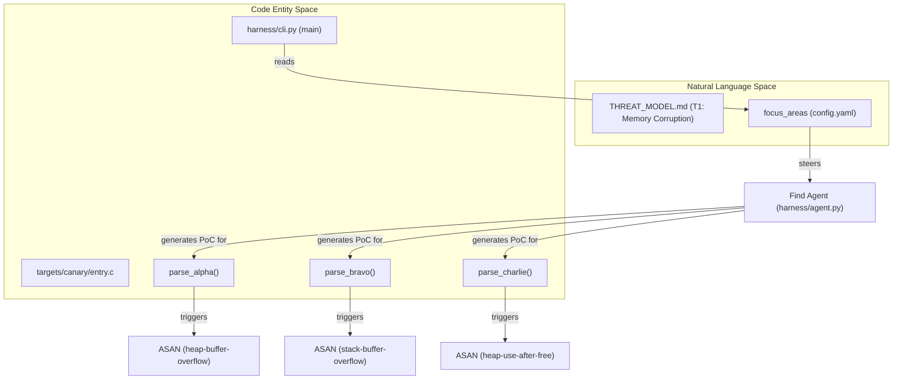
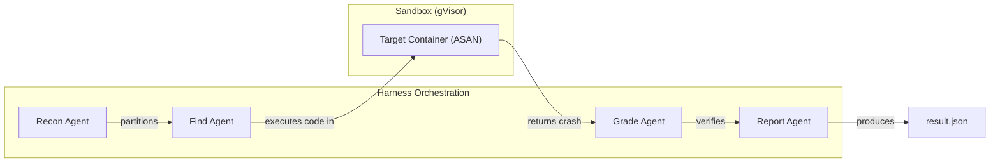

<!-- source: DeepWiki mcp.deepwiki.com · repo anthropics/defending-code-reference-harness · page 1.1 Getting Started · fetched 2026-10-26 -->

# Getting Started

<details>
<summary>Relevant source files</summary>

The following files were used as context for generating this wiki page:

- [.claude/skills/quickstart/SKILL.md](.claude/skills/quickstart/SKILL.md)
- [README.md](README.md)
- [docs/best-practices.md](docs/best-practices.md)
- [docs/troubleshooting.md](docs/troubleshooting.md)
- [pyproject.toml](pyproject.toml)
- [scripts/setup_sandbox.sh](scripts/setup_sandbox.sh)
- [targets/canary/README.md](targets/canary/README.md)
- [targets/canary/THREAT_MODEL.md](targets/canary/THREAT_MODEL.md)
- [targets/canary/config.yaml](targets/canary/config.yaml)

</details>


This page provides a step-by-step guide for setting up the Defending Code Reference Harness and running your first vulnerability discovery and remediation cycles. The harness supports two primary modes of operation: **Interactive Claude Code Skills** for rapid, file-based analysis, and the **Autonomous Pipeline** for execution-verified vulnerability discovery using Docker and gVisor.

## Prerequisites

Before starting, ensure your environment meets the following requirements:

*   **Host OS:** Linux (required for gVisor/runsc syscall isolation). macOS/Windows users should use a Linux VM or the `--dangerously-no-sandbox` flag [scripts/setup_sandbox.sh:29-32]().
*   **Tools:** Docker, Python 3.11+, and the `claude` CLI (Claude Code).
*   **API Access:** An `ANTHROPIC_API_KEY` or `CLAUDE_CODE_OAUTH_TOKEN` exported in your environment [README.md:141-141]().

## 1. Environment Setup

The system requires a specialized sandbox to safely execute untrusted agent-generated code.

### Step 1.1: Install the Harness
Clone the repository and install the package in editable mode within a virtual environment.

```bash
git clone https://github.com/anthropics/defending-code-reference-harness
cd defending-code-reference-harness
python3 -m venv .venv && .venv/bin/pip install -e .
```
Sources: [README.md:45-48](), [README.md:140-140](), [pyproject.toml:1-17]()

### Step 1.2: Provision the Sandbox
Run the `setup_sandbox.sh` script. This script automates the installation of gVisor (`runsc`), registers the Docker runtime, creates an egress-only internal network (`vp-internal`), and builds the initial target images [scripts/setup_sandbox.sh:4-6]().

```bash
sudo ./scripts/setup_sandbox.sh
```

**What this script does:**
1.  **gVisor Installation:** Downloads and installs the `runsc` binary [scripts/setup_sandbox.sh:24-41]().
2.  **Runtime Registration:** Updates `/etc/docker/daemon.json` to include the `runsc` runtime with `--overlay2=none` to ensure PoC files are visible to the orchestrator [scripts/setup_sandbox.sh:44-79]().
3.  **Network Isolation:** Sets up the `vp-egress-proxy` which restricts agent containers to specific allowlisted domains (default: `api.anthropic.com`) [scripts/setup_sandbox.sh:82-97]().
4.  **Image Preparation:** Builds the base target images and their corresponding agent-wrapped versions via `harness.agent_image.ensure` [scripts/setup_sandbox.sh:99-108]().

Sources: [scripts/setup_sandbox.sh:1-155](), [README.md:25-29]()

---

## 2. Smoke Test: The Canary Target

The `canary` target is a minimalist C tool designed to verify the entire pipeline in ~6 minutes [targets/canary/README.md:3-5](). It contains three deliberate vulnerabilities: a heap-buffer-overflow in `parse_alpha`, a stack-buffer-overflow in `parse_bravo`, and a heap-use-after-free in `parse_charlie` [targets/canary/README.md:12-18]().

### Running the Canary
Use the `bin/vp-sandboxed` entrypoint to run the autonomous pipeline under gVisor isolation.

```bash
# Pin the subagent model for consistency
export CLAUDE_CODE_SUBAGENT_MODEL=claude-3-5-sonnet-latest

# Run 3 parallel agents on the canary target
bin/vp-sandboxed run canary --runs 3 --parallel --stream
```

### Data Flow: Canary Smoke Test
The following diagram illustrates how the system transitions from natural language intent to code execution during the canary run.

**Canary Execution Flow**

Sources: [targets/canary/config.yaml:16-19](), [targets/canary/README.md:12-18](), [harness/cli.py:17-17](), [targets/canary/THREAT_MODEL.md:30-33]()

---

## 3. Choosing Your Workflow

Depending on your goals, you can use interactive skills or the autonomous pipeline.

### Option A: Interactive Claude Code Skills
Best for initial scoping, threat modeling, and triaging existing static analysis results. These skills only read and write files and do not require the gVisor sandbox [README.md:85-89]().

| Command | Purpose | Output |
| :--- | :--- | :--- |
| `/threat-model bootstrap <path>` | Automated 5-stage research into system architecture | `THREAT_MODEL.md` |
| `/vuln-scan <path>` | Static source analysis scoped by the threat model | `VULN-FINDINGS.json` |
| `/triage <findings.json>` | Adversarial verification and ranking of findings | `TRIAGE.md` |
| `/patch <triage.json>` | Generate candidate fixes for verified findings | `PATCHES/` |

Sources: [README.md:91-110](), [.claude/skills/quickstart/SKILL.md:60-74](), [docs/troubleshooting.md:125-136]()

### Option B: Autonomous Pipeline
Best for C/C++ projects where you require execution-verified PoCs (AddressSanitizer crashes) and automated exploitability reporting [README.md:128-132]().

**The Autonomous Workflow**

Sources: [README.md:13-18](), [README.md:147-155](), [docs/best-practices.md:109-114]()

### Resuming Work
If a run is interrupted (e.g., via rate limits or Ctrl-C), both modes support resuming:
*   **Skills:** Re-invoke the same command; it reads state from directories like `./.triage-state/` [docs/troubleshooting.md:34-43]().
*   **Pipeline:** Use the `--resume <results_dir>` flag to skip completed runs and carry over deduplication context [docs/troubleshooting.md:51-65]().

Sources: [docs/troubleshooting.md:1-137]()

---

