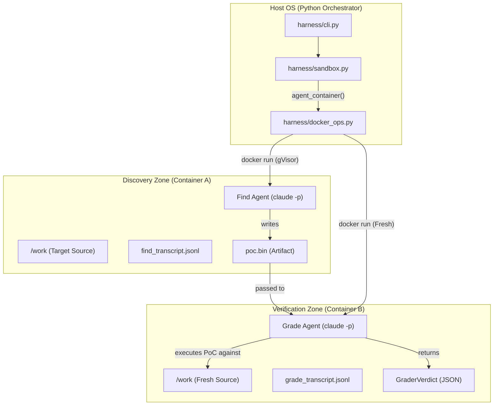
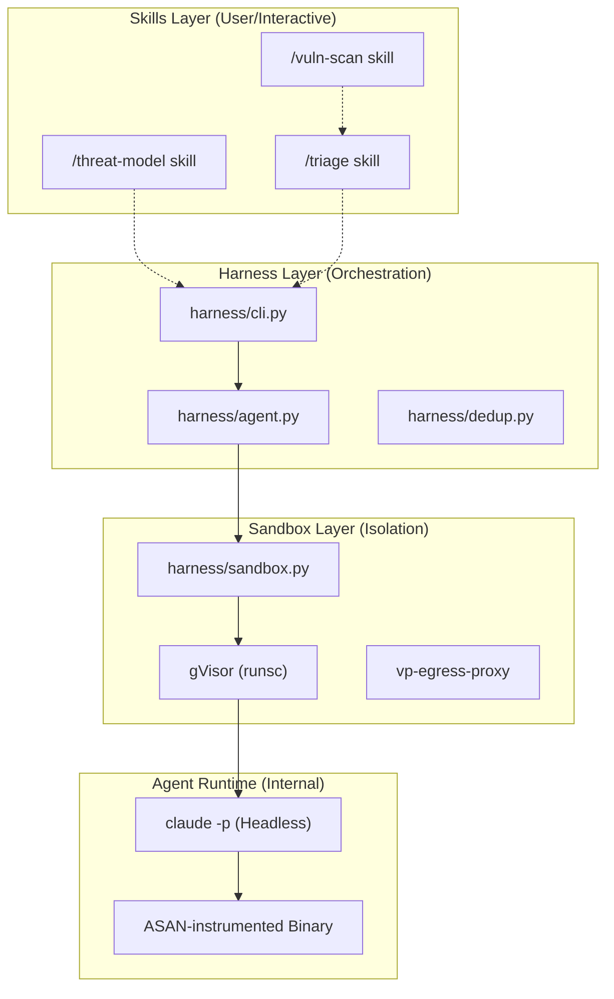

<!-- source: DeepWiki mcp.deepwiki.com · repo anthropics/defending-code-reference-harness · page 1.2 System Architecture · fetched 2026-10-26 -->

# System Architecture

Relevant source files

The following files were used as context for generating this wiki page:

- [.claude/skills/customize/SKILL.md](.claude/skills/customize/SKILL.md)
- [bin/vp-sandboxed](bin/vp-sandboxed)
- [docs/customizing.md](docs/customizing.md)
- [docs/pipeline.md](docs/pipeline.md)
- [docs/security.md](docs/security.md)
- [harness/README.md](harness/README.md)
- [harness/cli.py](harness/cli.py)
- [harness/sandbox.py](harness/sandbox.py)

The Defending Code Reference Harness is designed as a multi-agent, autonomous system for vulnerability discovery and verification. It operates on a "trust but verify" model, where discovery agents propose vulnerabilities and independent grader agents attempt to disprove them in clean environments.

## The Two-Container Trust Boundary

A core architectural principle of the harness is the strict isolation between the discovery phase and the verification phase. This prevents agents from "hallucinating" success by modifying their own environment or detectors.

1.  **Discovery Container (Find):** An agent runs `claude -p` inside a gVisor-isolated container. It has full read/write access to the target source and can execute the target binary. It iterates until it produces a Proof-of-Concept (PoC) file that triggers a crash [docs/pipeline.md:63-67]().
2.  **The PoC Bridge:** Only the raw bytes of the PoC (e.g., `poc.bin`) and minimal metadata (ASAN logs) cross the boundary [docs/pipeline.md:69-72]().
3.  **Verification Container (Grade):** A second agent is spawned in a **fresh** container that the discovery agent never touched. It attempts to reproduce the crash using only the provided PoC. If the crash does not reproduce here, the finding is rejected [harness/grade.py:48-52](), [docs/pipeline.md:69-72]().

### Diagram: Trust Boundary and Data Flow
This diagram illustrates how data flows between the Natural Language Space (agent reasoning) and the Code Entity Space (files and containers), bridged by the `agent_container`.

**Sources:** [harness/sandbox.py:59-92](), [harness/cli.py:43-55](), [docs/pipeline.md:63-72]()

---

## Discovery-Verification Split

The pipeline distinguishes between **finding** a potential bug and **confirming** it is a valid, exploitable vulnerability. This split is enforced by separate agent roles and prompts.

| Phase | Agent Role | Input | Output |
| :--- | :--- | :--- | :--- |
| **Recon** | Mapper | Source Tree | `focus_areas` (YAML) |
| **Find** | Attacker | Source + Focus Area | `poc.bin` + ASAN log |
| **Grade** | Skeptic | `poc.bin` | `GraderVerdict` (Score 0-5) |
| **Judge** | Registrar | `GraderVerdict` + Manifest | `JudgeVerdict` (New/Dup) |
| **Report** | Analyst | Verified Crash | `ReportVerdict` (Exploitability) |
| **Patch** | Developer | Verified Crash | `patch.diff` |

**Sources:** [harness/cli.py:16-21](), [docs/pipeline.md:50-91](), [harness/prompts/find_prompt.py:1-20]()

---

## Multi-Agent Workflow (The Pipeline)

The `vuln-pipeline` orchestrates agents through a series of stages, often running in parallel.

### 1. Reconnaissance (`recon`)
The `run_recon` function [harness/recon.py:23]() spawns an agent to partition the attack surface. It identifies distinct parsers or entry points to prevent multiple parallel `find` agents from converging on the same shallow bug [docs/pipeline.md:57-61]().

### 2. Discovery (`find`)
The `run_find` function [harness/find.py:27]() uses the `find_prompt` to guide an agent in crafting inputs. It monitors for ASAN crashes and saves the `CrashArtifact` [harness/artifacts.py:29]().

### 3. Verification (`grade`)
`run_grade` [harness/grade.py:23]() validates the finding. It uses a 5-criterion rubric:
1. Reproducibility (3/3 times).
2. Location (is it in the target code?).
3. Severity (is it more than just an OOM?).
4. Accuracy (does the agent understand the crash?).
5. Quality (is it a high-impact memory corruption?).
**Sources:** [harness/prompts/grade_prompt.py:15-40]()

### 4. Deduplication & Judging (`judge`)
When `--stream` is enabled, `run_judge` [harness/judge.py:23]() compares new findings against the `manifest.jsonl`. It performs semantic deduplication—deciding if a crash is a `NEW` bug or a `DUP_BETTER` version of an existing one [docs/pipeline.md:74-79]().

### 5. Exploitability Reporting (`report`)
`run_report` [harness/report.py:23]() generates a deep analysis. It characterizes the primitive (e.g., OOB Write), reachability, and potential escalation paths [harness/prompts/report_prompt.py:10-30]().

### 6. Patching (`patch`)
`run_patch` [harness/patch.py:28]() attempts to fix the bug. It follows a "T0-T3" ladder where the patch is verified to:
- Compile (T0).
- Fix the original crash (T1).
- Pass existing tests (T2).
- Resist "re-attack" by a find agent (T3).
**Sources:** [harness/patch.py:100-150](), [docs/pipeline.md:107-108]()

---

## Sandbox, Harness, and Skills Layers

The system is organized into three conceptual layers that manage the transition from user intent to sandboxed execution.

### Diagram: Layered Architecture
This diagram maps the system components to their code entities and shows how they interact across the sandbox boundary.

### Component Roles
*   **Skills Layer:** Interactive Claude Code skills (located in `.claude/skills/`) used for manual or semi-automated analysis. They often produce artifacts (like `THREAT_MODEL.md` or `VULN-FINDINGS.json`) that can seed the autonomous pipeline [docs/pipeline.md:41-48]().
*   **Harness Layer:** The Python-based logic (`harness/`) that manages the lifecycle of a "run." It handles API communication via `AgentRunner` [harness/agent.py:40](), state persistence in `result.json`, and the flow between stages [harness/cli.py:159-177]().
*   **Sandbox Layer:** The security infrastructure. `harness/sandbox.py` ensures that every agent is wrapped in an `agent_container` context manager [harness/sandbox.py:59](), enforcing gVisor isolation and routing traffic through the `vp-egress-proxy` [bin/vp-sandboxed:22-31]().

**Sources:** [harness/sandbox.py:5-10](), [harness/agent.py:40-60](), [docs/security.md:21-28](), [bin/vp-sandboxed:1-40]()

---

