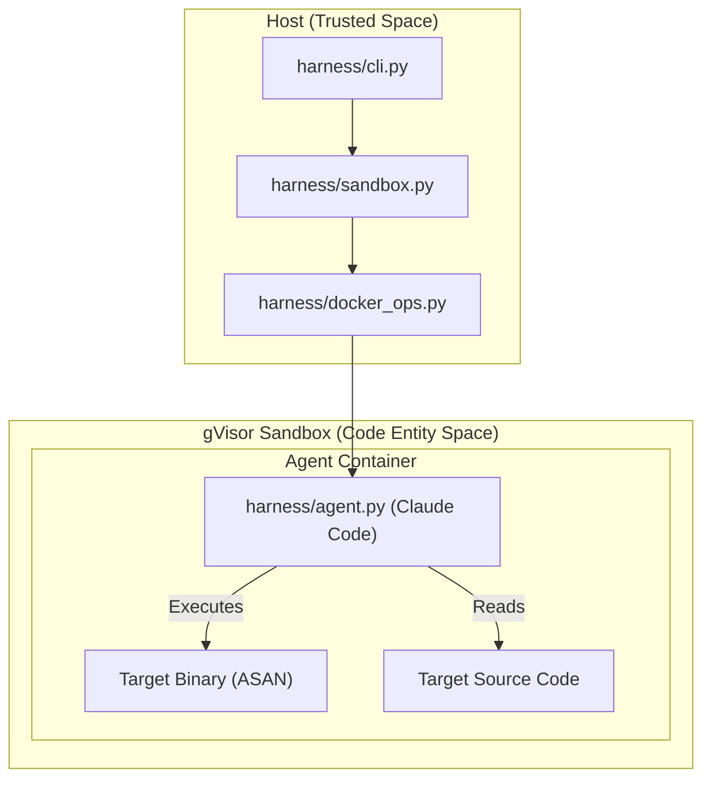
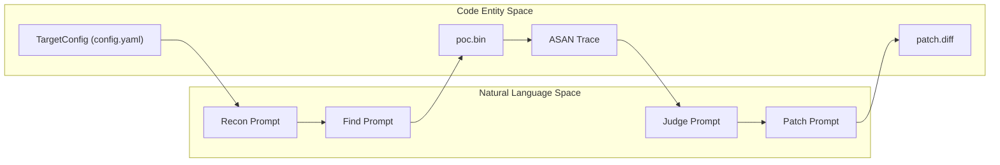

<!-- source: DeepWiki mcp.deepwiki.com · repo anthropics/defending-code-reference-harness · page 2 Autonomous Pipeline · fetched 2026-10-26 -->

# Autonomous Pipeline

Relevant source files

The following files were used as context for generating this wiki page:

- [CLAUDE.md](CLAUDE.md)
- [docs/agent-sandbox.md](docs/agent-sandbox.md)
- [docs/patching.md](docs/patching.md)
- [docs/pipeline.md](docs/pipeline.md)
- [docs/security.md](docs/security.md)
- [harness/README.md](harness/README.md)
- [harness/cli.py](harness/cli.py)

The autonomous pipeline is a multi-agent system designed for the end-to-end discovery, verification, and remediation of memory safety vulnerabilities in C/C++ codebases. It automates the transition from raw source code to verified exploitability reports and executable patches using a series of specialized LLM-driven agents.

The pipeline is primarily invoked via the `vuln-pipeline` CLI (or its sandboxed wrapper `bin/vp-sandboxed`), which manages the lifecycle of agents and their isolated execution environments [harness/cli.py:14-28]().

## Pipeline Lifecycle Overview

The pipeline operates in a modular sequence where each stage produces durable artifacts consumed by the next. While the stages can be run individually for fine-grained control, the `run` command provides a unified entry point for the core loop [docs/pipeline.md:50-91]().

### 1. Reconnaissance
The **Recon Agent** performs a static analysis of the target source tree to identify distinct attack surfaces. It partitions the codebase into "focus areas" (e.g., specific parsers or network handlers), allowing subsequent parallel find agents to explore different parts of the target rather than converging on the same shallow bugs [docs/pipeline.md:57-61]().
*   **For details, see [Reconnaissance and Find Agents](#2.2).**

### 2. Vulnerability Discovery (Find)
The **Find Agent** is the core discovery engine. It runs within a network-isolated gVisor container, where it reads source code and iteratively crafts malformed inputs. It executes the target binary—instrumented with AddressSanitizer (ASAN)—until it achieves a reproducible crash [docs/pipeline.md:63-68]().
*   **For details, see [Reconnaissance and Find Agents](#2.2).**

### 3. Verification (Grade)
The **Grade Agent** acts as an adversarial verifier. It takes the Proof-of-Concept (PoC) generated by a find agent and attempts to reproduce the crash in a fresh, "clean" container that the find agent never touched. This ensures the crash is legitimate, reproducible, and not an artifact of environment manipulation [docs/pipeline.md:69-73]().
*   **For details, see [Grading and Verification](#2.3).**

### 4. Deduplication and Judging
When running in `--stream` mode, the **Judge Agent** performs semantic deduplication in real-time. It compares newly verified crashes against the existing bug manifest to decide if a finding is a new unique bug, a better representative of a known bug, or a duplicate to be skipped [docs/pipeline.md:74-80]().
*   **For details, see [Deduplication and Judging](#2.4).**

### 5. Exploitability Reporting
The **Report Agent** conducts a deep analysis of unique, verified crashes. It produces a structured report covering the vulnerability primitive, reachability, heap layout implications, and potential escalation paths [docs/pipeline.md:81-89]().
*   **For details, see [Exploitability Reporting](#2.5).**

### 6. Patching
The **Patch Agent** attempts to fix verified vulnerabilities. It generates a `git diff` and validates it against a "verification ladder" that includes successful compilation, reproduction of the fix (the PoC no longer crashes), and a "re-attack" phase where a fresh find agent tries to bypass the new fix [docs/patching.md:55-84]().
*   **For details, see [Patch Generation and Verification](#2.6).**

## Data Flow and Environment Architecture

The pipeline maintains a strict separation between the "Natural Language Space" (where agents reason) and the "Code Entity Space" (where code is executed). This is enforced by the `Sandbox` and `Agent` abstractions.

### High-Level Component Relationship
This diagram shows how the host orchestrator manages the lifecycle of agents across the trust boundary.

**Sources:** [harness/sandbox.py:1-30](), [harness/docker_ops.py:1-40](), [docs/agent-sandbox.md:1-9]()

### Detailed Pipeline Data Flow
This diagram tracks the transformation of data from a target definition to a final verified patch.

**Sources:** [harness/config.py:1-20](), [harness/artifacts.py:1-50](), [docs/pipeline.md:50-91](), [docs/patching.md:55-78]()

## Core CLI Commands

The pipeline is controlled through the `vuln-pipeline` command. Common patterns include:

| Command | Description |
| :--- | :--- |
| `run <target> --auto-focus` | Full recon → find → grade loop [harness/cli.py:18](). |
| `run <target> --parallel --stream` | Parallel discovery with real-time judging and reporting [docs/pipeline.md:26-27](). |
| `report <results_dir>` | Batch-mode exploitability analysis for a results directory [harness/cli.py:21](). |
| `patch <results_dir>` | Generate and verify fixes for all unique bugs in a batch [docs/patching.md:41](). |
| `run <target> --resume <dir>` | Resume a partially-killed or failed batch [harness/cli.py:103](). |

**Sources:** [harness/cli.py:14-28](), [docs/pipeline.md:95-108]()

---

