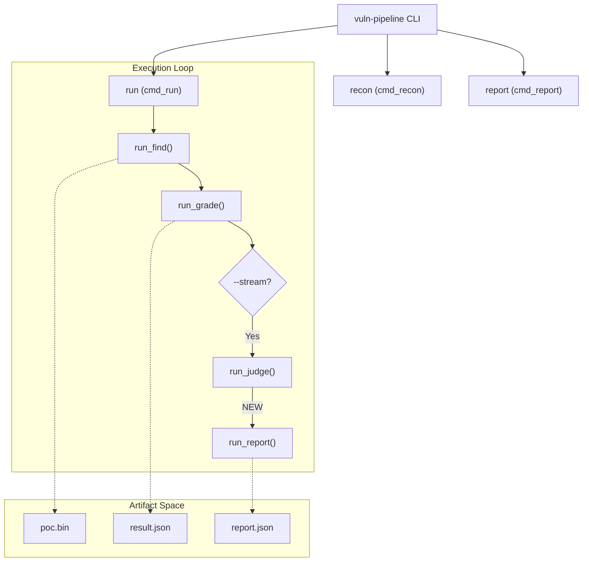
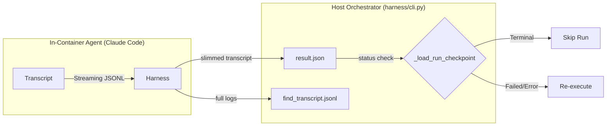

<!-- source: DeepWiki mcp.deepwiki.com · repo anthropics/defending-code-reference-harness · page 2.1 CLI Orchestration · fetched 2026-10-26 -->

# CLI Orchestration

Relevant source files

The following files were used as context for generating this wiki page:

- [.claude/skills/_lib/checkpoint.py](.claude/skills/_lib/checkpoint.py)
- [docs/pipeline.md](docs/pipeline.md)
- [harness/cli.py](harness/cli.py)
- [targets/canary/fixtures/results_sample/run_000/result.json](targets/canary/fixtures/results_sample/run_000/result.json)
- [targets/canary/fixtures/results_sample/run_001/result.json](targets/canary/fixtures/results_sample/run_001/result.json)
- [targets/canary/fixtures/results_sample/run_002/result.json](targets/canary/fixtures/results_sample/run_002/result.json)
- [tests/test_checkpoint.py](tests/test_checkpoint.py)
- [tests/test_skill_checkpoint.py](tests/test_skill_checkpoint.py)

The autonomous pipeline is orchestrated by `harness/cli.py`, which provides a unified entrypoint for vulnerability discovery, verification, deduplication, and reporting. It manages the complex lifecycle of parallel agent execution, network-isolated container provisioning, and durable state management to ensure that long-running security audits can be resumed and scaled.

## Subcommand Overview

The `vuln-pipeline` CLI supports several high-level subcommands that map to specific stages of the vulnerability research lifecycle.

| Subcommand | Purpose | Primary Functions |
| :--- | :--- | :--- |
| `recon` | Partitions the attack surface into focus areas. | `run_recon` [harness/cli.py:54]() |
| `run` | Executes the core find-and-grade loop. | `run_find` [harness/cli.py:49](), `run_grade` [harness/cli.py:50]() |
| `dedup` | Groups crashes by ASAN signature post-hoc. | `dedup` [harness/cli.py:48]() |
| `report` | Generates deep exploitability analysis. | `run_report` [harness/cli.py:55]() |
| `patch` | Generates and verifies code fixes. | `run_patch` [harness/cli.py:53]() |

Sources: [harness/cli.py:16-21](), [harness/cli.py:48-55]()

## Execution and Parallelism

The `run` subcommand is designed for high-concurrency execution. When invoked with `--parallel`, the orchestrator uses `asyncio` to manage multiple agent sessions simultaneously.

### Focus Area Assignment
If `--auto-focus` is enabled, the CLI first runs a `recon` agent to identify distinct entry points [harness/cli.py:18](). These are distributed to `find` agents using a round-robin strategy [harness/cli.py:17]().

### Streaming and Dispatch
With the `--stream` flag, the CLI enables a reactive pipeline where crashes are processed as soon as they are verified by a grader.
1. **Find**: Agents search for crashes in isolated containers.
2. **Grade**: Verification agents attempt to reproduce the crash in a clean environment.
3. **Dispatch**: Verified crashes are sent to `_stream_dispatch` [harness/cli.py:192]().
4. **Judge & Report**: The `run_judge` [harness/cli.py:51]() function determines if the crash is novel; if so, `run_report` [harness/cli.py:55]() generates the final artifact.

### Code Entity Mapping: Orchestration Flow
The following diagram maps the CLI subcommands to their internal implementation functions and the resulting artifacts.

Sources: [harness/cli.py:16-21](), [harness/cli.py:49-55](), [harness/cli.py:192-210]()

## State Management and Resume Logic

The harness prioritizes durability. Every agent interaction is persisted to disk, allowing the pipeline to recover from hardware failures, API timeouts, or manual interruptions.

### Resume Mechanics
When `--resume <dir>` is provided, the CLI inspects the `results/` directory to identify the state of prior runs [harness/cli.py:103]().
- **Terminal Statuses**: Runs with status `crash_found`, `crash_rejected`, or `no_crash_found` are considered terminal and skipped [harness/cli.py:156-176]().
- **Retries**: Statuses like `agent_failed` or `error` are not terminal; the orchestrator will re-attempt these runs [harness/cli.py:162]().
- **Layout Guard**: The function `_resume_layout_error` ensures that the user does not attempt to resume a multi-run batch into a single-run directory structure [harness/cli.py:159-182]().

### Checkpoint Data Flow
The CLI manages the transition between "Natural Language Space" (agent reasoning) and "Code Entity Space" (structured JSON artifacts).

Sources: [harness/cli.py:156-177](), [harness/cli.py:159-182](), [tests/test_checkpoint.py:25-54]()

## Container Lifecycle and Signal Handling

The pipeline relies on strict container isolation via `gVisor` and custom Docker networking. The CLI ensures these resources are cleaned up properly.

### Signal Handling
Standard Python `finally` blocks do not execute on signals like `SIGINT` or `SIGTERM`. To prevent orphaned containers (which can reserve significant memory) and orphaned Node.js subprocesses from the Claude Code SDK, `harness/cli.py` implements a custom signal handler:
- **`_terminate_subprocesses()`**: Scans `/proc` to find and `SIGKILL` direct child processes that might otherwise persist for hours [harness/cli.py:97-120]().
- **`_on_signal()`**: Filters Docker containers by name (e.g., `find_<target>_`, `grader_<target>_`) and forcibly removes them [harness/cli.py:125-154]().

### Authentication Resolution
The CLI resolves authentication for the in-container agents via `_resolve_auth_env` [harness/cli.py:66](). It prioritizes `ANTHROPIC_API_KEY` over `CLAUDE_CODE_OAUTH_TOKEN` and passes these credentials into the agent container at runtime [harness/cli.py:75-81]().

Sources: [harness/cli.py:66-81](), [harness/cli.py:97-154]()

---

