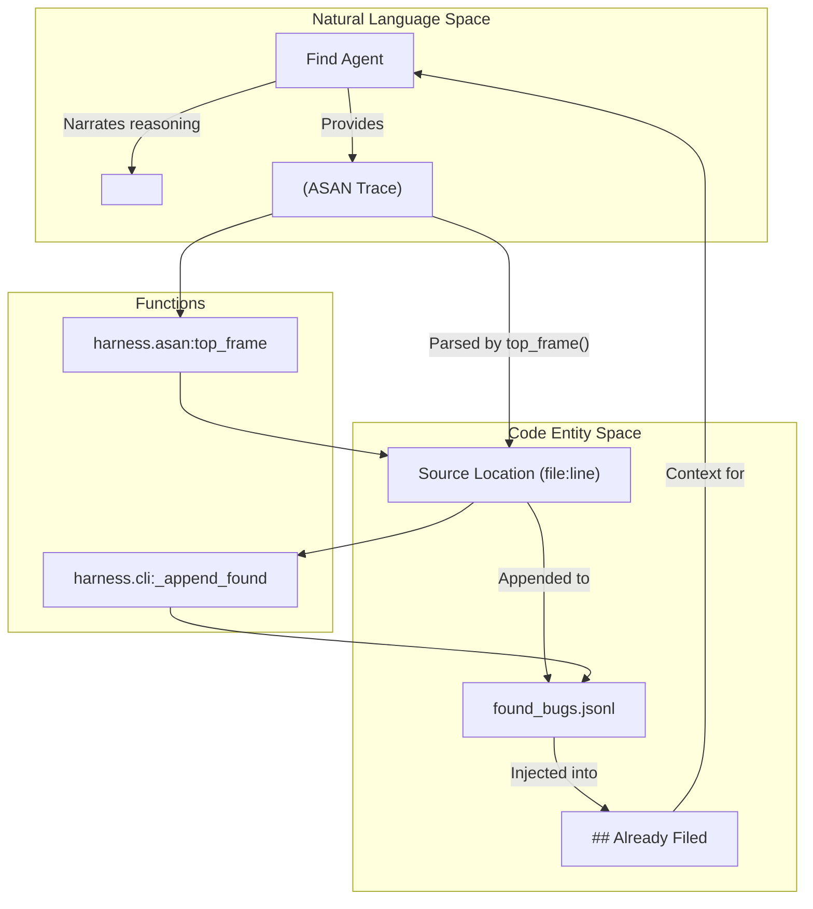

<!-- source: DeepWiki mcp.deepwiki.com · repo anthropics/defending-code-reference-harness · page 2.2 Reconnaissance and Find Agents · fetched 2026-10-26 -->

# Reconnaissance and Find Agents

<details>
<summary>Relevant source files</summary>

The following files were used as context for generating this wiki page:

- [harness/find.py](harness/find.py)
- [harness/prompts/find_prompt.py](harness/prompts/find_prompt.py)
- [harness/prompts/recon_prompt.py](harness/prompts/recon_prompt.py)
- [harness/prompts/system_prompt.py](harness/prompts/system_prompt.py)
- [harness/recon.py](harness/recon.py)
- [tests/test_focus.py](tests/test_focus.py)
- [tests/test_found_bugs.py](tests/test_found_bugs.py)
- [tests/test_report.py](tests/test_report.py)
- [tests/test_system_prompt.py](tests/test_system_prompt.py)

</details>


The **Reconnaissance (Recon)** and **Find** agents represent the initial stages of the autonomous vulnerability discovery pipeline. The Recon agent analyzes the target codebase to partition its attack surface into distinct focus areas, which are then assigned to parallel Find agents. The Find agents operate within the target container to craft proof-of-concept (PoC) inputs that trigger AddressSanitizer (ASAN) crashes.

### Reconnaissance Agent

The Recon agent is a lightweight agent designed to explore the target's source tree and identify subsystems that process untrusted input. Its primary goal is to prevent parallel Find agents from converging on the same bugs by providing a diverse set of focus areas.

#### Focus Area Partitioning
The Recon agent is tasked with identifying 5–15 distinct subsystems [harness/prompts/recon_prompt.py:25-27](). A "good" partition consists of independent parsers, formats, or protocol stages (e.g., "PNG decoder" vs "JPEG decoder") [harness/prompts/recon_prompt.py:29-30]().

The agent performs exploration by:
1.  Listing the source tree using `find` [harness/prompts/recon_prompt.py:37]().
2.  Identifying entry points and dispatch logic, such as magic-byte checks or switch statements [harness/prompts/recon_prompt.py:38-39]().
3.  Proposing focus areas in a specific format: `<subsystem name> (<function/file pattern>) — <key operations>` [harness/prompts/recon_prompt.py:49]().

#### Implementation: `run_recon`
The `run_recon` function orchestrates this process [harness/recon.py:22-60](). It starts a sandbox container, builds the recon prompt, and runs the agent with a relatively short turn budget (default 100 turns) [harness/recon.py:19-26](). It then parses the `<focus_areas>` XML tag from the agent's output [harness/recon.py:54-59]().

**Reconnaissance Data Flow**
Title: Recon Agent Subsystem Partitioning
```mermaid
graph TD
    subgraph "Natural Language Space"
        A["RECON_PROMPT_TEMPLATE"] -- "Exploration Task" --> B["Recon Agent (LLM)"]
        B -- "Proposed Focus Areas" --> C["<focus_areas> XML Tag"]
    end

    subgraph "Code Entity Space"
        D["target.source_root"] -- "find / grep" --> B
        B -- "Identify" --> E["Subsystems (e.g., parse_alpha)"]
        C -- "Parsed by run_recon" --> F["List[str] Focus Areas"]
    end

    B -.->| "Analyzes" | D
    F -.->| "Feeds into" | G["Find Agent Assignment"]
```
Sources: [harness/recon.py:22-60](), [harness/prompts/recon_prompt.py:10-59]()

---

### Find Agent

The Find agent is the core discovery engine. It runs inside the target container with the instrumented binary and source code [harness/prompts/find_prompt.py:14-17]().

#### Focus Area Assignment
When running in the autonomous pipeline, the CLI assigns focus areas to Find agents using a round-robin strategy via `_assigned_focus` [tests/test_focus.py:91-104](). If focus areas were defined in the target's `config.yaml` or generated by the Recon agent, they are injected into the Find agent's prompt to steer its research [harness/prompts/find_prompt.py:33]().

#### Implementation: `run_find`
The `run_find` function manages the lifecycle of a discovery attempt [harness/find.py:21-100]().
- **Sandbox:** It mounts a shared `found_bugs.jsonl` file to the container to allow for cross-agent deduplication [harness/find.py:45-49]().
- **Prompting:** It uses `build_find_prompt` to construct the instructions, including the focus area, known bugs, and the specific binary entry point [harness/find.py:50-60]().
- **Execution:** It runs the agent with a large turn budget (default 2000 turns) to allow for deep exploration and PoC minimization [harness/find.py:18-64]().
- **Artifact Extraction:** Upon completion, it parses the agent's output for the `<poc_path>`, `<reproduction_command>`, and `<crash_output>` tags, then reads the PoC bytes from the container using `docker_ops.read_file` [harness/find.py:74-98]().

#### Crash Quality Tiers
The Find agent is instructed to prioritize high-value memory corruption bugs over low-value DoS or logic bugs [harness/prompts/find_prompt.py:57-75]().

| Tier | Crash Types | Action |
| :--- | :--- | :--- |
| **High Value** | `heap-buffer-overflow` (WRITE), `heap-use-after-free`, `stack-buffer-overflow` | Submit immediately. |
| **Low Value** | Assertion failures, Stack overflow (recursion), Null-pointer dereference | Keep looking; use as a hint for escalation. |
| **Out of Scope** | OOM (huge allocations), Timeouts, Clean exits | Do not submit. |

Sources: [harness/find.py:21-100](), [harness/prompts/find_prompt.py:57-84]()

---

### Deduplication and Crash Sharing

To prevent redundant work in parallel runs, the harness implements a "found bugs" registry.

1.  **`found_bugs.jsonl`:** A shared file containing summaries of crashes already discovered during the current pipeline run [harness/find.py:45]().
2.  **ASAN Frame Extraction:** The harness uses `top_frame` and `project_frames` to extract the most relevant source code location from a raw ASAN trace [tests/test_found_bugs.py:12-43](). It specifically skips interceptor frames (like `memcpy` or `malloc`) to find the first frame within the project source [tests/test_found_bugs.py:51-54]().
3.  **`<dup_check>`:** The Find agent is required to provide a `<dup_check>` tag in its output, narrating why its discovered crash is distinct from those listed in the "Already Filed" section of its prompt [harness/prompts/find_prompt.py:97-109]().

**Discovery and Deduplication Logic**
Title: Find Agent Discovery and ASAN Parsing

Sources: [harness/asan.py:7-8](), [tests/test_found_bugs.py:12-54](), [harness/prompts/find_prompt.py:97-109]()

### Re-attack Mode
When the pipeline is used to verify a patch, the Find agent's prompt switches to a **Re-attack** template [harness/prompts/find_prompt.py:118-150](). In this mode:
- The agent is given the original PoC that was just patched [harness/prompts/find_prompt.py:147]().
- It is instructed to craft variants targeting the same or adjacent code paths to find "patch bypasses" [harness/prompts/find_prompt.py:162-165]().
- It uses a specific `reattack_harness` command provided in the `TargetConfig` to run its PoCs [harness/find.py:59]().

Sources: [harness/prompts/find_prompt.py:118-165](), [harness/find.py:50-60]()

---

