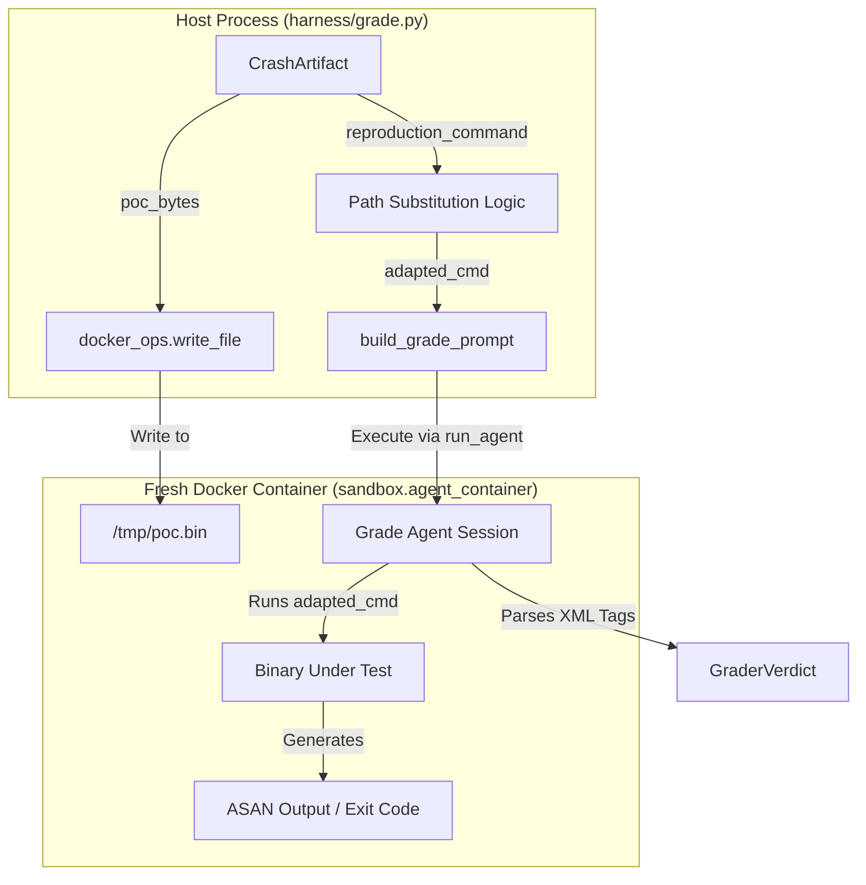
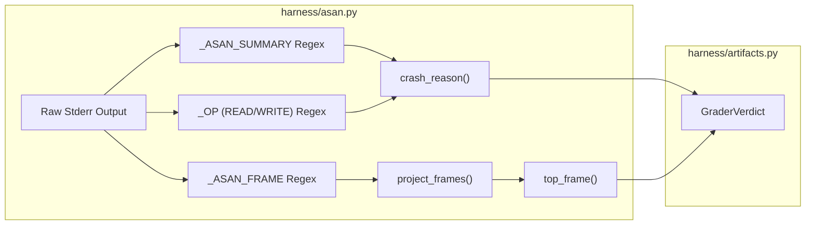

<!-- source: DeepWiki mcp.deepwiki.com · repo anthropics/defending-code-reference-harness · page 2.3 Grading and Verification · fetched 2026-10-26 -->

# Grading and Verification

Relevant source files

The following files were used as context for generating this wiki page:

- [harness/artifacts.py](harness/artifacts.py)
- [harness/asan.py](harness/asan.py)
- [harness/grade.py](harness/grade.py)
- [harness/prompts/grade_prompt.py](harness/prompts/grade_prompt.py)
- [tests/test_artifacts.py](tests/test_artifacts.py)
- [tests/test_asan.py](tests/test_asan.py)
- [tests/test_dedup.py](tests/test_dedup.py)

The Grading and Verification stage is the critical validation gate in the autonomous pipeline. It ensures that crashes discovered by a **Find Agent** are not hallucinations or artifacts of a corrupted environment. The **Grade Agent** operates across a strict trust boundary, attempting to reproduce the crash in a pristine container using only the Proof-of-Concept (PoC) bytes provided by the discovery phase.

## The Trust Boundary and Verification Flow

The core security and reliability principle of the harness is the separation of discovery and verification. A Find Agent may perform arbitrary actions within its container (e.g., modifying environment variables, installing libraries, or corrupting system files) [harness/grade.py:5-7](). To prevent these side effects from masquerading as legitimate vulnerabilities, the Grade Agent starts from a fresh container instance of the same `TargetConfig.image_tag` [harness/grade.py:51-52]().

### Data Flow: Find to Grade

1.  **Find Agent** emits a `CrashArtifact` containing the `poc_bytes`, a `reproduction_command`, and the original `poc_path` [harness/artifacts.py:16-24]().
2.  **Harness** (via `run_grade`) performs **PoC Path Substitution**. It writes the `poc_bytes` to a fixed location (`/tmp/poc.bin`) in the fresh container [harness/grade.py:53-55]().
3.  **Harness** adapts the `reproduction_command` by replacing the Find Agent's arbitrary path with the fixed `/tmp/poc.bin` path [harness/grade.py:56]().
4.  **Grade Agent** receives the adapted command and the fresh environment to execute the verification rubric [harness/grade.py:63-71]().

### Grade Execution Logic
The following diagram illustrates the transition from the data structures in the host process to the execution environment inside the sandboxed container.

**Verification Environment Mapping**

Sources: [harness/grade.py:26-100](), [harness/artifacts.py:16-24](), [harness/sandbox.py:1-20]()

## The 5-Criterion Rubric

The Grade Agent is instructed to evaluate the PoC against a strict 5-criterion rubric defined in the system prompt [harness/prompts/grade_prompt.py:9-64](). It must provide a `PASS`/`FAIL` for each:

| Criterion | Requirement | Failure Condition |
| :--- | :--- | :--- |
| **1: PoC Validity** | `/tmp/poc.bin` exists and is non-empty. | Missing or 0-byte file. |
| **2: Reproducibility** | Run the command 3 times. | No crash, or crashes in < 2/3 runs. |
| **3: Resource Limits** | Check for OOM or Timeouts. | Exit code 137 (OOM) or 124 (Timeout). |
| **4: Project Scope** | ASAN stack trace must hit project code. | Trace is entirely libc/runtime frames. |
| **5: Consistency** | Consistent crash class across runs. | Different crash types (e.g., SEGV then clean exit). |

Sources: [harness/prompts/grade_prompt.py:24-52](), [harness/grade.py:86-88]()

## ASAN Output Parsing and Deduplication

The harness includes specialized logic for parsing AddressSanitizer (ASAN) and glibc assertion output to extract semantic signatures. This is used both for the `GraderVerdict` and subsequent deduplication.

### Key Functions
*   **`crash_reason(crash_output)`**: Extracts the `crash_type` (e.g., `heap-buffer-overflow`) and the `operation` (`READ`/`WRITE`) [harness/asan.py:69-83]().
*   **`project_frames(crash_output, n)`**: Extracts the top `n` frames that contain source code locations (file:line), skipping library interceptors like `memcpy` or `malloc` [harness/asan.py:23-53]().
*   **`asan_excerpt(crash_output)`**: Creates a condensed version of the trace (Summary + Top 10 frames) for agent context [harness/asan.py:86-107]().

### Signature Extraction
Crashes are grouped into signatures using a tuple of `(crash_type, top_project_frame)` [tests/test_dedup.py:34-47](). This allows the system to recognize that different PoCs are triggering the same underlying bug.

**ASAN Parsing Logic**

Sources: [harness/asan.py:12-21](), [harness/asan.py:62-66](), [tests/test_dedup.py:109-110]()

## Implementation Details

### `run_grade` Function
The primary entry point for verification is `run_grade` [harness/grade.py:26](). 
1.  It validates that the `poc_path` exists within the `reproduction_command` to ensure agent consistency [harness/grade.py:45-49]().
2.  It invokes `sandbox.agent_container` to create the isolated environment [harness/grade.py:52]().
3.  It persists the `poc.bin` to the host `workspace_dir` so the artifact survives container teardown [harness/grade.py:58-61]().
4.  It executes the agent via `run_agent` with a 50-turn budget [harness/grade.py:73-81]().
5.  It parses the agent's XML-tagged output into a `GraderVerdict` object [harness/grade.py:84-99]().

### Data Structures
*   **`GraderVerdict`**: Stores the `passed` boolean, a `score` (0.0-1.0), the per-criterion results, and the `evidence` string [harness/artifacts.py:45-50]().
*   **`RunResult`**: The final container for a pipeline iteration, linking the `CrashArtifact` and its `GraderVerdict` [harness/artifacts.py:151-160]().

Sources: [harness/grade.py:23-24](), [harness/grade.py:84-100](), [harness/artifacts.py:45-50]()

---

