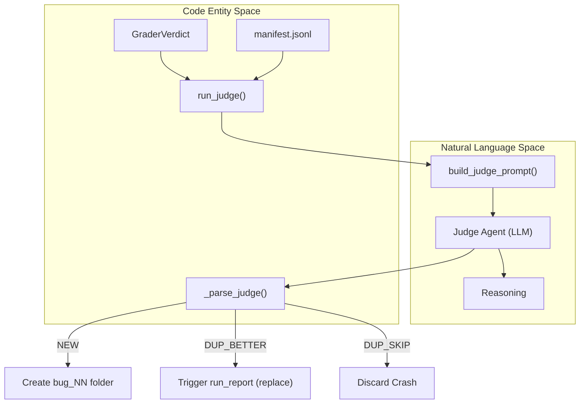
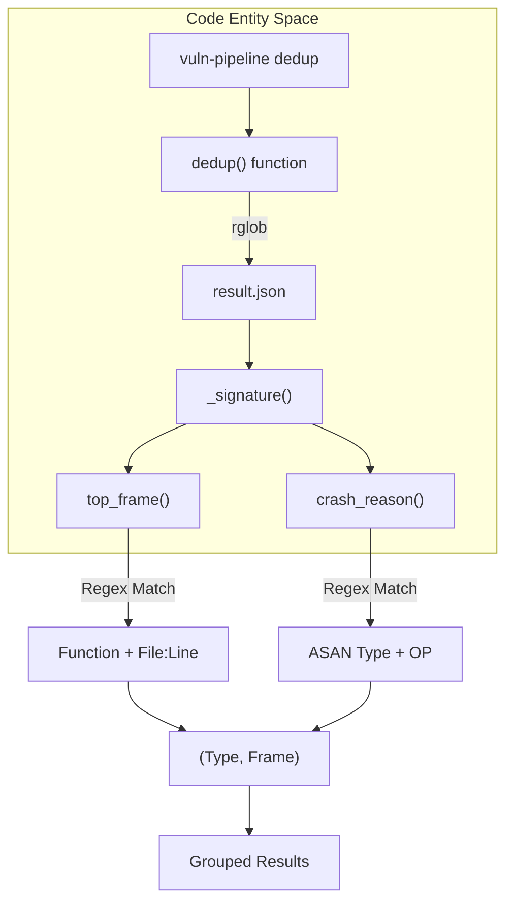

<!-- source: DeepWiki mcp.deepwiki.com · repo anthropics/defending-code-reference-harness · page 2.4 Deduplication and Judging · fetched 2026-10-26 -->

# Deduplication and Judging

Relevant source files

The following files were used as context for generating this wiki page:

- [harness/dedup.py](harness/dedup.py)
- [harness/judge.py](harness/judge.py)
- [harness/prompts/judge_prompt.py](harness/prompts/judge_prompt.py)
- [tests/test_asan.py](tests/test_asan.py)
- [tests/test_dedup.py](tests/test_dedup.py)
- [tests/test_judge.py](tests/test_judge.py)

Deduplication in the Defending Code Reference Harness ensures that the autonomous pipeline focuses its expensive reporting and patching resources on unique root causes rather than redundant manifestations of the same bug. The system employs two distinct layers of deduplication:

1.  **Semantic Judging**: An LLM-based `judge` agent that evaluates freshly-graded crashes against a registry of known bugs to decide if a new exploitability report is warranted.
2.  **Post-hoc Signature Clustering**: A regex-based signature extraction utility used for summary reporting and final results analysis.

## The Judge Agent

The `judge` agent replaces traditional stack-hash deduplication with semantic reasoning. It is invoked after a crash has been verified by the `grade` stage. Its primary role is to act as a gatekeeper for the `report` stage.

### Judgment Types
The judge must emit one of three specific tags:
*   `NEW`: The crash's root cause is distinct from every bug currently in the registry. This triggers a new `report` task [harness/prompts/judge_prompt.py:43-46]().
*   `DUP_SKIP`: The crash shares a root cause with an existing bug, and the current representative/report is sufficient [harness/prompts/judge_prompt.py:48-50]().
*   `DUP_BETTER`: The crash shares a root cause with an existing bug, but this new PoC is a "better" representative (e.g., smaller, more stable, or clearer ASAN trace). This triggers a re-report for that bug ID [harness/prompts/judge_prompt.py:52-57]().

### Implementation and Data Flow
The judge is a host-side, no-tools agent executed via `run_agent` [harness/judge.py:56-65](). It receives the ASAN excerpt of the new crash, its grade score, and a manifest of all previously identified bugs [harness/judge.py:45-52]().

#### Decision Logic Diagram
"This diagram illustrates how the `run_judge` function [harness/judge.py:25]() interacts with the `manifest.jsonl` registry to categorize new crashes."

Sources: [harness/judge.py:25-70](), [harness/prompts/judge_prompt.py:17-73](), [harness/artifacts.py:1-20]()

## The Manifest Registry

The `manifest.jsonl` file serves as the ground truth for the judging process. It is located in the `reports/` directory of a run's output.

### Manifest Schema
Each entry in the manifest contains:
*   `bug_id`: An integer identifier (e.g., `0`, `1`).
*   `run_idx`: The original run index that discovered the bug.
*   `asan_excerpt`: A truncated version of the ASAN output used for comparison [harness/prompts/judge_prompt.py:77-84]().
*   `report_text`: The first 1500 characters of the landed exploitability report (if available) [harness/prompts/judge_prompt.py:94-97]().

The manifest is updated atomically. When the judge rules `NEW`, `_append_manifest` is called to reserve a new `bug_id` [tests/test_judge.py:113-116]().

## Comparison Stage (`run_compare`)

When the judge rules `DUP_BETTER`, the pipeline generates a new report (Report B) for the existing bug. To prevent a "cleaner" PoC from accidentally producing a "weaker" analysis, the `run_compare` stage is invoked [harness/judge.py:90-100]().

The comparison agent evaluates both the original Report A and the new Report B against a rubric that prioritizes:
1.  Concrete primitive characterization (controlled bytes/offsets).
2.  Grounded reachability call chains.
3.  Evidence-backed claims (file:line citations).
4.  Completeness of all five analysis sections [harness/prompts/judge_prompt.py:159-168]().

The winner of this comparison becomes the canonical report for that `bug_id` [harness/judge.py:123-128]().

## Post-hoc Deduplication (`harness/dedup.py`)

While the judge handles streaming deduplication, the `dedup` utility provides a high-level summary of all crashes found across one or more batches [harness/dedup.py:3-15]().

### Signature Extraction
A signature is a tuple of `(crash_type, top_frame)` [harness/dedup.py:29-33]():
*   **Crash Type**: Extracted via `crash_reason()` from the ASAN `SUMMARY` line (e.g., `heap-buffer-overflow`, `SEGV`) [harness/asan.py:23-25]().
*   **Top Frame**: Extracted via `top_frame()`, skipping common interceptors like `memcpy` or `malloc` to find the first application-level function [harness/asan.py:23](), [tests/test_dedup.py:39-41]().

### Deduplication Process Diagram
"This diagram shows the relationship between the `dedup` command-line utility and the underlying ASAN parsing logic."

Sources: [harness/dedup.py:36-57](), [harness/asan.py:1-30](), [tests/test_dedup.py:105-115]()

## Streaming Deduplication Lock

In the CLI (`harness/cli.py`), judging is performed within a streaming loop. To prevent race conditions where two concurrent find-agents submit the same bug simultaneously:
1.  The CLI maintains a `manifest` in memory, updated from disk before each judge call [tests/test_judge.py:107-110]().
2.  The `run_judge` call is typically performed sequentially or protected by the state management logic to ensure the manifest seen by the LLM is up-to-date [harness/judge.py:31-39]().
3.  If the judge emits `NEW`, the pipeline immediately appends the entry to `manifest.jsonl` to "claim" that signature for subsequent judge calls [tests/test_judge.py:113-116]().

Sources: [harness/judge.py:1-128](), [harness/dedup.py:1-80](), [harness/prompts/judge_prompt.py:1-188](), [tests/test_dedup.py:1-115](), [tests/test_judge.py:1-140]()

---

