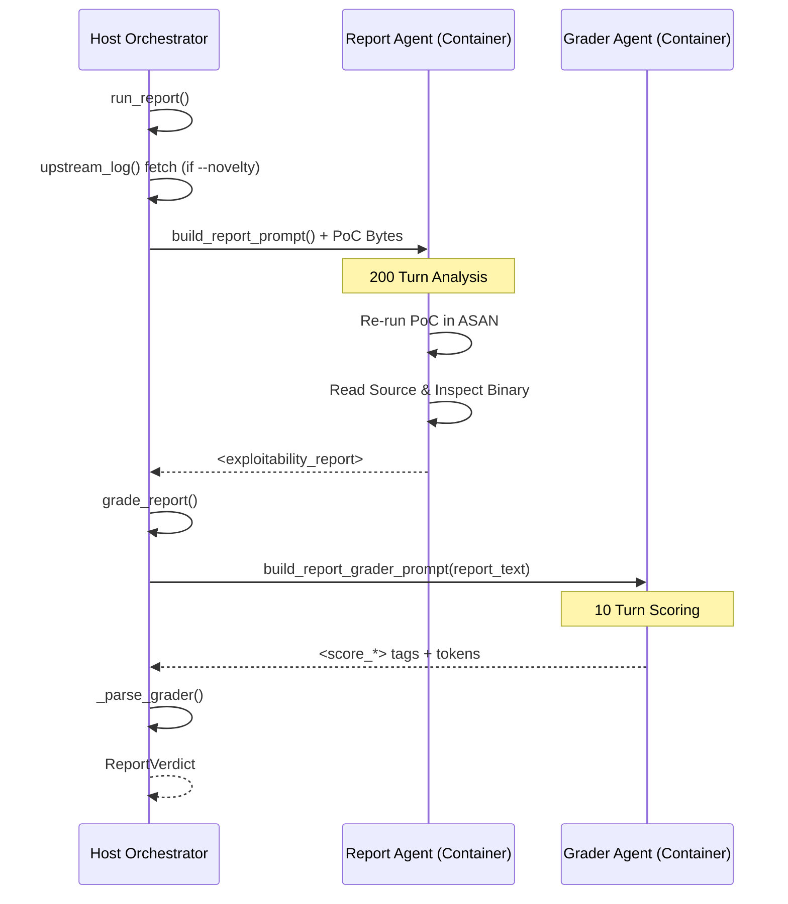

<!-- source: DeepWiki mcp.deepwiki.com · repo anthropics/defending-code-reference-harness · page 2.5 Exploitability Reporting · fetched 2026-10-26 -->

# Exploitability Reporting

<details>
<summary>Relevant source files</summary>

The following files were used as context for generating this wiki page:

- [harness/novelty.py](harness/novelty.py)
- [harness/prompts/report_grader_prompt.py](harness/prompts/report_grader_prompt.py)
- [harness/prompts/report_prompt.py](harness/prompts/report_prompt.py)
- [harness/prompts/system_prompt.py](harness/prompts/system_prompt.py)
- [harness/report.py](harness/report.py)
- [tests/test_focus.py](tests/test_focus.py)
- [tests/test_found_bugs.py](tests/test_found_bugs.py)
- [tests/test_report.py](tests/test_report.py)
- [tests/test_system_prompt.py](tests/test_system_prompt.py)

</details>


Exploitability reporting is the third stage of the autonomous vulnerability pipeline. After a crash has been discovered by a **find** agent and verified as reproducible by a **grade** agent, the **report** agent performs a deep analysis to determine if the crash represents a genuine, exploitable security vulnerability reachable from the target's real-world attack surface.

## Overview

The reporting stage transitions from simple crash verification to structured security analysis. It uses a specialized agent to investigate the crash within a fresh container, followed by a separate grader agent that semantically scores the report quality.

### Key Characteristics
*   **Deep Analysis**: Unlike the find agent, which is focused on triggering any crash, the report agent is given a 200-turn budget [harness/report.py:26-26]() to perform bounded, expert-level research.
*   **Structured Taxonomy**: Reports must follow a strict six-section format (Primitive, Reachability, Heap Layout, Escalation Path, Constraints, Escalation Attempt) [harness/prompts/report_prompt.py:38-40]().
*   **Host-Injected Novelty**: To maintain the `--network none` security boundary for the agent container, the host orchestrator performs upstream git log lookups and injects them into the agent's prompt [harness/novelty.py:3-11]().
*   **Semantic Grading**: A second LLM-based grader agent evaluates the report against a rubric, ensuring claims are backed by evidence rather than boilerplate [harness/report.py:125-128]().

## Process Flow

The reporting process involves data movement between the host orchestrator, the primary report agent, and the secondary grader agent.

### Report Generation Workflow
The following diagram illustrates the flow of data from a `CrashArtifact` to a final `ReportVerdict`.

**Report Execution and Grading Flow**

Sources: [harness/report.py:37-112](), [harness/report.py:115-141](), [harness/novelty.py:22-64]()

## The Six-Section Taxonomy

The report agent is prompted to produce a structured XML block `<exploitability_report>` containing six specific sections.

| Section | Purpose | Scoring Requirement |
| :--- | :--- | :--- |
| `<primitive>` | Precise characterization of the corruption (e.g., what bytes, what control). | Evidence of input variation (e.g., changing PoC size/offset). |
| `<reachability>` | Tracing the path from public API/wire handler to the crash site. | Citing call chains from source. |
| `<heap_layout>` | Adjacency analysis, size classes, and victim objects. | Specifics on allocation order or custom allocators. |
| `<escalation_path>`| Feasibility sketch from primitive to impact (e.g., RCE, Info Leak). | Specific target objects or fields. |
| `<constraints>` | Mitigations (PIE, RELRO) and trigger preconditions. | Binary inspection results. |
| `<escalation_attempt>`| (Optional) Partial demonstration of control (e.g., controlling a pointer). | Observation of controlled crash address. |

Sources: [harness/prompts/report_prompt.py:42-91](), [harness/prompts/report_grader_prompt.py:24-48]()

## Implementation Details

### run_report
The entry point for reporting is `run_report` in `harness/report.py`. It initializes a fresh `agent_container` using the target's image tag [harness/report.py:65-65](). It writes the PoC to `/tmp/poc.bin` and adapts the reproduction command to point to this path [harness/report.py:66-67]().

### Novelty Checking
If `--novelty` is enabled, the host performs a shallow clone of the upstream repository to determine if the crash has already been patched.
1.  **File Extraction**: The orchestrator extracts the filename from the ASAN top frame [harness/novelty.py:91-94]().
2.  **Upstream Log**: It runs `git log <commit>..HEAD -- <file>` [harness/novelty.py:50-54]().
3.  **Prompt Injection**: The resulting log is provided to the agent to fill the `<novelty>` section with tokens like `FIXED` or `UNFIXED` [harness/prompts/report_prompt.py:151-164]().

### Grading and Scoring
The `grade_report` function invokes a secondary agent to parse the report's semantic content.
*   **Section Scores**: Each of the five analysis sections is scored 0 (boilerplate), 1 (plausible but no evidence), or 2 (evidence-backed) [harness/prompts/report_grader_prompt.py:28-34]().
*   **Escalation Bonus**: A bonus of 0, 1, 2, or 4 is awarded based on the depth of the escalation attempt [harness/prompts/report_grader_prompt.py:40-47]().
*   **Total Score**: Calculated as `(rubric + bonus) / 14.0` [harness/report.py:160-160]().

**Data Model: ReportVerdict**
| Field | Type | Description |
| :--- | :--- | :--- |
| `section_scores` | `dict[str, int]` | Individual scores for the 5 sections. |
| `total_score` | `float` | Normalized score between 0.0 and 1.0. |
| `severity_rating` | `str` | CRITICAL, HIGH, MEDIUM, LOW, or NOT-A-BUG. |
| `novelty_status` | `str` | FIXED, UNFIXED, UNKNOWN, or NOT_CHECKED. |
| `reachability_verdict` | `str` | REACHABLE, HARNESS_ONLY, or UNCLEAR. |

Sources: [harness/report.py:144-164](), [harness/artifacts.py:20-20]()

## Code Entity Map

The following diagram maps the logical reporting concepts to their specific implementations in the codebase.

**Reporting Code Entity Map**
```mermaid
graph LD
    subgraph "harness/report.py"
        run_report["run_report()"]
        grade_report["grade_report()"]
        _parse_grader["_parse_grader()"]
    end

    subgraph "harness/prompts/"
        report_prompt["report_prompt.py: build_report_prompt()"]
        grader_prompt["report_grader_prompt.py: build_report_grader_prompt()"]
    end

    subgraph "harness/novelty.py"
        upstream_log["upstream_log()"]
        crash_file_from_frame["crash_file_from_frame()"]
    end

    subgraph "Data Structures"
        ReportVerdict["artifacts.py: ReportVerdict"]
        CrashArtifact["artifacts.py: CrashArtifact"]
    end

    CrashArtifact --> run_report
    run_report --> upstream_log
    upstream_log --> report_prompt
    run_report --> grade_report
    grade_report --> grader_prompt
    grade_report --> _parse_grader
    _parse_grader --> ReportVerdict
```
Sources: [harness/report.py:37-112](), [harness/novelty.py:22-31](), [harness/prompts/report_prompt.py:173-183](), [harness/artifacts.py:6-20]()

## Representative Selection
In the autonomous pipeline, multiple crashes might be found for the same vulnerability. The system uses `_pick_representative` to select the best crash for reporting.
*   **Priority 1**: Crashes that passed verification (`crash_found`) [tests/test_report.py:152-157]().
*   **Priority 2**: Crashes with the highest verification score [tests/test_report.py:160-165]().
*   **Priority 3**: Crashes with the smallest PoC byte size (easier to analyze) [tests/test_report.py:168-173]().

Sources: [harness/cli.py:11-11](), [tests/test_report.py:132-174]()

---

