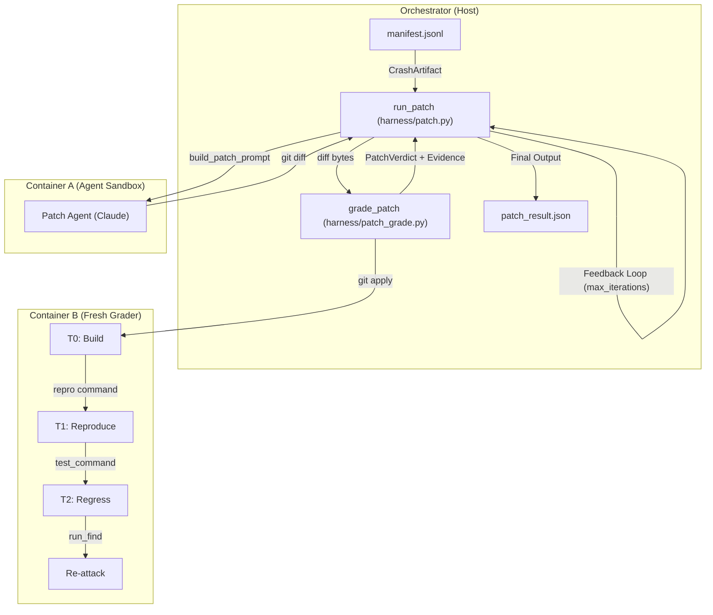
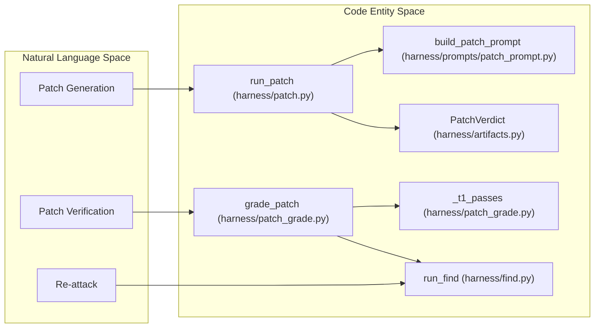

<!-- source: DeepWiki mcp.deepwiki.com · repo anthropics/defending-code-reference-harness · page 2.6 Patch Generation and Verification · fetched 2026-10-26 -->

# Patch Generation and Verification

<details>
<summary>Relevant source files</summary>

The following files were used as context for generating this wiki page:

- [CLAUDE.md](CLAUDE.md)
- [docs/agent-sandbox.md](docs/agent-sandbox.md)
- [docs/patching.md](docs/patching.md)
- [harness/patch.py](harness/patch.py)
- [harness/patch_grade.py](harness/patch_grade.py)
- [tests/fixtures/canary_alpha_crashsite.diff](tests/fixtures/canary_alpha_crashsite.diff)
- [tests/fixtures/canary_alpha_golden.diff](tests/fixtures/canary_alpha_golden.diff)
- [tests/fixtures/canary_noop.diff](tests/fixtures/canary_noop.diff)
- [tests/test_patch.py](tests/test_patch.py)
- [tests/test_patch_grade.py](tests/test_patch_grade.py)
- [tests/test_patch_grade_e2e.py](tests/test_patch_grade_e2e.py)

</details>


The patch stage is the final phase of the autonomous pipeline, responsible for generating and validating executable fixes for verified vulnerabilities. It transforms a confirmed crash into a candidate git diff that has passed a rigorous multi-tier verification ladder, including an adversarial re-attack phase to ensure the root cause is addressed rather than just the specific PoC input.

## Overview and Trust Boundary

The patching process mirrors the find-grade architecture by maintaining a strict two-container trust boundary [docs/patching.md:5-7](). 

1.  **Patch Agent (Container A):** Operates in a gVisor-isolated environment with access to the source code, the PoC, and the ASAN trace [docs/patching.md:61-72]().
2.  **Patch Grader (Container B):** A fresh container spawned from the same target image. Only the raw diff bytes generated by Container A are transferred to Container B [harness/patch_grade.py:5-8]().

This separation ensures that any malicious or accidental side effects from the patch agent's environment (e.g., modified build artifacts) do not influence the verification of the patch [harness/patch_grade.py:78-87]().

### Patching Data Flow

The following diagram illustrates the flow from a verified crash to a finalized `patch_result.json`.

**Patch Generation and Feedback Loop**

Sources: [harness/patch.py:30-45](), [harness/patch_grade.py:37-58](), [docs/patching.md:55-83]()

## The Verification Ladder (T0-T3)

The `grade_patch` function implements a sequential ladder of executable oracles. Failure at any tier short-circuits the process and returns the current `PatchVerdict` [harness/patch_grade.py:54-55]().

| Tier | Name | Oracle / Logic | Code Entity |
| :--- | :--- | :--- | :--- |
| **T0** | **Build** | `git apply` success + `TargetConfig.build_command` exit 0. | [harness/patch_grade.py:98-144]() |
| **T1** | **Reproduce** | Runs `reproduction_command`. Passes if exit 0 AND no `AddressSanitizer` in output. | [harness/patch_grade.py:147-166]() |
| **T2** | **Regress** | Runs `TargetConfig.test_command`. Passes if exit 0. | [harness/patch_grade.py:168-181]() |
| **Re-attack** | **Variant Hunt** | Fresh `find-agent` attacks the patched binary for 50 turns. | [harness/patch_grade.py:183-228]() |
| **T3** | **Style** | LLM-based 0-10 score. **Advisory only; never gates.** | [harness/patch_grade.py:230-249]() |

Sources: [harness/patch_grade.py:1-15](), [docs/patching.md:85-99]()

## Re-attack Mechanism

Re-attack is the most critical tier for security verification. It guards against "symptom-fixing"—where a model adds a bounds check that stops the specific PoC but leaves the vulnerability reachable via a slightly different input [docs/patching.md:101-110]().

1.  **Snapshot:** The grader container (Container B) is committed to a temporary Docker image after the patch is applied and built [harness/patch_grade.py:186-191]().
2.  **Adversarial Search:** A fresh `run_find` session is initiated using this temporary image [harness/patch_grade.py:202-218]().
3.  **Budget:** The agent is given `REATTACK_MAX_TURNS` (default 50) to find a new crash [harness/patch_grade.py:33]().
4.  **Verdict:** If the agent finds any crash (even a different one), `re_attack_clean` is set to `False` [harness/patch_grade.py:221]().

Sources: [harness/patch_grade.py:183-228](), [docs/patching.md:101-117]()

## Implementation Details

### The Iteration Loop
The `run_patch` function manages the feedback loop. If a patch fails the ladder, the failure evidence (e.g., compiler error, ASAN trace from T1, or the new PoC from re-attack) is extracted and injected into the `retry_evidence` field of the next prompt [harness/patch.py:168-171](). This continues for up to `DEFAULT_MAX_ITERATIONS` (5) [harness/patch.py:27]().

### Evidence Feedback
The `_failed_tier` helper identifies the specific point of failure and extracts the relevant log snippet to guide the agent's next attempt [harness/patch.py:174-183]().

### Artifacts: patch_result.json
Every iteration writes to the output directory, with the final iteration producing the authoritative `patch_result.json` [harness/patch.py:50-52]().

**Key Fields in `PatchVerdict`:**
- `t0_builds`: Boolean [harness/artifacts.py:15]()
- `t1_poc_stops`: Boolean [harness/artifacts.py:15]()
- `re_attack_clean`: Boolean [harness/artifacts.py:15]()
- `evidence`: Dictionary containing logs for failed tiers [harness/artifacts.py:15]()

Sources: [harness/patch.py:93-171](), [tests/test_patch.py:95-125]()

## Code Entity Map

The following diagram maps the high-level patching concepts to the specific Python functions and classes that implement them.

**System-to-Code Mapping**

Sources: [harness/patch.py:30](), [harness/patch_grade.py:37](), [harness/patch_grade.py:163](), [harness/find.py:30]()

## CLI Usage

The patch stage is invoked via the `vuln-pipeline patch` subcommand [harness/cli.py]().

```bash
# Patch all unique bugs in a results directory
vuln-pipeline patch results/target/timestamp/ --model claude-3-5-sonnet-20240620

# Patch a specific bug without the re-attack tier
vuln-pipeline patch results/target/timestamp/ --bug 0 --no-reattack
```
Sources: [docs/patching.md:39-48](), [CLAUDE.md:66-67]()

---

