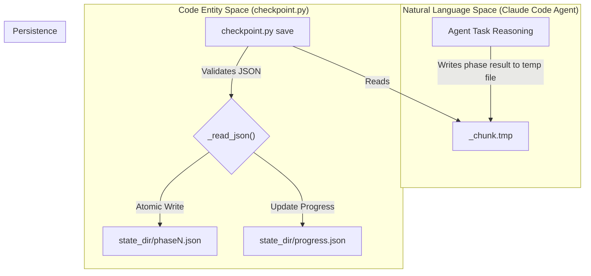
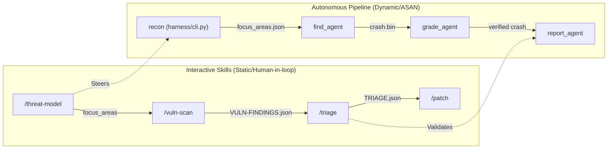

<!-- source: DeepWiki mcp.deepwiki.com · repo anthropics/defending-code-reference-harness · page 3 Interactive Claude Code Skills · fetched 2026-10-26 -->

# Interactive Claude Code Skills

Relevant source files

The following files were used as context for generating this wiki page:

- [.claude/skills/_lib/checkpoint.py](.claude/skills/_lib/checkpoint.py)
- [.claude/skills/quickstart/SKILL.md](.claude/skills/quickstart/SKILL.md)
- [README.md](README.md)
- [docs/best-practices.md](docs/best-practices.md)
- [docs/troubleshooting.md](docs/troubleshooting.md)
- [tests/test_checkpoint.py](tests/test_checkpoint.py)
- [tests/test_skill_checkpoint.py](tests/test_skill_checkpoint.py)

Interactive Claude Code skills are a set of specialized runbooks located in the `.claude/skills/` directory. These skills are invoked directly within a Claude Code session to perform targeted security tasks such as scoping, scanning, triaging, and patching.

While the [Autonomous Pipeline](#2) is designed for deep, execution-verified vulnerability discovery (dynamic analysis) on C/C++ targets, the interactive skills provide a **static-first, human-in-the-loop workflow** that works across many languages without requiring complex sandbox setup or Docker environments [README.md:19-29]().

### The Skill Ecosystem

The skills are designed to be run sequentially as part of a "Day 1" ramp-up, moving from high-level system understanding to verified findings.

| Skill | Command | Purpose | Output Artifacts |
|:---|:---|:---|:---|
| **Threat Model** | `/threat-model` | Map attack surface and trust boundaries. | `THREAT_MODEL.md` |
| **Vuln Scan** | `/vuln-scan` | Perform static analysis scoped by the threat model. | `VULN-FINDINGS.json/md` |
| **Triage** | `/triage` | Verify, deduplicate, and rank raw findings. | `TRIAGE.json/md` |
| **Patch** | `/patch` | Generate candidate fixes for triaged findings. | `PATCHES/` |
| **Customize** | `/customize` | Port the pipeline/skills to new stacks. | Updated harness code |
| **Quickstart** | `/quickstart` | Onboarding and guided first run. | N/A |

Sources: [README.md:9-12](), [README.md:96-110](), [.claude/skills/quickstart/SKILL.md:60-75]()

---

### Shared Checkpoint Infrastructure

To handle large codebases where analysis might be interrupted by rate limits or context exhaustion, the skills use a shared checkpointing library located at `.claude/skills/_lib/checkpoint.py` [.claude/skills/_lib/checkpoint.py:1-7]().

This infrastructure allows skills to:
*   **Resume State**: Save progress in atomic chunks to directories like `.threat-model-state/` or `.triage-state/` [docs/troubleshooting.md:35-43]().
*   **Atomic Writes**: Use temporary files and `os.replace` to ensure that partial writes never corrupt the state [.claude/skills/_lib/checkpoint.py:25-27]().
*   **Path Confinement**: Restrict all file operations to the repository root to prevent prompt-injected agents from accessing sensitive system files [.claude/skills/_lib/checkpoint.py:41-54]().

**Bridge: Checkpoint Data Flow**
The following diagram shows how the `checkpoint.py` script manages the transition from "Natural Language Space" (agent reasoning) to "Code Entity Space" (on-disk JSON state).

Sources: [.claude/skills/_lib/checkpoint.py:8-27](), [tests/test_skill_checkpoint.py:35-43]()

---

### Threat Modeling Skill (3.1)
The `/threat-model` skill helps "aim before you shoot." It uses a bootstrap mode to automatically research the codebase using a swarm of parallel agents, identifying focus areas and trust boundaries. It produces a `THREAT_MODEL.md` that guides subsequent scanning stages.

For details, see [Threat Modeling Skill](#3.1).

### Vulnerability Scan Skill (3.2)
The `/vuln-scan` skill performs static source code analysis. Unlike the autonomous pipeline, it does not execute code. It uses the focus areas defined in the threat model to narrow its search, producing a raw `VULN-FINDINGS.json` list of candidate bugs.

For details, see [Vulnerability Scan Skill](#3.2).

### Triage Skill (3.3)
The `/triage` skill is the "load-bearing component" of the interactive workflow. It ingests raw findings (from `/vuln-scan` or external tools) and subjects them to an adversarial verification pipeline. It filters false positives, deduplicates similar issues, and ranks findings by exploitability.

For details, see [Triage Skill](#3.3).

### Patch and Customize Skills (3.4)
The `/patch` skill generates `git diff` candidates for findings in a `TRIAGE.json` file. The `/customize` skill provides an interview-driven workflow to help developers port the harness to new languages (e.g., Java, Go, Rust) or different vulnerability classes.

For details, see [Patch Skill and Customize Skill](#3.4).

---

### Skills vs. Autonomous Pipeline

The skills and the pipeline are complementary. The skills are often used to "prime" the pipeline by generating the initial focus areas and threat models.

**System Integration Diagram**

Sources: [README.md:127-152](), [docs/troubleshooting.md:125-137](), [docs/best-practices.md:7-15]()

**Comparison Table**

| Feature | Interactive Skills | Autonomous Pipeline |
|:---|:---|:---|
| **Analysis Type** | Static review | Dynamic ASAN execution |
| **Setup Required** | None | Docker + gVisor Sandbox |
| **Best For** | Scoping, triage, multi-language | Deep C/C++ verified PoCs |
| **Primary Output** | `TRIAGE.md` (Human readable) | `result.json` (Machine readable) |

Sources: [README.md:20-29](), [docs/troubleshooting.md:125-137]()

---

