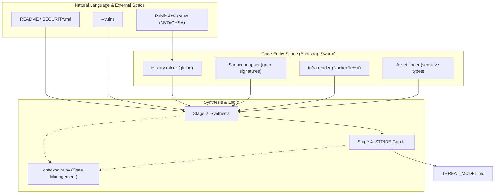
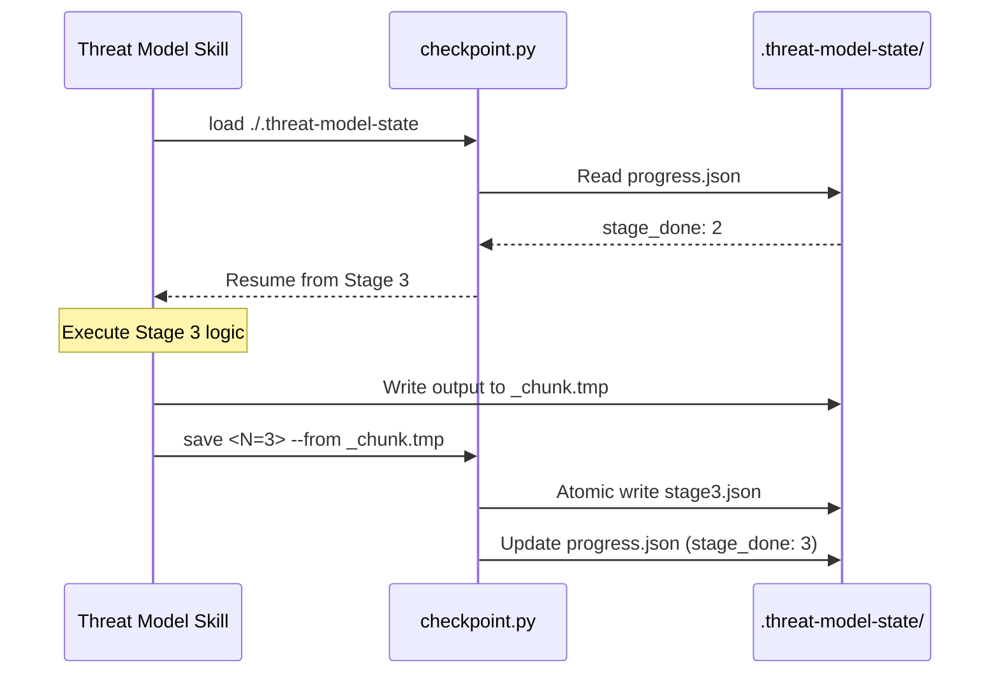

<!-- source: DeepWiki mcp.deepwiki.com · repo anthropics/defending-code-reference-harness · page 3.1 Threat Modeling Skill · fetched 2026-10-26 -->

# Threat Modeling Skill

Relevant source files

The following files were used as context for generating this wiki page:

- [.claude/skills/threat-model/README.md](.claude/skills/threat-model/README.md)
- [.claude/skills/threat-model/SKILL.md](.claude/skills/threat-model/SKILL.md)
- [.claude/skills/threat-model/bootstrap.md](.claude/skills/threat-model/bootstrap.md)
- [.claude/skills/threat-model/interview.md](.claude/skills/threat-model/interview.md)
- [.claude/skills/threat-model/schema.md](.claude/skills/threat-model/schema.md)
- [docs/threat-model.md](docs/threat-model.md)

The `/threat-model` skill is an interactive tool within the Claude Code environment designed to answer the fundamental security question: **"What could go wrong with this system, who would do it, and what should we do about it?"** It operates independently of specific bug discovery, acting as the "map" that guides the vulnerability pipeline's "metal detector" toward high-risk areas.

The skill produces a `THREAT_MODEL.md` file following a strict schema, which serves as a foundational artifact for downstream autonomous agents in the reconnaissance and triage stages.

### Core Philosophy: Threat vs. Vulnerability
The skill enforces a strict distinction between a threat and a vulnerability:
*   **Threat:** A high-level scenario (e.g., "Remote code execution via untrusted media parsing") that persists even after a specific bug is patched.
*   **Vulnerability:** A specific instance of a bug (e.g., "missing bounds check at line 412") that instantiates a threat.
*   **Litmus Test:** If patching one line of code makes an entry disappear, it was a vulnerability, not a threat.

Sources: [.claude/skills/threat-model/SKILL.md:29-42](), [.claude/skills/threat-model/interview.md:126-128]()

---

## Operational Modes

The skill supports three primary workflows to accommodate different levels of human availability and codebase familiarity.

| Mode | Trigger | Methodology | Best For |
| :--- | :--- | :--- | :--- |
| **Bootstrap** | `bootstrap` | Automated 5-stage research pipeline using parallel sub-agents. | Inherited systems, OSS, or when no owner is available. |
| **Interview** | `interview` | Conversational walk-through using the "Four Question Framework." | New systems or logic-heavy apps where code doesn't tell the whole story. |
| **Hybrid** | `bootstrap-then-interview` | Runs bootstrap first, then uses the output to seed a human interview. | **Recommended path**; minimizes owner time by refining a code-grounded draft. |

Sources: [.claude/skills/threat-model/SKILL.md:4-9](), [.claude/skills/threat-model/SKILL.md:73-82](), [.claude/skills/threat-model/SKILL.md:110-128]()

---

## Bootstrap Mode: The Automated Pipeline

When running in `bootstrap` mode, the skill executes a multi-stage research pipeline. For codebases with >50 files, it spawns a parallel "swarm" of agents using the `Task` tool to gather intelligence concurrently.

### 5-Stage Pipeline Flow

1.  **Stage 1: Research Swarm** — Parallel agents (`Docs reader`, `Surface mapper`, `Infra reader`, `Asset finder`, `History miner`, `Advisory fetcher`) gather raw data.
2.  **Stage 2: Synthesis** — Consolidates swarm findings into System Context, Assets, and Entry Points.
3.  **Stage 3: Generalization** — Analyzes collected vulnerabilities (from git history/CVEs) to derive domain-specific threat classes.
4.  **Stage 4: STRIDE Gap-filling** — Applies the STRIDE model (Spoofing, Tampering, Repudiation, Information Disclosure, Denial of Service, Elevation of Privilege) to entry points not covered by historical bugs.
5.  **Stage 5: Emission** — Finalizes the `THREAT_MODEL.md` and clears state.

### Bootstrap Data Flow Diagram

Sources: [.claude/skills/threat-model/bootstrap.md:8-10](), [.claude/skills/threat-model/bootstrap.md:94-135](), [.claude/skills/threat-model/SKILL.md:14-26]()

---

## Interview Mode: Four Question Framework

The `interview` mode follows the Shostack framework to extract security context from a human owner while grounding claims in the source code.

### The Four Questions
1.  **What are we working on?** (Fills System Context, Assets, Entry Points).
2.  **What can go wrong?** (Fills Threat Table via STRIDE and derived classes).
3.  **What are we going to do about it?** (Fills Controls, Impact, Likelihood, and Status).
4.  **Did we do a good job?** (Validates coverage and identifies Open Questions).

### Provenance Discipline
The agent maintains a strict "Provenance Discipline" during the interview:
*   `[Code-verified]`: Facts confirmed by reading the source (e.g., confirming a route exists in `routes.py`).
*   `[Owner-states]`: Claims made by the human that cannot be verified in code (e.g., "This service is only reachable via VPN"). These are explicitly listed in the "Open Questions" section.

Sources: [.claude/skills/threat-model/interview.md:7-19](), [.claude/skills/threat-model/interview.md:36-49]()

---

## State Management and Checkpointing

To handle large codebases and potential API rate limits, the bootstrap mode implements a robust checkpointing system.

*   **Storage:** State is stored in `./.threat-model-state/` relative to the current working directory.
*   **Implementation:** All I/O is managed by `.claude/skills/_lib/checkpoint.py` to ensure atomic, JSON-validated writes.
*   **Key Files:**
    *   `progress.json`: The single source of truth (`{"status": "running", "stage_done": N}`).
    *   `stageN.json`: Data payload for a specific stage.
*   **Resumption:** If a session is interrupted, re-running the command automatically reads the state and skips completed stages unless `--fresh` is passed.

### Checkpoint Logic Diagram

Sources: [.claude/skills/threat-model/bootstrap.md:46-90]()

---

## Output Schema: THREAT_MODEL.md

Both modes emit a standardized Markdown file. The schema is designed for both human readability and machine parsing (via regex on headings and tables).

### Required Sections
1.  **System context:** Prose description of the system.
2.  **Assets:** Table of things worth protecting (sensitivity: `low` to `critical`).
3.  **Entry points & trust boundaries:** Table of where untrusted input enters.
4.  **Threats:** The core table (Impact x Likelihood).
5.  **Deprioritized:** Threats explicitly out of scope or risk-accepted.
6.  **Open questions:** Follow-ups for humans (bootstrap) or code review (interview).
7.  **Provenance:** Metadata about how the model was generated (mode, date, target commit).
8.  **Recommended mitigations:** (Optional) Class-level controls (e.g., "sandbox the decoder").

### Threat Table Scoring
Threats are scored using standardized enums:
*   **Impact:** `low`, `medium`, `high`, `critical`, `existential`.
*   **Likelihood:** `very_rare`, `rare`, `possible`, `likely`, `almost_certain`.
*   **Status:** `unmitigated`, `partially_mitigated`, `mitigated`, `risk_accepted`.

Sources: [.claude/skills/threat-model/schema.md:7-35](), [.claude/skills/threat-model/schema.md:71-98](), [.claude/skills/threat-model/schema.md:147-172]()

---

