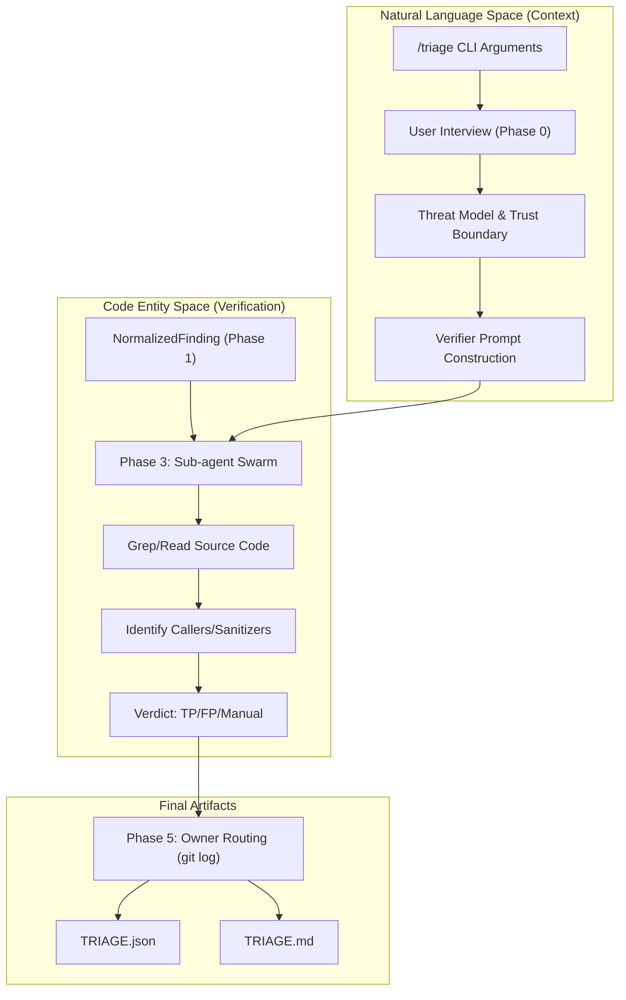
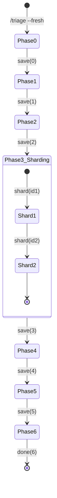

<!-- source: DeepWiki mcp.deepwiki.com · repo anthropics/defending-code-reference-harness · page 3.3 Triage Skill · fetched 2026-10-26 -->

# Triage Skill

Relevant source files

The following files were used as context for generating this wiki page:

- [.claude/skills/_lib/checkpoint.py](.claude/skills/_lib/checkpoint.py)
- [.claude/skills/triage/README.md](.claude/skills/triage/README.md)
- [.claude/skills/triage/SKILL.md](.claude/skills/triage/SKILL.md)
- [tests/test_checkpoint.py](tests/test_checkpoint.py)
- [tests/test_skill_checkpoint.py](tests/test_skill_checkpoint.py)

The `/triage` skill is an interactive and automated tool designed to process raw security scanner outputs through a rigorous 7-phase adversarial verification pipeline. Unlike simple format converters, the triage skill performs **static verification** of findings by reasoning about source code, deduplicates overlapping reports, re-ranks them based on derived exploitability, and routes confirmed issues to specific component owners.

## Overview and Purpose

The primary goal of the triage skill is to transform a "raw dump" of potential vulnerabilities into a prioritized, actionable list. It operates under a strict "no-execution" policy: it reads source code but never builds or runs target code to verify a finding [[.claude/skills/triage/SKILL.md:60-66]]().

### Key Capabilities
- **Verification**: Uses independent sub-agents to vote on whether a finding is a True Positive (TP) or False Positive (FP) [[.claude/skills/triage/SKILL.md:28-32]]().
- **Deduplication**: Collapses multiple scanner outputs (or results from different scanners) into unique logical issues [[.claude/skills/triage/SKILL.md:29-29]]().
- **Exploitability Ranking**: Re-ranks findings based on actual reachability and impact rather than the scanner's claimed severity [[.claude/skills/triage/SKILL.md:30-31]]().
- **Checkpointing**: Supports resuming large batches (hundreds of findings) across multiple sessions [[.claude/skills/triage/SKILL.md:73-78]]().

---

## The 7-Phase Pipeline

The skill executes in a linear sequence of phases, persisting state to `./.triage-state/` after each step.

### Phase 0: Mode Select and Interview
The skill determines its operational parameters. In interactive mode (default), it interviews the user to establish the **Environment & Trust Boundary** and the **Threat Model** [[.claude/skills/triage/SKILL.md:120-154]](). These answers directly influence how sub-agents judge reachability in Phase 3.

### Phase 1: Ingest and Normalize
The skill reads findings from various formats (JSON, Markdown, or `VULN-FINDINGS.json`) and maps them to a internal `NormalizedFinding` schema [[.claude/skills/triage/SKILL.md:193-205]]().

### Phase 2: Structural Deduplication
Findings are grouped by file and line number to prevent redundant verification of the same code location [[.claude/skills/triage/SKILL.md:223-230]]().

### Phase 3: Adversarial Verification
This is the most compute-intensive phase. The orchestrator spawns `N` independent sub-agents (controlled by `--votes`) for each finding.
- **Exclusion Rules**: Sub-agents are provided with "False Positive Rules" (e.g., "Prisma ORM handles SQLi") to filter out known-safe patterns [[.claude/skills/triage/SKILL.md:247-254]]().
- **Independent Reasoning**: Agents must cite file/line evidence and provide a verdict: `TP`, `FP`, or `NEEDS_MANUAL_CHECK` [[.claude/skills/triage/SKILL.md:256-270]]().

### Phase 4: Semantic Deduplication
A "Judge" agent reviews findings that occur in the same component or share similar logic to ensure only unique root causes are reported [[.claude/skills/triage/SKILL.md:300-310]]().

### Phase 5: Ranking and Routing
Surviving findings are ranked by a scoring rubric (0.0 to 10.0) based on reachability, exploitability, and impact [[.claude/skills/triage/SKILL.md:328-340]](). Each finding is assigned an `owner_hint` based on `git log` or directory structure [[.claude/skills/triage/SKILL.md:342-345]]().

### Phase 6: Output Generation
The final artifacts are written: `TRIAGE.json` (machine-readable) and `TRIAGE.md` (human-readable report) [[.claude/skills/triage/SKILL.md:363-375]]().

---

## Data Flow and Sub-agent Orchestration

The following diagram illustrates how the triage skill bridges the gap between raw scanner output and verified code entities.

**Triage Verification Logic**

**Sources:** [[.claude/skills/triage/SKILL.md:120-160]](), [[.claude/skills/triage/SKILL.md:242-270]](), [[.claude/skills/triage/SKILL.md:363-375]]()

---

## Checkpointing Infrastructure

For large batches, the skill uses a robust checkpointing system managed by `checkpoint.py`. This prevents losing progress due to API rate limits or context exhaustion.

### State Management
- **`progress.json`**: The single source of truth for the current phase and completed shards [[.claude/skills/triage/SKILL.md:87-90]]().
- **`phaseN.json`**: Contains the data payload for Phase `N` [[.claude/skills/triage/SKILL.md:91-92]]().
- **Sharding**: In Phase 3, findings are sharded into `shard_ID.json` files to handle high-volume verification tasks [[.claude/skills/triage/SKILL.md:275-280]]().

### Checkpoint Operations
The skill invokes `checkpoint.py` via Bash to ensure atomic writes and prevent shell injection by using the `--from` flag for payloads [[.claude/skills/_lib/checkpoint.py:16-19]]().

**Checkpoint State Transition**

**Sources:** [[.claude/skills/triage/SKILL.md:73-117]](), [[.claude/skills/_lib/checkpoint.py:9-14]](), [[tests/test_skill_checkpoint.py:35-46]]()

---

## Implementation Details

### Key Functions and Classes

| Component | File Path | Description |
| :--- | :--- | :--- |
| `checkpoint.py` | [[.claude/skills/_lib/checkpoint.py:1-27]]() | CLI utility for atomic state persistence and path-confined I/O. |
| `_confine` | [[.claude/skills/_lib/checkpoint.py:41-54]]() | Ensures all checkpoint writes stay within the allowed repository root. |
| `_atomic_write` | [[.claude/skills/_lib/checkpoint.py:64-68]]() | Uses `os.replace` to ensure files are never partially written. |
| `SKILL.md` | [[.claude/skills/triage/SKILL.md:1-24]]() | Defines the skill's tool permissions (Read, Glob, Grep, etc.) and entry point. |

### False Positive Exclusion Rules
The skill supports a flexible mechanism for suppressing findings based on organizational context. These rules are injected into the Phase 3 verifier prompts:
1. **Built-in Rules**: 10 standard rules (e.g., Rule 8: "Operator-controlled environment is not a trust boundary for DoS") [[.claude/skills/triage/SKILL.md:173-189]]().
2. **Custom Rules**: Provided via the `--fp-rules FILE` argument [[.claude/skills/triage/SKILL.md:48-51]]().

**Sources:** [[.claude/skills/triage/SKILL.md:48-51]](), [[.claude/skills/triage/SKILL.md:173-189]](), [[.claude/skills/_lib/checkpoint.py:41-68]]()

---

