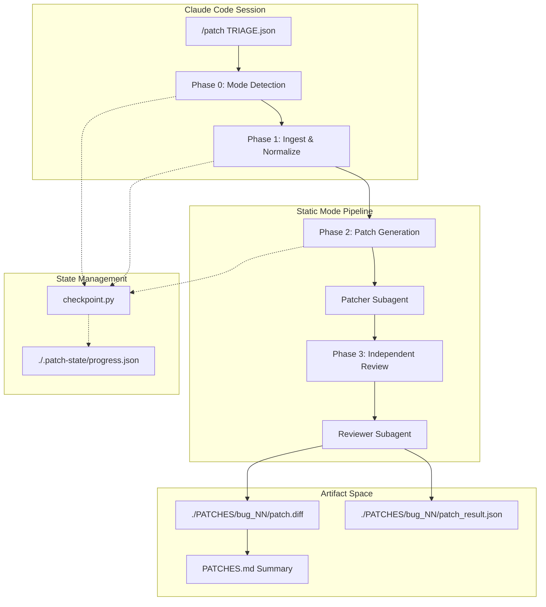
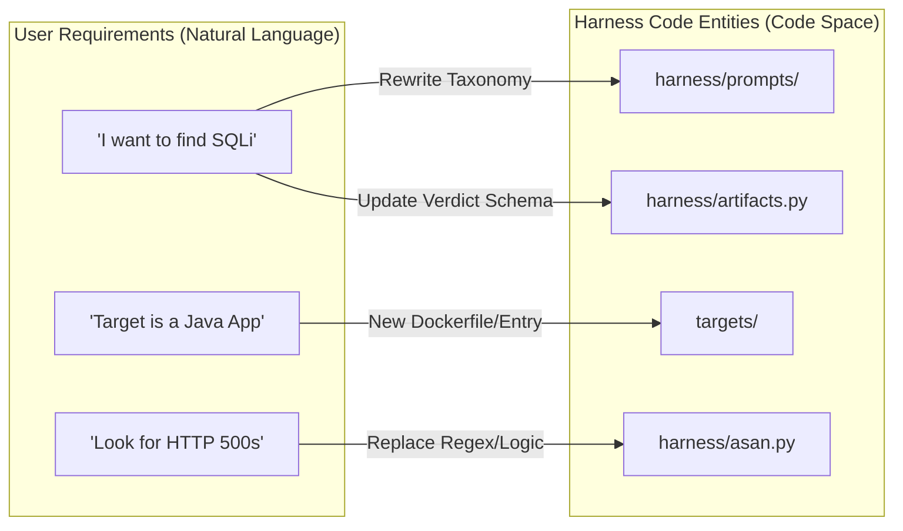

<!-- source: DeepWiki mcp.deepwiki.com · repo anthropics/defending-code-reference-harness · page 3.4 Patch Skill and Customize Skill · fetched 2026-10-26 -->

# Patch Skill and Customize Skill

Relevant source files

The following files were used as context for generating this wiki page:

- [.claude/skills/customize/SKILL.md](.claude/skills/customize/SKILL.md)
- [.claude/skills/patch/SKILL.md](.claude/skills/patch/SKILL.md)
- [docs/customizing.md](docs/customizing.md)
- [docs/other-use-cases.md](docs/other-use-cases.md)
- [docs/prompting.md](docs/prompting.md)

The `/patch` and `/customize` skills extend the harness beyond vulnerability discovery into remediation and architectural adaptation. While the `/patch` skill provides a bridge between identified findings and candidate fixes, the `/customize` skill allows the entire pipeline to be ported to new languages, detectors, and vulnerability classes through an interactive, interview-driven workflow.

## The Patch Skill (/patch)

The `/patch` skill is the final leg of the static analysis pipeline (`/vuln-scan` → `/triage` → `/patch`). It consumes verified findings and generates candidate git diffs for human review. Unlike the autonomous pipeline's patching stage, the interactive `/patch` skill operates in two distinct modes depending on the input provided.

### Operational Modes

The skill automatically detects its mode by inspecting the provided findings path [[.claude/skills/patch/SKILL.md:112-114]]().

| Mode | Input Source | Verification Mechanism |
| :--- | :--- | :--- |
| **Execution-Verified** | Pipeline results directory (contains PoCs/ASAN traces) [[.claude/skills/patch/SKILL.md:116-119]]() | Delegated to `vuln-pipeline patch` for T0-T3 ladder validation [[.claude/skills/patch/SKILL.md:5-6]](). |
| **Static** | `TRIAGE.json`, `VULN-FINDINGS.json`, or generic JSON/Markdown [[.claude/skills/patch/SKILL.md:120-121]]() | Independent subagent reviewer acts as the oracle in a fresh context [[.claude/skills/patch/SKILL.md:121-121]](). |

### Implementation and Data Flow

The skill follows a phased execution model, utilizing a checkpointing system to ensure resilience against session timeouts or API errors. State is persisted to `./.patch-state/` using `checkpoint.py` [[.claude/skills/patch/SKILL.md:73-75]]().

**Patch Generation Logic (Static Mode):**
1.  **Ingest:** Normalizes input into a flat `findings[]` array [[.claude/skills/patch/SKILL.md:133-136]]().
2.  **Subagent Spawn:** For each finding, a "patcher" subagent is spawned to generate a diff [[.claude/skills/patch/SKILL.md:180-182]]().
3.  **Independent Review:** A "reviewer" subagent evaluates the diff for correctness and regression risks [[.claude/skills/patch/SKILL.md:183-185]]().
4.  **Inert Output:** Results are written to `./PATCHES/` as inert text. The skill **never** applies patches to the source tree [[.claude/skills/patch/SKILL.md:34-38]]().

### Patch Skill Architecture

The following diagram illustrates the flow from a `TRIAGE.json` finding to a generated patch artifact.

**Static Patch Generation Flow**

**Sources:** [[.claude/skills/patch/SKILL.md:29-41]](), [[.claude/skills/patch/SKILL.md:73-81]](), [[.claude/skills/patch/SKILL.md:112-121]](), [[.claude/skills/patch/SKILL.md:180-195]]()

---

## The Customize Skill (/customize)

The `/customize` skill is designed to adapt the C/C++ ASAN-centric pipeline to other domains, such as web applications (SQLi/XSS), smart contracts (Reentrancy), or different languages (Java/Python). It functions as an architectural consultant that interviews the user to map new requirements onto the harness's generic components [[.claude/skills/customize/SKILL.md:8-10]]().

### The Interview Workflow

The skill follows a structured interview process to bridge the gap between a user's high-level goal and the technical implementation of the harness.

1.  **Internal Audit:** The agent first reads the existing pipeline files (e.g., `harness/cli.py`, `harness/prompts/find_prompt.py`) to understand what is generic vs. ASAN-specific [[.claude/skills/customize/SKILL.md:12-28]]().
2.  **Round 1 (Context & Goal):** Asks broad questions about the operating environment (e.g., pentesting vs. internal AppSec) and the target bug classes [[.claude/skills/customize/SKILL.md:34-48]]().
3.  **Round 2 (Technical Mapping):** Deep dives into "axes of variation" such as detection signals (e.g., HTTP 500 vs. ASAN crash) and PoC shapes [[.claude/skills/customize/SKILL.md:50-63]]().

### Axes of Variation

The skill uses these dimensions to guide the migration plan:

| Axis | C/C++ Default | Example Customization |
| :--- | :--- | :--- |
| **Detection** | ASAN crash/abort [[.claude/skills/customize/SKILL.md:72-72]]() | Exception, Canary file, DNS callback [[.claude/skills/customize/SKILL.md:54-54]]() |
| **PoC Shape** | Binary file [[.claude/skills/customize/SKILL.md:82-82]]() | HTTP request sequence, Transaction list [[.claude/skills/customize/SKILL.md:55-55]]() |
| **Isolation** | Docker + gVisor [[.claude/skills/customize/SKILL.md:76-76]]() | VM, Testnet, or Static-only [[.claude/skills/customize/SKILL.md:56-56]]() |
| **Signature** | `(crash_type, top_frame)` [[.claude/skills/customize/SKILL.md:78-78]]() | `(vuln_type, endpoint, param)` [[.claude/skills/customize/SKILL.md:78-78]]() |

### Mapping Customization to Code Entities

The following diagram shows how the `/customize` skill maps natural language requirements to specific code entities within the harness.

**Customization Mapping: Requirements to Code**

**Sources:** [[.claude/skills/customize/SKILL.md:16-28]](), [[.claude/skills/customize/SKILL.md:50-63]](), [[docs/customizing.md:71-78]]()

### Concretely: What Changes?

When porting the pipeline, the `/customize` skill focuses on these specific files:

*   **Prompts:** `find_prompt.py` and `grade_prompt.py` must be updated with the new bug taxonomy and grading rubric [[docs/customizing.md:71-74]]().
*   **Report Structure:** `report_prompt.py` is modified to change exploitability sections (e.g., from "Heap Layout" to "Injection Vector") [[.claude/skills/customize/SKILL.md:58-58]]().
*   **Target Definition:** A new `targets/<name>/Dockerfile` is created to set up the build environment and detector hooks [[docs/customizing.md:78-78]]().
*   **Signature Logic:** `harness/asan.py` is typically replaced or modified to parse the new detection signal for deduplication [[.claude/skills/customize/SKILL.md:23-23]]().

**Sources:**
* [[.claude/skills/patch/SKILL.md:1-195]]()
* [[.claude/skills/customize/SKILL.md:1-85]]()
* [[docs/customizing.md:1-87]]()
* [[docs/prompting.md:47-71]]()
* [[docs/other-use-cases.md:9-21]]()

---

