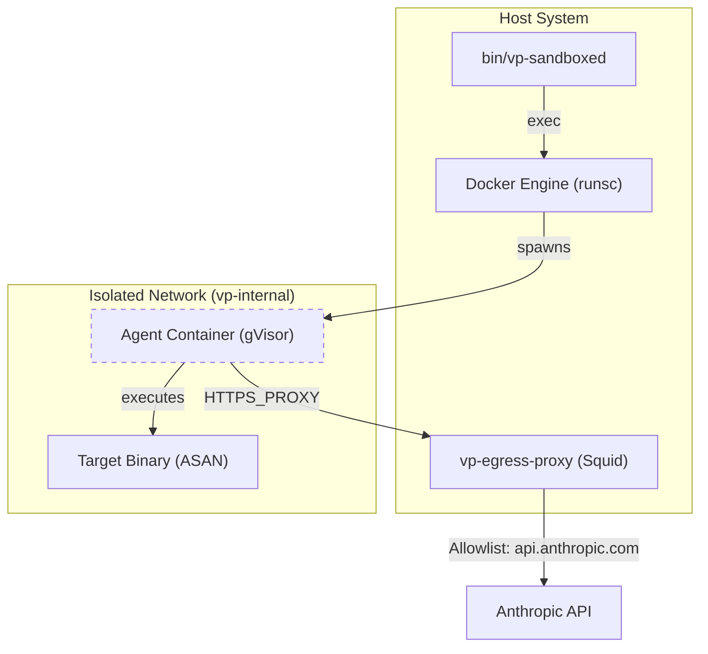

<!-- source: DeepWiki mcp.deepwiki.com · repo anthropics/defending-code-reference-harness · page 4 Sandbox and Infrastructure · fetched 2026-10-26 -->

# Sandbox and Infrastructure

Relevant source files

The following files were used as context for generating this wiki page:

- [bin/vp-sandboxed](bin/vp-sandboxed)
- [docs/security.md](docs/security.md)
- [harness/README.md](harness/README.md)
- [harness/sandbox.py](harness/sandbox.py)

The Defending Code Reference Harness is designed with a "Security-First" architecture that assumes the code being analyzed—and the agents analyzing it—may be malicious. The infrastructure provides a multi-layered defense-in-depth strategy to isolate the execution of untrusted code and restrict the capabilities of AI agents.

The core of this infrastructure is a **gVisor-isolated container system** combined with a **strict egress proxy**. This ensures that while agents have the freedom to compile and execute target code to find vulnerabilities, they cannot reach out to the internet (except for the Anthropic API) or access the host system.

## Infrastructure Overview

The infrastructure is built on four pillars that work together to create a secure "Attack Phase" environment [docs/security.md:50-73]():

1.  **gVisor Isolation**: Uses the `runsc` runtime to provide syscall-level sandboxing, preventing container escapes even if the target code exploits a kernel vulnerability [docs/security.md:96-98]().
2.  **Network Segregation**: Agents run on a dedicated Docker network (`vp-internal`) with no default gateway to the internet [harness/sandbox.py:5-10]().
3.  **Egress Proxy**: A Squid-based proxy (`vp-egress-proxy`) serves as the sole gateway, allowlisting only `api.anthropic.com` [bin/vp-sandboxed:22-31]().
4.  **Agent Image System**: A specialized build system that layers the Claude Code CLI and target-specific dependencies into a hardened image [harness/sandbox.py:78-79]().

### The Sandbox Trust Boundary

The following diagram illustrates how the `bin/vp-sandboxed` entrypoint orchestrates the various components to establish the trust boundary.

**Infrastructure Architecture and Data Flow**

**Sources:** [bin/vp-sandboxed:10-39](), [harness/sandbox.py:5-10](), [docs/security.md:21-28]()

---

## Sandbox Setup and Configuration

Before running the pipeline, the environment must be provisioned. This is handled by `scripts/setup_sandbox.sh`, which automates the installation of gVisor, the creation of the internal Docker network, and the deployment of the egress proxy.

The setup process enforces a **Setup → Attack isolation split** [docs/security.md:51-73](). During setup, network access is allowed to pull dependencies and build the target image. Once the "Attack" phase begins (via `bin/vp-sandboxed`), the environment is locked down.

For details on provisioning and environment variables, see **[Sandbox Setup and Configuration](#4.1)**.

**Sources:** [harness/README.md:47-52](), [docs/security.md:53-65]()

---

## Runtime Sandbox and Docker Operations

At runtime, the harness manages container lifecycles using `harness/sandbox.py` and `harness/docker_ops.py`. Every agent (recon, find, grade, report, or patch) is wrapped in the `agent_container` context manager [harness/sandbox.py:58-67]().

This layer handles:
*   **Runtime Selection**: Automatically choosing `runsc` (gVisor) if available, or falling back to `runc` if `--dangerously-no-sandbox` is specified [harness/sandbox.py:27-28]().
*   **Permission Modes**: Setting `bypassPermissions` inside the sandbox so the agent can work efficiently, while defaulting to `auto` mode outside the sandbox for safety [harness/sandbox.py:46-55]().
*   **Resource Constraints**: Enforcing memory limits (default 4GB) and SHM sizes for stable execution [harness/sandbox.py:63-64]().

For details on the container lifecycle and image management, see **[Runtime Sandbox and Docker Operations](#4.2)**.

**Sources:** [harness/sandbox.py:14-104](), [harness/README.md:12-16]()

---

## Agent Runner

The `harness/agent.py` module is responsible for the low-level execution of the Claude Code CLI within the provisioned containers. It invokes the headless CLI with specific flags: `claude -p --output-format stream-json` [harness/agent.py:133-140]().

The runner provides:
*   **JSONL Streaming**: Real-time parsing of agent thoughts and tool use.
*   **Persistence**: Ensuring transcripts are saved to disk with `fsync` to prevent data loss during crashes [harness/agent.py:175-180]().
*   **Session Management**: Logic to resume sessions if the API returns transient errors.

For details on the subprocess management and XML tag parsing, see **[Agent Runner](#4.3)**.

**Sources:** [harness/agent.py:13-145](), [harness/README.md:122-134]()

---

## Summary of Infrastructure Components

| Component | Code Entity | Purpose |
| :--- | :--- | :--- |
| **Sandbox Manager** | `harness/sandbox.py` | High-level API for spawning isolated agent environments [harness/sandbox.py:59]() |
| **Docker Wrapper** | `harness/docker_ops.py` | Low-level Docker CLI abstractions (run, rm, cp, exec) |
| **Egress Proxy** | `vp-egress-proxy` | Squid proxy restricting agent network access [bin/vp-sandboxed:12]() |
| **Sandboxed Entry** | `bin/vp-sandboxed` | Shell wrapper that ensures the environment is secure before execution [bin/vp-sandboxed:1-7]() |
| **Agent Image** | `harness/agent_image.py` | Logic to build/ensure the `vuln-pipeline-agent` image [harness/sandbox.py:78]() |

**Sources:** [harness/sandbox.py:19-25](), [bin/vp-sandboxed:10-14](), [docs/security.md:21-28]()

---

