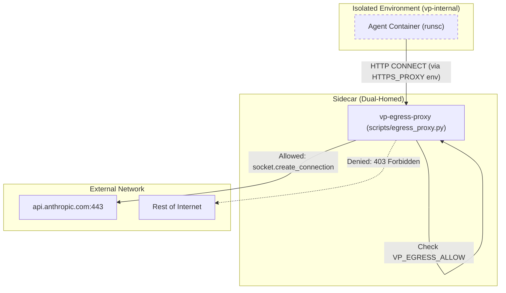
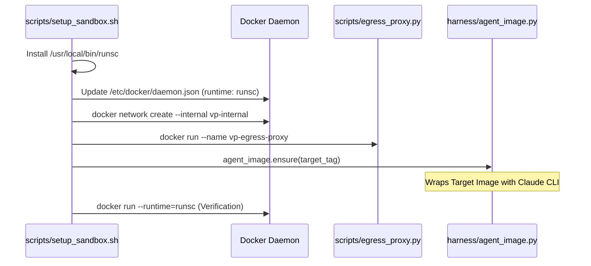

<!-- source: DeepWiki mcp.deepwiki.com · repo anthropics/defending-code-reference-harness · page 4.1 Sandbox Setup and Configuration · fetched 2026-10-26 -->

# Sandbox Setup and Configuration

Relevant source files

The following files were used as context for generating this wiki page:

- [scripts/Dockerfile.proxy](scripts/Dockerfile.proxy)
- [scripts/egress_proxy.py](scripts/egress_proxy.py)
- [scripts/setup_sandbox.sh](scripts/setup_sandbox.sh)

The Defending Code Reference Harness utilizes a multi-layered sandbox to isolate agent execution from the host environment. This isolation is critical for safely running untrusted code generated by agents and for preventing agents from accessing sensitive host resources or external networks beyond the necessary LLM APIs.

The sandbox infrastructure is provisioned primarily via `scripts/setup_sandbox.sh`, which configures **gVisor** for syscall isolation, establishes an internal Docker network, and deploys a filtering egress proxy.

## Provisioning Workflow

The `scripts/setup_sandbox.sh` script automates the one-time setup required to run the pipeline in its default secure mode. It performs five major operations:

### 1. gVisor (runsc) Installation
The script downloads and installs the `runsc` binary, the user-space kernel for gVisor [scripts/setup_sandbox.sh:24-41](). gVisor provides a strong isolation boundary by intercepting application syscalls and running them in a non-privileged process, effectively mitigating container breakout risks.

### 2. Docker Runtime Registration
To make gVisor available to Docker, the script modifies `/etc/docker/daemon.json` to register `runsc` as a runtime [scripts/setup_sandbox.sh:44-68](). 
*   **Overlay Configuration**: It explicitly sets `--overlay2=none` [scripts/setup_sandbox.sh:48](). This ensures that files written by the agent (like PoC exploits) are visible to the orchestrator via `docker exec`, bypassing the default in-sandbox tmpfs overlay that would otherwise hide them.
*   **Cgroups**: It probes for cgroup writability and adds `--ignore-cgroups` if the host cannot delegate them, which affects memory limit enforcement [scripts/setup_sandbox.sh:49-53]().

### 3. Network Isolation and Egress Proxy
The harness enforces strict network boundaries:
*   **Internal Network**: A Docker network named `vp-internal` is created with the `--internal` flag, which prevents containers on this network from having a default route to the internet [scripts/setup_sandbox.sh:82-84]().
*   **Egress Proxy**: A specialized proxy (`scripts/egress_proxy.py`) is deployed as a sidecar container named `vp-egress-proxy` [scripts/setup_sandbox.sh:85-93](). This proxy is dual-homed: it sits on both the `vp-internal` network and the standard Docker `bridge` network [scripts/setup_sandbox.sh:94]().

### 4. Image Preparation
The script iterates through all directories in `targets/` to build the base target images and then wraps them into "agent images" using `harness.agent_image.ensure()` [scripts/setup_sandbox.sh:100-108](). These agent images contain the target's build artifacts along with the `claude` CLI and necessary debugging tools.

### 5. Verification Tests
The setup concludes with a suite of "smoke tests" to verify the security properties [scripts/setup_sandbox.sh:111-152]():
*   **Kernel Check**: Compares `uname -r` inside and outside the container to ensure the gVisor guest kernel is active.
*   **Egress Check**: Verifies that the agent can reach `api.anthropic.com` via the proxy but cannot reach `example.com` or direct IP addresses like `8.8.8.8`.
*   **Filesystem Check**: Confirms the container cannot see the host's `/tmp` directory.

**Sources:**
* `scripts/setup_sandbox.sh`
* `scripts/egress_proxy.py`

## Egress Proxy Architecture

The `scripts/egress_proxy.py` script implements a minimal `HTTP CONNECT` proxy. It is the only bridge between the isolated `vp-internal` network and the internet.

### Implementation Details
*   **Allowlist**: The proxy only honors `CONNECT` requests to host:port pairs defined in the `VP_EGRESS_ALLOW` environment variable [scripts/egress_proxy.py:23-27]().
*   **Connection Pumping**: When a valid `CONNECT` request is received, the `Handler._pump` method performs bi-directional asynchronous data transfer between the agent and the upstream API using `select.select` [scripts/egress_proxy.py:52-74]().
*   **Logging**: All denied attempts are logged to `stderr` in the proxy container, providing an audit trail of attempted network breakouts [scripts/egress_proxy.py:37-38]().

### Sandbox Network Flow
The following diagram illustrates how an agent container communicates with the Anthropic API while being blocked from the general internet.

**Sandbox Network and Egress Logic**

**Sources:**
* `scripts/egress_proxy.py:31-50` (Handler logic)
* `scripts/setup_sandbox.sh:82-97` (Network configuration)

## Configuration and Bypasses

The sandbox behavior can be influenced by environment variables and CLI flags.

### Environment Variables
| Variable | Default | Purpose |
| :--- | :--- | :--- |
| `VP_EGRESS_ALLOW` | `api.anthropic.com:443` | Comma-separated list of `host:port` allowed for egress [scripts/egress_proxy.py:25](). |
| `VP_EGRESS_PORT` | `3128` | The port the egress proxy listens on [scripts/egress_proxy.py:28](). |
| `RUNSC_RELEASE` | `20260420` | The version of gVisor to install [scripts/setup_sandbox.sh:19](). |

### The --dangerously-no-sandbox Bypass
In environments where gVisor cannot be installed (e.g., macOS, Windows, or restricted CI environments), the pipeline can be run using the `--dangerously-no-sandbox` flag.

*   **Mechanism**: When this flag is used, the orchestrator bypasses the `runsc` runtime and the `vp-internal` network. Containers are run using the default Docker runtime with standard host networking.
*   **Risk**: This disables syscall isolation and network filtering. The agent's generated code will have the same level of access as a standard Docker container.
*   **Fallback**: `scripts/setup_sandbox.sh` explicitly suggests this flag if it detects a non-Linux host [scripts/setup_sandbox.sh:29-32]().

## Setup Sequence
This diagram maps the `setup_sandbox.sh` procedure to the resulting system state.

**Provisioning Sequence and Code Entities**

**Sources:**
* `scripts/setup_sandbox.sh:1-153`
* `scripts/egress_proxy.py:80-86` (Main entry point)

---

