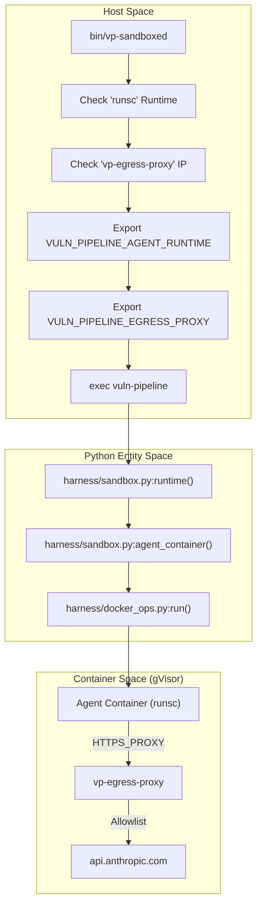
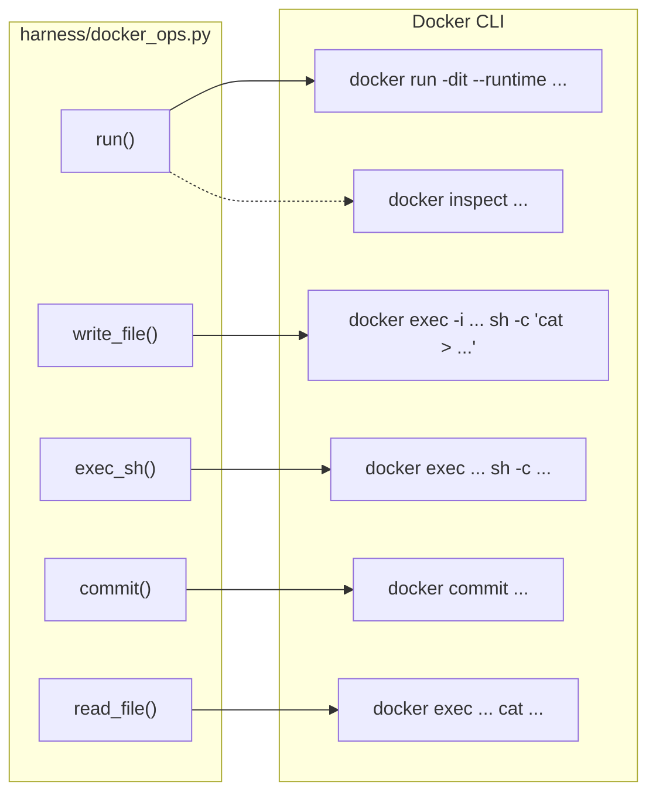

<!-- source: DeepWiki mcp.deepwiki.com · repo anthropics/defending-code-reference-harness · page 4.2 Runtime Sandbox and Docker Operations · fetched 2026-10-26 -->

# Runtime Sandbox and Docker Operations

Relevant source files

The following files were used as context for generating this wiki page:

- [bin/vp-sandboxed](bin/vp-sandboxed)
- [harness/agent_image.py](harness/agent_image.py)
- [harness/docker_ops.py](harness/docker_ops.py)
- [harness/sandbox.py](harness/sandbox.py)
- [tests/test_agent_sandbox.py](tests/test_agent_sandbox.py)
- [tests/test_sandbox.py](tests/test_sandbox.py)

The Defending Code Reference Harness relies on a robust containerization strategy to isolate agents while they perform vulnerability discovery and exploitation. This isolation is achieved through a combination of **gVisor** (the `runsc` runtime), strict **Docker networking**, and a **layered image build system** that separates the agent's toolset from the target's build environment.

The core logic for managing these lifecycles resides in `harness/sandbox.py` and `harness/docker_ops.py`.

## Overview of Sandbox Architecture

The sandbox ensures that agents (find, grade, report, etc.) can execute arbitrary code (e.g., compiling and running PoCs) without compromising the host system. It also enforces a strict egress policy, allowing agents to reach the Anthropic API only through a controlled proxy.

### System Flow: Host to Sandbox

The following diagram illustrates how the `bin/vp-sandboxed` entry point prepares the environment before the Python harness begins spawning containers.

**Sandbox Initialization Flow**

**Sources:** [bin/vp-sandboxed:1-39](), [harness/sandbox.py:21-38](), [harness/sandbox.py:58-88]()

---

## Agent Image Build System

To avoid the overhead of installing Node.js and the Claude Code CLI for every target, the harness uses a layered approach managed by `harness/agent_image.py`.

1.  **Base Image (`_ensure_base`)**: A shared image `vuln-pipeline-agent-base:<version>` is built once. It contains `gcc:14`, Node.js, the pinned Claude Code CLI, and essential tools like `xxd` and `gdb` [harness/agent_image.py:45-63]().
2.  **Per-Target Agent Image (`ensure`)**: When a specific target (e.g., `canary:v1`) is analyzed, the harness creates a new image. It uses the base image and performs a `COPY --from` to pull the `/work` directory from the target's own image [harness/agent_image.py:67-83]().
3.  **Naming Conventions**: Agent images are tagged using the format `<target-tag>-agent:<cli-version>`. This prevents collisions between original targets and patched snapshots created during the re-attack phase [harness/agent_image.py:27-30]().

**Sources:** [harness/agent_image.py:22-30](), [harness/agent_image.py:45-63](), [harness/agent_image.py:67-83]()

---

## Container Lifecycle Management

The `agent_container` context manager in `harness/sandbox.py` is the primary interface for spawning agent environments. It ensures that containers are correctly configured and reliably torn down [harness/sandbox.py:58-92]().

### Runtime and Permission Modes

The harness dynamically adjusts its security posture based on the availability of gVisor:

| Feature | Sandbox Active (`runsc`) | No Sandbox (`--dangerously-no-sandbox`) |
| :--- | :--- | :--- |
| **Runtime** | `runsc` (gVisor) | `runc` (Default) |
| **Permission Mode** | `bypassPermissions` | `auto` |
| **Network** | `vp-internal` | `bridge` |
| **Security Boundary** | Strong (Kernel Isolation) | Weak (Process Isolation) |

**Permission Mode Logic**: When gVisor is active, the container itself is the trust boundary. The Claude CLI is run with `bypassPermissions` because gVisor prevents the agent from escaping the container even if it attempts risky writes. Without the sandbox, it falls back to `auto` mode, where the CLI's internal classifier gates potentially harmful actions [harness/sandbox.py:46-55]().

### Network Isolation Tiers

The `network` parameter in `agent_container` allows for specific isolation levels [harness/sandbox.py:66-77]():

*   **`vp-internal`**: Default mode. Egress is only allowed through the proxy [harness/sandbox.py:24]().
*   **`none`**: Used for containers that run untrusted target code but do not need to communicate with the LLM (e.g., the T0–T2 patch verification ladder). This provides maximum isolation against attacker-crafted PoCs [harness/sandbox.py:73-77]().

**Sources:** [harness/sandbox.py:46-55](), [harness/sandbox.py:58-92](), [harness/sandbox.py:107-128]()

---

## Docker Operations Implementation

`harness/docker_ops.py` serves as a dependency-free wrapper around the Docker CLI. It implements critical checks to ensure the requested runtime and image are actually used.

### Key Functions

*   **`run()`**: Starts a detached container. Crucially, it calls `docker inspect` after starting to verify that the `HostConfig.Runtime` matches the requested runtime (e.g., `runsc`), failing loudly if there is a mismatch [harness/docker_ops.py:24-83]().
*   **`write_file()`**: Uses `docker exec -i ... sh -c 'cat > ...'` instead of `docker cp`. This ensures writes are performed from the container's perspective, which is necessary for gVisor-managed filesystems like `tmpfs` [harness/docker_ops.py:97-108]().
*   **`exec_sh()`**: Executes shell commands inside the container, supporting pipes and redirects. It includes a timeout mechanism to prevent hung processes from blocking the pipeline [harness/docker_ops.py:125-141]().
*   **`commit()`**: Snapshots a container's filesystem. This is used during the patch verification phase to create a "patched" image that can be tested by a find-agent [harness/docker_ops.py:144-148]().

### Entity Mapping: Python to Docker CLI

The following diagram maps high-level Python functions to the underlying Docker commands they execute.

**Docker Operations Mapping**

**Sources:** [harness/docker_ops.py:24-83](), [harness/docker_ops.py:86-94](), [harness/docker_ops.py:97-108](), [harness/docker_ops.py:125-141](), [harness/docker_ops.py:144-148]()

---

## Verification and Safety

The harness includes internal checks to prevent accidental execution outside the sandbox unless explicitly overridden via `--dangerously-no-sandbox`.

*   **Runtime Verification**: The `require()` function in `sandbox.py` checks the `VULN_PIPELINE_AGENT_RUNTIME` environment variable and queries `docker info` to ensure the runtime is registered with the Docker daemon [harness/sandbox.py:107-128]().
*   **Kernel Isolation**: Tests confirm that the kernel reported inside the container (`uname -r`) differs from the host kernel when gVisor is active [tests/test_agent_sandbox.py:50-54]().
*   **Filesystem Boundary**: Verification tests ensure that host files are unreachable from within the `runsc` container, even if the agent attempts to guess paths [tests/test_agent_sandbox.py:57-64]().

**Sources:** [harness/sandbox.py:107-128](), [tests/test_agent_sandbox.py:50-54](), [tests/test_agent_sandbox.py:57-64](), [tests/test_sandbox.py:17-40]()

---

