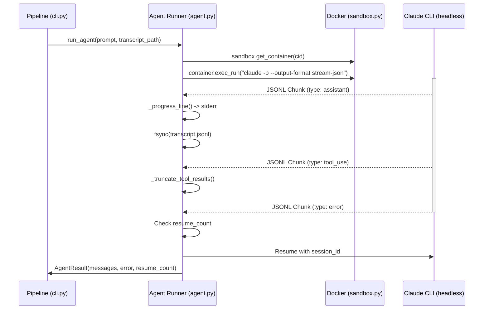
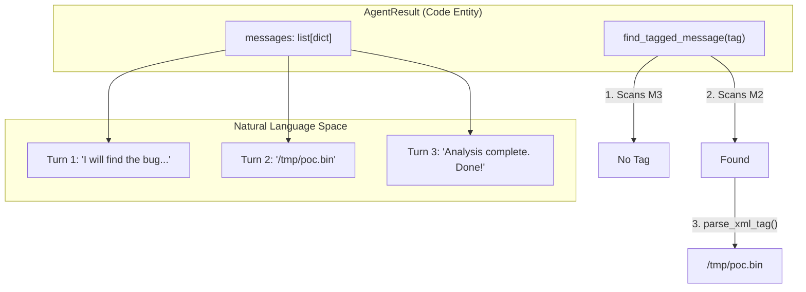

<!-- source: DeepWiki mcp.deepwiki.com · repo anthropics/defending-code-reference-harness · page 4.3 Agent Runner · fetched 2026-10-26 -->

# Agent Runner

Relevant source files

The following files were used as context for generating this wiki page:

- [harness/agent.py](harness/agent.py)
- [tests/test_cli_auth.py](tests/test_cli_auth.py)
- [tests/test_xml_parse.py](tests/test_xml_parse.py)

The Agent Runner is the core execution engine of the harness, responsible for managing the lifecycle of Claude Code instances. It encapsulates the complexity of subprocess management, JSONL stream processing, and robust error recovery, providing a clean interface for the autonomous pipeline and interactive skills to interact with the model.

The primary entry point is `run_agent()`, which wraps the Claude Code headless CLI (`claude -p --output-format stream-json`) within a gVisor-isolated container.

### System Overview and Data Flow

The runner operates by executing the `claude` binary via `docker exec`. It interprets the resulting JSONL stream in real-time to provide progress updates, persist transcripts, and handle session-level failures.

#### Agent Execution Flow
The following diagram illustrates the flow from a pipeline request to the final `AgentResult`.

**Diagram: Agent Execution Lifecycle**

Sources: [harness/agent.py:11-21](), [harness/agent.py:182-205](), [harness/agent.py:228-245]()

---

### Subprocess and Session Management

The runner invokes the Claude CLI using specific flags to ensure machine-readability and headless operation:
- `-p`: Runs in "print" (non-interactive) mode.
- `--output-format stream-json`: Forces the CLI to emit JSONL objects for every event (text, tool use, usage, results).

#### Session Resumption
The runner is designed to be resilient to transient API errors or network interruptions. It tracks the `session_id` provided by the Claude CLI. If the subprocess exits with a retryable error, `run_agent` can automatically resume the session by passing the `--session-id` flag back to the CLI, allowing the agent to pick up exactly where it left off without re-executing previous turns.

| Feature | Implementation |
| :--- | :--- |
| **Streaming** | Async iterator over `stdout` lines [harness/agent.py:218-220]() |
| **Persistence** | Immediate `fsync` after each message block [harness/agent.py:224-226]() |
| **Resumption** | `resume_count` tracking with `--session-id` [harness/agent.py:182-188]() |
| **Truncation** | `_truncate_tool_results` limits ASAN traces to 5000 chars in transcripts [harness/agent.py:87-110]() |

Sources: [harness/agent.py:1-21](), [harness/agent.py:151-159](), [harness/agent.py:182-205]()

---

### XML Tag Parsing and AgentResult

Agents in the harness communicate their findings (e.g., PoC paths, crash types, or verdicts) using XML-style tags within their prose. Because agents often provide a detailed report followed by a short "Done!" message, naive parsing of the *last* message frequently fails to find the required data.

#### The `find_tagged_message` Logic
The `AgentResult` class provides `find_tagged_message(tag)`, which implements a reverse-search strategy:
1. It iterates backward through the assistant's messages.
2. It looks for the first (most recent) message containing the requested `<tag>`.
3. If no tag is found, it falls back to the final assistant message.

**Diagram: Text Extraction and Tag Search**

Sources: [harness/agent.py:160-177](), [tests/test_xml_parse.py:92-120]()

#### Key Functions
- `parse_xml_tag(text, tag)`: Uses `re.DOTALL` to extract content between tags, supporting multiline content like ASAN traces. [harness/agent.py:139-144]()
- `_blocks_to_text(content)`: Filters out `tool_use` and `thinking` blocks, extracting only the raw text the agent intended to communicate. [harness/agent.py:71-84]()

---

### Transcript Persistence and Visualization

The runner maintains a real-time transcript on disk. This is critical for debugging autonomous runs that might take 10-20 minutes.

#### Progress Reporting
While the JSONL is being written to disk, `_progress_line()` provides a human-readable summary to `stderr`.
- **Tool Calls**: Displayed in `dim` grey, showing the tool name and truncated arguments (e.g., `bash: ls -R`). [harness/agent.py:121-127]()
- **Text**: Truncated previews of assistant thoughts. [harness/agent.py:128-132]()

#### ANSI Coloring
The `color()` function provides visual cues in the terminal for different agent phases (e.g., Cyan for `recon`, Blue for `find`, Yellow for `grade`) when the output is a TTY. This ensures that even when multiple agents are running in parallel, their logs remain scannable.

Sources: [harness/agent.py:38-64](), [harness/agent.py:113-133]()

---

