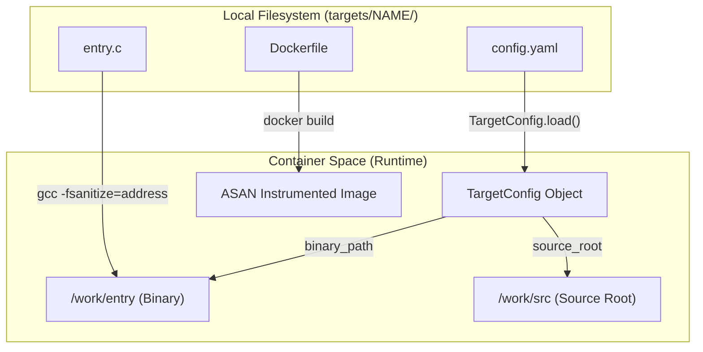
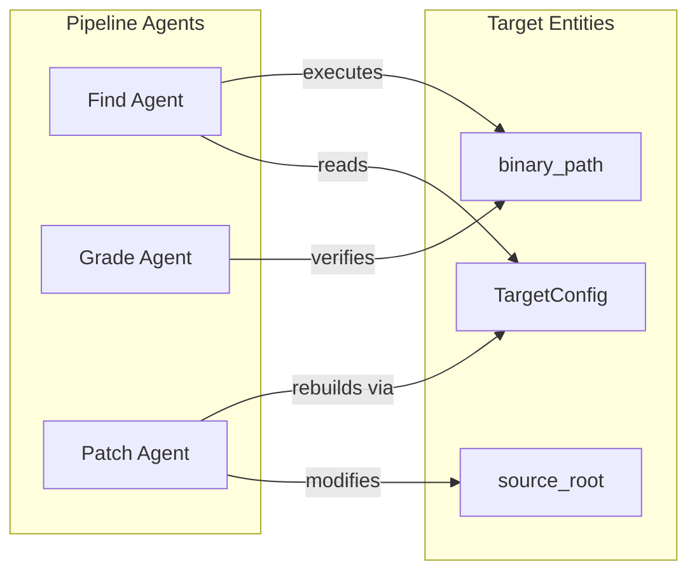

<!-- source: DeepWiki mcp.deepwiki.com · repo anthropics/defending-code-reference-harness · page 5 Targets · fetched 2026-10-26 -->

# Targets

Relevant source files

The following files were used as context for generating this wiki page:

- [harness/artifacts.py](harness/artifacts.py)
- [harness/config.py](harness/config.py)
- [targets/README.md](targets/README.md)

The `targets/` directory contains the definitions for the software projects that the pipeline analyzes. A target is a self-contained environment comprising an AddressSanitizer (ASAN) instrumented binary, the corresponding source code, and metadata that guides the autonomous agents [harness/config.py:3-11]().

The harness is designed to be extensible; adding a new target requires no changes to the core Python pipeline logic [targets/README.md:83-86]().

## Target Definition Structure

Each target is defined by three primary components located in its respective subdirectory under `targets/`.

### 1. Configuration (`config.yaml`)
This file contains the metadata necessary for the pipeline to interact with the target. It is loaded into the `TargetConfig` data class [harness/config.py:21-38]().

*   **Identity**: Specifies the `image_tag`, `github_url`, and `commit` to ensure the agent has the correct source context [targets/README.md:10-13]().
*   **Environment**: Defines the `binary_path` and `source_root` inside the container [targets/README.md:14-15]().
*   **Guidance**: Includes `focus_areas` to seed parallel find agents and `known_bugs` to prevent duplicate submissions of pre-existing issues [targets/README.md:21-25]().
*   **Verification**: Provides `build_command` and `test_command` used by the patch agent for T0 (build) and T2 (regression) verification [targets/README.md:32-40]().

### 2. Environment (`Dockerfile`)
The `Dockerfile` must produce a reproducible build environment. It is required to install debugging tools like `xxd`, `file`, and `gdb`, which agents use to craft Proof-of-Concept (PoC) inputs [targets/README.md:51-56](). The binary must be compiled with `-fsanitize=address` and `-fno-omit-frame-pointer` to provide readable stack traces for the `CrashArtifact` [targets/README.md:69-75]().

### 3. Attack Surface (`entry.c`)
The `entry.c` file serves as a minimal wrapper that translates a file input into a library call [targets/README.md:77-81](). This file effectively defines the entry point for the "Find" agents' fuzzing and exploration efforts.

### Target Component Relationship
The following diagram illustrates how these files bridge the gap between the local filesystem and the sandboxed execution environment.

"Target Definition to Code Entity Space"

Sources: [harness/config.py:21-66](), [targets/README.md:3-81]()

---

## The TargetConfig Data Class

The `TargetConfig` class is the internal representation of a target within the harness. It captures both the operational requirements (memory limits, timeouts) and the semantic requirements (attack surface descriptions) of the target.

| Attribute | Type | Description |
| :--- | :--- | :--- |
| `name` | `str` | The directory name of the target. |
| `image_tag` | `str` | The Docker tag used for building and running. |
| `binary_path` | `str` | Location of the instrumented entry point in the container. |
| `focus_areas` | `list[str]` | Human-readable strings describing specific components to audit. |
| `known_bugs` | `list[str]` | Descriptions of bugs to ignore, usually keyed by function name. |
| `reattack_harness`| `str` | Optional script to verify if a patch successfully blocks a PoC. |

Sources: [harness/config.py:21-38](), [harness/artifacts.py:151-161]()

---

## Bundled Targets

The repository includes four reference targets categorized into testing and real-world scenarios.

### Canary Target
The **Canary** target is a synthetic C application used for pipeline smoke testing. It contains three deliberately planted vulnerabilities:
1.  **Heap Buffer Overflow** in `parse_alpha`.
2.  **Stack Buffer Overflow** in `parse_bravo`.
3.  **Heap Use-After-Free** in `parse_charlie`.

It is used to verify that the find, grade, and report agents are functioning correctly before running against expensive real-world targets.

For details, see [Canary Target](#5.1).

### Real-World Targets
The harness includes three real-world libraries that represent different attack surfaces:
*   **drlibs**: A collection of single-header audio/media libraries (e.g., `dr_wav`). Focuses on complex file format parsing.
*   **htslib**: A C library for high-throughput sequencing data formats (SAM/BAM/CRAM). Focuses on bioinformatics data processing.
*   **alsa**: The Advanced Linux Sound Architecture library. Focuses on system-level audio interfacing.

For details, see [Real-World Targets](#5.2).

### Target Interaction Flow
This diagram shows how the pipeline agents interact with the target entities defined in `TargetConfig`.

"Agent-Target Interaction"

Sources: [harness/config.py:21-38](), [targets/README.md:32-40](), [harness/artifacts.py:3-6]()

---
**Child Pages:**
*   [Canary Target](#5.1) — Details on the synthetic test target and its planted bugs.
*   [Real-World Targets](#5.2) — Deep dive into `drlibs`, `htslib`, and `alsa` configurations.

---

