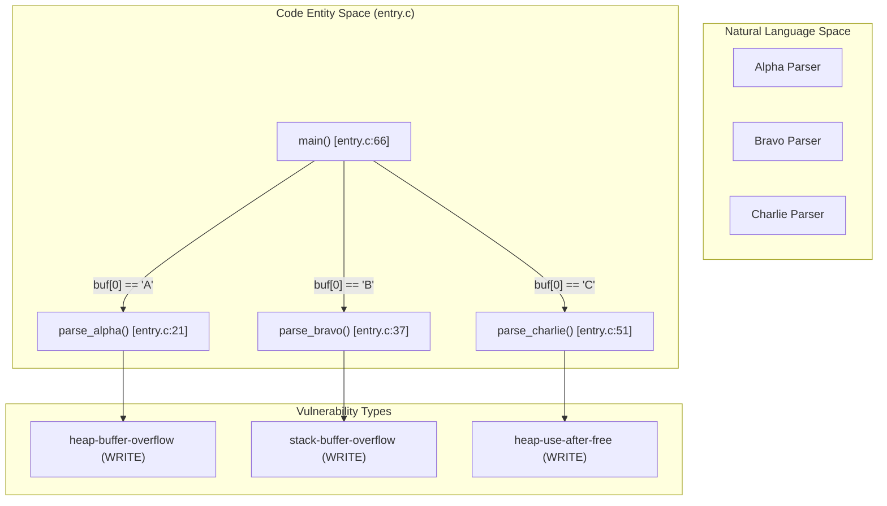
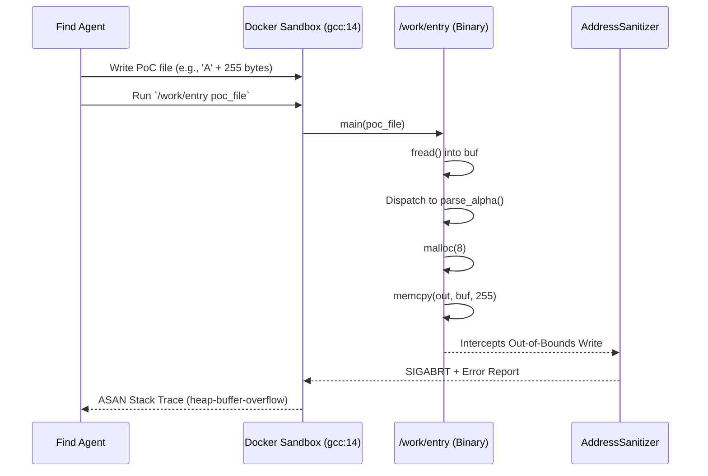

<!-- source: DeepWiki mcp.deepwiki.com · repo anthropics/defending-code-reference-harness · page 5.1 Canary Target · fetched 2026-10-26 -->

# Canary Target

Relevant source files

The following files were used as context for generating this wiki page:

- [.claude/skills/triage/fixtures/canary-findings.json](.claude/skills/triage/fixtures/canary-findings.json)
- [targets/canary/Dockerfile](targets/canary/Dockerfile)
- [targets/canary/README.md](targets/canary/README.md)
- [targets/canary/THREAT_MODEL.md](targets/canary/THREAT_MODEL.md)
- [targets/canary/config.yaml](targets/canary/config.yaml)
- [targets/canary/entry.c](targets/canary/entry.c)
- [targets/canary/fixtures/README.md](targets/canary/fixtures/README.md)
- [targets/drlibs/Dockerfile](targets/drlibs/Dockerfile)

The `canary` target is a purpose-built, single-file C command-line tool designed for rapid smoke testing and validation of the vulnerability discovery pipeline. It contains three deliberately planted vulnerabilities, each with a distinct AddressSanitizer (ASAN) signature, allowing developers to verify the entire find-to-patch lifecycle in approximately 6 minutes [targets/canary/README.md:1-10]().

## System Design and Dispatch Logic

The target consists of `entry.c`, which implements a simple dispatch wrapper. It reads up to 4 KB of data from a file provided via `argv[1]` and routes the input to one of three "parser" functions based on the first byte of the buffer [targets/canary/entry.c:66-84]().

### Entry Point Dispatch
| First Byte | Target Function | Vulnerability Type |
| :--- | :--- | :--- |
| `'A'` | `parse_alpha` | `heap-buffer-overflow` |
| `'B'` | `parse_bravo` | `stack-buffer-overflow` |
| `'C'` | `parse_charlie` | `heap-use-after-free` |

**Sources:** [targets/canary/entry.c:77-84](), [targets/canary/README.md:12-18]()

### Code Entity Relationship Diagram
This diagram maps the natural language "Parser" concepts to the specific C functions and their associated vulnerabilities.

**Sources:** [targets/canary/entry.c:17-63](), [targets/canary/entry.c:77-84]()

## Vulnerability Implementations

### 1. Alpha Parser (Heap Overflow)
The `parse_alpha` function allocates a fixed 8-byte buffer on the heap using `malloc(8)`. It then reads a length field from the first byte of the input (`buf[0]`) and performs a `memcpy` into the allocated buffer using that untrusted length [targets/canary/entry.c:21-31]().

### 2. Bravo Parser (Stack Overflow)
The `parse_bravo` function defines a fixed-size stack array `char name[16]`. It performs an unbounded `memcpy` of the remaining input buffer into this stack array without checking if the input length exceeds 16 bytes [targets/canary/entry.c:37-43]().

### 3. Charlie Parser (Use-After-Free)
The `parse_charlie` function allocates a `struct record` on the heap. If the first byte of the input is a sentinel value (`0xff`), it calls `free(r)` but fails to return, allowing execution to fall through and attempt to write a value to the now-freed pointer [targets/canary/entry.c:51-63]().

**Sources:** [targets/canary/entry.c:17-63](), [targets/canary/README.md:12-18]()

## Configuration and Build Environment

The canary target is built within a `gcc:14` Docker image with AddressSanitizer enabled to ensure predictable crash detection [targets/canary/Dockerfile:1-13]().

### Build Specification
| Parameter | Value |
| :--- | :--- |
| **Base Image** | `gcc:14` [targets/canary/Dockerfile:1]() |
| **Compiler Flags** | `-O1 -g -fsanitize=address -fno-omit-frame-pointer` [targets/canary/config.yaml:10]() |
| **Binary Path** | `/work/entry` [targets/canary/config.yaml:8]() |
| **Test Command** | Generates three trigger files (`/tmp/t_a`, `/tmp/t_b`, `/tmp/t_c`) and executes `/work/entry` against each [targets/canary/config.yaml:11-14]() |

**Sources:** [targets/canary/config.yaml:1-15](), [targets/canary/Dockerfile:1-16]()

## Data Flow: From Input to Crash
The following diagram illustrates how the `vuln-pipeline` interacts with the canary target to produce verified crash artifacts.

**Sources:** [targets/canary/entry.c:21-31](), [targets/canary/entry.c:66-84](), [targets/canary/config.yaml:10-14]()

## Testing and Fixtures

The canary target includes pre-baked fixtures to facilitate testing of downstream pipeline stages (like `report` and `patch`) without requiring a fresh `find` run.

*   **Result Samples:** Located in `targets/canary/fixtures/results_sample/`, these contain `result.json` files and PoCs for the three planted bugs [targets/canary/fixtures/README.md:1-6]().
*   **Triage Findings:** A sample `canary-findings.json` is provided to test the `/triage` skill, containing both real vulnerabilities (f001, f003) and false positives (f004, f005) to exercise the agent's discernment [.claude/skills/triage/fixtures/canary-findings.json:1-49]().

**Sources:** [targets/canary/fixtures/README.md:1-16](), [.claude/skills/triage/fixtures/canary-findings.json:1-49]()

---

