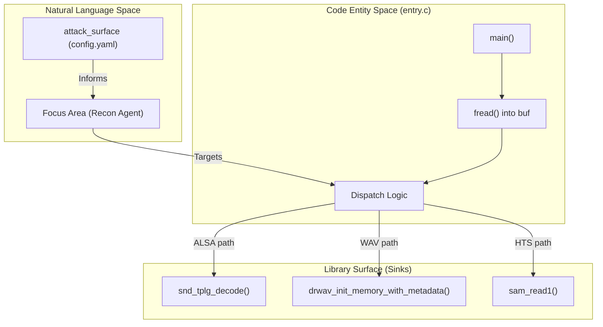
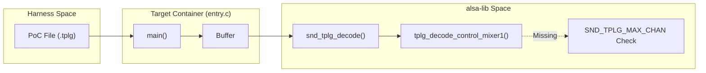

<!-- source: DeepWiki mcp.deepwiki.com · repo anthropics/defending-code-reference-harness · page 5.2 Real-World Targets · fetched 2026-10-26 -->

# Real-World Targets

Relevant source files

The following files were used as context for generating this wiki page:

- [targets/alsa/Dockerfile](targets/alsa/Dockerfile)
- [targets/alsa/README.md](targets/alsa/README.md)
- [targets/alsa/config.yaml](targets/alsa/config.yaml)
- [targets/alsa/entry.c](targets/alsa/entry.c)
- [targets/drlibs/README.md](targets/drlibs/README.md)
- [targets/drlibs/THREAT_MODEL.md](targets/drlibs/THREAT_MODEL.md)
- [targets/drlibs/config.yaml](targets/drlibs/config.yaml)
- [targets/drlibs/entry.c](targets/drlibs/entry.c)
- [targets/drlibs/vulns.txt](targets/drlibs/vulns.txt)
- [targets/htslib/Dockerfile](targets/htslib/Dockerfile)
- [targets/htslib/README.md](targets/htslib/README.md)
- [targets/htslib/config.yaml](targets/htslib/config.yaml)
- [targets/htslib/entry.c](targets/htslib/entry.c)

The Defending Code Reference Harness includes three real-world targets: **drlibs**, **htslib**, and **alsa**. Unlike the synthetic canary target, these represent complex, production-grade C libraries with historically significant CVEs. They are used to benchmark the autonomous pipeline's ability to navigate large codebases, perform reconnaissance without hints, and craft sophisticated binary payloads.

## Target Architecture

Each real-world target follows a standardized structure within the `targets/` directory to interface with the `vuln-pipeline` [targets/drlibs/config.yaml:1-19]().

### Component Overview

| Component | Role | Implementation Detail |
| :--- | :--- | :--- |
| **Dockerfile** | Environment Definition | Provisions a GCC-14 environment, fetches pinned source, and builds the library with AddressSanitizer (ASAN) [targets/alsa/Dockerfile:1-45](). |
| **config.yaml** | Pipeline Metadata | Defines `image_tag`, `binary_path`, and `attack_surface` description for the Recon agent [targets/alsa/config.yaml:1-41](). |
| **entry.c** | Attack Surface Wrapper | A thin C wrapper that consumes a file path and dispatches data to library APIs [targets/alsa/entry.c:15-44](). |
| **THREAT_MODEL.md** | Security Context | Provides a STRIDE-based analysis of the target assets and entry points [targets/drlibs/THREAT_MODEL.md:1-68](). |

### Data Flow: From File to Sink

The following diagram illustrates how the `entry.c` wrapper bridges the "Natural Language Space" (attack surface description) to the "Code Entity Space" (library functions).

**Target Dispatch Mechanism**

Sources: [targets/alsa/config.yaml:14-38](), [targets/alsa/entry.c:15-44](), [targets/drlibs/entry.c:19-28](), [targets/htslib/entry.c:24-37]()

---

## 1. drlibs (Audio Decoders)

`drlibs` consists of single-header C audio decoders (`dr_wav.h` and `dr_flac.h`). It is a high-density target for memory corruption due to complex metadata parsing and manual memory management [targets/drlibs/README.md:1-15]().

### Threat Model & Vulnerabilities
The pipeline targets two primary CVEs in this library:
*   **CVE-2026-29022 (dr_wav):** A Heap Out-of-Bounds (OOB) write caused by a two-pass desync in the `smpl` chunk parser [targets/drlibs/README.md:6-12]().
*   **CVE-2025-14369 (dr_flac):** An integer overflow in `totalPCMFrameCount` leading to an undersized allocation (DoS) [targets/drlibs/README.md:6-12]().

### Implementation Details
*   **Dockerfile:** Fetches the headers from pinned commit `fb1b2dfc585c` at build time [targets/drlibs/README.md:14-15]().
*   **Entry Wrapper:** Sniffs the first 4 bytes of input. `RIFF` dispatches to `do_wav`, while `fLaC` dispatches to `do_flac` [targets/drlibs/entry.c:51-56]().
*   **WAV Path:** Specifically calls `drwav_init_memory_with_metadata` to ensure complex metadata parsers (where the CVE resides) are exercised [targets/drlibs/entry.c:21]().

Sources: [targets/drlibs/README.md:1-96](), [targets/drlibs/entry.c:1-61](), [targets/drlibs/THREAT_MODEL.md:1-68]()

---

## 2. alsa-lib (Linux Audio Topology)

The `alsa` target focuses on the topology subsystem of `alsa-lib`, which parses binary `.tplg` files and text-based configurations [targets/alsa/README.md:1-6]().

### Threat Model & Vulnerabilities
*   **CVE-2026-25068:** A Heap OOB write in `tplg_decode_control_mixer1()`. The function trusts the `num_channels` field from the binary file and loops past a fixed-size array `SND_TPLG_MAX_CHAN` [targets/alsa/README.md:7-13]().

### Implementation Details
*   **Static Build:** The Dockerfile performs an ASAN-instrumented static build, linking `libatopology.a` and `libasound.a` [targets/alsa/Dockerfile:22-34]().
*   **Dual Parse Path:** The `entry.c` wrapper calls both `snd_tplg_decode` (binary) and `snd_tplg_load` (text) unconditionally. Each is designed to fail fast if the magic bytes do not match [targets/alsa/entry.c:30-40]().

**ALSA Component Interaction**

Sources: [targets/alsa/README.md:11-13](), [targets/alsa/entry.c:30-40](), [targets/alsa/Dockerfile:37-42]()

---

## 3. htslib (Genomics Library)

`htslib` is the reference implementation for biological data formats (SAM/BAM/CRAM). It is the most complex target due to the nested nature of the CRAM container format [targets/htslib/README.md:1-6]().

### Threat Model & Vulnerabilities
This target features a **10-CVE cluster** [targets/htslib/README.md:8-19]():
*   **CVE-2026-31970 (BGZF):** A heap OOB write in the BGZF index loader via integer overflow [targets/htslib/README.md:13-19]().
*   **CRAM Cluster (9 CVEs):** Various heap overflows and NULL dereferences across the codec dispatch layer (e.g., `XPACK`, `huffman`) [targets/htslib/README.md:13-19]().

### Implementation Details
*   **Dependencies:** The Dockerfile installs `zlib`, `libbz2`, and `liblzma` to support CRAM's compressed sub-blocks [targets/htslib/Dockerfile:9]().
*   **Entry Wrapper:**
    1.  `do_gzi()`: Exercises `bgzf_index_load()` for the `.gzi` surface [targets/htslib/entry.c:17-22]().
    2.  `do_sam()`: Uses `sam_open()` and `sam_read1()` to trigger the CRAM/BAM/SAM decoders [targets/htslib/entry.c:24-37]().

Sources: [targets/htslib/README.md:1-91](), [targets/htslib/entry.c:1-45](), [targets/htslib/Dockerfile:1-39]()

---

## Comparison of Real-World Targets

The following table compares the complexity and expected pipeline performance across the three targets based on validation runs.

| Target | Primary Difficulty | Find Time (Typical) | Input Complexity |
| :--- | :--- | :--- | :--- |
| **alsa** | Simple binary structs | ~13 mins | Low (Fixed-layout structs) [targets/alsa/README.md:32-75]() |
| **drlibs** | Checksummed bitstreams (FLAC) | ~6-80 mins | Medium (WAV is easy, FLAC is hard) [targets/drlibs/README.md:38-39]() |
| **htslib** | Multi-stage container (CRAM) | ~15-40 mins | High (Container → Slice → Codec) [targets/htslib/README.md:38-39]() |

Sources: [targets/alsa/README.md:30-38](), [targets/drlibs/README.md:36-40](), [targets/htslib/README.md:36-40]()

---

