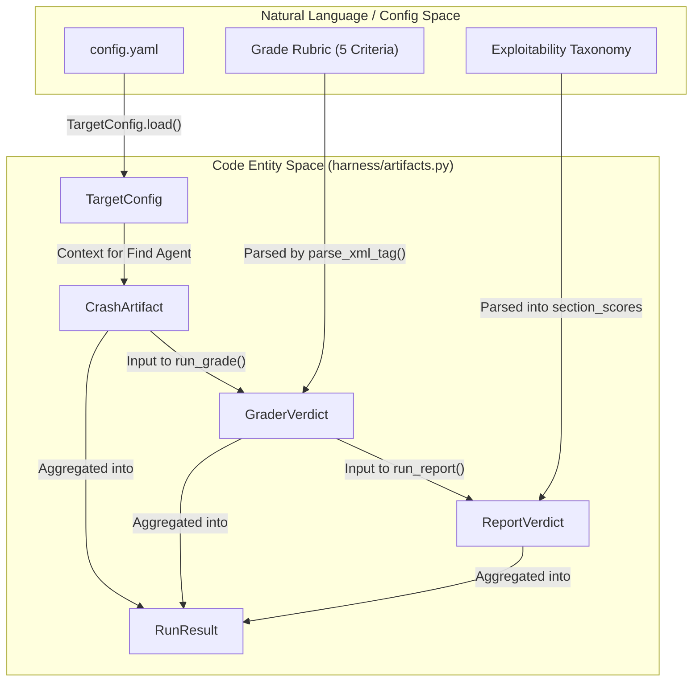
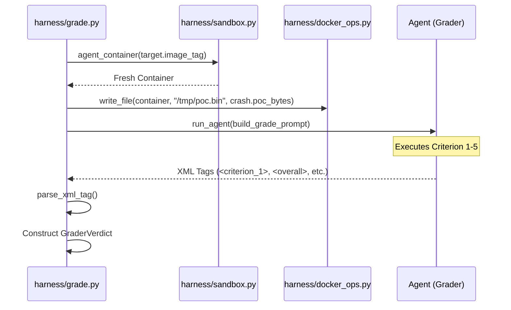

<!-- source: DeepWiki mcp.deepwiki.com · repo anthropics/defending-code-reference-harness · page 6 Data Models and Artifacts · fetched 2026-10-26 -->

# Data Models and Artifacts

Relevant source files

The following files were used as context for generating this wiki page:

- [harness/artifacts.py](harness/artifacts.py)
- [harness/config.py](harness/config.py)
- [harness/grade.py](harness/grade.py)
- [harness/prompts/grade_prompt.py](harness/prompts/grade_prompt.py)
- [targets/README.md](targets/README.md)
- [tests/test_artifacts.py](tests/test_artifacts.py)

This page serves as a technical reference for the core data structures and on-disk artifact formats used by the Defending Code Reference Harness. These models define the "contract" between different stages of the autonomous pipeline (Find → Grade → Judge → Report → Patch) and ensure consistent state management across distributed agent executions.

## Core Data Models

The harness utilizes Python dataclasses to represent the state of vulnerabilities as they progress through the pipeline. These models are defined in `harness/artifacts.py` and `harness/config.py`.

### TargetConfig
The `TargetConfig` class represents the static configuration of a target software project. It is loaded from the `config.yaml` file located in each target directory [harness/config.py:21-38]().

| Field | Type | Description |
| :--- | :--- | :--- |
| `image_tag` | `str` | The Docker tag for the ASAN-instrumented target image [harness/config.py:24](). |
| `binary_path` | `str` | Path to the entrypoint binary inside the container [harness/config.py:27](). |
| `source_root` | `str` | Root directory of the source code inside the container [harness/config.py:28](). |
| `build_command`| `str` | Command to recompile the binary (used for Patch T0 verification) [harness/config.py:32](). |
| `test_command` | `str` | Command to run regression tests (used for Patch T2 verification) [harness/config.py:33](). |

**Sources:** [harness/config.py:20-67](), [targets/README.md:8-40]()

### CrashArtifact
The `CrashArtifact` is the primary output of the **Find Agent**. it contains the raw evidence of a potential vulnerability [harness/artifacts.py:16-24]().

| Field | Type | Description |
| :--- | :--- | :--- |
| `poc_bytes` | `bytes` | The raw content of the Proof-of-Concept (PoC) file [harness/artifacts.py:19](). |
| `reproduction_command` | `str` | The exact shell command used to trigger the crash [harness/artifacts.py:20](). |
| `crash_type` | `str` | Classification (e.g., `heap-buffer-overflow`, `use-after-free`) [harness/artifacts.py:21](). |
| `crash_output` | `str` | The ASAN stack trace or stderr output (truncated to 10KB) [harness/artifacts.py:22](). |

**Sources:** [harness/artifacts.py:15-43]()

### Verdict Models
As a crash moves through the pipeline, various agents attach "verdicts" to it to record verification and analysis results.

*   **`GraderVerdict`**: Produced by `run_grade`. Contains a boolean `passed` status and a 5-criterion rubric score [harness/artifacts.py:45-50]().
*   **`JudgeVerdict`**: Produced by `run_judge`. Determines if a crash is `NEW`, `DUP_BETTER` (a better PoC for an existing bug), or `DUP_SKIP` [harness/artifacts.py:105-110]().
*   **`ReportVerdict`**: Produced by `run_report`. Contains complex exploitability scoring, including primitive analysis, reachability, and severity ratings [harness/artifacts.py:124-133]().
*   **`PatchVerdict`**: Produced by `grade_patch`. Represents the T0-T3 ladder results, indicating if a patch builds, stops the PoC, and passes regressions [harness/artifacts.py:66-75]().

**Sources:** [harness/artifacts.py:44-149]()

## Data Flow and Transitions

The following diagram illustrates how "Natural Language" requirements from the `TargetConfig` and agent prompts are transformed into "Code Entity" data structures throughout the pipeline.

### Entity Relationship: Pipeline Transitions

**Sources:** [harness/config.py:40-66](), [harness/grade.py:26-36](), [harness/artifacts.py:151-161]()

## On-Disk Artifact Formats

The pipeline persists its state using several standardized files within the output directory (e.g., `outputs/<target>/<timestamp>/`).

### `result.json`
This file contains a serialized `RunResult` object, representing a single execution of the Find-Grade loop [harness/artifacts.py:151-161](). It includes the full agent transcripts and the `CrashArtifact` (with `poc_bytes` stored as Base64) [harness/artifacts.py:26-29]().

### `found_bugs.jsonl`
A streaming log of every verified crash found by the pipeline. Each line is a JSON object containing the `CrashArtifact` and `GraderVerdict`. This file serves as the input for the deduplication and judging stages.

### `manifest.jsonl`
The "Source of Truth" for the `Judge Agent`. It tracks unique vulnerabilities across multiple runs.
*   **Columns**: `bug_id`, `crash_type`, `crash_function`, `poc_path`, `report_path`.
*   **Logic**: The `run_judge` function compares new crashes against this manifest to prevent duplicate reporting [harness/artifacts.py:105-120]().

### `patch.diff` and `TRIAGE.json`
*   **`patch.diff`**: A standard unified git diff generated by the Patch Agent [harness/artifacts.py:66]().
*   **`TRIAGE.json`**: Produced by the interactive `/triage` skill. It maps identified vulnerabilities to specific source code locations and severity levels.

## Verification Logic (Grader)

The `GraderVerdict` is generated by `harness/grade.py` by executing the `reproduction_command` in a pristine container [harness/grade.py:52-56]().

### Grader Verification Flow

**Sources:** [harness/grade.py:37-100](), [harness/prompts/grade_prompt.py:9-64]()

### The 5-Criterion Rubric
The Grader Agent must evaluate these specific points to issue a `PASS` verdict:
1.  **PoC Validity**: Is the file present and non-empty? [harness/prompts/grade_prompt.py:26-29]()
2.  **Reproducibility**: Does it crash at least 2/3 times in the fresh container? [harness/prompts/grade_prompt.py:30-34]()
3.  **No OOM/Timeout**: Is the crash a memory error, not a resource exhaustion? [harness/prompts/grade_prompt.py:35-38]()
4.  **Project Code**: Is the crash inside `{source_root}`, not just `libc`? [harness/prompts/grade_prompt.py:40-43]()
5.  **Consistency**: Is the crash class (e.g., `heap-buffer-overflow`) consistent? [harness/prompts/grade_prompt.py:44-48]()

**Sources:** [harness/grade.py:86-99](), [harness/prompts/grade_prompt.py:24-52]()

---

