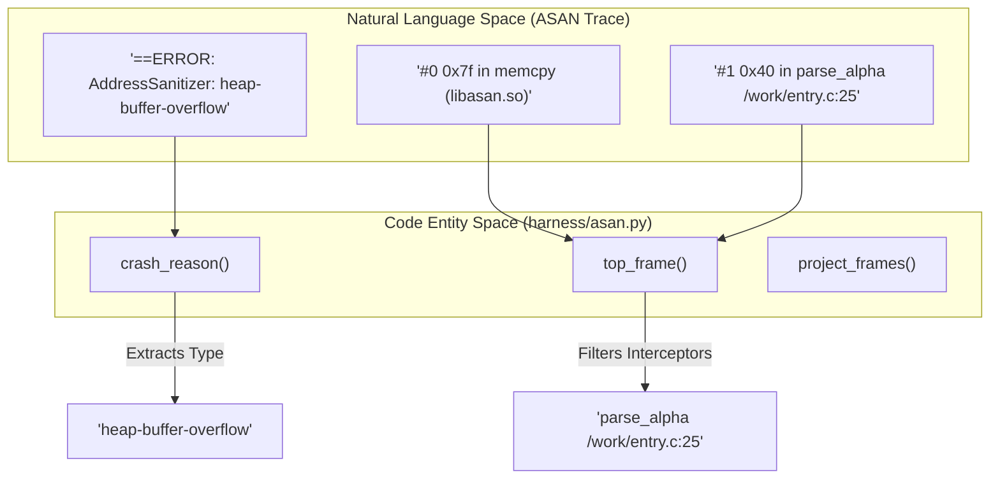
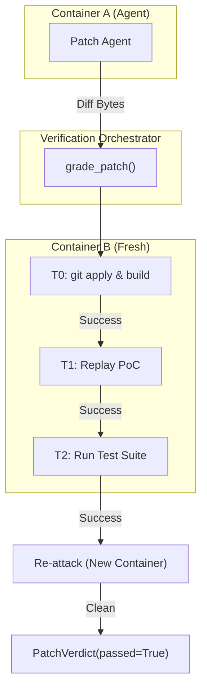

<!-- source: DeepWiki mcp.deepwiki.com · repo anthropics/defending-code-reference-harness · page 7 Testing · fetched 2026-10-26 -->

# Testing

<details>
<summary>Relevant source files</summary>

The following files were used as context for generating this wiki page:

- [harness/__init__.py](harness/__init__.py)
- [harness/patch.py](harness/patch.py)
- [harness/patch_grade.py](harness/patch_grade.py)
- [harness/prompts/__init__.py](harness/prompts/__init__.py)
- [harness/prompts/system_prompt.py](harness/prompts/system_prompt.py)
- [tests/__init__.py](tests/__init__.py)
- [tests/fixtures/canary_alpha_crashsite.diff](tests/fixtures/canary_alpha_crashsite.diff)
- [tests/fixtures/canary_alpha_golden.diff](tests/fixtures/canary_alpha_golden.diff)
- [tests/fixtures/canary_noop.diff](tests/fixtures/canary_noop.diff)
- [tests/test_asan.py](tests/test_asan.py)
- [tests/test_dedup.py](tests/test_dedup.py)
- [tests/test_focus.py](tests/test_focus.py)
- [tests/test_found_bugs.py](tests/test_found_bugs.py)
- [tests/test_patch.py](tests/test_patch.py)
- [tests/test_patch_grade.py](tests/test_patch_grade.py)
- [tests/test_patch_grade_e2e.py](tests/test_patch_grade_e2e.py)
- [tests/test_report.py](tests/test_report.py)
- [tests/test_system_prompt.py](tests/test_system_prompt.py)

</details>


The Defending Code Reference Harness employs a multi-layered testing strategy to ensure the reliability of the autonomous pipeline, the accuracy of ASAN parsing, and the integrity of the patch-verification ladder. The test suite is divided into unit tests (mocking Docker and LLM calls) and end-to-end (e2e) tests that execute against real containers using the built-in canary target.

## Test Suite Structure

The test suite is located in the `tests/` directory and follows a pattern of isolating logical components (ASAN parsing, deduplication, prompt rendering) from heavy infrastructure.

| Category | Description | Key Modules |
| :--- | :--- | :--- |
| **Unit Tests** | Fast tests using `unittest.mock` to simulate Docker operations and LLM responses. | `test_asan.py`, `test_focus.py`, `test_patch_grade.py` |
| **E2E Tests** | Integration tests that spawn real gVisor/Docker containers. | `test_patch_grade_e2e.py` |
| **Fixture-based** | Tests validating logic against static files (e.g., `.diff` files). | `tests/fixtures/` |

Sources: [tests/test_patch_grade.py:1-7](), [tests/test_patch_grade_e2e.py:1-12]()

## ASAN and Crash Parsing

The harness relies heavily on parsing AddressSanitizer (ASAN) output to determine crash types and locations. Tests in `tests/test_asan.py` and `tests/test_found_bugs.py` ensure that the system correctly identifies the "top frame" of a crash, even when intercepted by standard library functions like `memcpy` or `malloc`.

### ASAN Frame Extraction Logic
The system uses `top_frame` and `project_frames` to extract project-relevant stack information while filtering out ASAN interceptors.



Sources: [harness/asan.py:6-7](), [tests/test_asan.py:13-41](), [tests/test_found_bugs.py:15-43]()

## Patch Verification Ladder (T0-T3)

The most critical testing logic resides in the patch verification ladder. This ladder is an executable oracle that validates candidate patches through increasingly stringent tiers.

### The Ladder Tiers
1.  **T0 (Build)**: Does the patch apply via `git apply` and does `target.build_command` succeed?
2.  **T1 (PoC Stops)**: Does the original reproduction command now exit with code 0 and no ASAN errors?
3.  **T2 (Tests Pass)**: Does the `target.test_command` (if defined) pass?
4.  **Re-attack**: Can a new Find Agent discover a variant or bypass of the fix?
5.  **T3 (Style)**: An advisory LLM-based score of the patch quality.

### Patch Grading Data Flow
The `grade_patch` function in `harness/patch_grade.py` manages the lifecycle of a fresh container to verify a diff.



Sources: [harness/patch_grade.py:37-58](), [harness/patch_grade.py:98-175](), [tests/test_patch_grade.py:52-115]()

## End-to-End Validation

The `tests/test_patch_grade_e2e.py` module performs real-world validation of the ladder using the `canary` target. It tests three specific scenarios:
*   **No-op Patch**: A patch that changes nothing should pass T0 but fail T1 because the PoC still crashes. [tests/test_patch_grade_e2e.py:70-77]()
*   **Symptom-only Patch**: A patch that suppresses the specific crash site but leaves the root cause (e.g., adding a local check but not fixing the length calculation) will pass T1 but is intended to be caught by the Re-attack phase. [tests/test_patch_grade_e2e.py:79-87]()
*   **Golden Patch**: A root-cause fix that passes all tiers. [tests/test_patch_grade_e2e.py:89-95]()

## Running Tests

Tests are executed using `pytest`. Some tests require a functional Docker environment with the `runsc` (gVisor) runtime or the `VULN_PIPELINE_DOCKER_RUNTIME` environment variable set.

```bash
# Run all unit tests
pytest tests/

# Run ASAN parsing tests specifically
pytest tests/test_asan.py

# Run E2E tests (requires Docker/gVisor)
pytest tests/test_patch_grade_e2e.py
```

Sources: [tests/test_patch_grade_e2e.py:10-12](), [tests/test_patch_grade_e2e.py:50-53]()

## Key Test Utilities

| Function | File | Purpose |
| :--- | :--- | :--- |
| `_exec_sequence` | `tests/test_patch_grade.py` | Mocks `docker_ops.exec_sh` to return a series of predetermined (return code, stdout, stderr) tuples. |
| `_mk_crash` | `tests/test_found_bugs.py` | Helper to generate `CrashArtifact` objects for testing deduplication and reporting. |
| `_agent_emitting` | `tests/test_patch.py` | Simulates an agent's `AgentResult` containing specific XML tags like `<patch_path>`. |
| `_write_result` | `tests/test_dedup.py` | Creates mock `result.json` files on disk to test results-tree walking. |

Sources: [tests/test_patch_grade.py:152-160](), [tests/test_found_bugs.py:158-166](), [tests/test_patch.py:18-26](), [tests/test_dedup.py:62-79]()

---

