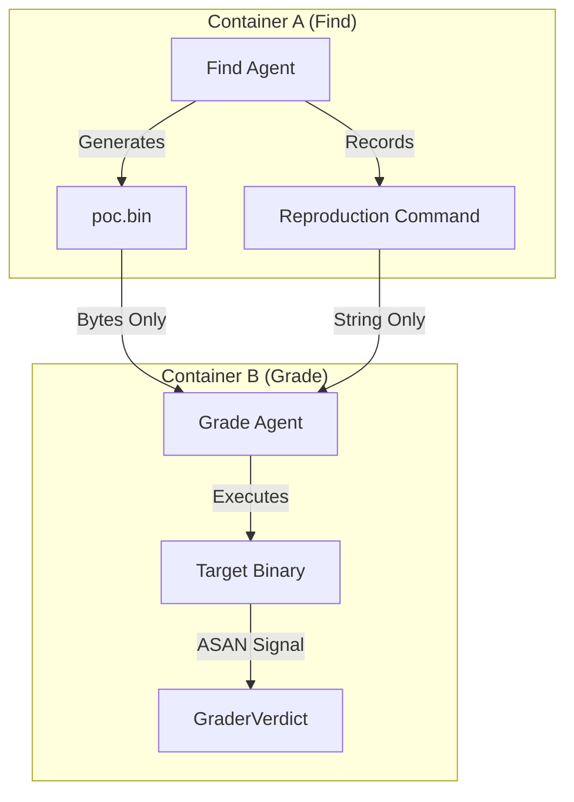
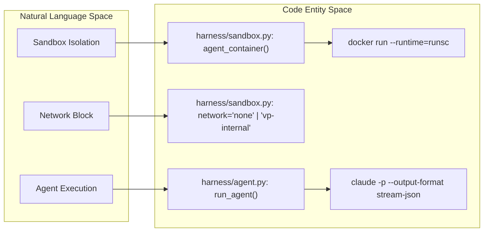

<!-- source: DeepWiki mcp.deepwiki.com · repo anthropics/defending-code-reference-harness · page 8 Glossary · fetched 2026-10-26 -->

# Glossary

Relevant source files

The following files were used as context for generating this wiki page:

- [.claude/skills/quickstart/SKILL.md](.claude/skills/quickstart/SKILL.md)
- [.claude/skills/threat-model/bootstrap.md](.claude/skills/threat-model/bootstrap.md)
- [.claude/skills/threat-model/interview.md](.claude/skills/threat-model/interview.md)
- [.claude/skills/threat-model/schema.md](.claude/skills/threat-model/schema.md)
- [.claude/skills/triage/README.md](.claude/skills/triage/README.md)
- [.claude/skills/triage/SKILL.md](.claude/skills/triage/SKILL.md)
- [README.md](README.md)
- [bin/vp-sandboxed](bin/vp-sandboxed)
- [docs/best-practices.md](docs/best-practices.md)
- [docs/pipeline.md](docs/pipeline.md)
- [docs/troubleshooting.md](docs/troubleshooting.md)
- [harness/artifacts.py](harness/artifacts.py)
- [harness/asan.py](harness/asan.py)
- [harness/cli.py](harness/cli.py)
- [harness/judge.py](harness/judge.py)
- [harness/novelty.py](harness/novelty.py)
- [harness/patch.py](harness/patch.py)
- [harness/patch_grade.py](harness/patch_grade.py)
- [harness/prompts/judge_prompt.py](harness/prompts/judge_prompt.py)
- [harness/prompts/report_grader_prompt.py](harness/prompts/report_grader_prompt.py)
- [harness/prompts/report_prompt.py](harness/prompts/report_prompt.py)
- [harness/report.py](harness/report.py)
- [harness/sandbox.py](harness/sandbox.py)
- [targets/canary/README.md](targets/canary/README.md)
- [targets/canary/THREAT_MODEL.md](targets/canary/THREAT_MODEL.md)
- [targets/canary/config.yaml](targets/canary/config.yaml)
- [tests/test_judge.py](tests/test_judge.py)
- [tests/test_patch_grade_e2e.py](tests/test_patch_grade_e2e.py)

This page provides definitions for codebase-specific terminology, domain concepts, and abbreviations used throughout the Defending Code Reference Harness. It serves as a technical reference for onboarding engineers to understand the implementation and data flow of the autonomous pipeline and interactive skills.

## Core Concepts & Roles

| Term | Definition | Code Pointer |
|:---|:---|:---|
| **Agent** | A headless execution of Claude Code, running within a container, tasked with a specific phase (Find, Grade, Report, etc.). | [harness/agent.py:19-112]() |
| **Target** | The software under test. Defined by a directory containing a `config.yaml`, a `Dockerfile` for ASAN-instrumented builds, and usually an `entry.c` wrapper. | [harness/config.py:27-58]() |
| **Focus Area** | A specific subsystem or parser within a target identified during Recon to partition the attack surface for parallel agents. | [harness/recon.py:25-45]() |
| **PoC (Proof of Concept)** | A binary or text file that, when provided as input to the target, triggers a detectable crash (usually via ASAN). | [harness/artifacts.py:43-62]() |
| **Trust Boundary** | The security isolation layer (gVisor + Docker) that prevents untrusted code execution from affecting the host or other agents. | [harness/sandbox.py:34-75]() |

**Sources:** [README.md:13-18](), [docs/pipeline.md:50-89](), [harness/cli.py:43-57]()

---

## Pipeline Stages (Autonomous)

The autonomous pipeline moves findings through a series of specialized agents. Each stage is designed to be adversarial to the previous one to minimize false positives.

### Reconnaissance (Recon)
The process of mapping a target's source code to identify entry points and partition them into `focus_areas`. This prevents parallel agents from redundantly attacking the same "shallow" bugs.
*   **Key Function:** `run_recon` in [harness/recon.py:25-45]().
*   **Output:** A list of focus areas used to seed the Find stage.

### Find
The discovery phase where an agent attempts to trigger a crash. It iterates by reading source, crafting inputs, and observing ASAN output.
*   **Key Function:** `run_find` in [harness/find.py:49-110]().
*   **Data Flow:** Produces a `CrashArtifact` containing the PoC bytes and the reproduction command.

### Grade (Verification)
A critical "guilty until proven innocent" phase. A fresh agent in a clean container attempts to reproduce the crash using *only* the PoC provided by the Find agent.
*   **Key Function:** `run_grade` in [harness/grade.py:50-105]().
*   **Verdict:** Returns a `GraderVerdict` (e.g., `crash_found`, `crash_rejected`).

### Judge
A host-side agent that performs semantic deduplication. It compares a new verified crash against the `manifest.jsonl` to decide if it is a `NEW` bug, a `DUP_SKIP`, or a `DUP_BETTER`.
*   **Key Function:** `run_judge` in [harness/judge.py:51-72]().
*   **Logic:** Uses `build_judge_prompt` to provide the agent with existing bug excerpts for comparison. [harness/prompts/judge_prompt.py:101-137]()

### Report
Generates a structured exploitability analysis. It includes six sections: primitive, reachability, heap layout, escalation path, constraints, and an agent-judged severity.
*   **Key Function:** `run_report` in [harness/report.py:37-112]().
*   **Scoring:** A separate `grade_report` agent scores the analysis sections on a rubric of 0-2. [harness/report.py:115-141]()

**Sources:** [docs/pipeline.md:50-89](), [harness/cli.py:16-21](), [harness/report.py:29-35]()

---

## Technical Infrastructure

### The Two-Container Trust Boundary
To ensure integrity, discovery and verification are strictly separated. The `find` agent's environment is considered "dirty." The `grade` and `report` agents run in "clean" containers where only the PoC bytes cross the boundary.

**Data Flow: Find to Grade**

**Sources:** [docs/best-practices.md:109-133](), [harness/grade.py:50-60](), [harness/report.py:5-9]()

### Agent Sandbox
The runtime environment for agents, utilizing gVisor (`runsc`) for kernel-level isolation and a dedicated Docker network (`vp-internal`).
*   **`agent_container`**: A context manager that handles container lifecycle, volume mounting (read-only for source), and network tiering. [harness/sandbox.py:34-75]()
*   **`docker_ops`**: Low-level utility for executing shell commands and file I/O within the sandbox. [harness/docker_ops.py:20-85]()

**System Mapping: Code to Sandbox Entities**

**Sources:** [docs/agent-sandbox.md](), [harness/sandbox.py:34-75](), [harness/agent.py:19-50]()

---

## Artifacts & Data Models

| Artifact | Description | Implementation |
|:---|:---|:---|
| `CrashArtifact` | Contains PoC bytes, reproduction command, and the raw ASAN output from the find agent. | [harness/artifacts.py:43-62]() |
| `RunResult` | The summary of a single find+grade cycle, including transcripts and final status. | [harness/artifacts.py:15-41]() |
| `manifest.jsonl` | The registry of unique bugs found for a target, managed by the Judge. | [harness/cli.py:20-21](), [harness/dedup.py:25-40]() |
| `THREAT_MODEL.md` | A structured document defining the system context, assets, and prioritized threats. | [.claude/skills/threat-model/schema.md]() |
| `TRIAGE.json` | The output of the interactive `/triage` skill, containing ranked and verified findings. | [.claude/skills/triage/SKILL.md:5-9]() |

**Sources:** [harness/artifacts.py:10-80](), [harness/cli.py:159-177]()

---

## Interactive Skills (Claude Code)

Interactive skills are invoked via `/` commands within a Claude Code session. They utilize a shared checkpointing infrastructure to handle large repositories and rate limits.

### Threat Modeling (`/threat-model`)
*   **Bootstrap Mode:** Autonomous 5-stage research pipeline (Research Swarm) to derive a threat model from code. [.claude/skills/threat-model/bootstrap.md:8-19]()
*   **Interview Mode:** Guided 4-question framework to build a model with a human owner. [.claude/skills/threat-model/interview.md:12-20]()

### Triage (`/triage`)
A 7-phase adversarial pipeline that ingests raw scanner output (like `VULN-FINDINGS.json`), deduplicates findings, and verifies them via independent subagent "votes".
*   **Implementation:** Defined in [.claude/skills/triage/SKILL.md]().
*   **Constraint:** Does **not** execute target code; conclusions are derived from source analysis. [.claude/skills/triage/SKILL.md:60-66]()

### Patching (`/patch`)
Generates fixes and validates them against a **T0-T3 Ladder**:
1.  **T0 (Build):** Does the patch compile?
2.  **T1 (PoC):** Does the PoC no longer crash?
3.  **T2 (Tests):** Does the existing test suite still pass?
4.  **Re-attack:** Can a new Find agent break the patched binary?
5.  **T3 (Style):** Does the code meet style guidelines? (LLM-judged).

*   **Key Function:** `grade_patch` in [harness/patch_grade.py:37-145]().

**Sources:** [README.md:9-12](), [harness/patch_grade.py:4-15](), [.claude/skills/triage/SKILL.md:28-32]()