# Page: Overview

# Overview

<details>
<summary>Relevant source files</summary>

The following files were used as context for generating this wiki page:

- [.claude/skills/quickstart/SKILL.md](.claude/skills/quickstart/SKILL.md)
- [CLAUDE.md](CLAUDE.md)
- [README.md](README.md)
- [docs/agent-sandbox.md](docs/agent-sandbox.md)
- [docs/best-practices.md](docs/best-practices.md)
- [docs/patching.md](docs/patching.md)
- [docs/security.md](docs/security.md)
- [docs/troubleshooting.md](docs/troubleshooting.md)
- [harness/README.md](harness/README.md)

</details>


The **Defending Code Reference Harness** is a reference implementation for autonomous vulnerability discovery and remediation using Claude. It provides a multi-agent framework designed to find, verify, and patch security vulnerabilities (specifically memory corruption in C/C++ via ASAN) with high precision and low false-positive rates [README.md:1-18]().

The system is designed around the principle of **executable oracles**: it does not just produce prose reports of potential bugs, but generates crashing input files (PoCs) and verifies them in isolated environments [CLAUDE.md:22-27]().

### Operational Modes

The harness operates in two primary modes depending on the user's needs for interactivity and execution:

| Mode | Tools | Analysis Type | Primary Use Case |
| :--- | :--- | :--- | :--- |
| **Interactive Skills** | `.claude/skills/` | Static / File-based | Threat modeling, initial scanning, and human-in-the-loop triage [CLAUDE.md:5-12](). |
| **Autonomous Pipeline** | `harness/` | Dynamic / Execution | Autonomous find-verify-report-patch loops using Docker and ASAN [CLAUDE.md:13-15](). |

For a step-by-step guide on choosing and setting up these modes, see [Getting Started](#1.1).

### Key Concepts

#### The Two-Container Trust Boundary
To prevent agents from "hallucinating" success or being misled by their own previous actions, the harness enforces a strict boundary between discovery and verification. A **Find Agent** works in one container to produce a candidate; a **Grade Agent** then attempts to reproduce that candidate in a completely fresh, isolated container [docs/patching.md:5-7](), [docs/best-practices.md:123-126]().

#### Sandbox Isolation
The harness utilizes **gVisor** (`runsc`) to provide syscall-level isolation for agents executing target code. This ensures that even if an agent triggers a malicious payload or attempts an escape, the host system remains protected [docs/agent-sandbox.md:1-9](). For architectural details on this boundary, see [System Architecture](#1.2).

#### Natural Language to Code Entity Mapping
The following diagram illustrates how high-level system components map to specific code entities and files within the repository.

**System Component Mapping**
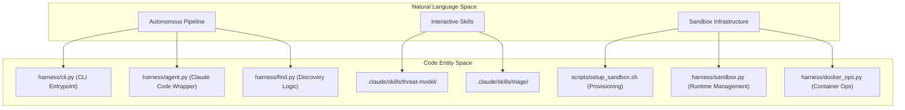
Sources: [CLAUDE.md:5-15](), [harness/README.md:161-162](), [docs/agent-sandbox.md:30-37](), [harness/sandbox.py:1-20]()

### Workflow: From Recon to Patch

The autonomous pipeline follows a structured lifecycle to ensure coverage and depth:

1.  **Recon**: An agent partitions the attack surface into `focus_areas` [harness/README.md:108-108]().
2.  **Find**: Parallel agents attempt to trigger ASAN crashes in their assigned areas [harness/README.md:59-61]().
3.  **Grade**: A fresh container verifies the reproducibility of the crash [harness/README.md:6-7]().
4.  **Judge/Dedup**: The system performs semantic deduplication to group crashes by root cause [harness/README.md:139-139]().
5.  **Report**: A detailed exploitability analysis is generated for unique bugs [harness/README.md:140-140]().
6.  **Patch**: A fix is generated and validated against a multi-tier "verification ladder" [docs/patching.md:85-99]().

**Pipeline Data Flow**
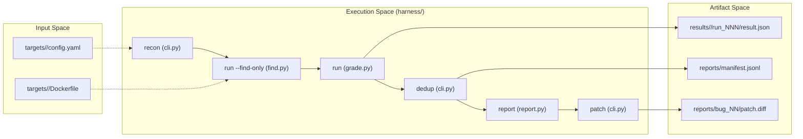
Sources: [CLAUDE.md:52-68](), [harness/README.md:56-66](), [docs/patching.md:50-53](), [harness/cli.py:1-50]()

### Next Steps

*   To set up your environment and run a smoke test, see **[Getting Started](#1.1)**.
*   For a deep dive into the security boundaries and multi-agent coordination, see **[System Architecture](#1.2)**.
*   To learn how to adapt the harness for a new language or project, refer to the **[Autonomous Pipeline](#2)** and **[Targets](#5)** documentation.

Sources: [README.md:1-55](), [CLAUDE.md:1-18](), [harness/README.md:1-17]()

---

# Page: Getting Started

# Getting Started

<details>
<summary>Relevant source files</summary>

The following files were used as context for generating this wiki page:

- [.claude/skills/quickstart/SKILL.md](.claude/skills/quickstart/SKILL.md)
- [README.md](README.md)
- [docs/best-practices.md](docs/best-practices.md)
- [docs/troubleshooting.md](docs/troubleshooting.md)
- [pyproject.toml](pyproject.toml)
- [scripts/setup_sandbox.sh](scripts/setup_sandbox.sh)
- [targets/canary/README.md](targets/canary/README.md)
- [targets/canary/THREAT_MODEL.md](targets/canary/THREAT_MODEL.md)
- [targets/canary/config.yaml](targets/canary/config.yaml)

</details>


This page provides a step-by-step guide for setting up the Defending Code Reference Harness and running your first vulnerability discovery and remediation cycles. The harness supports two primary modes of operation: **Interactive Claude Code Skills** for rapid, file-based analysis, and the **Autonomous Pipeline** for execution-verified vulnerability discovery using Docker and gVisor.

## Prerequisites

Before starting, ensure your environment meets the following requirements:

*   **Host OS:** Linux (required for gVisor/runsc syscall isolation). macOS/Windows users should use a Linux VM or the `--dangerously-no-sandbox` flag [scripts/setup_sandbox.sh:29-32]().
*   **Tools:** Docker, Python 3.11+, and the `claude` CLI (Claude Code).
*   **API Access:** An `ANTHROPIC_API_KEY` or `CLAUDE_CODE_OAUTH_TOKEN` exported in your environment [README.md:141-141]().

## 1. Environment Setup

The system requires a specialized sandbox to safely execute untrusted agent-generated code.

### Step 1.1: Install the Harness
Clone the repository and install the package in editable mode within a virtual environment.

```bash
git clone https://github.com/anthropics/defending-code-reference-harness
cd defending-code-reference-harness
python3 -m venv .venv && .venv/bin/pip install -e .
```
Sources: [README.md:45-48](), [README.md:140-140](), [pyproject.toml:1-17]()

### Step 1.2: Provision the Sandbox
Run the `setup_sandbox.sh` script. This script automates the installation of gVisor (`runsc`), registers the Docker runtime, creates an egress-only internal network (`vp-internal`), and builds the initial target images [scripts/setup_sandbox.sh:4-6]().

```bash
sudo ./scripts/setup_sandbox.sh
```

**What this script does:**
1.  **gVisor Installation:** Downloads and installs the `runsc` binary [scripts/setup_sandbox.sh:24-41]().
2.  **Runtime Registration:** Updates `/etc/docker/daemon.json` to include the `runsc` runtime with `--overlay2=none` to ensure PoC files are visible to the orchestrator [scripts/setup_sandbox.sh:44-79]().
3.  **Network Isolation:** Sets up the `vp-egress-proxy` which restricts agent containers to specific allowlisted domains (default: `api.anthropic.com`) [scripts/setup_sandbox.sh:82-97]().
4.  **Image Preparation:** Builds the base target images and their corresponding agent-wrapped versions via `harness.agent_image.ensure` [scripts/setup_sandbox.sh:99-108]().

Sources: [scripts/setup_sandbox.sh:1-155](), [README.md:25-29]()

---

## 2. Smoke Test: The Canary Target

The `canary` target is a minimalist C tool designed to verify the entire pipeline in ~6 minutes [targets/canary/README.md:3-5](). It contains three deliberate vulnerabilities: a heap-buffer-overflow in `parse_alpha`, a stack-buffer-overflow in `parse_bravo`, and a heap-use-after-free in `parse_charlie` [targets/canary/README.md:12-18]().

### Running the Canary
Use the `bin/vp-sandboxed` entrypoint to run the autonomous pipeline under gVisor isolation.

```bash
# Pin the subagent model for consistency
export CLAUDE_CODE_SUBAGENT_MODEL=claude-3-5-sonnet-latest

# Run 3 parallel agents on the canary target
bin/vp-sandboxed run canary --runs 3 --parallel --stream
```

### Data Flow: Canary Smoke Test
The following diagram illustrates how the system transitions from natural language intent to code execution during the canary run.

**Canary Execution Flow**
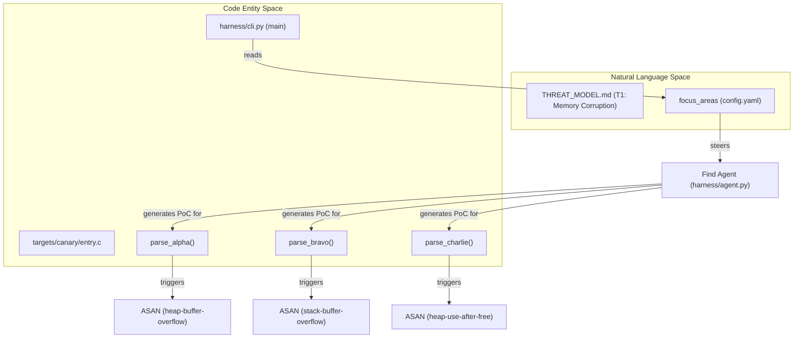
Sources: [targets/canary/config.yaml:16-19](), [targets/canary/README.md:12-18](), [harness/cli.py:17-17](), [targets/canary/THREAT_MODEL.md:30-33]()

---

## 3. Choosing Your Workflow

Depending on your goals, you can use interactive skills or the autonomous pipeline.

### Option A: Interactive Claude Code Skills
Best for initial scoping, threat modeling, and triaging existing static analysis results. These skills only read and write files and do not require the gVisor sandbox [README.md:85-89]().

| Command | Purpose | Output |
| :--- | :--- | :--- |
| `/threat-model bootstrap <path>` | Automated 5-stage research into system architecture | `THREAT_MODEL.md` |
| `/vuln-scan <path>` | Static source analysis scoped by the threat model | `VULN-FINDINGS.json` |
| `/triage <findings.json>` | Adversarial verification and ranking of findings | `TRIAGE.md` |
| `/patch <triage.json>` | Generate candidate fixes for verified findings | `PATCHES/` |

Sources: [README.md:91-110](), [.claude/skills/quickstart/SKILL.md:60-74](), [docs/troubleshooting.md:125-136]()

### Option B: Autonomous Pipeline
Best for C/C++ projects where you require execution-verified PoCs (AddressSanitizer crashes) and automated exploitability reporting [README.md:128-132]().

**The Autonomous Workflow**
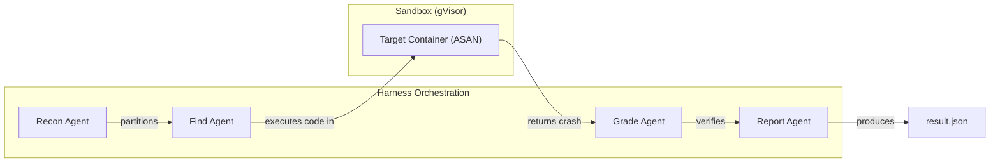
Sources: [README.md:13-18](), [README.md:147-155](), [docs/best-practices.md:109-114]()

### Resuming Work
If a run is interrupted (e.g., via rate limits or Ctrl-C), both modes support resuming:
*   **Skills:** Re-invoke the same command; it reads state from directories like `./.triage-state/` [docs/troubleshooting.md:34-43]().
*   **Pipeline:** Use the `--resume <results_dir>` flag to skip completed runs and carry over deduplication context [docs/troubleshooting.md:51-65]().

Sources: [docs/troubleshooting.md:1-137]()

---

# Page: System Architecture

# System Architecture

<details>
<summary>Relevant source files</summary>

The following files were used as context for generating this wiki page:

- [.claude/skills/customize/SKILL.md](.claude/skills/customize/SKILL.md)
- [bin/vp-sandboxed](bin/vp-sandboxed)
- [docs/customizing.md](docs/customizing.md)
- [docs/pipeline.md](docs/pipeline.md)
- [docs/security.md](docs/security.md)
- [harness/README.md](harness/README.md)
- [harness/cli.py](harness/cli.py)
- [harness/sandbox.py](harness/sandbox.py)

</details>


The Defending Code Reference Harness is designed as a multi-agent, autonomous system for vulnerability discovery and verification. It operates on a "trust but verify" model, where discovery agents propose vulnerabilities and independent grader agents attempt to disprove them in clean environments.

## The Two-Container Trust Boundary

A core architectural principle of the harness is the strict isolation between the discovery phase and the verification phase. This prevents agents from "hallucinating" success by modifying their own environment or detectors.

1.  **Discovery Container (Find):** An agent runs `claude -p` inside a gVisor-isolated container. It has full read/write access to the target source and can execute the target binary. It iterates until it produces a Proof-of-Concept (PoC) file that triggers a crash [docs/pipeline.md:63-67]().
2.  **The PoC Bridge:** Only the raw bytes of the PoC (e.g., `poc.bin`) and minimal metadata (ASAN logs) cross the boundary [docs/pipeline.md:69-72]().
3.  **Verification Container (Grade):** A second agent is spawned in a **fresh** container that the discovery agent never touched. It attempts to reproduce the crash using only the provided PoC. If the crash does not reproduce here, the finding is rejected [harness/grade.py:48-52](), [docs/pipeline.md:69-72]().

### Diagram: Trust Boundary and Data Flow
This diagram illustrates how data flows between the Natural Language Space (agent reasoning) and the Code Entity Space (files and containers), bridged by the `agent_container`.

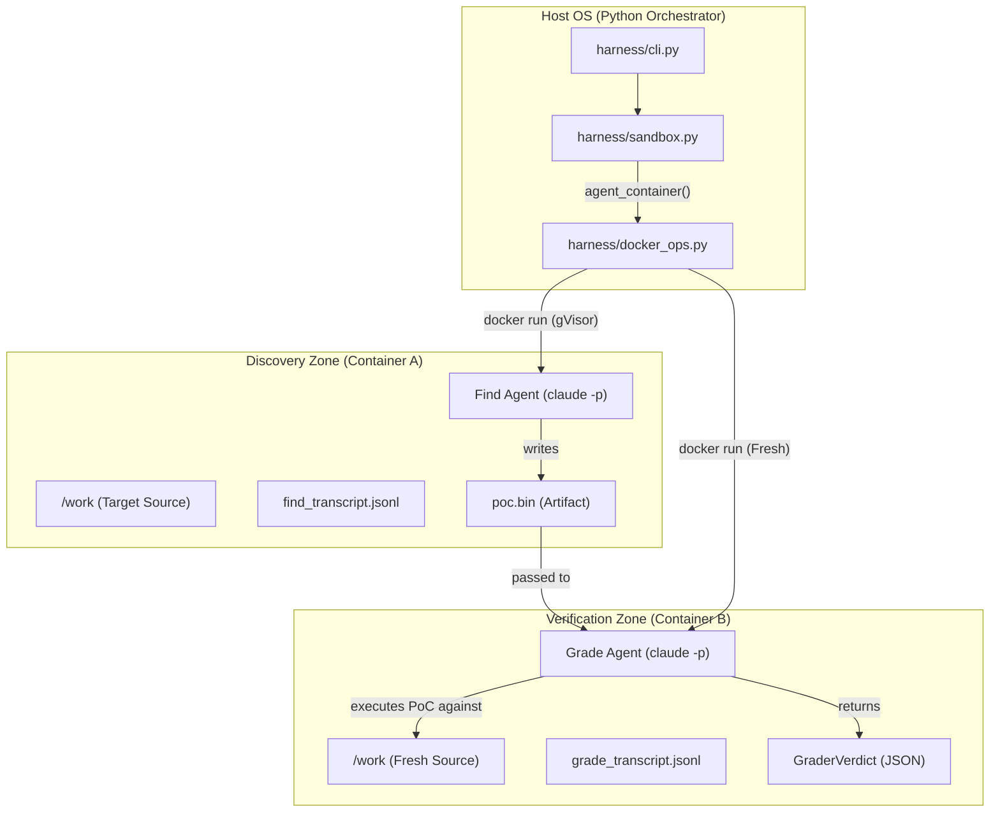
**Sources:** [harness/sandbox.py:59-92](), [harness/cli.py:43-55](), [docs/pipeline.md:63-72]()

---

## Discovery-Verification Split

The pipeline distinguishes between **finding** a potential bug and **confirming** it is a valid, exploitable vulnerability. This split is enforced by separate agent roles and prompts.

| Phase | Agent Role | Input | Output |
| :--- | :--- | :--- | :--- |
| **Recon** | Mapper | Source Tree | `focus_areas` (YAML) |
| **Find** | Attacker | Source + Focus Area | `poc.bin` + ASAN log |
| **Grade** | Skeptic | `poc.bin` | `GraderVerdict` (Score 0-5) |
| **Judge** | Registrar | `GraderVerdict` + Manifest | `JudgeVerdict` (New/Dup) |
| **Report** | Analyst | Verified Crash | `ReportVerdict` (Exploitability) |
| **Patch** | Developer | Verified Crash | `patch.diff` |

**Sources:** [harness/cli.py:16-21](), [docs/pipeline.md:50-91](), [harness/prompts/find_prompt.py:1-20]()

---

## Multi-Agent Workflow (The Pipeline)

The `vuln-pipeline` orchestrates agents through a series of stages, often running in parallel.

### 1. Reconnaissance (`recon`)
The `run_recon` function [harness/recon.py:23]() spawns an agent to partition the attack surface. It identifies distinct parsers or entry points to prevent multiple parallel `find` agents from converging on the same shallow bug [docs/pipeline.md:57-61]().

### 2. Discovery (`find`)
The `run_find` function [harness/find.py:27]() uses the `find_prompt` to guide an agent in crafting inputs. It monitors for ASAN crashes and saves the `CrashArtifact` [harness/artifacts.py:29]().

### 3. Verification (`grade`)
`run_grade` [harness/grade.py:23]() validates the finding. It uses a 5-criterion rubric:
1. Reproducibility (3/3 times).
2. Location (is it in the target code?).
3. Severity (is it more than just an OOM?).
4. Accuracy (does the agent understand the crash?).
5. Quality (is it a high-impact memory corruption?).
**Sources:** [harness/prompts/grade_prompt.py:15-40]()

### 4. Deduplication & Judging (`judge`)
When `--stream` is enabled, `run_judge` [harness/judge.py:23]() compares new findings against the `manifest.jsonl`. It performs semantic deduplication—deciding if a crash is a `NEW` bug or a `DUP_BETTER` version of an existing one [docs/pipeline.md:74-79]().

### 5. Exploitability Reporting (`report`)
`run_report` [harness/report.py:23]() generates a deep analysis. It characterizes the primitive (e.g., OOB Write), reachability, and potential escalation paths [harness/prompts/report_prompt.py:10-30]().

### 6. Patching (`patch`)
`run_patch` [harness/patch.py:28]() attempts to fix the bug. It follows a "T0-T3" ladder where the patch is verified to:
- Compile (T0).
- Fix the original crash (T1).
- Pass existing tests (T2).
- Resist "re-attack" by a find agent (T3).
**Sources:** [harness/patch.py:100-150](), [docs/pipeline.md:107-108]()

---

## Sandbox, Harness, and Skills Layers

The system is organized into three conceptual layers that manage the transition from user intent to sandboxed execution.

### Diagram: Layered Architecture
This diagram maps the system components to their code entities and shows how they interact across the sandbox boundary.

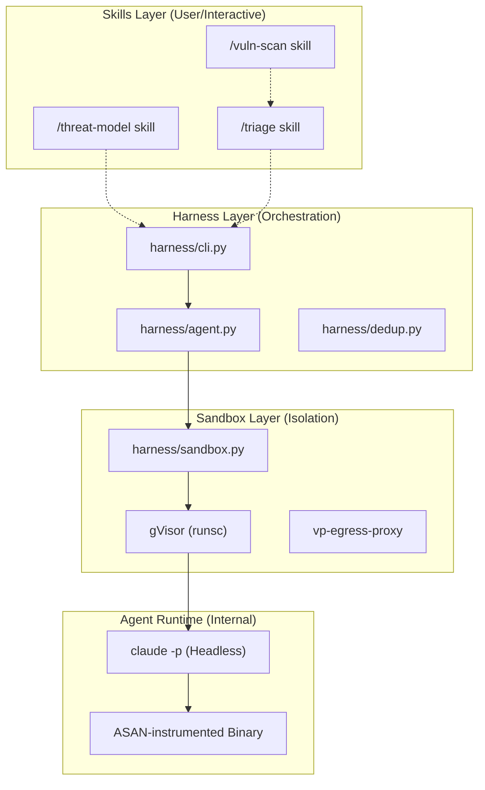

### Component Roles
*   **Skills Layer:** Interactive Claude Code skills (located in `.claude/skills/`) used for manual or semi-automated analysis. They often produce artifacts (like `THREAT_MODEL.md` or `VULN-FINDINGS.json`) that can seed the autonomous pipeline [docs/pipeline.md:41-48]().
*   **Harness Layer:** The Python-based logic (`harness/`) that manages the lifecycle of a "run." It handles API communication via `AgentRunner` [harness/agent.py:40](), state persistence in `result.json`, and the flow between stages [harness/cli.py:159-177]().
*   **Sandbox Layer:** The security infrastructure. `harness/sandbox.py` ensures that every agent is wrapped in an `agent_container` context manager [harness/sandbox.py:59](), enforcing gVisor isolation and routing traffic through the `vp-egress-proxy` [bin/vp-sandboxed:22-31]().

**Sources:** [harness/sandbox.py:5-10](), [harness/agent.py:40-60](), [docs/security.md:21-28](), [bin/vp-sandboxed:1-40]()

---

# Page: Autonomous Pipeline

# Autonomous Pipeline

<details>
<summary>Relevant source files</summary>

The following files were used as context for generating this wiki page:

- [CLAUDE.md](CLAUDE.md)
- [docs/agent-sandbox.md](docs/agent-sandbox.md)
- [docs/patching.md](docs/patching.md)
- [docs/pipeline.md](docs/pipeline.md)
- [docs/security.md](docs/security.md)
- [harness/README.md](harness/README.md)
- [harness/cli.py](harness/cli.py)

</details>


The autonomous pipeline is a multi-agent system designed for the end-to-end discovery, verification, and remediation of memory safety vulnerabilities in C/C++ codebases. It automates the transition from raw source code to verified exploitability reports and executable patches using a series of specialized LLM-driven agents.

The pipeline is primarily invoked via the `vuln-pipeline` CLI (or its sandboxed wrapper `bin/vp-sandboxed`), which manages the lifecycle of agents and their isolated execution environments [harness/cli.py:14-28]().

## Pipeline Lifecycle Overview

The pipeline operates in a modular sequence where each stage produces durable artifacts consumed by the next. While the stages can be run individually for fine-grained control, the `run` command provides a unified entry point for the core loop [docs/pipeline.md:50-91]().

### 1. Reconnaissance
The **Recon Agent** performs a static analysis of the target source tree to identify distinct attack surfaces. It partitions the codebase into "focus areas" (e.g., specific parsers or network handlers), allowing subsequent parallel find agents to explore different parts of the target rather than converging on the same shallow bugs [docs/pipeline.md:57-61]().
*   **For details, see [Reconnaissance and Find Agents](#2.2).**

### 2. Vulnerability Discovery (Find)
The **Find Agent** is the core discovery engine. It runs within a network-isolated gVisor container, where it reads source code and iteratively crafts malformed inputs. It executes the target binary—instrumented with AddressSanitizer (ASAN)—until it achieves a reproducible crash [docs/pipeline.md:63-68]().
*   **For details, see [Reconnaissance and Find Agents](#2.2).**

### 3. Verification (Grade)
The **Grade Agent** acts as an adversarial verifier. It takes the Proof-of-Concept (PoC) generated by a find agent and attempts to reproduce the crash in a fresh, "clean" container that the find agent never touched. This ensures the crash is legitimate, reproducible, and not an artifact of environment manipulation [docs/pipeline.md:69-73]().
*   **For details, see [Grading and Verification](#2.3).**

### 4. Deduplication and Judging
When running in `--stream` mode, the **Judge Agent** performs semantic deduplication in real-time. It compares newly verified crashes against the existing bug manifest to decide if a finding is a new unique bug, a better representative of a known bug, or a duplicate to be skipped [docs/pipeline.md:74-80]().
*   **For details, see [Deduplication and Judging](#2.4).**

### 5. Exploitability Reporting
The **Report Agent** conducts a deep analysis of unique, verified crashes. It produces a structured report covering the vulnerability primitive, reachability, heap layout implications, and potential escalation paths [docs/pipeline.md:81-89]().
*   **For details, see [Exploitability Reporting](#2.5).**

### 6. Patching
The **Patch Agent** attempts to fix verified vulnerabilities. It generates a `git diff` and validates it against a "verification ladder" that includes successful compilation, reproduction of the fix (the PoC no longer crashes), and a "re-attack" phase where a fresh find agent tries to bypass the new fix [docs/patching.md:55-84]().
*   **For details, see [Patch Generation and Verification](#2.6).**

## Data Flow and Environment Architecture

The pipeline maintains a strict separation between the "Natural Language Space" (where agents reason) and the "Code Entity Space" (where code is executed). This is enforced by the `Sandbox` and `Agent` abstractions.

### High-Level Component Relationship
This diagram shows how the host orchestrator manages the lifecycle of agents across the trust boundary.

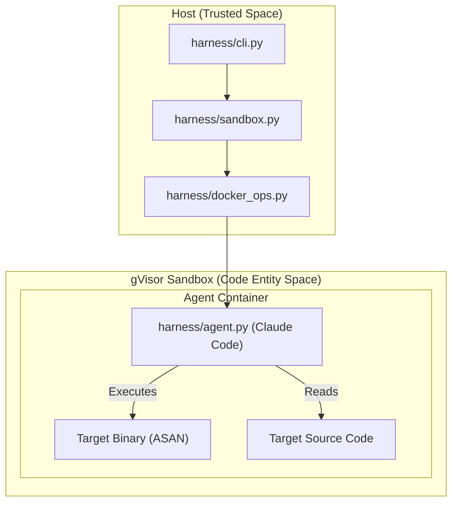
**Sources:** [harness/sandbox.py:1-30](), [harness/docker_ops.py:1-40](), [docs/agent-sandbox.md:1-9]()

### Detailed Pipeline Data Flow
This diagram tracks the transformation of data from a target definition to a final verified patch.

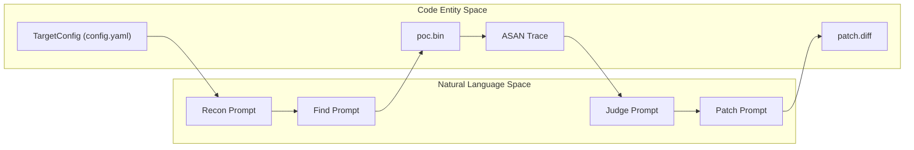
**Sources:** [harness/config.py:1-20](), [harness/artifacts.py:1-50](), [docs/pipeline.md:50-91](), [docs/patching.md:55-78]()

## Core CLI Commands

The pipeline is controlled through the `vuln-pipeline` command. Common patterns include:

| Command | Description |
| :--- | :--- |
| `run <target> --auto-focus` | Full recon → find → grade loop [harness/cli.py:18](). |
| `run <target> --parallel --stream` | Parallel discovery with real-time judging and reporting [docs/pipeline.md:26-27](). |
| `report <results_dir>` | Batch-mode exploitability analysis for a results directory [harness/cli.py:21](). |
| `patch <results_dir>` | Generate and verify fixes for all unique bugs in a batch [docs/patching.md:41](). |
| `run <target> --resume <dir>` | Resume a partially-killed or failed batch [harness/cli.py:103](). |

**Sources:** [harness/cli.py:14-28](), [docs/pipeline.md:95-108]()

---

# Page: CLI Orchestration

# CLI Orchestration

<details>
<summary>Relevant source files</summary>

The following files were used as context for generating this wiki page:

- [.claude/skills/_lib/checkpoint.py](.claude/skills/_lib/checkpoint.py)
- [docs/pipeline.md](docs/pipeline.md)
- [harness/cli.py](harness/cli.py)
- [targets/canary/fixtures/results_sample/run_000/result.json](targets/canary/fixtures/results_sample/run_000/result.json)
- [targets/canary/fixtures/results_sample/run_001/result.json](targets/canary/fixtures/results_sample/run_001/result.json)
- [targets/canary/fixtures/results_sample/run_002/result.json](targets/canary/fixtures/results_sample/run_002/result.json)
- [tests/test_checkpoint.py](tests/test_checkpoint.py)
- [tests/test_skill_checkpoint.py](tests/test_skill_checkpoint.py)

</details>


The autonomous pipeline is orchestrated by `harness/cli.py`, which provides a unified entrypoint for vulnerability discovery, verification, deduplication, and reporting. It manages the complex lifecycle of parallel agent execution, network-isolated container provisioning, and durable state management to ensure that long-running security audits can be resumed and scaled.

## Subcommand Overview

The `vuln-pipeline` CLI supports several high-level subcommands that map to specific stages of the vulnerability research lifecycle.

| Subcommand | Purpose | Primary Functions |
| :--- | :--- | :--- |
| `recon` | Partitions the attack surface into focus areas. | `run_recon` [harness/cli.py:54]() |
| `run` | Executes the core find-and-grade loop. | `run_find` [harness/cli.py:49](), `run_grade` [harness/cli.py:50]() |
| `dedup` | Groups crashes by ASAN signature post-hoc. | `dedup` [harness/cli.py:48]() |
| `report` | Generates deep exploitability analysis. | `run_report` [harness/cli.py:55]() |
| `patch` | Generates and verifies code fixes. | `run_patch` [harness/cli.py:53]() |

Sources: [harness/cli.py:16-21](), [harness/cli.py:48-55]()

## Execution and Parallelism

The `run` subcommand is designed for high-concurrency execution. When invoked with `--parallel`, the orchestrator uses `asyncio` to manage multiple agent sessions simultaneously.

### Focus Area Assignment
If `--auto-focus` is enabled, the CLI first runs a `recon` agent to identify distinct entry points [harness/cli.py:18](). These are distributed to `find` agents using a round-robin strategy [harness/cli.py:17]().

### Streaming and Dispatch
With the `--stream` flag, the CLI enables a reactive pipeline where crashes are processed as soon as they are verified by a grader.
1. **Find**: Agents search for crashes in isolated containers.
2. **Grade**: Verification agents attempt to reproduce the crash in a clean environment.
3. **Dispatch**: Verified crashes are sent to `_stream_dispatch` [harness/cli.py:192]().
4. **Judge & Report**: The `run_judge` [harness/cli.py:51]() function determines if the crash is novel; if so, `run_report` [harness/cli.py:55]() generates the final artifact.

### Code Entity Mapping: Orchestration Flow
The following diagram maps the CLI subcommands to their internal implementation functions and the resulting artifacts.

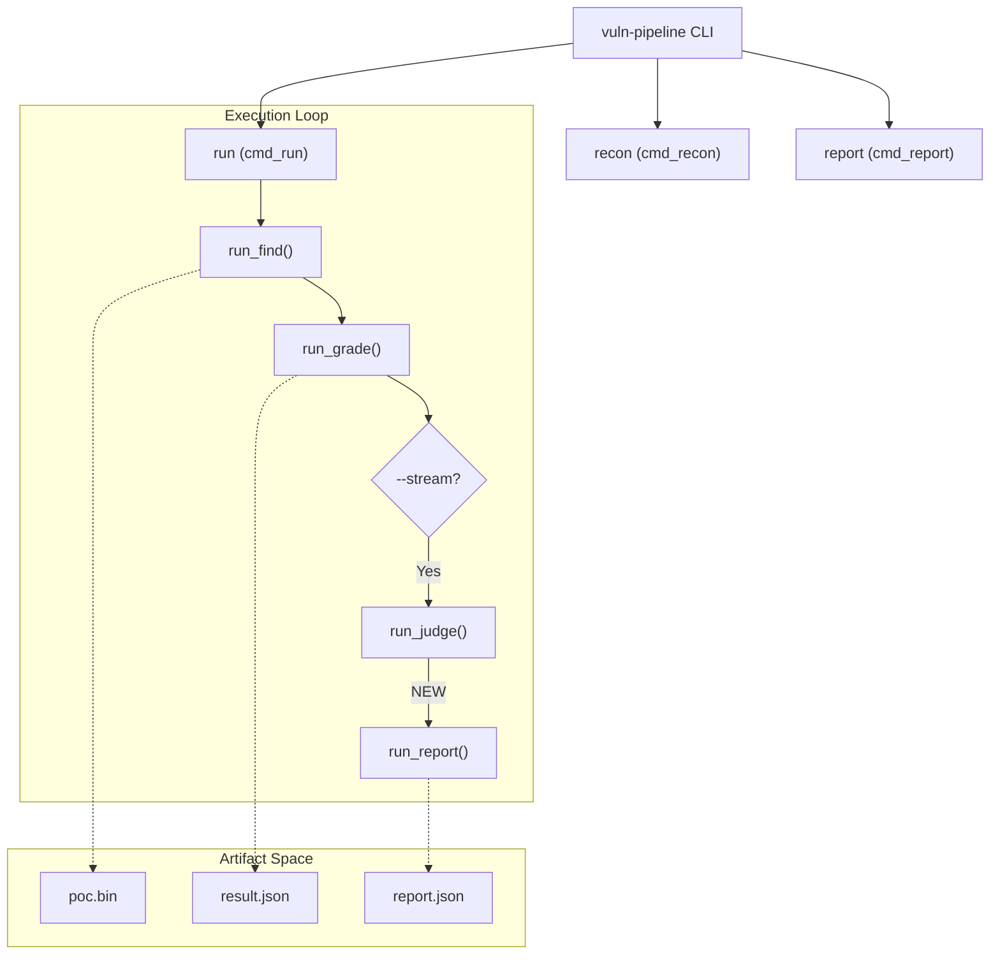
Sources: [harness/cli.py:16-21](), [harness/cli.py:49-55](), [harness/cli.py:192-210]()

## State Management and Resume Logic

The harness prioritizes durability. Every agent interaction is persisted to disk, allowing the pipeline to recover from hardware failures, API timeouts, or manual interruptions.

### Resume Mechanics
When `--resume <dir>` is provided, the CLI inspects the `results/` directory to identify the state of prior runs [harness/cli.py:103]().
- **Terminal Statuses**: Runs with status `crash_found`, `crash_rejected`, or `no_crash_found` are considered terminal and skipped [harness/cli.py:156-176]().
- **Retries**: Statuses like `agent_failed` or `error` are not terminal; the orchestrator will re-attempt these runs [harness/cli.py:162]().
- **Layout Guard**: The function `_resume_layout_error` ensures that the user does not attempt to resume a multi-run batch into a single-run directory structure [harness/cli.py:159-182]().

### Checkpoint Data Flow
The CLI manages the transition between "Natural Language Space" (agent reasoning) and "Code Entity Space" (structured JSON artifacts).

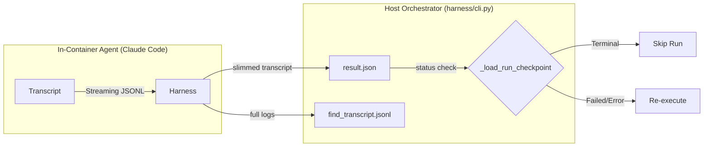
Sources: [harness/cli.py:156-177](), [harness/cli.py:159-182](), [tests/test_checkpoint.py:25-54]()

## Container Lifecycle and Signal Handling

The pipeline relies on strict container isolation via `gVisor` and custom Docker networking. The CLI ensures these resources are cleaned up properly.

### Signal Handling
Standard Python `finally` blocks do not execute on signals like `SIGINT` or `SIGTERM`. To prevent orphaned containers (which can reserve significant memory) and orphaned Node.js subprocesses from the Claude Code SDK, `harness/cli.py` implements a custom signal handler:
- **`_terminate_subprocesses()`**: Scans `/proc` to find and `SIGKILL` direct child processes that might otherwise persist for hours [harness/cli.py:97-120]().
- **`_on_signal()`**: Filters Docker containers by name (e.g., `find_<target>_`, `grader_<target>_`) and forcibly removes them [harness/cli.py:125-154]().

### Authentication Resolution
The CLI resolves authentication for the in-container agents via `_resolve_auth_env` [harness/cli.py:66](). It prioritizes `ANTHROPIC_API_KEY` over `CLAUDE_CODE_OAUTH_TOKEN` and passes these credentials into the agent container at runtime [harness/cli.py:75-81]().

Sources: [harness/cli.py:66-81](), [harness/cli.py:97-154]()

---

# Page: Reconnaissance and Find Agents

# Reconnaissance and Find Agents

<details>
<summary>Relevant source files</summary>

The following files were used as context for generating this wiki page:

- [harness/find.py](harness/find.py)
- [harness/prompts/find_prompt.py](harness/prompts/find_prompt.py)
- [harness/prompts/recon_prompt.py](harness/prompts/recon_prompt.py)
- [harness/prompts/system_prompt.py](harness/prompts/system_prompt.py)
- [harness/recon.py](harness/recon.py)
- [tests/test_focus.py](tests/test_focus.py)
- [tests/test_found_bugs.py](tests/test_found_bugs.py)
- [tests/test_report.py](tests/test_report.py)
- [tests/test_system_prompt.py](tests/test_system_prompt.py)

</details>


The **Reconnaissance (Recon)** and **Find** agents represent the initial stages of the autonomous vulnerability discovery pipeline. The Recon agent analyzes the target codebase to partition its attack surface into distinct focus areas, which are then assigned to parallel Find agents. The Find agents operate within the target container to craft proof-of-concept (PoC) inputs that trigger AddressSanitizer (ASAN) crashes.

### Reconnaissance Agent

The Recon agent is a lightweight agent designed to explore the target's source tree and identify subsystems that process untrusted input. Its primary goal is to prevent parallel Find agents from converging on the same bugs by providing a diverse set of focus areas.

#### Focus Area Partitioning
The Recon agent is tasked with identifying 5–15 distinct subsystems [harness/prompts/recon_prompt.py:25-27](). A "good" partition consists of independent parsers, formats, or protocol stages (e.g., "PNG decoder" vs "JPEG decoder") [harness/prompts/recon_prompt.py:29-30]().

The agent performs exploration by:
1.  Listing the source tree using `find` [harness/prompts/recon_prompt.py:37]().
2.  Identifying entry points and dispatch logic, such as magic-byte checks or switch statements [harness/prompts/recon_prompt.py:38-39]().
3.  Proposing focus areas in a specific format: `<subsystem name> (<function/file pattern>) — <key operations>` [harness/prompts/recon_prompt.py:49]().

#### Implementation: `run_recon`
The `run_recon` function orchestrates this process [harness/recon.py:22-60](). It starts a sandbox container, builds the recon prompt, and runs the agent with a relatively short turn budget (default 100 turns) [harness/recon.py:19-26](). It then parses the `<focus_areas>` XML tag from the agent's output [harness/recon.py:54-59]().

**Reconnaissance Data Flow**
Title: Recon Agent Subsystem Partitioning
```mermaid
graph TD
    subgraph "Natural Language Space"
        A["RECON_PROMPT_TEMPLATE"] -- "Exploration Task" --> B["Recon Agent (LLM)"]
        B -- "Proposed Focus Areas" --> C["<focus_areas> XML Tag"]
    end

    subgraph "Code Entity Space"
        D["target.source_root"] -- "find / grep" --> B
        B -- "Identify" --> E["Subsystems (e.g., parse_alpha)"]
        C -- "Parsed by run_recon" --> F["List[str] Focus Areas"]
    end

    B -.->| "Analyzes" | D
    F -.->| "Feeds into" | G["Find Agent Assignment"]
```
Sources: [harness/recon.py:22-60](), [harness/prompts/recon_prompt.py:10-59]()

---

### Find Agent

The Find agent is the core discovery engine. It runs inside the target container with the instrumented binary and source code [harness/prompts/find_prompt.py:14-17]().

#### Focus Area Assignment
When running in the autonomous pipeline, the CLI assigns focus areas to Find agents using a round-robin strategy via `_assigned_focus` [tests/test_focus.py:91-104](). If focus areas were defined in the target's `config.yaml` or generated by the Recon agent, they are injected into the Find agent's prompt to steer its research [harness/prompts/find_prompt.py:33]().

#### Implementation: `run_find`
The `run_find` function manages the lifecycle of a discovery attempt [harness/find.py:21-100]().
- **Sandbox:** It mounts a shared `found_bugs.jsonl` file to the container to allow for cross-agent deduplication [harness/find.py:45-49]().
- **Prompting:** It uses `build_find_prompt` to construct the instructions, including the focus area, known bugs, and the specific binary entry point [harness/find.py:50-60]().
- **Execution:** It runs the agent with a large turn budget (default 2000 turns) to allow for deep exploration and PoC minimization [harness/find.py:18-64]().
- **Artifact Extraction:** Upon completion, it parses the agent's output for the `<poc_path>`, `<reproduction_command>`, and `<crash_output>` tags, then reads the PoC bytes from the container using `docker_ops.read_file` [harness/find.py:74-98]().

#### Crash Quality Tiers
The Find agent is instructed to prioritize high-value memory corruption bugs over low-value DoS or logic bugs [harness/prompts/find_prompt.py:57-75]().

| Tier | Crash Types | Action |
| :--- | :--- | :--- |
| **High Value** | `heap-buffer-overflow` (WRITE), `heap-use-after-free`, `stack-buffer-overflow` | Submit immediately. |
| **Low Value** | Assertion failures, Stack overflow (recursion), Null-pointer dereference | Keep looking; use as a hint for escalation. |
| **Out of Scope** | OOM (huge allocations), Timeouts, Clean exits | Do not submit. |

Sources: [harness/find.py:21-100](), [harness/prompts/find_prompt.py:57-84]()

---

### Deduplication and Crash Sharing

To prevent redundant work in parallel runs, the harness implements a "found bugs" registry.

1.  **`found_bugs.jsonl`:** A shared file containing summaries of crashes already discovered during the current pipeline run [harness/find.py:45]().
2.  **ASAN Frame Extraction:** The harness uses `top_frame` and `project_frames` to extract the most relevant source code location from a raw ASAN trace [tests/test_found_bugs.py:12-43](). It specifically skips interceptor frames (like `memcpy` or `malloc`) to find the first frame within the project source [tests/test_found_bugs.py:51-54]().
3.  **`<dup_check>`:** The Find agent is required to provide a `<dup_check>` tag in its output, narrating why its discovered crash is distinct from those listed in the "Already Filed" section of its prompt [harness/prompts/find_prompt.py:97-109]().

**Discovery and Deduplication Logic**
Title: Find Agent Discovery and ASAN Parsing
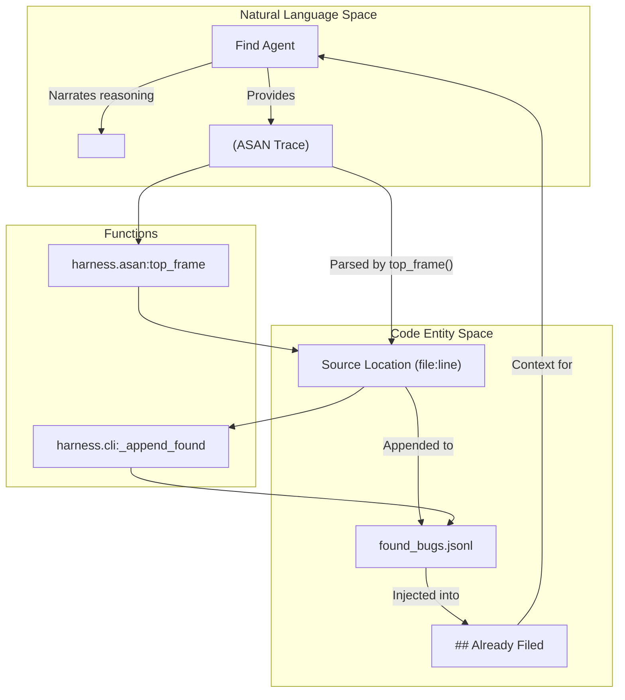
Sources: [harness/asan.py:7-8](), [tests/test_found_bugs.py:12-54](), [harness/prompts/find_prompt.py:97-109]()

### Re-attack Mode
When the pipeline is used to verify a patch, the Find agent's prompt switches to a **Re-attack** template [harness/prompts/find_prompt.py:118-150](). In this mode:
- The agent is given the original PoC that was just patched [harness/prompts/find_prompt.py:147]().
- It is instructed to craft variants targeting the same or adjacent code paths to find "patch bypasses" [harness/prompts/find_prompt.py:162-165]().
- It uses a specific `reattack_harness` command provided in the `TargetConfig` to run its PoCs [harness/find.py:59]().

Sources: [harness/prompts/find_prompt.py:118-165](), [harness/find.py:50-60]()

---

# Page: Grading and Verification

# Grading and Verification

<details>
<summary>Relevant source files</summary>

The following files were used as context for generating this wiki page:

- [harness/artifacts.py](harness/artifacts.py)
- [harness/asan.py](harness/asan.py)
- [harness/grade.py](harness/grade.py)
- [harness/prompts/grade_prompt.py](harness/prompts/grade_prompt.py)
- [tests/test_artifacts.py](tests/test_artifacts.py)
- [tests/test_asan.py](tests/test_asan.py)
- [tests/test_dedup.py](tests/test_dedup.py)

</details>


The Grading and Verification stage is the critical validation gate in the autonomous pipeline. It ensures that crashes discovered by a **Find Agent** are not hallucinations or artifacts of a corrupted environment. The **Grade Agent** operates across a strict trust boundary, attempting to reproduce the crash in a pristine container using only the Proof-of-Concept (PoC) bytes provided by the discovery phase.

## The Trust Boundary and Verification Flow

The core security and reliability principle of the harness is the separation of discovery and verification. A Find Agent may perform arbitrary actions within its container (e.g., modifying environment variables, installing libraries, or corrupting system files) [harness/grade.py:5-7](). To prevent these side effects from masquerading as legitimate vulnerabilities, the Grade Agent starts from a fresh container instance of the same `TargetConfig.image_tag` [harness/grade.py:51-52]().

### Data Flow: Find to Grade

1.  **Find Agent** emits a `CrashArtifact` containing the `poc_bytes`, a `reproduction_command`, and the original `poc_path` [harness/artifacts.py:16-24]().
2.  **Harness** (via `run_grade`) performs **PoC Path Substitution**. It writes the `poc_bytes` to a fixed location (`/tmp/poc.bin`) in the fresh container [harness/grade.py:53-55]().
3.  **Harness** adapts the `reproduction_command` by replacing the Find Agent's arbitrary path with the fixed `/tmp/poc.bin` path [harness/grade.py:56]().
4.  **Grade Agent** receives the adapted command and the fresh environment to execute the verification rubric [harness/grade.py:63-71]().

### Grade Execution Logic
The following diagram illustrates the transition from the data structures in the host process to the execution environment inside the sandboxed container.

**Verification Environment Mapping**
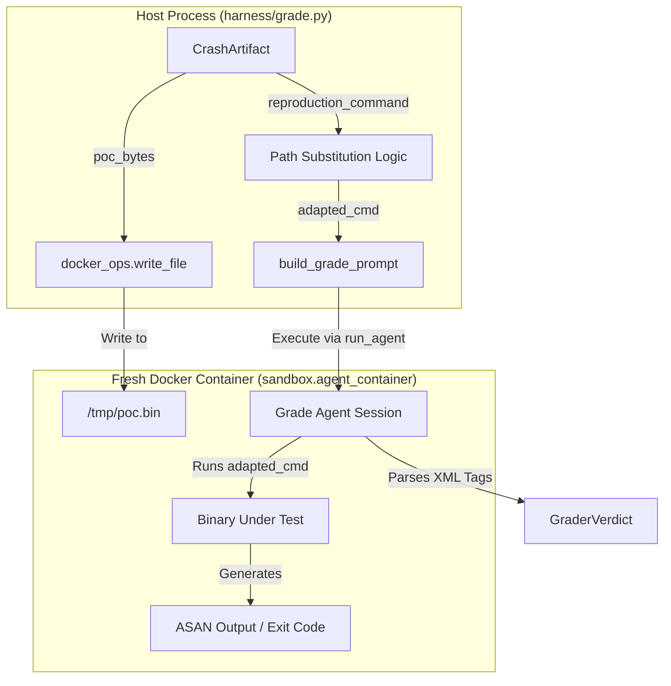
Sources: [harness/grade.py:26-100](), [harness/artifacts.py:16-24](), [harness/sandbox.py:1-20]()

## The 5-Criterion Rubric

The Grade Agent is instructed to evaluate the PoC against a strict 5-criterion rubric defined in the system prompt [harness/prompts/grade_prompt.py:9-64](). It must provide a `PASS`/`FAIL` for each:

| Criterion | Requirement | Failure Condition |
| :--- | :--- | :--- |
| **1: PoC Validity** | `/tmp/poc.bin` exists and is non-empty. | Missing or 0-byte file. |
| **2: Reproducibility** | Run the command 3 times. | No crash, or crashes in < 2/3 runs. |
| **3: Resource Limits** | Check for OOM or Timeouts. | Exit code 137 (OOM) or 124 (Timeout). |
| **4: Project Scope** | ASAN stack trace must hit project code. | Trace is entirely libc/runtime frames. |
| **5: Consistency** | Consistent crash class across runs. | Different crash types (e.g., SEGV then clean exit). |

Sources: [harness/prompts/grade_prompt.py:24-52](), [harness/grade.py:86-88]()

## ASAN Output Parsing and Deduplication

The harness includes specialized logic for parsing AddressSanitizer (ASAN) and glibc assertion output to extract semantic signatures. This is used both for the `GraderVerdict` and subsequent deduplication.

### Key Functions
*   **`crash_reason(crash_output)`**: Extracts the `crash_type` (e.g., `heap-buffer-overflow`) and the `operation` (`READ`/`WRITE`) [harness/asan.py:69-83]().
*   **`project_frames(crash_output, n)`**: Extracts the top `n` frames that contain source code locations (file:line), skipping library interceptors like `memcpy` or `malloc` [harness/asan.py:23-53]().
*   **`asan_excerpt(crash_output)`**: Creates a condensed version of the trace (Summary + Top 10 frames) for agent context [harness/asan.py:86-107]().

### Signature Extraction
Crashes are grouped into signatures using a tuple of `(crash_type, top_project_frame)` [tests/test_dedup.py:34-47](). This allows the system to recognize that different PoCs are triggering the same underlying bug.

**ASAN Parsing Logic**
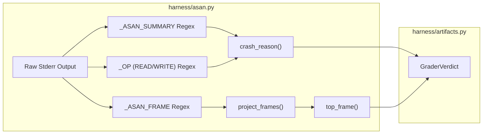
Sources: [harness/asan.py:12-21](), [harness/asan.py:62-66](), [tests/test_dedup.py:109-110]()

## Implementation Details

### `run_grade` Function
The primary entry point for verification is `run_grade` [harness/grade.py:26](). 
1.  It validates that the `poc_path` exists within the `reproduction_command` to ensure agent consistency [harness/grade.py:45-49]().
2.  It invokes `sandbox.agent_container` to create the isolated environment [harness/grade.py:52]().
3.  It persists the `poc.bin` to the host `workspace_dir` so the artifact survives container teardown [harness/grade.py:58-61]().
4.  It executes the agent via `run_agent` with a 50-turn budget [harness/grade.py:73-81]().
5.  It parses the agent's XML-tagged output into a `GraderVerdict` object [harness/grade.py:84-99]().

### Data Structures
*   **`GraderVerdict`**: Stores the `passed` boolean, a `score` (0.0-1.0), the per-criterion results, and the `evidence` string [harness/artifacts.py:45-50]().
*   **`RunResult`**: The final container for a pipeline iteration, linking the `CrashArtifact` and its `GraderVerdict` [harness/artifacts.py:151-160]().

Sources: [harness/grade.py:23-24](), [harness/grade.py:84-100](), [harness/artifacts.py:45-50]()

---

# Page: Deduplication and Judging

# Deduplication and Judging

<details>
<summary>Relevant source files</summary>

The following files were used as context for generating this wiki page:

- [harness/dedup.py](harness/dedup.py)
- [harness/judge.py](harness/judge.py)
- [harness/prompts/judge_prompt.py](harness/prompts/judge_prompt.py)
- [tests/test_asan.py](tests/test_asan.py)
- [tests/test_dedup.py](tests/test_dedup.py)
- [tests/test_judge.py](tests/test_judge.py)

</details>


Deduplication in the Defending Code Reference Harness ensures that the autonomous pipeline focuses its expensive reporting and patching resources on unique root causes rather than redundant manifestations of the same bug. The system employs two distinct layers of deduplication:

1.  **Semantic Judging**: An LLM-based `judge` agent that evaluates freshly-graded crashes against a registry of known bugs to decide if a new exploitability report is warranted.
2.  **Post-hoc Signature Clustering**: A regex-based signature extraction utility used for summary reporting and final results analysis.

## The Judge Agent

The `judge` agent replaces traditional stack-hash deduplication with semantic reasoning. It is invoked after a crash has been verified by the `grade` stage. Its primary role is to act as a gatekeeper for the `report` stage.

### Judgment Types
The judge must emit one of three specific tags:
*   `NEW`: The crash's root cause is distinct from every bug currently in the registry. This triggers a new `report` task [harness/prompts/judge_prompt.py:43-46]().
*   `DUP_SKIP`: The crash shares a root cause with an existing bug, and the current representative/report is sufficient [harness/prompts/judge_prompt.py:48-50]().
*   `DUP_BETTER`: The crash shares a root cause with an existing bug, but this new PoC is a "better" representative (e.g., smaller, more stable, or clearer ASAN trace). This triggers a re-report for that bug ID [harness/prompts/judge_prompt.py:52-57]().

### Implementation and Data Flow
The judge is a host-side, no-tools agent executed via `run_agent` [harness/judge.py:56-65](). It receives the ASAN excerpt of the new crash, its grade score, and a manifest of all previously identified bugs [harness/judge.py:45-52]().

#### Decision Logic Diagram
"This diagram illustrates how the `run_judge` function [harness/judge.py:25]() interacts with the `manifest.jsonl` registry to categorize new crashes."

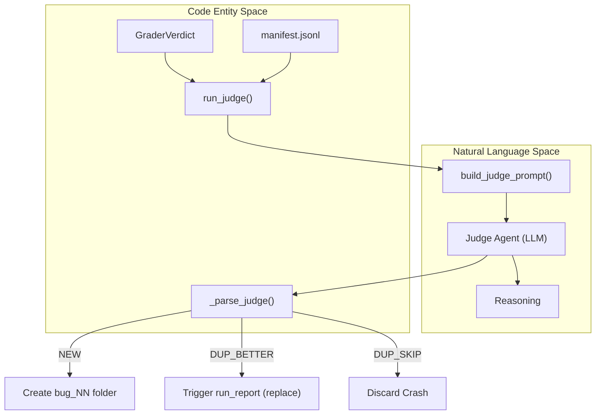
Sources: [harness/judge.py:25-70](), [harness/prompts/judge_prompt.py:17-73](), [harness/artifacts.py:1-20]()

## The Manifest Registry

The `manifest.jsonl` file serves as the ground truth for the judging process. It is located in the `reports/` directory of a run's output.

### Manifest Schema
Each entry in the manifest contains:
*   `bug_id`: An integer identifier (e.g., `0`, `1`).
*   `run_idx`: The original run index that discovered the bug.
*   `asan_excerpt`: A truncated version of the ASAN output used for comparison [harness/prompts/judge_prompt.py:77-84]().
*   `report_text`: The first 1500 characters of the landed exploitability report (if available) [harness/prompts/judge_prompt.py:94-97]().

The manifest is updated atomically. When the judge rules `NEW`, `_append_manifest` is called to reserve a new `bug_id` [tests/test_judge.py:113-116]().

## Comparison Stage (`run_compare`)

When the judge rules `DUP_BETTER`, the pipeline generates a new report (Report B) for the existing bug. To prevent a "cleaner" PoC from accidentally producing a "weaker" analysis, the `run_compare` stage is invoked [harness/judge.py:90-100]().

The comparison agent evaluates both the original Report A and the new Report B against a rubric that prioritizes:
1.  Concrete primitive characterization (controlled bytes/offsets).
2.  Grounded reachability call chains.
3.  Evidence-backed claims (file:line citations).
4.  Completeness of all five analysis sections [harness/prompts/judge_prompt.py:159-168]().

The winner of this comparison becomes the canonical report for that `bug_id` [harness/judge.py:123-128]().

## Post-hoc Deduplication (`harness/dedup.py`)

While the judge handles streaming deduplication, the `dedup` utility provides a high-level summary of all crashes found across one or more batches [harness/dedup.py:3-15]().

### Signature Extraction
A signature is a tuple of `(crash_type, top_frame)` [harness/dedup.py:29-33]():
*   **Crash Type**: Extracted via `crash_reason()` from the ASAN `SUMMARY` line (e.g., `heap-buffer-overflow`, `SEGV`) [harness/asan.py:23-25]().
*   **Top Frame**: Extracted via `top_frame()`, skipping common interceptors like `memcpy` or `malloc` to find the first application-level function [harness/asan.py:23](), [tests/test_dedup.py:39-41]().

### Deduplication Process Diagram
"This diagram shows the relationship between the `dedup` command-line utility and the underlying ASAN parsing logic."

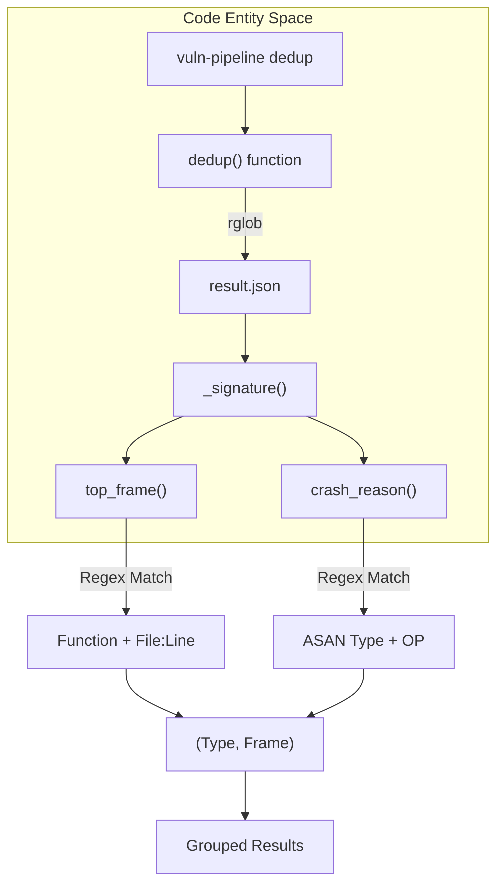
Sources: [harness/dedup.py:36-57](), [harness/asan.py:1-30](), [tests/test_dedup.py:105-115]()

## Streaming Deduplication Lock

In the CLI (`harness/cli.py`), judging is performed within a streaming loop. To prevent race conditions where two concurrent find-agents submit the same bug simultaneously:
1.  The CLI maintains a `manifest` in memory, updated from disk before each judge call [tests/test_judge.py:107-110]().
2.  The `run_judge` call is typically performed sequentially or protected by the state management logic to ensure the manifest seen by the LLM is up-to-date [harness/judge.py:31-39]().
3.  If the judge emits `NEW`, the pipeline immediately appends the entry to `manifest.jsonl` to "claim" that signature for subsequent judge calls [tests/test_judge.py:113-116]().

Sources: [harness/judge.py:1-128](), [harness/dedup.py:1-80](), [harness/prompts/judge_prompt.py:1-188](), [tests/test_dedup.py:1-115](), [tests/test_judge.py:1-140]()

---

# Page: Exploitability Reporting

# Exploitability Reporting

<details>
<summary>Relevant source files</summary>

The following files were used as context for generating this wiki page:

- [harness/novelty.py](harness/novelty.py)
- [harness/prompts/report_grader_prompt.py](harness/prompts/report_grader_prompt.py)
- [harness/prompts/report_prompt.py](harness/prompts/report_prompt.py)
- [harness/prompts/system_prompt.py](harness/prompts/system_prompt.py)
- [harness/report.py](harness/report.py)
- [tests/test_focus.py](tests/test_focus.py)
- [tests/test_found_bugs.py](tests/test_found_bugs.py)
- [tests/test_report.py](tests/test_report.py)
- [tests/test_system_prompt.py](tests/test_system_prompt.py)

</details>


Exploitability reporting is the third stage of the autonomous vulnerability pipeline. After a crash has been discovered by a **find** agent and verified as reproducible by a **grade** agent, the **report** agent performs a deep analysis to determine if the crash represents a genuine, exploitable security vulnerability reachable from the target's real-world attack surface.

## Overview

The reporting stage transitions from simple crash verification to structured security analysis. It uses a specialized agent to investigate the crash within a fresh container, followed by a separate grader agent that semantically scores the report quality.

### Key Characteristics
*   **Deep Analysis**: Unlike the find agent, which is focused on triggering any crash, the report agent is given a 200-turn budget [harness/report.py:26-26]() to perform bounded, expert-level research.
*   **Structured Taxonomy**: Reports must follow a strict six-section format (Primitive, Reachability, Heap Layout, Escalation Path, Constraints, Escalation Attempt) [harness/prompts/report_prompt.py:38-40]().
*   **Host-Injected Novelty**: To maintain the `--network none` security boundary for the agent container, the host orchestrator performs upstream git log lookups and injects them into the agent's prompt [harness/novelty.py:3-11]().
*   **Semantic Grading**: A second LLM-based grader agent evaluates the report against a rubric, ensuring claims are backed by evidence rather than boilerplate [harness/report.py:125-128]().

## Process Flow

The reporting process involves data movement between the host orchestrator, the primary report agent, and the secondary grader agent.

### Report Generation Workflow
The following diagram illustrates the flow of data from a `CrashArtifact` to a final `ReportVerdict`.

**Report Execution and Grading Flow**
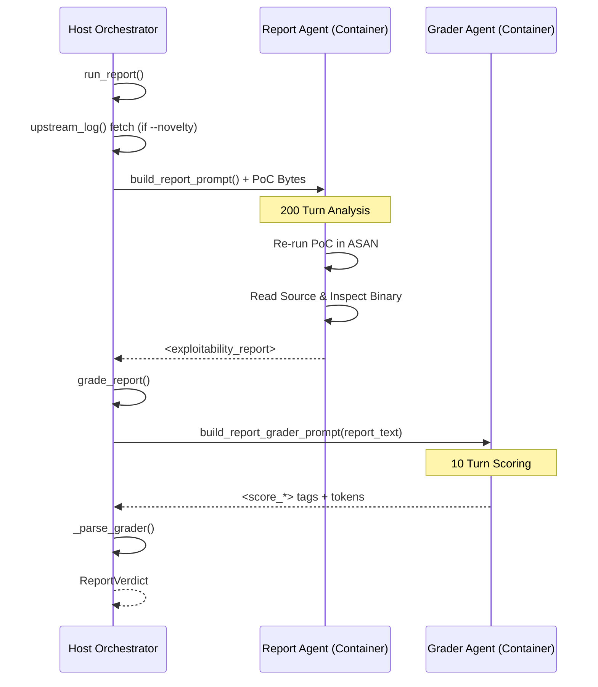
Sources: [harness/report.py:37-112](), [harness/report.py:115-141](), [harness/novelty.py:22-64]()

## The Six-Section Taxonomy

The report agent is prompted to produce a structured XML block `<exploitability_report>` containing six specific sections.

| Section | Purpose | Scoring Requirement |
| :--- | :--- | :--- |
| `<primitive>` | Precise characterization of the corruption (e.g., what bytes, what control). | Evidence of input variation (e.g., changing PoC size/offset). |
| `<reachability>` | Tracing the path from public API/wire handler to the crash site. | Citing call chains from source. |
| `<heap_layout>` | Adjacency analysis, size classes, and victim objects. | Specifics on allocation order or custom allocators. |
| `<escalation_path>`| Feasibility sketch from primitive to impact (e.g., RCE, Info Leak). | Specific target objects or fields. |
| `<constraints>` | Mitigations (PIE, RELRO) and trigger preconditions. | Binary inspection results. |
| `<escalation_attempt>`| (Optional) Partial demonstration of control (e.g., controlling a pointer). | Observation of controlled crash address. |

Sources: [harness/prompts/report_prompt.py:42-91](), [harness/prompts/report_grader_prompt.py:24-48]()

## Implementation Details

### run_report
The entry point for reporting is `run_report` in `harness/report.py`. It initializes a fresh `agent_container` using the target's image tag [harness/report.py:65-65](). It writes the PoC to `/tmp/poc.bin` and adapts the reproduction command to point to this path [harness/report.py:66-67]().

### Novelty Checking
If `--novelty` is enabled, the host performs a shallow clone of the upstream repository to determine if the crash has already been patched.
1.  **File Extraction**: The orchestrator extracts the filename from the ASAN top frame [harness/novelty.py:91-94]().
2.  **Upstream Log**: It runs `git log <commit>..HEAD -- <file>` [harness/novelty.py:50-54]().
3.  **Prompt Injection**: The resulting log is provided to the agent to fill the `<novelty>` section with tokens like `FIXED` or `UNFIXED` [harness/prompts/report_prompt.py:151-164]().

### Grading and Scoring
The `grade_report` function invokes a secondary agent to parse the report's semantic content.
*   **Section Scores**: Each of the five analysis sections is scored 0 (boilerplate), 1 (plausible but no evidence), or 2 (evidence-backed) [harness/prompts/report_grader_prompt.py:28-34]().
*   **Escalation Bonus**: A bonus of 0, 1, 2, or 4 is awarded based on the depth of the escalation attempt [harness/prompts/report_grader_prompt.py:40-47]().
*   **Total Score**: Calculated as `(rubric + bonus) / 14.0` [harness/report.py:160-160]().

**Data Model: ReportVerdict**
| Field | Type | Description |
| :--- | :--- | :--- |
| `section_scores` | `dict[str, int]` | Individual scores for the 5 sections. |
| `total_score` | `float` | Normalized score between 0.0 and 1.0. |
| `severity_rating` | `str` | CRITICAL, HIGH, MEDIUM, LOW, or NOT-A-BUG. |
| `novelty_status` | `str` | FIXED, UNFIXED, UNKNOWN, or NOT_CHECKED. |
| `reachability_verdict` | `str` | REACHABLE, HARNESS_ONLY, or UNCLEAR. |

Sources: [harness/report.py:144-164](), [harness/artifacts.py:20-20]()

## Code Entity Map

The following diagram maps the logical reporting concepts to their specific implementations in the codebase.

**Reporting Code Entity Map**
```mermaid
graph LD
    subgraph "harness/report.py"
        run_report["run_report()"]
        grade_report["grade_report()"]
        _parse_grader["_parse_grader()"]
    end

    subgraph "harness/prompts/"
        report_prompt["report_prompt.py: build_report_prompt()"]
        grader_prompt["report_grader_prompt.py: build_report_grader_prompt()"]
    end

    subgraph "harness/novelty.py"
        upstream_log["upstream_log()"]
        crash_file_from_frame["crash_file_from_frame()"]
    end

    subgraph "Data Structures"
        ReportVerdict["artifacts.py: ReportVerdict"]
        CrashArtifact["artifacts.py: CrashArtifact"]
    end

    CrashArtifact --> run_report
    run_report --> upstream_log
    upstream_log --> report_prompt
    run_report --> grade_report
    grade_report --> grader_prompt
    grade_report --> _parse_grader
    _parse_grader --> ReportVerdict
```
Sources: [harness/report.py:37-112](), [harness/novelty.py:22-31](), [harness/prompts/report_prompt.py:173-183](), [harness/artifacts.py:6-20]()

## Representative Selection
In the autonomous pipeline, multiple crashes might be found for the same vulnerability. The system uses `_pick_representative` to select the best crash for reporting.
*   **Priority 1**: Crashes that passed verification (`crash_found`) [tests/test_report.py:152-157]().
*   **Priority 2**: Crashes with the highest verification score [tests/test_report.py:160-165]().
*   **Priority 3**: Crashes with the smallest PoC byte size (easier to analyze) [tests/test_report.py:168-173]().

Sources: [harness/cli.py:11-11](), [tests/test_report.py:132-174]()

---

# Page: Patch Generation and Verification

# Patch Generation and Verification

<details>
<summary>Relevant source files</summary>

The following files were used as context for generating this wiki page:

- [CLAUDE.md](CLAUDE.md)
- [docs/agent-sandbox.md](docs/agent-sandbox.md)
- [docs/patching.md](docs/patching.md)
- [harness/patch.py](harness/patch.py)
- [harness/patch_grade.py](harness/patch_grade.py)
- [tests/fixtures/canary_alpha_crashsite.diff](tests/fixtures/canary_alpha_crashsite.diff)
- [tests/fixtures/canary_alpha_golden.diff](tests/fixtures/canary_alpha_golden.diff)
- [tests/fixtures/canary_noop.diff](tests/fixtures/canary_noop.diff)
- [tests/test_patch.py](tests/test_patch.py)
- [tests/test_patch_grade.py](tests/test_patch_grade.py)
- [tests/test_patch_grade_e2e.py](tests/test_patch_grade_e2e.py)

</details>


The patch stage is the final phase of the autonomous pipeline, responsible for generating and validating executable fixes for verified vulnerabilities. It transforms a confirmed crash into a candidate git diff that has passed a rigorous multi-tier verification ladder, including an adversarial re-attack phase to ensure the root cause is addressed rather than just the specific PoC input.

## Overview and Trust Boundary

The patching process mirrors the find-grade architecture by maintaining a strict two-container trust boundary [docs/patching.md:5-7](). 

1.  **Patch Agent (Container A):** Operates in a gVisor-isolated environment with access to the source code, the PoC, and the ASAN trace [docs/patching.md:61-72]().
2.  **Patch Grader (Container B):** A fresh container spawned from the same target image. Only the raw diff bytes generated by Container A are transferred to Container B [harness/patch_grade.py:5-8]().

This separation ensures that any malicious or accidental side effects from the patch agent's environment (e.g., modified build artifacts) do not influence the verification of the patch [harness/patch_grade.py:78-87]().

### Patching Data Flow

The following diagram illustrates the flow from a verified crash to a finalized `patch_result.json`.

**Patch Generation and Feedback Loop**
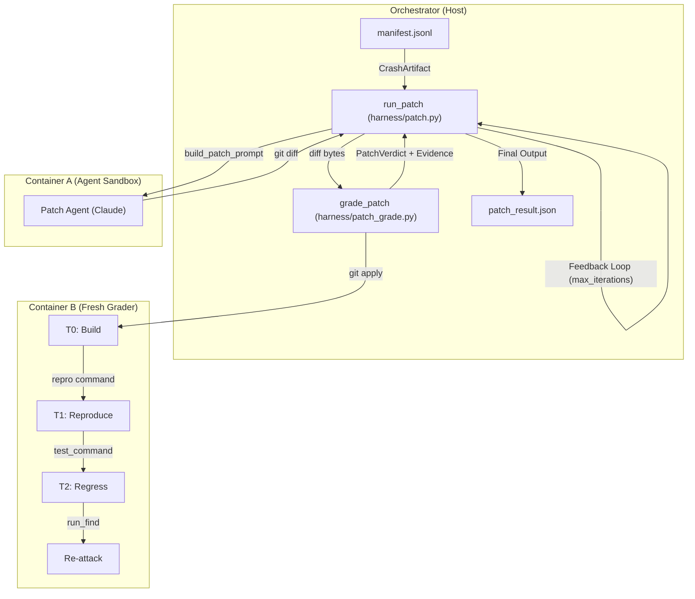
Sources: [harness/patch.py:30-45](), [harness/patch_grade.py:37-58](), [docs/patching.md:55-83]()

## The Verification Ladder (T0-T3)

The `grade_patch` function implements a sequential ladder of executable oracles. Failure at any tier short-circuits the process and returns the current `PatchVerdict` [harness/patch_grade.py:54-55]().

| Tier | Name | Oracle / Logic | Code Entity |
| :--- | :--- | :--- | :--- |
| **T0** | **Build** | `git apply` success + `TargetConfig.build_command` exit 0. | [harness/patch_grade.py:98-144]() |
| **T1** | **Reproduce** | Runs `reproduction_command`. Passes if exit 0 AND no `AddressSanitizer` in output. | [harness/patch_grade.py:147-166]() |
| **T2** | **Regress** | Runs `TargetConfig.test_command`. Passes if exit 0. | [harness/patch_grade.py:168-181]() |
| **Re-attack** | **Variant Hunt** | Fresh `find-agent` attacks the patched binary for 50 turns. | [harness/patch_grade.py:183-228]() |
| **T3** | **Style** | LLM-based 0-10 score. **Advisory only; never gates.** | [harness/patch_grade.py:230-249]() |

Sources: [harness/patch_grade.py:1-15](), [docs/patching.md:85-99]()

## Re-attack Mechanism

Re-attack is the most critical tier for security verification. It guards against "symptom-fixing"—where a model adds a bounds check that stops the specific PoC but leaves the vulnerability reachable via a slightly different input [docs/patching.md:101-110]().

1.  **Snapshot:** The grader container (Container B) is committed to a temporary Docker image after the patch is applied and built [harness/patch_grade.py:186-191]().
2.  **Adversarial Search:** A fresh `run_find` session is initiated using this temporary image [harness/patch_grade.py:202-218]().
3.  **Budget:** The agent is given `REATTACK_MAX_TURNS` (default 50) to find a new crash [harness/patch_grade.py:33]().
4.  **Verdict:** If the agent finds any crash (even a different one), `re_attack_clean` is set to `False` [harness/patch_grade.py:221]().

Sources: [harness/patch_grade.py:183-228](), [docs/patching.md:101-117]()

## Implementation Details

### The Iteration Loop
The `run_patch` function manages the feedback loop. If a patch fails the ladder, the failure evidence (e.g., compiler error, ASAN trace from T1, or the new PoC from re-attack) is extracted and injected into the `retry_evidence` field of the next prompt [harness/patch.py:168-171](). This continues for up to `DEFAULT_MAX_ITERATIONS` (5) [harness/patch.py:27]().

### Evidence Feedback
The `_failed_tier` helper identifies the specific point of failure and extracts the relevant log snippet to guide the agent's next attempt [harness/patch.py:174-183]().

### Artifacts: patch_result.json
Every iteration writes to the output directory, with the final iteration producing the authoritative `patch_result.json` [harness/patch.py:50-52]().

**Key Fields in `PatchVerdict`:**
- `t0_builds`: Boolean [harness/artifacts.py:15]()
- `t1_poc_stops`: Boolean [harness/artifacts.py:15]()
- `re_attack_clean`: Boolean [harness/artifacts.py:15]()
- `evidence`: Dictionary containing logs for failed tiers [harness/artifacts.py:15]()

Sources: [harness/patch.py:93-171](), [tests/test_patch.py:95-125]()

## Code Entity Map

The following diagram maps the high-level patching concepts to the specific Python functions and classes that implement them.

**System-to-Code Mapping**
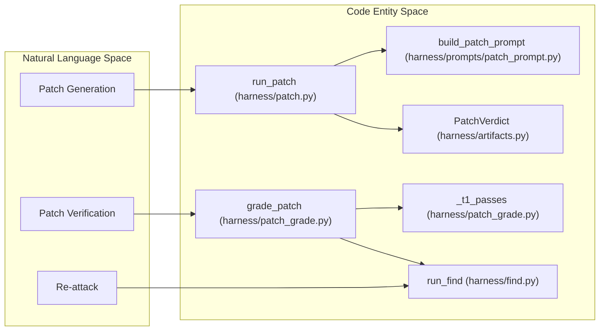
Sources: [harness/patch.py:30](), [harness/patch_grade.py:37](), [harness/patch_grade.py:163](), [harness/find.py:30]()

## CLI Usage

The patch stage is invoked via the `vuln-pipeline patch` subcommand [harness/cli.py]().

```bash
# Patch all unique bugs in a results directory
vuln-pipeline patch results/target/timestamp/ --model claude-3-5-sonnet-20240620

# Patch a specific bug without the re-attack tier
vuln-pipeline patch results/target/timestamp/ --bug 0 --no-reattack
```
Sources: [docs/patching.md:39-48](), [CLAUDE.md:66-67]()

---

# Page: Interactive Claude Code Skills

# Interactive Claude Code Skills

<details>
<summary>Relevant source files</summary>

The following files were used as context for generating this wiki page:

- [.claude/skills/_lib/checkpoint.py](.claude/skills/_lib/checkpoint.py)
- [.claude/skills/quickstart/SKILL.md](.claude/skills/quickstart/SKILL.md)
- [README.md](README.md)
- [docs/best-practices.md](docs/best-practices.md)
- [docs/troubleshooting.md](docs/troubleshooting.md)
- [tests/test_checkpoint.py](tests/test_checkpoint.py)
- [tests/test_skill_checkpoint.py](tests/test_skill_checkpoint.py)

</details>


Interactive Claude Code skills are a set of specialized runbooks located in the `.claude/skills/` directory. These skills are invoked directly within a Claude Code session to perform targeted security tasks such as scoping, scanning, triaging, and patching.

While the [Autonomous Pipeline](#2) is designed for deep, execution-verified vulnerability discovery (dynamic analysis) on C/C++ targets, the interactive skills provide a **static-first, human-in-the-loop workflow** that works across many languages without requiring complex sandbox setup or Docker environments [README.md:19-29]().

### The Skill Ecosystem

The skills are designed to be run sequentially as part of a "Day 1" ramp-up, moving from high-level system understanding to verified findings.

| Skill | Command | Purpose | Output Artifacts |
|:---|:---|:---|:---|
| **Threat Model** | `/threat-model` | Map attack surface and trust boundaries. | `THREAT_MODEL.md` |
| **Vuln Scan** | `/vuln-scan` | Perform static analysis scoped by the threat model. | `VULN-FINDINGS.json/md` |
| **Triage** | `/triage` | Verify, deduplicate, and rank raw findings. | `TRIAGE.json/md` |
| **Patch** | `/patch` | Generate candidate fixes for triaged findings. | `PATCHES/` |
| **Customize** | `/customize` | Port the pipeline/skills to new stacks. | Updated harness code |
| **Quickstart** | `/quickstart` | Onboarding and guided first run. | N/A |

Sources: [README.md:9-12](), [README.md:96-110](), [.claude/skills/quickstart/SKILL.md:60-75]()

---

### Shared Checkpoint Infrastructure

To handle large codebases where analysis might be interrupted by rate limits or context exhaustion, the skills use a shared checkpointing library located at `.claude/skills/_lib/checkpoint.py` [.claude/skills/_lib/checkpoint.py:1-7]().

This infrastructure allows skills to:
*   **Resume State**: Save progress in atomic chunks to directories like `.threat-model-state/` or `.triage-state/` [docs/troubleshooting.md:35-43]().
*   **Atomic Writes**: Use temporary files and `os.replace` to ensure that partial writes never corrupt the state [.claude/skills/_lib/checkpoint.py:25-27]().
*   **Path Confinement**: Restrict all file operations to the repository root to prevent prompt-injected agents from accessing sensitive system files [.claude/skills/_lib/checkpoint.py:41-54]().

**Bridge: Checkpoint Data Flow**
The following diagram shows how the `checkpoint.py` script manages the transition from "Natural Language Space" (agent reasoning) to "Code Entity Space" (on-disk JSON state).

```mermaid
graph TD
    subgraph "Natural Language Space (Claude Code Agent)"
        A["Agent Task Reasoning"] -- "Writes phase result to temp file" --> B["_chunk.tmp"]
    end

    subgraph "Code Entity Space (checkpoint.py)"
        C["checkpoint.py save"] -- "Reads" --> B
        C -- "Validates JSON" --> D{"_read_json()"}
        D -- "Atomic Write" --> E["state_dir/phaseN.json"]
        D -- "Update Progress" --> F["state_dir/progress.json"]
    end

    subgraph "Persistence"
        E
        F
    end
```
Sources: [.claude/skills/_lib/checkpoint.py:8-27](), [tests/test_skill_checkpoint.py:35-43]()

---

### Threat Modeling Skill (3.1)
The `/threat-model` skill helps "aim before you shoot." It uses a bootstrap mode to automatically research the codebase using a swarm of parallel agents, identifying focus areas and trust boundaries. It produces a `THREAT_MODEL.md` that guides subsequent scanning stages.

For details, see [Threat Modeling Skill](#3.1).

### Vulnerability Scan Skill (3.2)
The `/vuln-scan` skill performs static source code analysis. Unlike the autonomous pipeline, it does not execute code. It uses the focus areas defined in the threat model to narrow its search, producing a raw `VULN-FINDINGS.json` list of candidate bugs.

For details, see [Vulnerability Scan Skill](#3.2).

### Triage Skill (3.3)
The `/triage` skill is the "load-bearing component" of the interactive workflow. It ingests raw findings (from `/vuln-scan` or external tools) and subjects them to an adversarial verification pipeline. It filters false positives, deduplicates similar issues, and ranks findings by exploitability.

For details, see [Triage Skill](#3.3).

### Patch and Customize Skills (3.4)
The `/patch` skill generates `git diff` candidates for findings in a `TRIAGE.json` file. The `/customize` skill provides an interview-driven workflow to help developers port the harness to new languages (e.g., Java, Go, Rust) or different vulnerability classes.

For details, see [Patch Skill and Customize Skill](#3.4).

---

### Skills vs. Autonomous Pipeline

The skills and the pipeline are complementary. The skills are often used to "prime" the pipeline by generating the initial focus areas and threat models.

**System Integration Diagram**

```mermaid
graph LR
    subgraph "Interactive Skills (Static/Human-in-loop)"
        TM["/threat-model"] -- "focus_areas" --> VS["/vuln-scan"]
        VS -- "VULN-FINDINGS.json" --> TR["/triage"]
        TR -- "TRIAGE.json" --> PA["/patch"]
    end

    subgraph "Autonomous Pipeline (Dynamic/ASAN)"
        RE["recon (harness/cli.py)"] -- "focus_areas.json" --> FI["find_agent"]
        FI -- "crash.bin" --> GR["grade_agent"]
        GR -- "verified crash" --> REP["report_agent"]
    end

    TM -. "Steers" .-> RE
    TR -. "Validates" .-> REP
```
Sources: [README.md:127-152](), [docs/troubleshooting.md:125-137](), [docs/best-practices.md:7-15]()

**Comparison Table**

| Feature | Interactive Skills | Autonomous Pipeline |
|:---|:---|:---|
| **Analysis Type** | Static review | Dynamic ASAN execution |
| **Setup Required** | None | Docker + gVisor Sandbox |
| **Best For** | Scoping, triage, multi-language | Deep C/C++ verified PoCs |
| **Primary Output** | `TRIAGE.md` (Human readable) | `result.json` (Machine readable) |

Sources: [README.md:20-29](), [docs/troubleshooting.md:125-137]()

---

# Page: Threat Modeling Skill

# Threat Modeling Skill

<details>
<summary>Relevant source files</summary>

The following files were used as context for generating this wiki page:

- [.claude/skills/threat-model/README.md](.claude/skills/threat-model/README.md)
- [.claude/skills/threat-model/SKILL.md](.claude/skills/threat-model/SKILL.md)
- [.claude/skills/threat-model/bootstrap.md](.claude/skills/threat-model/bootstrap.md)
- [.claude/skills/threat-model/interview.md](.claude/skills/threat-model/interview.md)
- [.claude/skills/threat-model/schema.md](.claude/skills/threat-model/schema.md)
- [docs/threat-model.md](docs/threat-model.md)

</details>


The `/threat-model` skill is an interactive tool within the Claude Code environment designed to answer the fundamental security question: **"What could go wrong with this system, who would do it, and what should we do about it?"** It operates independently of specific bug discovery, acting as the "map" that guides the vulnerability pipeline's "metal detector" toward high-risk areas.

The skill produces a `THREAT_MODEL.md` file following a strict schema, which serves as a foundational artifact for downstream autonomous agents in the reconnaissance and triage stages.

### Core Philosophy: Threat vs. Vulnerability
The skill enforces a strict distinction between a threat and a vulnerability:
*   **Threat:** A high-level scenario (e.g., "Remote code execution via untrusted media parsing") that persists even after a specific bug is patched.
*   **Vulnerability:** A specific instance of a bug (e.g., "missing bounds check at line 412") that instantiates a threat.
*   **Litmus Test:** If patching one line of code makes an entry disappear, it was a vulnerability, not a threat.

Sources: [.claude/skills/threat-model/SKILL.md:29-42](), [.claude/skills/threat-model/interview.md:126-128]()

---

## Operational Modes

The skill supports three primary workflows to accommodate different levels of human availability and codebase familiarity.

| Mode | Trigger | Methodology | Best For |
| :--- | :--- | :--- | :--- |
| **Bootstrap** | `bootstrap` | Automated 5-stage research pipeline using parallel sub-agents. | Inherited systems, OSS, or when no owner is available. |
| **Interview** | `interview` | Conversational walk-through using the "Four Question Framework." | New systems or logic-heavy apps where code doesn't tell the whole story. |
| **Hybrid** | `bootstrap-then-interview` | Runs bootstrap first, then uses the output to seed a human interview. | **Recommended path**; minimizes owner time by refining a code-grounded draft. |

Sources: [.claude/skills/threat-model/SKILL.md:4-9](), [.claude/skills/threat-model/SKILL.md:73-82](), [.claude/skills/threat-model/SKILL.md:110-128]()

---

## Bootstrap Mode: The Automated Pipeline

When running in `bootstrap` mode, the skill executes a multi-stage research pipeline. For codebases with >50 files, it spawns a parallel "swarm" of agents using the `Task` tool to gather intelligence concurrently.

### 5-Stage Pipeline Flow

1.  **Stage 1: Research Swarm** — Parallel agents (`Docs reader`, `Surface mapper`, `Infra reader`, `Asset finder`, `History miner`, `Advisory fetcher`) gather raw data.
2.  **Stage 2: Synthesis** — Consolidates swarm findings into System Context, Assets, and Entry Points.
3.  **Stage 3: Generalization** — Analyzes collected vulnerabilities (from git history/CVEs) to derive domain-specific threat classes.
4.  **Stage 4: STRIDE Gap-filling** — Applies the STRIDE model (Spoofing, Tampering, Repudiation, Information Disclosure, Denial of Service, Elevation of Privilege) to entry points not covered by historical bugs.
5.  **Stage 5: Emission** — Finalizes the `THREAT_MODEL.md` and clears state.

### Bootstrap Data Flow Diagram

```mermaid
graph TD
    subgraph "Natural Language & External Space"
        CVE["Public Advisories (NVD/GHSA)"]
        DOCS["README / SECURITY.md"]
        VULNS["--vulns <file>"]
    end

    subgraph "Code Entity Space (Bootstrap Swarm)"
        GIT["History miner (git log)"]
        MAP["Surface mapper (grep signatures)"]
        INFRA["Infra reader (Dockerfile/*.tf)"]
        ASSET["Asset finder (sensitive types)"]
    end

    subgraph "Synthesis & Logic"
        SYN["Stage 2: Synthesis"]
        STRIDE["Stage 4: STRIDE Gap-fill"]
        CHK["checkpoint.py (State Management)"]
    end

    CVE --> GIT
    DOCS --> SYN
    VULNS --> SYN
    GIT --> SYN
    MAP --> SYN
    INFRA --> SYN
    ASSET --> SYN
    
    SYN --> STRIDE
    STRIDE --> FINAL["THREAT_MODEL.md"]
    
    SYN -.-> CHK
    STRIDE -.-> CHK
```
Sources: [.claude/skills/threat-model/bootstrap.md:8-10](), [.claude/skills/threat-model/bootstrap.md:94-135](), [.claude/skills/threat-model/SKILL.md:14-26]()

---

## Interview Mode: Four Question Framework

The `interview` mode follows the Shostack framework to extract security context from a human owner while grounding claims in the source code.

### The Four Questions
1.  **What are we working on?** (Fills System Context, Assets, Entry Points).
2.  **What can go wrong?** (Fills Threat Table via STRIDE and derived classes).
3.  **What are we going to do about it?** (Fills Controls, Impact, Likelihood, and Status).
4.  **Did we do a good job?** (Validates coverage and identifies Open Questions).

### Provenance Discipline
The agent maintains a strict "Provenance Discipline" during the interview:
*   `[Code-verified]`: Facts confirmed by reading the source (e.g., confirming a route exists in `routes.py`).
*   `[Owner-states]`: Claims made by the human that cannot be verified in code (e.g., "This service is only reachable via VPN"). These are explicitly listed in the "Open Questions" section.

Sources: [.claude/skills/threat-model/interview.md:7-19](), [.claude/skills/threat-model/interview.md:36-49]()

---

## State Management and Checkpointing

To handle large codebases and potential API rate limits, the bootstrap mode implements a robust checkpointing system.

*   **Storage:** State is stored in `./.threat-model-state/` relative to the current working directory.
*   **Implementation:** All I/O is managed by `.claude/skills/_lib/checkpoint.py` to ensure atomic, JSON-validated writes.
*   **Key Files:**
    *   `progress.json`: The single source of truth (`{"status": "running", "stage_done": N}`).
    *   `stageN.json`: Data payload for a specific stage.
*   **Resumption:** If a session is interrupted, re-running the command automatically reads the state and skips completed stages unless `--fresh` is passed.

### Checkpoint Logic Diagram

```mermaid
sequenceDiagram
    participant Agent as Threat Model Skill
    participant Lib as checkpoint.py
    participant Disk as .threat-model-state/

    Agent->>Lib: load ./.threat-model-state
    Lib->>Disk: Read progress.json
    Disk-->>Lib: stage_done: 2
    Lib-->>Agent: Resume from Stage 3

    Note over Agent: Execute Stage 3 logic

    Agent->>Disk: Write output to _chunk.tmp
    Agent->>Lib: save <N=3> --from _chunk.tmp
    Lib->>Disk: Atomic write stage3.json
    Lib->>Disk: Update progress.json (stage_done: 3)
```
Sources: [.claude/skills/threat-model/bootstrap.md:46-90]()

---

## Output Schema: THREAT_MODEL.md

Both modes emit a standardized Markdown file. The schema is designed for both human readability and machine parsing (via regex on headings and tables).

### Required Sections
1.  **System context:** Prose description of the system.
2.  **Assets:** Table of things worth protecting (sensitivity: `low` to `critical`).
3.  **Entry points & trust boundaries:** Table of where untrusted input enters.
4.  **Threats:** The core table (Impact x Likelihood).
5.  **Deprioritized:** Threats explicitly out of scope or risk-accepted.
6.  **Open questions:** Follow-ups for humans (bootstrap) or code review (interview).
7.  **Provenance:** Metadata about how the model was generated (mode, date, target commit).
8.  **Recommended mitigations:** (Optional) Class-level controls (e.g., "sandbox the decoder").

### Threat Table Scoring
Threats are scored using standardized enums:
*   **Impact:** `low`, `medium`, `high`, `critical`, `existential`.
*   **Likelihood:** `very_rare`, `rare`, `possible`, `likely`, `almost_certain`.
*   **Status:** `unmitigated`, `partially_mitigated`, `mitigated`, `risk_accepted`.

Sources: [.claude/skills/threat-model/schema.md:7-35](), [.claude/skills/threat-model/schema.md:71-98](), [.claude/skills/threat-model/schema.md:147-172]()

---

# Page: Vulnerability Scan Skill

# Vulnerability Scan Skill

<details>
<summary>Relevant source files</summary>

The following files were used as context for generating this wiki page:

- [.claude/skills/vuln-scan/SKILL.md](.claude/skills/vuln-scan/SKILL.md)
- [docs/other-use-cases.md](docs/other-use-cases.md)
- [docs/prompting.md](docs/prompting.md)

</details>


The `/vuln-scan` skill is an interactive Claude Code skill designed to perform static source-code vulnerability analysis on a target directory. Unlike the autonomous `vuln-pipeline`, which focuses on dynamic execution and PoC generation, `/vuln-scan` relies on static reasoning to identify candidate vulnerabilities across a broad range of classes, from memory safety to logic flaws [.claude/skills/vuln-scan/SKILL.md:4-10]().

It is scoped by a threat model (typically generated by `/threat-model`) and produces structured `VULN-FINDINGS.json` and human-readable `.md` files, which serve as the primary input for the `/triage` skill [.claude/skills/vuln-scan/SKILL.md:28-29]().

## Operational Overview

The skill operates in a read-only capacity. It is strictly prohibited from building, running, or probing the target code [.claude/skills/vuln-scan/SKILL.md:31-33](). Instead, it leverages a "Fan-out" architecture where a coordinator agent partitions the codebase into focus areas and spawns parallel subagents to conduct deep-dive reviews.

### Data Flow: Scan to Triage

The following diagram illustrates how the skill transforms raw source code and threat models into structured findings for the triage layer.

**Vulnerability Scan Data Flow**
```mermaid
graph TD
    subgraph "Input Space"
        TM["THREAT_MODEL.md"]
        SRC["Source Code Tree"]
    end

    subgraph "Skill Execution (.claude/skills/vuln-scan/)"
        COORD["Coordinator Agent"]
        SUB["Subagent (Task)"]
        RECON["Quick Recon (Fallback)"]
    end

    subgraph "Output Space"
        VF_JSON["VULN-FINDINGS.json"]
        VF_MD["VULN-FINDINGS.md"]
    end

    TM -->|Section 3 & 4| COORD
    SRC --> COORD
    COORD -->|No THREAT_MODEL| RECON
    RECON -->|Focus Areas| COORD
    COORD -->|Spawn Parallel| SUB
    SUB -->|Static Analysis| SRC
    SUB -->|XML Findings| COORD
    COORD -->|Consolidate| VF_JSON
    COORD -->|Format| VF_MD
    VF_JSON -->|Input| TRIAGE["/triage Skill"]
```
Sources: [.claude/skills/vuln-scan/SKILL.md:28-29](), [.claude/skills/vuln-scan/SKILL.md:57-78]()

## Implementation Phases

### 1. Scoping and Reconnaissance
The skill first attempts to resolve the `<target-dir>`. If a `THREAT_MODEL.md` exists, it parses Section 3 ("Entry points & trust boundaries") and Section 4 ("Threats") to identify high-risk focus areas [.claude/skills/vuln-scan/SKILL.md:57-63]().

If no threat model is provided, the skill performs a **quick recon** phase. This involves:
* Enumerating the source tree using `ls -R` or `rg --files`.
* Reading entry points and dispatch logic.
* Proposing 3-10 focus areas following the pattern: `<subsystem> (<function/file>) — <key operations>` [.claude/skills/vuln-scan/SKILL.md:64-67]().

### 2. Parallel Fan-out
Unless the `--single` flag is used, the skill spawns one `Task` subagent per focus area (capped at 10 concurrent agents) [.claude/skills/vuln-scan/SKILL.md:73-78](). This avoids work duplication and ensures parallel coverage of the attack surface [docs/prompting.md:26-33]().

Each subagent is provided with a **Review Brief** that defines:
* **The Trust Boundary**: Derived from the threat model (e.g., "untrusted input → process memory") [.claude/skills/vuln-scan/SKILL.md:88-89]().
* **High-Value Targets**: Memory safety (C/C++), Injection, Code Execution, and Auth/Crypto bypasses [.claude/skills/vuln-scan/SKILL.md:100-120]().
* **Exclusion Rules**: The skill explicitly ignores volumetric DoS, memory-safety in safe languages, and findings in test/doc files to reduce noise [.claude/skills/vuln-scan/SKILL.md:125-136]().

### 3. Finding Generation
Subagents produce findings in a strict XML format. The schema is designed so that the model must provide the description and exploit scenario before assigning a severity score, preventing "anchoring bias" where the model rationalizes a score it has already committed to [docs/prompting.md:48-55]().

**Finding Schema Elements**
| Element | Description |
| :--- | :--- |
| `<id>` | Format `F-{focus_idx}-{n}` for tracking [.claude/skills/vuln-scan/SKILL.md:146]() |
| `<category>` | Standardized labels (e.g., `heap-buffer-overflow`, `path-traversal`) [.claude/skills/vuln-scan/SKILL.md:149]() |
| `<confidence>` | A float between 0.0 and 1.0 [.claude/skills/vuln-scan/SKILL.md:151]() |
| `<exploit_scenario>` | Concrete description of input and outcome [.claude/skills/vuln-scan/SKILL.md:154]() |

Sources: [.claude/skills/vuln-scan/SKILL.md:143-156](), [docs/prompting.md:48-55]()

## Tooling and Sandbox Constraints

The `/vuln-scan` skill is restricted to read-only tools. It uses a specific whitelist of Bash commands when dedicated `Glob` or `Grep` tools are unavailable.

**Code Entity to Tool Mapping**
```mermaid
graph LR
    subgraph "Skill Logic"
        VS["/vuln-scan"]
    end

    subgraph "Allowed Tools (Bash Whitelist)"
        RG["rg (ripgrep)"]
        LS["ls -R"]
        WC["wc"]
        HEAD["head"]
        FILE["file"]
    end

    VS -->|Enumeration| LS
    VS -->|Search| RG
    VS -->|Sniffing| FILE
    VS -->|Validation| WC
```
Sources: [.claude/skills/vuln-scan/SKILL.md:12-23](), [.claude/skills/vuln-scan/SKILL.md:35-42]()

## Integration with Triage

Once the scan is complete, the findings are written to `VULN-FINDINGS.json`. This file acts as a handoff artifact. The `/triage` skill then consumes this file to perform adversarial verification, where a separate agent attempts to "disprove" the findings by hunting for reachability constraints or existing mitigations that the scanner might have missed [docs/prompting.md:58-70]().

Sources: [.claude/skills/vuln-scan/SKILL.md:28-29](), [docs/prompting.md:64-69]()

---

# Page: Triage Skill

# Triage Skill

<details>
<summary>Relevant source files</summary>

The following files were used as context for generating this wiki page:

- [.claude/skills/_lib/checkpoint.py](.claude/skills/_lib/checkpoint.py)
- [.claude/skills/triage/README.md](.claude/skills/triage/README.md)
- [.claude/skills/triage/SKILL.md](.claude/skills/triage/SKILL.md)
- [tests/test_checkpoint.py](tests/test_checkpoint.py)
- [tests/test_skill_checkpoint.py](tests/test_skill_checkpoint.py)

</details>


The `/triage` skill is an interactive and automated tool designed to process raw security scanner outputs through a rigorous 7-phase adversarial verification pipeline. Unlike simple format converters, the triage skill performs **static verification** of findings by reasoning about source code, deduplicates overlapping reports, re-ranks them based on derived exploitability, and routes confirmed issues to specific component owners.

## Overview and Purpose

The primary goal of the triage skill is to transform a "raw dump" of potential vulnerabilities into a prioritized, actionable list. It operates under a strict "no-execution" policy: it reads source code but never builds or runs target code to verify a finding [[.claude/skills/triage/SKILL.md:60-66]]().

### Key Capabilities
- **Verification**: Uses independent sub-agents to vote on whether a finding is a True Positive (TP) or False Positive (FP) [[.claude/skills/triage/SKILL.md:28-32]]().
- **Deduplication**: Collapses multiple scanner outputs (or results from different scanners) into unique logical issues [[.claude/skills/triage/SKILL.md:29-29]]().
- **Exploitability Ranking**: Re-ranks findings based on actual reachability and impact rather than the scanner's claimed severity [[.claude/skills/triage/SKILL.md:30-31]]().
- **Checkpointing**: Supports resuming large batches (hundreds of findings) across multiple sessions [[.claude/skills/triage/SKILL.md:73-78]]().

---

## The 7-Phase Pipeline

The skill executes in a linear sequence of phases, persisting state to `./.triage-state/` after each step.

### Phase 0: Mode Select and Interview
The skill determines its operational parameters. In interactive mode (default), it interviews the user to establish the **Environment & Trust Boundary** and the **Threat Model** [[.claude/skills/triage/SKILL.md:120-154]](). These answers directly influence how sub-agents judge reachability in Phase 3.

### Phase 1: Ingest and Normalize
The skill reads findings from various formats (JSON, Markdown, or `VULN-FINDINGS.json`) and maps them to a internal `NormalizedFinding` schema [[.claude/skills/triage/SKILL.md:193-205]]().

### Phase 2: Structural Deduplication
Findings are grouped by file and line number to prevent redundant verification of the same code location [[.claude/skills/triage/SKILL.md:223-230]]().

### Phase 3: Adversarial Verification
This is the most compute-intensive phase. The orchestrator spawns `N` independent sub-agents (controlled by `--votes`) for each finding.
- **Exclusion Rules**: Sub-agents are provided with "False Positive Rules" (e.g., "Prisma ORM handles SQLi") to filter out known-safe patterns [[.claude/skills/triage/SKILL.md:247-254]]().
- **Independent Reasoning**: Agents must cite file/line evidence and provide a verdict: `TP`, `FP`, or `NEEDS_MANUAL_CHECK` [[.claude/skills/triage/SKILL.md:256-270]]().

### Phase 4: Semantic Deduplication
A "Judge" agent reviews findings that occur in the same component or share similar logic to ensure only unique root causes are reported [[.claude/skills/triage/SKILL.md:300-310]]().

### Phase 5: Ranking and Routing
Surviving findings are ranked by a scoring rubric (0.0 to 10.0) based on reachability, exploitability, and impact [[.claude/skills/triage/SKILL.md:328-340]](). Each finding is assigned an `owner_hint` based on `git log` or directory structure [[.claude/skills/triage/SKILL.md:342-345]]().

### Phase 6: Output Generation
The final artifacts are written: `TRIAGE.json` (machine-readable) and `TRIAGE.md` (human-readable report) [[.claude/skills/triage/SKILL.md:363-375]]().

---

## Data Flow and Sub-agent Orchestration

The following diagram illustrates how the triage skill bridges the gap between raw scanner output and verified code entities.

**Triage Verification Logic**
```mermaid
graph TD
    subgraph "Natural Language Space (Context)"
        A["/triage CLI Arguments"] --> B["User Interview (Phase 0)"]
        B --> C["Threat Model & Trust Boundary"]
        C --> D["Verifier Prompt Construction"]
    end

    subgraph "Code Entity Space (Verification)"
        E["NormalizedFinding (Phase 1)"] --> F["Phase 3: Sub-agent Swarm"]
        D --> F
        F --> G["Grep/Read Source Code"]
        G --> H["Identify Callers/Sanitizers"]
        H --> I["Verdict: TP/FP/Manual"]
    end

    subgraph "Final Artifacts"
        I --> J["Phase 5: Owner Routing (git log)"]
        J --> K["TRIAGE.json"]
        J --> L["TRIAGE.md"]
    end
```
**Sources:** [[.claude/skills/triage/SKILL.md:120-160]](), [[.claude/skills/triage/SKILL.md:242-270]](), [[.claude/skills/triage/SKILL.md:363-375]]()

---

## Checkpointing Infrastructure

For large batches, the skill uses a robust checkpointing system managed by `checkpoint.py`. This prevents losing progress due to API rate limits or context exhaustion.

### State Management
- **`progress.json`**: The single source of truth for the current phase and completed shards [[.claude/skills/triage/SKILL.md:87-90]]().
- **`phaseN.json`**: Contains the data payload for Phase `N` [[.claude/skills/triage/SKILL.md:91-92]]().
- **Sharding**: In Phase 3, findings are sharded into `shard_ID.json` files to handle high-volume verification tasks [[.claude/skills/triage/SKILL.md:275-280]]().

### Checkpoint Operations
The skill invokes `checkpoint.py` via Bash to ensure atomic writes and prevent shell injection by using the `--from` flag for payloads [[.claude/skills/_lib/checkpoint.py:16-19]]().

**Checkpoint State Transition**
```mermaid
stateDiagram-v2
    [*] --> Phase0: /triage --fresh
    Phase0 --> Phase1: save(0)
    Phase1 --> Phase2: save(1)
    Phase2 --> Phase3_Sharding: save(2)
    state Phase3_Sharding {
        [*] --> Shard1: shard(id1)
        Shard1 --> Shard2: shard(id2)
        Shard2 --> [*]
    }
    Phase3_Sharding --> Phase4: save(3)
    Phase4 --> Phase5: save(4)
    Phase5 --> Phase6: save(5)
    Phase6 --> [*]: done(6)
```
**Sources:** [[.claude/skills/triage/SKILL.md:73-117]](), [[.claude/skills/_lib/checkpoint.py:9-14]](), [[tests/test_skill_checkpoint.py:35-46]]()

---

## Implementation Details

### Key Functions and Classes

| Component | File Path | Description |
| :--- | :--- | :--- |
| `checkpoint.py` | [[.claude/skills/_lib/checkpoint.py:1-27]]() | CLI utility for atomic state persistence and path-confined I/O. |
| `_confine` | [[.claude/skills/_lib/checkpoint.py:41-54]]() | Ensures all checkpoint writes stay within the allowed repository root. |
| `_atomic_write` | [[.claude/skills/_lib/checkpoint.py:64-68]]() | Uses `os.replace` to ensure files are never partially written. |
| `SKILL.md` | [[.claude/skills/triage/SKILL.md:1-24]]() | Defines the skill's tool permissions (Read, Glob, Grep, etc.) and entry point. |

### False Positive Exclusion Rules
The skill supports a flexible mechanism for suppressing findings based on organizational context. These rules are injected into the Phase 3 verifier prompts:
1. **Built-in Rules**: 10 standard rules (e.g., Rule 8: "Operator-controlled environment is not a trust boundary for DoS") [[.claude/skills/triage/SKILL.md:173-189]]().
2. **Custom Rules**: Provided via the `--fp-rules FILE` argument [[.claude/skills/triage/SKILL.md:48-51]]().

**Sources:** [[.claude/skills/triage/SKILL.md:48-51]](), [[.claude/skills/triage/SKILL.md:173-189]](), [[.claude/skills/_lib/checkpoint.py:41-68]]()

---

# Page: Patch Skill and Customize Skill

# Patch Skill and Customize Skill

<details>
<summary>Relevant source files</summary>

The following files were used as context for generating this wiki page:

- [.claude/skills/customize/SKILL.md](.claude/skills/customize/SKILL.md)
- [.claude/skills/patch/SKILL.md](.claude/skills/patch/SKILL.md)
- [docs/customizing.md](docs/customizing.md)
- [docs/other-use-cases.md](docs/other-use-cases.md)
- [docs/prompting.md](docs/prompting.md)

</details>


The `/patch` and `/customize` skills extend the harness beyond vulnerability discovery into remediation and architectural adaptation. While the `/patch` skill provides a bridge between identified findings and candidate fixes, the `/customize` skill allows the entire pipeline to be ported to new languages, detectors, and vulnerability classes through an interactive, interview-driven workflow.

## The Patch Skill (/patch)

The `/patch` skill is the final leg of the static analysis pipeline (`/vuln-scan` → `/triage` → `/patch`). It consumes verified findings and generates candidate git diffs for human review. Unlike the autonomous pipeline's patching stage, the interactive `/patch` skill operates in two distinct modes depending on the input provided.

### Operational Modes

The skill automatically detects its mode by inspecting the provided findings path [[.claude/skills/patch/SKILL.md:112-114]]().

| Mode | Input Source | Verification Mechanism |
| :--- | :--- | :--- |
| **Execution-Verified** | Pipeline results directory (contains PoCs/ASAN traces) [[.claude/skills/patch/SKILL.md:116-119]]() | Delegated to `vuln-pipeline patch` for T0-T3 ladder validation [[.claude/skills/patch/SKILL.md:5-6]](). |
| **Static** | `TRIAGE.json`, `VULN-FINDINGS.json`, or generic JSON/Markdown [[.claude/skills/patch/SKILL.md:120-121]]() | Independent subagent reviewer acts as the oracle in a fresh context [[.claude/skills/patch/SKILL.md:121-121]](). |

### Implementation and Data Flow

The skill follows a phased execution model, utilizing a checkpointing system to ensure resilience against session timeouts or API errors. State is persisted to `./.patch-state/` using `checkpoint.py` [[.claude/skills/patch/SKILL.md:73-75]]().

**Patch Generation Logic (Static Mode):**
1.  **Ingest:** Normalizes input into a flat `findings[]` array [[.claude/skills/patch/SKILL.md:133-136]]().
2.  **Subagent Spawn:** For each finding, a "patcher" subagent is spawned to generate a diff [[.claude/skills/patch/SKILL.md:180-182]]().
3.  **Independent Review:** A "reviewer" subagent evaluates the diff for correctness and regression risks [[.claude/skills/patch/SKILL.md:183-185]]().
4.  **Inert Output:** Results are written to `./PATCHES/` as inert text. The skill **never** applies patches to the source tree [[.claude/skills/patch/SKILL.md:34-38]]().

### Patch Skill Architecture

The following diagram illustrates the flow from a `TRIAGE.json` finding to a generated patch artifact.

**Static Patch Generation Flow**
```mermaid
graph TD
    subgraph "Claude Code Session"
        CMD["/patch TRIAGE.json"] --> P0["Phase 0: Mode Detection"]
        P0 --> P1["Phase 1: Ingest & Normalize"]
    end

    subgraph "Static Mode Pipeline"
        P1 --> P2["Phase 2: Patch Generation"]
        P2 --> SUB_P["Patcher Subagent"]
        SUB_P --> P3["Phase 3: Independent Review"]
        P3 --> SUB_R["Reviewer Subagent"]
    end

    subgraph "Artifact Space"
        SUB_R --> OUT["./PATCHES/bug_NN/patch.diff"]
        SUB_R --> RES["./PATCHES/bug_NN/patch_result.json"]
        OUT --> MD["PATCHES.md Summary"]
    end

    subgraph "State Management"
        P0 -.-> CHK["checkpoint.py"]
        P1 -.-> CHK
        P2 -.-> CHK
        CHK -.-> STATE["./.patch-state/progress.json"]
    end
```
**Sources:** [[.claude/skills/patch/SKILL.md:29-41]](), [[.claude/skills/patch/SKILL.md:73-81]](), [[.claude/skills/patch/SKILL.md:112-121]](), [[.claude/skills/patch/SKILL.md:180-195]]()

---

## The Customize Skill (/customize)

The `/customize` skill is designed to adapt the C/C++ ASAN-centric pipeline to other domains, such as web applications (SQLi/XSS), smart contracts (Reentrancy), or different languages (Java/Python). It functions as an architectural consultant that interviews the user to map new requirements onto the harness's generic components [[.claude/skills/customize/SKILL.md:8-10]]().

### The Interview Workflow

The skill follows a structured interview process to bridge the gap between a user's high-level goal and the technical implementation of the harness.

1.  **Internal Audit:** The agent first reads the existing pipeline files (e.g., `harness/cli.py`, `harness/prompts/find_prompt.py`) to understand what is generic vs. ASAN-specific [[.claude/skills/customize/SKILL.md:12-28]]().
2.  **Round 1 (Context & Goal):** Asks broad questions about the operating environment (e.g., pentesting vs. internal AppSec) and the target bug classes [[.claude/skills/customize/SKILL.md:34-48]]().
3.  **Round 2 (Technical Mapping):** Deep dives into "axes of variation" such as detection signals (e.g., HTTP 500 vs. ASAN crash) and PoC shapes [[.claude/skills/customize/SKILL.md:50-63]]().

### Axes of Variation

The skill uses these dimensions to guide the migration plan:

| Axis | C/C++ Default | Example Customization |
| :--- | :--- | :--- |
| **Detection** | ASAN crash/abort [[.claude/skills/customize/SKILL.md:72-72]]() | Exception, Canary file, DNS callback [[.claude/skills/customize/SKILL.md:54-54]]() |
| **PoC Shape** | Binary file [[.claude/skills/customize/SKILL.md:82-82]]() | HTTP request sequence, Transaction list [[.claude/skills/customize/SKILL.md:55-55]]() |
| **Isolation** | Docker + gVisor [[.claude/skills/customize/SKILL.md:76-76]]() | VM, Testnet, or Static-only [[.claude/skills/customize/SKILL.md:56-56]]() |
| **Signature** | `(crash_type, top_frame)` [[.claude/skills/customize/SKILL.md:78-78]]() | `(vuln_type, endpoint, param)` [[.claude/skills/customize/SKILL.md:78-78]]() |

### Mapping Customization to Code Entities

The following diagram shows how the `/customize` skill maps natural language requirements to specific code entities within the harness.

**Customization Mapping: Requirements to Code**
```mermaid
graph LR
    subgraph "User Requirements (Natural Language)"
        VULN["'I want to find SQLi'"]
        LANG["'Target is a Java App'"]
        DET["'Look for HTTP 500s'"]
    end

    subgraph "Harness Code Entities (Code Space)"
        PROMPTS["harness/prompts/"]
        TARGETS["targets/"]
        ARTIFACTS["harness/artifacts.py"]
        PARSER["harness/asan.py"]
    end

    VULN -->|"Rewrite Taxonomy"| PROMPTS
    VULN -->|"Update Verdict Schema"| ARTIFACTS
    LANG -->|"New Dockerfile/Entry"| TARGETS
    DET -->|"Replace Regex/Logic"| PARSER
```
**Sources:** [[.claude/skills/customize/SKILL.md:16-28]](), [[.claude/skills/customize/SKILL.md:50-63]](), [[docs/customizing.md:71-78]]()

### Concretely: What Changes?

When porting the pipeline, the `/customize` skill focuses on these specific files:

*   **Prompts:** `find_prompt.py` and `grade_prompt.py` must be updated with the new bug taxonomy and grading rubric [[docs/customizing.md:71-74]]().
*   **Report Structure:** `report_prompt.py` is modified to change exploitability sections (e.g., from "Heap Layout" to "Injection Vector") [[.claude/skills/customize/SKILL.md:58-58]]().
*   **Target Definition:** A new `targets/<name>/Dockerfile` is created to set up the build environment and detector hooks [[docs/customizing.md:78-78]]().
*   **Signature Logic:** `harness/asan.py` is typically replaced or modified to parse the new detection signal for deduplication [[.claude/skills/customize/SKILL.md:23-23]]().

**Sources:**
* [[.claude/skills/patch/SKILL.md:1-195]]()
* [[.claude/skills/customize/SKILL.md:1-85]]()
* [[docs/customizing.md:1-87]]()
* [[docs/prompting.md:47-71]]()
* [[docs/other-use-cases.md:9-21]]()

---

# Page: Sandbox and Infrastructure

# Sandbox and Infrastructure

<details>
<summary>Relevant source files</summary>

The following files were used as context for generating this wiki page:

- [bin/vp-sandboxed](bin/vp-sandboxed)
- [docs/security.md](docs/security.md)
- [harness/README.md](harness/README.md)
- [harness/sandbox.py](harness/sandbox.py)

</details>


The Defending Code Reference Harness is designed with a "Security-First" architecture that assumes the code being analyzed—and the agents analyzing it—may be malicious. The infrastructure provides a multi-layered defense-in-depth strategy to isolate the execution of untrusted code and restrict the capabilities of AI agents.

The core of this infrastructure is a **gVisor-isolated container system** combined with a **strict egress proxy**. This ensures that while agents have the freedom to compile and execute target code to find vulnerabilities, they cannot reach out to the internet (except for the Anthropic API) or access the host system.

## Infrastructure Overview

The infrastructure is built on four pillars that work together to create a secure "Attack Phase" environment [docs/security.md:50-73]():

1.  **gVisor Isolation**: Uses the `runsc` runtime to provide syscall-level sandboxing, preventing container escapes even if the target code exploits a kernel vulnerability [docs/security.md:96-98]().
2.  **Network Segregation**: Agents run on a dedicated Docker network (`vp-internal`) with no default gateway to the internet [harness/sandbox.py:5-10]().
3.  **Egress Proxy**: A Squid-based proxy (`vp-egress-proxy`) serves as the sole gateway, allowlisting only `api.anthropic.com` [bin/vp-sandboxed:22-31]().
4.  **Agent Image System**: A specialized build system that layers the Claude Code CLI and target-specific dependencies into a hardened image [harness/sandbox.py:78-79]().

### The Sandbox Trust Boundary

The following diagram illustrates how the `bin/vp-sandboxed` entrypoint orchestrates the various components to establish the trust boundary.

**Infrastructure Architecture and Data Flow**
```mermaid
graph TD
    subgraph "Host System"
        VP_CLI["bin/vp-sandboxed"]
        DOCKER["Docker Engine (runsc)"]
        PROXY_CONT["vp-egress-proxy (Squid)"]
    end

    subgraph "Isolated Network (vp-internal)"
        AGENT_CONT["Agent Container (gVisor)"]
        TARGET_CODE["Target Binary (ASAN)"]
    end

    VP_CLI -->|"exec"| DOCKER
    DOCKER -->|"spawns"| AGENT_CONT
    AGENT_CONT -->|"executes"| TARGET_CODE
    
    AGENT_CONT -->|"HTTPS_PROXY"| PROXY_CONT
    PROXY_CONT -->|"Allowlist: api.anthropic.com"| WAN["Anthropic API"]
    
    style AGENT_CONT stroke-dasharray: 5 5
```
**Sources:** [bin/vp-sandboxed:10-39](), [harness/sandbox.py:5-10](), [docs/security.md:21-28]()

---

## Sandbox Setup and Configuration

Before running the pipeline, the environment must be provisioned. This is handled by `scripts/setup_sandbox.sh`, which automates the installation of gVisor, the creation of the internal Docker network, and the deployment of the egress proxy.

The setup process enforces a **Setup → Attack isolation split** [docs/security.md:51-73](). During setup, network access is allowed to pull dependencies and build the target image. Once the "Attack" phase begins (via `bin/vp-sandboxed`), the environment is locked down.

For details on provisioning and environment variables, see **[Sandbox Setup and Configuration](#4.1)**.

**Sources:** [harness/README.md:47-52](), [docs/security.md:53-65]()

---

## Runtime Sandbox and Docker Operations

At runtime, the harness manages container lifecycles using `harness/sandbox.py` and `harness/docker_ops.py`. Every agent (recon, find, grade, report, or patch) is wrapped in the `agent_container` context manager [harness/sandbox.py:58-67]().

This layer handles:
*   **Runtime Selection**: Automatically choosing `runsc` (gVisor) if available, or falling back to `runc` if `--dangerously-no-sandbox` is specified [harness/sandbox.py:27-28]().
*   **Permission Modes**: Setting `bypassPermissions` inside the sandbox so the agent can work efficiently, while defaulting to `auto` mode outside the sandbox for safety [harness/sandbox.py:46-55]().
*   **Resource Constraints**: Enforcing memory limits (default 4GB) and SHM sizes for stable execution [harness/sandbox.py:63-64]().

For details on the container lifecycle and image management, see **[Runtime Sandbox and Docker Operations](#4.2)**.

**Sources:** [harness/sandbox.py:14-104](), [harness/README.md:12-16]()

---

## Agent Runner

The `harness/agent.py` module is responsible for the low-level execution of the Claude Code CLI within the provisioned containers. It invokes the headless CLI with specific flags: `claude -p --output-format stream-json` [harness/agent.py:133-140]().

The runner provides:
*   **JSONL Streaming**: Real-time parsing of agent thoughts and tool use.
*   **Persistence**: Ensuring transcripts are saved to disk with `fsync` to prevent data loss during crashes [harness/agent.py:175-180]().
*   **Session Management**: Logic to resume sessions if the API returns transient errors.

For details on the subprocess management and XML tag parsing, see **[Agent Runner](#4.3)**.

**Sources:** [harness/agent.py:13-145](), [harness/README.md:122-134]()

---

## Summary of Infrastructure Components

| Component | Code Entity | Purpose |
| :--- | :--- | :--- |
| **Sandbox Manager** | `harness/sandbox.py` | High-level API for spawning isolated agent environments [harness/sandbox.py:59]() |
| **Docker Wrapper** | `harness/docker_ops.py` | Low-level Docker CLI abstractions (run, rm, cp, exec) |
| **Egress Proxy** | `vp-egress-proxy` | Squid proxy restricting agent network access [bin/vp-sandboxed:12]() |
| **Sandboxed Entry** | `bin/vp-sandboxed` | Shell wrapper that ensures the environment is secure before execution [bin/vp-sandboxed:1-7]() |
| **Agent Image** | `harness/agent_image.py` | Logic to build/ensure the `vuln-pipeline-agent` image [harness/sandbox.py:78]() |

**Sources:** [harness/sandbox.py:19-25](), [bin/vp-sandboxed:10-14](), [docs/security.md:21-28]()

---

# Page: Sandbox Setup and Configuration

# Sandbox Setup and Configuration

<details>
<summary>Relevant source files</summary>

The following files were used as context for generating this wiki page:

- [scripts/Dockerfile.proxy](scripts/Dockerfile.proxy)
- [scripts/egress_proxy.py](scripts/egress_proxy.py)
- [scripts/setup_sandbox.sh](scripts/setup_sandbox.sh)

</details>


The Defending Code Reference Harness utilizes a multi-layered sandbox to isolate agent execution from the host environment. This isolation is critical for safely running untrusted code generated by agents and for preventing agents from accessing sensitive host resources or external networks beyond the necessary LLM APIs.

The sandbox infrastructure is provisioned primarily via `scripts/setup_sandbox.sh`, which configures **gVisor** for syscall isolation, establishes an internal Docker network, and deploys a filtering egress proxy.

## Provisioning Workflow

The `scripts/setup_sandbox.sh` script automates the one-time setup required to run the pipeline in its default secure mode. It performs five major operations:

### 1. gVisor (runsc) Installation
The script downloads and installs the `runsc` binary, the user-space kernel for gVisor [scripts/setup_sandbox.sh:24-41](). gVisor provides a strong isolation boundary by intercepting application syscalls and running them in a non-privileged process, effectively mitigating container breakout risks.

### 2. Docker Runtime Registration
To make gVisor available to Docker, the script modifies `/etc/docker/daemon.json` to register `runsc` as a runtime [scripts/setup_sandbox.sh:44-68](). 
*   **Overlay Configuration**: It explicitly sets `--overlay2=none` [scripts/setup_sandbox.sh:48](). This ensures that files written by the agent (like PoC exploits) are visible to the orchestrator via `docker exec`, bypassing the default in-sandbox tmpfs overlay that would otherwise hide them.
*   **Cgroups**: It probes for cgroup writability and adds `--ignore-cgroups` if the host cannot delegate them, which affects memory limit enforcement [scripts/setup_sandbox.sh:49-53]().

### 3. Network Isolation and Egress Proxy
The harness enforces strict network boundaries:
*   **Internal Network**: A Docker network named `vp-internal` is created with the `--internal` flag, which prevents containers on this network from having a default route to the internet [scripts/setup_sandbox.sh:82-84]().
*   **Egress Proxy**: A specialized proxy (`scripts/egress_proxy.py`) is deployed as a sidecar container named `vp-egress-proxy` [scripts/setup_sandbox.sh:85-93](). This proxy is dual-homed: it sits on both the `vp-internal` network and the standard Docker `bridge` network [scripts/setup_sandbox.sh:94]().

### 4. Image Preparation
The script iterates through all directories in `targets/` to build the base target images and then wraps them into "agent images" using `harness.agent_image.ensure()` [scripts/setup_sandbox.sh:100-108](). These agent images contain the target's build artifacts along with the `claude` CLI and necessary debugging tools.

### 5. Verification Tests
The setup concludes with a suite of "smoke tests" to verify the security properties [scripts/setup_sandbox.sh:111-152]():
*   **Kernel Check**: Compares `uname -r` inside and outside the container to ensure the gVisor guest kernel is active.
*   **Egress Check**: Verifies that the agent can reach `api.anthropic.com` via the proxy but cannot reach `example.com` or direct IP addresses like `8.8.8.8`.
*   **Filesystem Check**: Confirms the container cannot see the host's `/tmp` directory.

**Sources:**
* `scripts/setup_sandbox.sh`
* `scripts/egress_proxy.py`

## Egress Proxy Architecture

The `scripts/egress_proxy.py` script implements a minimal `HTTP CONNECT` proxy. It is the only bridge between the isolated `vp-internal` network and the internet.

### Implementation Details
*   **Allowlist**: The proxy only honors `CONNECT` requests to host:port pairs defined in the `VP_EGRESS_ALLOW` environment variable [scripts/egress_proxy.py:23-27]().
*   **Connection Pumping**: When a valid `CONNECT` request is received, the `Handler._pump` method performs bi-directional asynchronous data transfer between the agent and the upstream API using `select.select` [scripts/egress_proxy.py:52-74]().
*   **Logging**: All denied attempts are logged to `stderr` in the proxy container, providing an audit trail of attempted network breakouts [scripts/egress_proxy.py:37-38]().

### Sandbox Network Flow
The following diagram illustrates how an agent container communicates with the Anthropic API while being blocked from the general internet.

**Sandbox Network and Egress Logic**
```mermaid
graph TD
    subgraph "Isolated Environment (vp-internal)"
        AgentContainer["Agent Container (runsc)"]
    end

    subgraph "Sidecar (Dual-Homed)"
        Proxy["vp-egress-proxy (scripts/egress_proxy.py)"]
    end

    subgraph "External Network"
        API["api.anthropic.com:443"]
        Other["Rest of Internet"]
    end

    AgentContainer -- "HTTP CONNECT (via HTTPS_PROXY env)" --> Proxy
    Proxy -- "Check VP_EGRESS_ALLOW" --> Proxy
    Proxy -- "Allowed: socket.create_connection" --> API
    Proxy -. "Denied: 403 Forbidden" .-> Other

    style AgentContainer stroke-dasharray: 5 5
```
**Sources:**
* `scripts/egress_proxy.py:31-50` (Handler logic)
* `scripts/setup_sandbox.sh:82-97` (Network configuration)

## Configuration and Bypasses

The sandbox behavior can be influenced by environment variables and CLI flags.

### Environment Variables
| Variable | Default | Purpose |
| :--- | :--- | :--- |
| `VP_EGRESS_ALLOW` | `api.anthropic.com:443` | Comma-separated list of `host:port` allowed for egress [scripts/egress_proxy.py:25](). |
| `VP_EGRESS_PORT` | `3128` | The port the egress proxy listens on [scripts/egress_proxy.py:28](). |
| `RUNSC_RELEASE` | `20260420` | The version of gVisor to install [scripts/setup_sandbox.sh:19](). |

### The --dangerously-no-sandbox Bypass
In environments where gVisor cannot be installed (e.g., macOS, Windows, or restricted CI environments), the pipeline can be run using the `--dangerously-no-sandbox` flag.

*   **Mechanism**: When this flag is used, the orchestrator bypasses the `runsc` runtime and the `vp-internal` network. Containers are run using the default Docker runtime with standard host networking.
*   **Risk**: This disables syscall isolation and network filtering. The agent's generated code will have the same level of access as a standard Docker container.
*   **Fallback**: `scripts/setup_sandbox.sh` explicitly suggests this flag if it detects a non-Linux host [scripts/setup_sandbox.sh:29-32]().

## Setup Sequence
This diagram maps the `setup_sandbox.sh` procedure to the resulting system state.

**Provisioning Sequence and Code Entities**
```mermaid
sequenceDiagram
    participant S as scripts/setup_sandbox.sh
    participant D as Docker Daemon
    participant P as scripts/egress_proxy.py
    participant I as harness/agent_image.py

    S->>S: Install /usr/local/bin/runsc
    S->>D: Update /etc/docker/daemon.json (runtime: runsc)
    S->>D: docker network create --internal vp-internal
    S->>P: docker run --name vp-egress-proxy
    S->>I: agent_image.ensure(target_tag)
    Note over I: Wraps Target Image with Claude CLI
    S->>D: docker run --runtime=runsc (Verification)
```

**Sources:**
* `scripts/setup_sandbox.sh:1-153`
* `scripts/egress_proxy.py:80-86` (Main entry point)

---

# Page: Runtime Sandbox and Docker Operations

# Runtime Sandbox and Docker Operations

<details>
<summary>Relevant source files</summary>

The following files were used as context for generating this wiki page:

- [bin/vp-sandboxed](bin/vp-sandboxed)
- [harness/agent_image.py](harness/agent_image.py)
- [harness/docker_ops.py](harness/docker_ops.py)
- [harness/sandbox.py](harness/sandbox.py)
- [tests/test_agent_sandbox.py](tests/test_agent_sandbox.py)
- [tests/test_sandbox.py](tests/test_sandbox.py)

</details>


The Defending Code Reference Harness relies on a robust containerization strategy to isolate agents while they perform vulnerability discovery and exploitation. This isolation is achieved through a combination of **gVisor** (the `runsc` runtime), strict **Docker networking**, and a **layered image build system** that separates the agent's toolset from the target's build environment.

The core logic for managing these lifecycles resides in `harness/sandbox.py` and `harness/docker_ops.py`.

## Overview of Sandbox Architecture

The sandbox ensures that agents (find, grade, report, etc.) can execute arbitrary code (e.g., compiling and running PoCs) without compromising the host system. It also enforces a strict egress policy, allowing agents to reach the Anthropic API only through a controlled proxy.

### System Flow: Host to Sandbox

The following diagram illustrates how the `bin/vp-sandboxed` entry point prepares the environment before the Python harness begins spawning containers.

**Sandbox Initialization Flow**
```mermaid
graph TD
    subgraph "Host Space"
        A["bin/vp-sandboxed"] --> B["Check 'runsc' Runtime"]
        B --> C["Check 'vp-egress-proxy' IP"]
        C --> D["Export VULN_PIPELINE_AGENT_RUNTIME"]
        D --> E["Export VULN_PIPELINE_EGRESS_PROXY"]
        E --> F["exec vuln-pipeline"]
    end

    subgraph "Python Entity Space"
        F --> G["harness/sandbox.py:runtime()"]
        G --> H["harness/sandbox.py:agent_container()"]
        H --> I["harness/docker_ops.py:run()"]
    end

    subgraph "Container Space (gVisor)"
        I --> J["Agent Container (runsc)"]
        J -- "HTTPS_PROXY" --> K["vp-egress-proxy"]
        K -- "Allowlist" --> L["api.anthropic.com"]
    end
```
**Sources:** [bin/vp-sandboxed:1-39](), [harness/sandbox.py:21-38](), [harness/sandbox.py:58-88]()

---

## Agent Image Build System

To avoid the overhead of installing Node.js and the Claude Code CLI for every target, the harness uses a layered approach managed by `harness/agent_image.py`.

1.  **Base Image (`_ensure_base`)**: A shared image `vuln-pipeline-agent-base:<version>` is built once. It contains `gcc:14`, Node.js, the pinned Claude Code CLI, and essential tools like `xxd` and `gdb` [harness/agent_image.py:45-63]().
2.  **Per-Target Agent Image (`ensure`)**: When a specific target (e.g., `canary:v1`) is analyzed, the harness creates a new image. It uses the base image and performs a `COPY --from` to pull the `/work` directory from the target's own image [harness/agent_image.py:67-83]().
3.  **Naming Conventions**: Agent images are tagged using the format `<target-tag>-agent:<cli-version>`. This prevents collisions between original targets and patched snapshots created during the re-attack phase [harness/agent_image.py:27-30]().

**Sources:** [harness/agent_image.py:22-30](), [harness/agent_image.py:45-63](), [harness/agent_image.py:67-83]()

---

## Container Lifecycle Management

The `agent_container` context manager in `harness/sandbox.py` is the primary interface for spawning agent environments. It ensures that containers are correctly configured and reliably torn down [harness/sandbox.py:58-92]().

### Runtime and Permission Modes

The harness dynamically adjusts its security posture based on the availability of gVisor:

| Feature | Sandbox Active (`runsc`) | No Sandbox (`--dangerously-no-sandbox`) |
| :--- | :--- | :--- |
| **Runtime** | `runsc` (gVisor) | `runc` (Default) |
| **Permission Mode** | `bypassPermissions` | `auto` |
| **Network** | `vp-internal` | `bridge` |
| **Security Boundary** | Strong (Kernel Isolation) | Weak (Process Isolation) |

**Permission Mode Logic**: When gVisor is active, the container itself is the trust boundary. The Claude CLI is run with `bypassPermissions` because gVisor prevents the agent from escaping the container even if it attempts risky writes. Without the sandbox, it falls back to `auto` mode, where the CLI's internal classifier gates potentially harmful actions [harness/sandbox.py:46-55]().

### Network Isolation Tiers

The `network` parameter in `agent_container` allows for specific isolation levels [harness/sandbox.py:66-77]():

*   **`vp-internal`**: Default mode. Egress is only allowed through the proxy [harness/sandbox.py:24]().
*   **`none`**: Used for containers that run untrusted target code but do not need to communicate with the LLM (e.g., the T0–T2 patch verification ladder). This provides maximum isolation against attacker-crafted PoCs [harness/sandbox.py:73-77]().

**Sources:** [harness/sandbox.py:46-55](), [harness/sandbox.py:58-92](), [harness/sandbox.py:107-128]()

---

## Docker Operations Implementation

`harness/docker_ops.py` serves as a dependency-free wrapper around the Docker CLI. It implements critical checks to ensure the requested runtime and image are actually used.

### Key Functions

*   **`run()`**: Starts a detached container. Crucially, it calls `docker inspect` after starting to verify that the `HostConfig.Runtime` matches the requested runtime (e.g., `runsc`), failing loudly if there is a mismatch [harness/docker_ops.py:24-83]().
*   **`write_file()`**: Uses `docker exec -i ... sh -c 'cat > ...'` instead of `docker cp`. This ensures writes are performed from the container's perspective, which is necessary for gVisor-managed filesystems like `tmpfs` [harness/docker_ops.py:97-108]().
*   **`exec_sh()`**: Executes shell commands inside the container, supporting pipes and redirects. It includes a timeout mechanism to prevent hung processes from blocking the pipeline [harness/docker_ops.py:125-141]().
*   **`commit()`**: Snapshots a container's filesystem. This is used during the patch verification phase to create a "patched" image that can be tested by a find-agent [harness/docker_ops.py:144-148]().

### Entity Mapping: Python to Docker CLI

The following diagram maps high-level Python functions to the underlying Docker commands they execute.

**Docker Operations Mapping**
```mermaid
graph LR
    subgraph "harness/docker_ops.py"
        direction TB
        F1["run()"]
        F2["write_file()"]
        F3["exec_sh()"]
        F4["commit()"]
        F5["read_file()"]
    end

    subgraph "Docker CLI"
        direction TB
        C1["docker run -dit --runtime ..."]
        C2["docker exec -i ... sh -c 'cat > ...'"]
        C3["docker exec ... sh -c ..."]
        C4["docker commit ..."]
        C5["docker exec ... cat ..."]
        C6["docker inspect ..."]
    end

    F1 --> C1
    F1 -.-> C6
    F2 --> C2
    F3 --> C3
    F4 --> C4
    F5 --> C5
```
**Sources:** [harness/docker_ops.py:24-83](), [harness/docker_ops.py:86-94](), [harness/docker_ops.py:97-108](), [harness/docker_ops.py:125-141](), [harness/docker_ops.py:144-148]()

---

## Verification and Safety

The harness includes internal checks to prevent accidental execution outside the sandbox unless explicitly overridden via `--dangerously-no-sandbox`.

*   **Runtime Verification**: The `require()` function in `sandbox.py` checks the `VULN_PIPELINE_AGENT_RUNTIME` environment variable and queries `docker info` to ensure the runtime is registered with the Docker daemon [harness/sandbox.py:107-128]().
*   **Kernel Isolation**: Tests confirm that the kernel reported inside the container (`uname -r`) differs from the host kernel when gVisor is active [tests/test_agent_sandbox.py:50-54]().
*   **Filesystem Boundary**: Verification tests ensure that host files are unreachable from within the `runsc` container, even if the agent attempts to guess paths [tests/test_agent_sandbox.py:57-64]().

**Sources:** [harness/sandbox.py:107-128](), [tests/test_agent_sandbox.py:50-54](), [tests/test_agent_sandbox.py:57-64](), [tests/test_sandbox.py:17-40]()

---

# Page: Agent Runner

# Agent Runner

<details>
<summary>Relevant source files</summary>

The following files were used as context for generating this wiki page:

- [harness/agent.py](harness/agent.py)
- [tests/test_cli_auth.py](tests/test_cli_auth.py)
- [tests/test_xml_parse.py](tests/test_xml_parse.py)

</details>


The Agent Runner is the core execution engine of the harness, responsible for managing the lifecycle of Claude Code instances. It encapsulates the complexity of subprocess management, JSONL stream processing, and robust error recovery, providing a clean interface for the autonomous pipeline and interactive skills to interact with the model.

The primary entry point is `run_agent()`, which wraps the Claude Code headless CLI (`claude -p --output-format stream-json`) within a gVisor-isolated container.

### System Overview and Data Flow

The runner operates by executing the `claude` binary via `docker exec`. It interprets the resulting JSONL stream in real-time to provide progress updates, persist transcripts, and handle session-level failures.

#### Agent Execution Flow
The following diagram illustrates the flow from a pipeline request to the final `AgentResult`.

**Diagram: Agent Execution Lifecycle**
```mermaid
sequenceDiagram
    participant P as Pipeline (cli.py)
    participant R as Agent Runner (agent.py)
    participant D as Docker (sandbox.py)
    participant C as Claude CLI (headless)

    P->>R: run_agent(prompt, transcript_path)
    R->>D: sandbox.get_container(cid)
    R->>D: container.exec_run("claude -p --output-format stream-json")
    activate C
    C-->>R: JSONL Chunk (type: assistant)
    R->>R: _progress_line() -> stderr
    R->>R: fsync(transcript.jsonl)
    C-->>R: JSONL Chunk (type: tool_use)
    R->>R: _truncate_tool_results()
    C-->>R: JSONL Chunk (type: error)
    deactivate C
    R->>R: Check resume_count
    R->>C: Resume with session_id
    R->>P: AgentResult(messages, error, resume_count)
```
Sources: [harness/agent.py:11-21](), [harness/agent.py:182-205](), [harness/agent.py:228-245]()

---

### Subprocess and Session Management

The runner invokes the Claude CLI using specific flags to ensure machine-readability and headless operation:
- `-p`: Runs in "print" (non-interactive) mode.
- `--output-format stream-json`: Forces the CLI to emit JSONL objects for every event (text, tool use, usage, results).

#### Session Resumption
The runner is designed to be resilient to transient API errors or network interruptions. It tracks the `session_id` provided by the Claude CLI. If the subprocess exits with a retryable error, `run_agent` can automatically resume the session by passing the `--session-id` flag back to the CLI, allowing the agent to pick up exactly where it left off without re-executing previous turns.

| Feature | Implementation |
| :--- | :--- |
| **Streaming** | Async iterator over `stdout` lines [harness/agent.py:218-220]() |
| **Persistence** | Immediate `fsync` after each message block [harness/agent.py:224-226]() |
| **Resumption** | `resume_count` tracking with `--session-id` [harness/agent.py:182-188]() |
| **Truncation** | `_truncate_tool_results` limits ASAN traces to 5000 chars in transcripts [harness/agent.py:87-110]() |

Sources: [harness/agent.py:1-21](), [harness/agent.py:151-159](), [harness/agent.py:182-205]()

---

### XML Tag Parsing and AgentResult

Agents in the harness communicate their findings (e.g., PoC paths, crash types, or verdicts) using XML-style tags within their prose. Because agents often provide a detailed report followed by a short "Done!" message, naive parsing of the *last* message frequently fails to find the required data.

#### The `find_tagged_message` Logic
The `AgentResult` class provides `find_tagged_message(tag)`, which implements a reverse-search strategy:
1. It iterates backward through the assistant's messages.
2. It looks for the first (most recent) message containing the requested `<tag>`.
3. If no tag is found, it falls back to the final assistant message.

**Diagram: Text Extraction and Tag Search**
```mermaid
graph TD
    subgraph "AgentResult (Code Entity)"
        AR_MSG["messages: list[dict]"]
        AR_FTM["find_tagged_message(tag)"]
    end

    subgraph "Natural Language Space"
        M1["Turn 1: 'I will find the bug...'"]
        M2["Turn 2: '<poc_path>/tmp/poc.bin</poc_path>'"]
        M3["Turn 3: 'Analysis complete. Done!'"]
    end

    AR_MSG --> M1
    AR_MSG --> M2
    AR_MSG --> M3

    AR_FTM -- "1. Scans M3" --> R1["No Tag"]
    AR_FTM -- "2. Scans M2" --> R2["Found <poc_path>"]
    R2 -- "3. parse_xml_tag()" --> Final["/tmp/poc.bin"]
```
Sources: [harness/agent.py:160-177](), [tests/test_xml_parse.py:92-120]()

#### Key Functions
- `parse_xml_tag(text, tag)`: Uses `re.DOTALL` to extract content between tags, supporting multiline content like ASAN traces. [harness/agent.py:139-144]()
- `_blocks_to_text(content)`: Filters out `tool_use` and `thinking` blocks, extracting only the raw text the agent intended to communicate. [harness/agent.py:71-84]()

---

### Transcript Persistence and Visualization

The runner maintains a real-time transcript on disk. This is critical for debugging autonomous runs that might take 10-20 minutes.

#### Progress Reporting
While the JSONL is being written to disk, `_progress_line()` provides a human-readable summary to `stderr`.
- **Tool Calls**: Displayed in `dim` grey, showing the tool name and truncated arguments (e.g., `bash: ls -R`). [harness/agent.py:121-127]()
- **Text**: Truncated previews of assistant thoughts. [harness/agent.py:128-132]()

#### ANSI Coloring
The `color()` function provides visual cues in the terminal for different agent phases (e.g., Cyan for `recon`, Blue for `find`, Yellow for `grade`) when the output is a TTY. This ensures that even when multiple agents are running in parallel, their logs remain scannable.

Sources: [harness/agent.py:38-64](), [harness/agent.py:113-133]()

---

# Page: Targets

# Targets

<details>
<summary>Relevant source files</summary>

The following files were used as context for generating this wiki page:

- [harness/artifacts.py](harness/artifacts.py)
- [harness/config.py](harness/config.py)
- [targets/README.md](targets/README.md)

</details>


The `targets/` directory contains the definitions for the software projects that the pipeline analyzes. A target is a self-contained environment comprising an AddressSanitizer (ASAN) instrumented binary, the corresponding source code, and metadata that guides the autonomous agents [harness/config.py:3-11]().

The harness is designed to be extensible; adding a new target requires no changes to the core Python pipeline logic [targets/README.md:83-86]().

## Target Definition Structure

Each target is defined by three primary components located in its respective subdirectory under `targets/`.

### 1. Configuration (`config.yaml`)
This file contains the metadata necessary for the pipeline to interact with the target. It is loaded into the `TargetConfig` data class [harness/config.py:21-38]().

*   **Identity**: Specifies the `image_tag`, `github_url`, and `commit` to ensure the agent has the correct source context [targets/README.md:10-13]().
*   **Environment**: Defines the `binary_path` and `source_root` inside the container [targets/README.md:14-15]().
*   **Guidance**: Includes `focus_areas` to seed parallel find agents and `known_bugs` to prevent duplicate submissions of pre-existing issues [targets/README.md:21-25]().
*   **Verification**: Provides `build_command` and `test_command` used by the patch agent for T0 (build) and T2 (regression) verification [targets/README.md:32-40]().

### 2. Environment (`Dockerfile`)
The `Dockerfile` must produce a reproducible build environment. It is required to install debugging tools like `xxd`, `file`, and `gdb`, which agents use to craft Proof-of-Concept (PoC) inputs [targets/README.md:51-56](). The binary must be compiled with `-fsanitize=address` and `-fno-omit-frame-pointer` to provide readable stack traces for the `CrashArtifact` [targets/README.md:69-75]().

### 3. Attack Surface (`entry.c`)
The `entry.c` file serves as a minimal wrapper that translates a file input into a library call [targets/README.md:77-81](). This file effectively defines the entry point for the "Find" agents' fuzzing and exploration efforts.

### Target Component Relationship
The following diagram illustrates how these files bridge the gap between the local filesystem and the sandboxed execution environment.

"Target Definition to Code Entity Space"
```mermaid
graph TD
    subgraph "Local Filesystem (targets/NAME/)"
        C["config.yaml"]
        D["Dockerfile"]
        E["entry.c"]
    end

    subgraph "Container Space (Runtime)"
        B["TargetConfig Object"]
        I["ASAN Instrumented Image"]
        P["/work/entry (Binary)"]
        S["/work/src (Source Root)"]
    end

    C -- "TargetConfig.load()" --> B
    D -- "docker build" --> I
    E -- "gcc -fsanitize=address" --> P
    B -- "binary_path" --> P
    B -- "source_root" --> S
```
Sources: [harness/config.py:21-66](), [targets/README.md:3-81]()

---

## The TargetConfig Data Class

The `TargetConfig` class is the internal representation of a target within the harness. It captures both the operational requirements (memory limits, timeouts) and the semantic requirements (attack surface descriptions) of the target.

| Attribute | Type | Description |
| :--- | :--- | :--- |
| `name` | `str` | The directory name of the target. |
| `image_tag` | `str` | The Docker tag used for building and running. |
| `binary_path` | `str` | Location of the instrumented entry point in the container. |
| `focus_areas` | `list[str]` | Human-readable strings describing specific components to audit. |
| `known_bugs` | `list[str]` | Descriptions of bugs to ignore, usually keyed by function name. |
| `reattack_harness`| `str` | Optional script to verify if a patch successfully blocks a PoC. |

Sources: [harness/config.py:21-38](), [harness/artifacts.py:151-161]()

---

## Bundled Targets

The repository includes four reference targets categorized into testing and real-world scenarios.

### Canary Target
The **Canary** target is a synthetic C application used for pipeline smoke testing. It contains three deliberately planted vulnerabilities:
1.  **Heap Buffer Overflow** in `parse_alpha`.
2.  **Stack Buffer Overflow** in `parse_bravo`.
3.  **Heap Use-After-Free** in `parse_charlie`.

It is used to verify that the find, grade, and report agents are functioning correctly before running against expensive real-world targets.

For details, see [Canary Target](#5.1).

### Real-World Targets
The harness includes three real-world libraries that represent different attack surfaces:
*   **drlibs**: A collection of single-header audio/media libraries (e.g., `dr_wav`). Focuses on complex file format parsing.
*   **htslib**: A C library for high-throughput sequencing data formats (SAM/BAM/CRAM). Focuses on bioinformatics data processing.
*   **alsa**: The Advanced Linux Sound Architecture library. Focuses on system-level audio interfacing.

For details, see [Real-World Targets](#5.2).

### Target Interaction Flow
This diagram shows how the pipeline agents interact with the target entities defined in `TargetConfig`.

"Agent-Target Interaction"
```mermaid
graph LR
    subgraph "Pipeline Agents"
        FA["Find Agent"]
        GA["Grade Agent"]
        PA["Patch Agent"]
    end

    subgraph "Target Entities"
        TRG["TargetConfig"]
        BIN["binary_path"]
        SRC["source_root"]
    end

    FA -- "reads" --> TRG
    FA -- "executes" --> BIN
    GA -- "verifies" --> BIN
    PA -- "modifies" --> SRC
    PA -- "rebuilds via" --> TRG
```
Sources: [harness/config.py:21-38](), [targets/README.md:32-40](), [harness/artifacts.py:3-6]()

---
**Child Pages:**
*   [Canary Target](#5.1) — Details on the synthetic test target and its planted bugs.
*   [Real-World Targets](#5.2) — Deep dive into `drlibs`, `htslib`, and `alsa` configurations.

---

# Page: Canary Target

# Canary Target

<details>
<summary>Relevant source files</summary>

The following files were used as context for generating this wiki page:

- [.claude/skills/triage/fixtures/canary-findings.json](.claude/skills/triage/fixtures/canary-findings.json)
- [targets/canary/Dockerfile](targets/canary/Dockerfile)
- [targets/canary/README.md](targets/canary/README.md)
- [targets/canary/THREAT_MODEL.md](targets/canary/THREAT_MODEL.md)
- [targets/canary/config.yaml](targets/canary/config.yaml)
- [targets/canary/entry.c](targets/canary/entry.c)
- [targets/canary/fixtures/README.md](targets/canary/fixtures/README.md)
- [targets/drlibs/Dockerfile](targets/drlibs/Dockerfile)

</details>


The `canary` target is a purpose-built, single-file C command-line tool designed for rapid smoke testing and validation of the vulnerability discovery pipeline. It contains three deliberately planted vulnerabilities, each with a distinct AddressSanitizer (ASAN) signature, allowing developers to verify the entire find-to-patch lifecycle in approximately 6 minutes [targets/canary/README.md:1-10]().

## System Design and Dispatch Logic

The target consists of `entry.c`, which implements a simple dispatch wrapper. It reads up to 4 KB of data from a file provided via `argv[1]` and routes the input to one of three "parser" functions based on the first byte of the buffer [targets/canary/entry.c:66-84]().

### Entry Point Dispatch
| First Byte | Target Function | Vulnerability Type |
| :--- | :--- | :--- |
| `'A'` | `parse_alpha` | `heap-buffer-overflow` |
| `'B'` | `parse_bravo` | `stack-buffer-overflow` |
| `'C'` | `parse_charlie` | `heap-use-after-free` |

**Sources:** [targets/canary/entry.c:77-84](), [targets/canary/README.md:12-18]()

### Code Entity Relationship Diagram
This diagram maps the natural language "Parser" concepts to the specific C functions and their associated vulnerabilities.

```mermaid
graph TD
    subgraph "Natural Language Space"
        A_Parser["Alpha Parser"]
        B_Parser["Bravo Parser"]
        C_Parser["Charlie Parser"]
    end

    subgraph "Code Entity Space (entry.c)"
        Main["main() [entry.c:66]"]
        Alpha["parse_alpha() [entry.c:21]"]
        Bravo["parse_bravo() [entry.c:37]"]
        Charlie["parse_charlie() [entry.c:51]"]
        
        Main -- "buf[0] == 'A'" --> Alpha
        Main -- "buf[0] == 'B'" --> Bravo
        Main -- "buf[0] == 'C'" --> Charlie
    end

    subgraph "Vulnerability Types"
        HBO["heap-buffer-overflow (WRITE)"]
        SBO["stack-buffer-overflow (WRITE)"]
        UAF["heap-use-after-free (WRITE)"]
    end

    Alpha --> HBO
    Bravo --> SBO
    Charlie --> UAF
```
**Sources:** [targets/canary/entry.c:17-63](), [targets/canary/entry.c:77-84]()

## Vulnerability Implementations

### 1. Alpha Parser (Heap Overflow)
The `parse_alpha` function allocates a fixed 8-byte buffer on the heap using `malloc(8)`. It then reads a length field from the first byte of the input (`buf[0]`) and performs a `memcpy` into the allocated buffer using that untrusted length [targets/canary/entry.c:21-31]().

### 2. Bravo Parser (Stack Overflow)
The `parse_bravo` function defines a fixed-size stack array `char name[16]`. It performs an unbounded `memcpy` of the remaining input buffer into this stack array without checking if the input length exceeds 16 bytes [targets/canary/entry.c:37-43]().

### 3. Charlie Parser (Use-After-Free)
The `parse_charlie` function allocates a `struct record` on the heap. If the first byte of the input is a sentinel value (`0xff`), it calls `free(r)` but fails to return, allowing execution to fall through and attempt to write a value to the now-freed pointer [targets/canary/entry.c:51-63]().

**Sources:** [targets/canary/entry.c:17-63](), [targets/canary/README.md:12-18]()

## Configuration and Build Environment

The canary target is built within a `gcc:14` Docker image with AddressSanitizer enabled to ensure predictable crash detection [targets/canary/Dockerfile:1-13]().

### Build Specification
| Parameter | Value |
| :--- | :--- |
| **Base Image** | `gcc:14` [targets/canary/Dockerfile:1]() |
| **Compiler Flags** | `-O1 -g -fsanitize=address -fno-omit-frame-pointer` [targets/canary/config.yaml:10]() |
| **Binary Path** | `/work/entry` [targets/canary/config.yaml:8]() |
| **Test Command** | Generates three trigger files (`/tmp/t_a`, `/tmp/t_b`, `/tmp/t_c`) and executes `/work/entry` against each [targets/canary/config.yaml:11-14]() |

**Sources:** [targets/canary/config.yaml:1-15](), [targets/canary/Dockerfile:1-16]()

## Data Flow: From Input to Crash
The following diagram illustrates how the `vuln-pipeline` interacts with the canary target to produce verified crash artifacts.

```mermaid
sequenceDiagram
    participant Agent as Find Agent
    participant Sandbox as Docker Sandbox (gcc:14)
    participant Entry as /work/entry (Binary)
    participant ASAN as AddressSanitizer

    Agent->>Sandbox: Write PoC file (e.g., 'A' + 255 bytes)
    Agent->>Sandbox: Run `/work/entry poc_file`
    Sandbox->>Entry: main(poc_file)
    Entry->>Entry: fread() into buf
    Entry->>Entry: Dispatch to parse_alpha()
    Entry->>Entry: malloc(8)
    Entry->>Entry: memcpy(out, buf, 255)
    Entry-->>ASAN: Intercepts Out-of-Bounds Write
    ASAN-->>Sandbox: SIGABRT + Error Report
    Sandbox-->>Agent: ASAN Stack Trace (heap-buffer-overflow)
```
**Sources:** [targets/canary/entry.c:21-31](), [targets/canary/entry.c:66-84](), [targets/canary/config.yaml:10-14]()

## Testing and Fixtures

The canary target includes pre-baked fixtures to facilitate testing of downstream pipeline stages (like `report` and `patch`) without requiring a fresh `find` run.

*   **Result Samples:** Located in `targets/canary/fixtures/results_sample/`, these contain `result.json` files and PoCs for the three planted bugs [targets/canary/fixtures/README.md:1-6]().
*   **Triage Findings:** A sample `canary-findings.json` is provided to test the `/triage` skill, containing both real vulnerabilities (f001, f003) and false positives (f004, f005) to exercise the agent's discernment [.claude/skills/triage/fixtures/canary-findings.json:1-49]().

**Sources:** [targets/canary/fixtures/README.md:1-16](), [.claude/skills/triage/fixtures/canary-findings.json:1-49]()

---

# Page: Real-World Targets

# Real-World Targets

<details>
<summary>Relevant source files</summary>

The following files were used as context for generating this wiki page:

- [targets/alsa/Dockerfile](targets/alsa/Dockerfile)
- [targets/alsa/README.md](targets/alsa/README.md)
- [targets/alsa/config.yaml](targets/alsa/config.yaml)
- [targets/alsa/entry.c](targets/alsa/entry.c)
- [targets/drlibs/README.md](targets/drlibs/README.md)
- [targets/drlibs/THREAT_MODEL.md](targets/drlibs/THREAT_MODEL.md)
- [targets/drlibs/config.yaml](targets/drlibs/config.yaml)
- [targets/drlibs/entry.c](targets/drlibs/entry.c)
- [targets/drlibs/vulns.txt](targets/drlibs/vulns.txt)
- [targets/htslib/Dockerfile](targets/htslib/Dockerfile)
- [targets/htslib/README.md](targets/htslib/README.md)
- [targets/htslib/config.yaml](targets/htslib/config.yaml)
- [targets/htslib/entry.c](targets/htslib/entry.c)

</details>


The Defending Code Reference Harness includes three real-world targets: **drlibs**, **htslib**, and **alsa**. Unlike the synthetic canary target, these represent complex, production-grade C libraries with historically significant CVEs. They are used to benchmark the autonomous pipeline's ability to navigate large codebases, perform reconnaissance without hints, and craft sophisticated binary payloads.

## Target Architecture

Each real-world target follows a standardized structure within the `targets/` directory to interface with the `vuln-pipeline` [targets/drlibs/config.yaml:1-19]().

### Component Overview

| Component | Role | Implementation Detail |
| :--- | :--- | :--- |
| **Dockerfile** | Environment Definition | Provisions a GCC-14 environment, fetches pinned source, and builds the library with AddressSanitizer (ASAN) [targets/alsa/Dockerfile:1-45](). |
| **config.yaml** | Pipeline Metadata | Defines `image_tag`, `binary_path`, and `attack_surface` description for the Recon agent [targets/alsa/config.yaml:1-41](). |
| **entry.c** | Attack Surface Wrapper | A thin C wrapper that consumes a file path and dispatches data to library APIs [targets/alsa/entry.c:15-44](). |
| **THREAT_MODEL.md** | Security Context | Provides a STRIDE-based analysis of the target assets and entry points [targets/drlibs/THREAT_MODEL.md:1-68](). |

### Data Flow: From File to Sink

The following diagram illustrates how the `entry.c` wrapper bridges the "Natural Language Space" (attack surface description) to the "Code Entity Space" (library functions).

**Target Dispatch Mechanism**
```mermaid
graph TD
    subgraph "Natural Language Space"
        A["attack_surface (config.yaml)"]
        B["Focus Area (Recon Agent)"]
    end

    subgraph "Code Entity Space (entry.c)"
        C["main()"]
        D["fread() into buf"]
        E["Dispatch Logic"]
    end

    subgraph "Library Surface (Sinks)"
        F["snd_tplg_decode()"]
        G["drwav_init_memory_with_metadata()"]
        H["sam_read1()"]
    end

    A -->|Informs| B
    B -->|Targets| E
    C --> D
    D --> E
    E -->|"ALSA path"| F
    E -->|"WAV path"| G
    E -->|"HTS path"| H
```
Sources: [targets/alsa/config.yaml:14-38](), [targets/alsa/entry.c:15-44](), [targets/drlibs/entry.c:19-28](), [targets/htslib/entry.c:24-37]()

---

## 1. drlibs (Audio Decoders)

`drlibs` consists of single-header C audio decoders (`dr_wav.h` and `dr_flac.h`). It is a high-density target for memory corruption due to complex metadata parsing and manual memory management [targets/drlibs/README.md:1-15]().

### Threat Model & Vulnerabilities
The pipeline targets two primary CVEs in this library:
*   **CVE-2026-29022 (dr_wav):** A Heap Out-of-Bounds (OOB) write caused by a two-pass desync in the `smpl` chunk parser [targets/drlibs/README.md:6-12]().
*   **CVE-2025-14369 (dr_flac):** An integer overflow in `totalPCMFrameCount` leading to an undersized allocation (DoS) [targets/drlibs/README.md:6-12]().

### Implementation Details
*   **Dockerfile:** Fetches the headers from pinned commit `fb1b2dfc585c` at build time [targets/drlibs/README.md:14-15]().
*   **Entry Wrapper:** Sniffs the first 4 bytes of input. `RIFF` dispatches to `do_wav`, while `fLaC` dispatches to `do_flac` [targets/drlibs/entry.c:51-56]().
*   **WAV Path:** Specifically calls `drwav_init_memory_with_metadata` to ensure complex metadata parsers (where the CVE resides) are exercised [targets/drlibs/entry.c:21]().

Sources: [targets/drlibs/README.md:1-96](), [targets/drlibs/entry.c:1-61](), [targets/drlibs/THREAT_MODEL.md:1-68]()

---

## 2. alsa-lib (Linux Audio Topology)

The `alsa` target focuses on the topology subsystem of `alsa-lib`, which parses binary `.tplg` files and text-based configurations [targets/alsa/README.md:1-6]().

### Threat Model & Vulnerabilities
*   **CVE-2026-25068:** A Heap OOB write in `tplg_decode_control_mixer1()`. The function trusts the `num_channels` field from the binary file and loops past a fixed-size array `SND_TPLG_MAX_CHAN` [targets/alsa/README.md:7-13]().

### Implementation Details
*   **Static Build:** The Dockerfile performs an ASAN-instrumented static build, linking `libatopology.a` and `libasound.a` [targets/alsa/Dockerfile:22-34]().
*   **Dual Parse Path:** The `entry.c` wrapper calls both `snd_tplg_decode` (binary) and `snd_tplg_load` (text) unconditionally. Each is designed to fail fast if the magic bytes do not match [targets/alsa/entry.c:30-40]().

**ALSA Component Interaction**
```mermaid
graph LR
    subgraph "Harness Space"
        P["PoC File (.tplg)"]
    end

    subgraph "Target Container (entry.c)"
        E["main()"]
        BUF["Buffer"]
    end

    subgraph "alsa-lib Space"
        D["snd_tplg_decode()"]
        M["tplg_decode_control_mixer1()"]
        V["SND_TPLG_MAX_CHAN Check"]
    end

    P --> E
    E --> BUF
    BUF --> D
    D --> M
    M -.->|Missing| V
```
Sources: [targets/alsa/README.md:11-13](), [targets/alsa/entry.c:30-40](), [targets/alsa/Dockerfile:37-42]()

---

## 3. htslib (Genomics Library)

`htslib` is the reference implementation for biological data formats (SAM/BAM/CRAM). It is the most complex target due to the nested nature of the CRAM container format [targets/htslib/README.md:1-6]().

### Threat Model & Vulnerabilities
This target features a **10-CVE cluster** [targets/htslib/README.md:8-19]():
*   **CVE-2026-31970 (BGZF):** A heap OOB write in the BGZF index loader via integer overflow [targets/htslib/README.md:13-19]().
*   **CRAM Cluster (9 CVEs):** Various heap overflows and NULL dereferences across the codec dispatch layer (e.g., `XPACK`, `huffman`) [targets/htslib/README.md:13-19]().

### Implementation Details
*   **Dependencies:** The Dockerfile installs `zlib`, `libbz2`, and `liblzma` to support CRAM's compressed sub-blocks [targets/htslib/Dockerfile:9]().
*   **Entry Wrapper:**
    1.  `do_gzi()`: Exercises `bgzf_index_load()` for the `.gzi` surface [targets/htslib/entry.c:17-22]().
    2.  `do_sam()`: Uses `sam_open()` and `sam_read1()` to trigger the CRAM/BAM/SAM decoders [targets/htslib/entry.c:24-37]().

Sources: [targets/htslib/README.md:1-91](), [targets/htslib/entry.c:1-45](), [targets/htslib/Dockerfile:1-39]()

---

## Comparison of Real-World Targets

The following table compares the complexity and expected pipeline performance across the three targets based on validation runs.

| Target | Primary Difficulty | Find Time (Typical) | Input Complexity |
| :--- | :--- | :--- | :--- |
| **alsa** | Simple binary structs | ~13 mins | Low (Fixed-layout structs) [targets/alsa/README.md:32-75]() |
| **drlibs** | Checksummed bitstreams (FLAC) | ~6-80 mins | Medium (WAV is easy, FLAC is hard) [targets/drlibs/README.md:38-39]() |
| **htslib** | Multi-stage container (CRAM) | ~15-40 mins | High (Container → Slice → Codec) [targets/htslib/README.md:38-39]() |

Sources: [targets/alsa/README.md:30-38](), [targets/drlibs/README.md:36-40](), [targets/htslib/README.md:36-40]()

---

# Page: Data Models and Artifacts

# Data Models and Artifacts

<details>
<summary>Relevant source files</summary>

The following files were used as context for generating this wiki page:

- [harness/artifacts.py](harness/artifacts.py)
- [harness/config.py](harness/config.py)
- [harness/grade.py](harness/grade.py)
- [harness/prompts/grade_prompt.py](harness/prompts/grade_prompt.py)
- [targets/README.md](targets/README.md)
- [tests/test_artifacts.py](tests/test_artifacts.py)

</details>


This page serves as a technical reference for the core data structures and on-disk artifact formats used by the Defending Code Reference Harness. These models define the "contract" between different stages of the autonomous pipeline (Find → Grade → Judge → Report → Patch) and ensure consistent state management across distributed agent executions.

## Core Data Models

The harness utilizes Python dataclasses to represent the state of vulnerabilities as they progress through the pipeline. These models are defined in `harness/artifacts.py` and `harness/config.py`.

### TargetConfig
The `TargetConfig` class represents the static configuration of a target software project. It is loaded from the `config.yaml` file located in each target directory [harness/config.py:21-38]().

| Field | Type | Description |
| :--- | :--- | :--- |
| `image_tag` | `str` | The Docker tag for the ASAN-instrumented target image [harness/config.py:24](). |
| `binary_path` | `str` | Path to the entrypoint binary inside the container [harness/config.py:27](). |
| `source_root` | `str` | Root directory of the source code inside the container [harness/config.py:28](). |
| `build_command`| `str` | Command to recompile the binary (used for Patch T0 verification) [harness/config.py:32](). |
| `test_command` | `str` | Command to run regression tests (used for Patch T2 verification) [harness/config.py:33](). |

**Sources:** [harness/config.py:20-67](), [targets/README.md:8-40]()

### CrashArtifact
The `CrashArtifact` is the primary output of the **Find Agent**. it contains the raw evidence of a potential vulnerability [harness/artifacts.py:16-24]().

| Field | Type | Description |
| :--- | :--- | :--- |
| `poc_bytes` | `bytes` | The raw content of the Proof-of-Concept (PoC) file [harness/artifacts.py:19](). |
| `reproduction_command` | `str` | The exact shell command used to trigger the crash [harness/artifacts.py:20](). |
| `crash_type` | `str` | Classification (e.g., `heap-buffer-overflow`, `use-after-free`) [harness/artifacts.py:21](). |
| `crash_output` | `str` | The ASAN stack trace or stderr output (truncated to 10KB) [harness/artifacts.py:22](). |

**Sources:** [harness/artifacts.py:15-43]()

### Verdict Models
As a crash moves through the pipeline, various agents attach "verdicts" to it to record verification and analysis results.

*   **`GraderVerdict`**: Produced by `run_grade`. Contains a boolean `passed` status and a 5-criterion rubric score [harness/artifacts.py:45-50]().
*   **`JudgeVerdict`**: Produced by `run_judge`. Determines if a crash is `NEW`, `DUP_BETTER` (a better PoC for an existing bug), or `DUP_SKIP` [harness/artifacts.py:105-110]().
*   **`ReportVerdict`**: Produced by `run_report`. Contains complex exploitability scoring, including primitive analysis, reachability, and severity ratings [harness/artifacts.py:124-133]().
*   **`PatchVerdict`**: Produced by `grade_patch`. Represents the T0-T3 ladder results, indicating if a patch builds, stops the PoC, and passes regressions [harness/artifacts.py:66-75]().

**Sources:** [harness/artifacts.py:44-149]()

## Data Flow and Transitions

The following diagram illustrates how "Natural Language" requirements from the `TargetConfig` and agent prompts are transformed into "Code Entity" data structures throughout the pipeline.

### Entity Relationship: Pipeline Transitions
```mermaid
graph TD
    subgraph "Natural Language / Config Space"
        A["config.yaml"]
        B["Grade Rubric (5 Criteria)"]
        C["Exploitability Taxonomy"]
    end

    subgraph "Code Entity Space (harness/artifacts.py)"
        D["TargetConfig"]
        E["CrashArtifact"]
        F["GraderVerdict"]
        G["ReportVerdict"]
        H["RunResult"]
    end

    A -- "TargetConfig.load()" --> D
    D -- "Context for Find Agent" --> E
    E -- "Input to run_grade()" --> F
    B -- "Parsed by parse_xml_tag()" --> F
    F -- "Input to run_report()" --> G
    C -- "Parsed into section_scores" --> G
    
    E & F & G -- "Aggregated into" --> H
```
**Sources:** [harness/config.py:40-66](), [harness/grade.py:26-36](), [harness/artifacts.py:151-161]()

## On-Disk Artifact Formats

The pipeline persists its state using several standardized files within the output directory (e.g., `outputs/<target>/<timestamp>/`).

### `result.json`
This file contains a serialized `RunResult` object, representing a single execution of the Find-Grade loop [harness/artifacts.py:151-161](). It includes the full agent transcripts and the `CrashArtifact` (with `poc_bytes` stored as Base64) [harness/artifacts.py:26-29]().

### `found_bugs.jsonl`
A streaming log of every verified crash found by the pipeline. Each line is a JSON object containing the `CrashArtifact` and `GraderVerdict`. This file serves as the input for the deduplication and judging stages.

### `manifest.jsonl`
The "Source of Truth" for the `Judge Agent`. It tracks unique vulnerabilities across multiple runs.
*   **Columns**: `bug_id`, `crash_type`, `crash_function`, `poc_path`, `report_path`.
*   **Logic**: The `run_judge` function compares new crashes against this manifest to prevent duplicate reporting [harness/artifacts.py:105-120]().

### `patch.diff` and `TRIAGE.json`
*   **`patch.diff`**: A standard unified git diff generated by the Patch Agent [harness/artifacts.py:66]().
*   **`TRIAGE.json`**: Produced by the interactive `/triage` skill. It maps identified vulnerabilities to specific source code locations and severity levels.

## Verification Logic (Grader)

The `GraderVerdict` is generated by `harness/grade.py` by executing the `reproduction_command` in a pristine container [harness/grade.py:52-56]().

### Grader Verification Flow
```mermaid
sequenceDiagram
    participant H as harness/grade.py
    participant S as harness/sandbox.py
    participant D as harness/docker_ops.py
    participant A as Agent (Grader)

    H->>S: agent_container(target.image_tag)
    S-->>H: Fresh Container
    H->>D: write_file(container, "/tmp/poc.bin", crash.poc_bytes)
    H->>A: run_agent(build_grade_prompt)
    Note over A: Executes Criterion 1-5
    A-->>H: XML Tags (<criterion_1>, <overall>, etc.)
    H->>H: parse_xml_tag()
    H->>H: Construct GraderVerdict
```
**Sources:** [harness/grade.py:37-100](), [harness/prompts/grade_prompt.py:9-64]()

### The 5-Criterion Rubric
The Grader Agent must evaluate these specific points to issue a `PASS` verdict:
1.  **PoC Validity**: Is the file present and non-empty? [harness/prompts/grade_prompt.py:26-29]()
2.  **Reproducibility**: Does it crash at least 2/3 times in the fresh container? [harness/prompts/grade_prompt.py:30-34]()
3.  **No OOM/Timeout**: Is the crash a memory error, not a resource exhaustion? [harness/prompts/grade_prompt.py:35-38]()
4.  **Project Code**: Is the crash inside `{source_root}`, not just `libc`? [harness/prompts/grade_prompt.py:40-43]()
5.  **Consistency**: Is the crash class (e.g., `heap-buffer-overflow`) consistent? [harness/prompts/grade_prompt.py:44-48]()

**Sources:** [harness/grade.py:86-99](), [harness/prompts/grade_prompt.py:24-52]()

---

# Page: Testing

# Testing

<details>
<summary>Relevant source files</summary>

The following files were used as context for generating this wiki page:

- [harness/__init__.py](harness/__init__.py)
- [harness/patch.py](harness/patch.py)
- [harness/patch_grade.py](harness/patch_grade.py)
- [harness/prompts/__init__.py](harness/prompts/__init__.py)
- [harness/prompts/system_prompt.py](harness/prompts/system_prompt.py)
- [tests/__init__.py](tests/__init__.py)
- [tests/fixtures/canary_alpha_crashsite.diff](tests/fixtures/canary_alpha_crashsite.diff)
- [tests/fixtures/canary_alpha_golden.diff](tests/fixtures/canary_alpha_golden.diff)
- [tests/fixtures/canary_noop.diff](tests/fixtures/canary_noop.diff)
- [tests/test_asan.py](tests/test_asan.py)
- [tests/test_dedup.py](tests/test_dedup.py)
- [tests/test_focus.py](tests/test_focus.py)
- [tests/test_found_bugs.py](tests/test_found_bugs.py)
- [tests/test_patch.py](tests/test_patch.py)
- [tests/test_patch_grade.py](tests/test_patch_grade.py)
- [tests/test_patch_grade_e2e.py](tests/test_patch_grade_e2e.py)
- [tests/test_report.py](tests/test_report.py)
- [tests/test_system_prompt.py](tests/test_system_prompt.py)

</details>


The Defending Code Reference Harness employs a multi-layered testing strategy to ensure the reliability of the autonomous pipeline, the accuracy of ASAN parsing, and the integrity of the patch-verification ladder. The test suite is divided into unit tests (mocking Docker and LLM calls) and end-to-end (e2e) tests that execute against real containers using the built-in canary target.

## Test Suite Structure

The test suite is located in the `tests/` directory and follows a pattern of isolating logical components (ASAN parsing, deduplication, prompt rendering) from heavy infrastructure.

| Category | Description | Key Modules |
| :--- | :--- | :--- |
| **Unit Tests** | Fast tests using `unittest.mock` to simulate Docker operations and LLM responses. | `test_asan.py`, `test_focus.py`, `test_patch_grade.py` |
| **E2E Tests** | Integration tests that spawn real gVisor/Docker containers. | `test_patch_grade_e2e.py` |
| **Fixture-based** | Tests validating logic against static files (e.g., `.diff` files). | `tests/fixtures/` |

Sources: [tests/test_patch_grade.py:1-7](), [tests/test_patch_grade_e2e.py:1-12]()

## ASAN and Crash Parsing

The harness relies heavily on parsing AddressSanitizer (ASAN) output to determine crash types and locations. Tests in `tests/test_asan.py` and `tests/test_found_bugs.py` ensure that the system correctly identifies the "top frame" of a crash, even when intercepted by standard library functions like `memcpy` or `malloc`.

### ASAN Frame Extraction Logic
The system uses `top_frame` and `project_frames` to extract project-relevant stack information while filtering out ASAN interceptors.

```mermaid
graph TD
    subgraph "Natural Language Space (ASAN Trace)"
        A["'==ERROR: AddressSanitizer: heap-buffer-overflow'"]
        B["'#0 0x7f in memcpy (libasan.so)'"]
        C["'#1 0x40 in parse_alpha /work/entry.c:25'"]
    end

    subgraph "Code Entity Space (harness/asan.py)"
        D["crash_reason()"]
        E["top_frame()"]
        F["project_frames()"]
    end

    A --> D
    B --> E
    C --> E
    E -->|Filters Interceptors| G["'parse_alpha /work/entry.c:25'"]
    D -->|Extracts Type| H["'heap-buffer-overflow'"]
```

Sources: [harness/asan.py:6-7](), [tests/test_asan.py:13-41](), [tests/test_found_bugs.py:15-43]()

## Patch Verification Ladder (T0-T3)

The most critical testing logic resides in the patch verification ladder. This ladder is an executable oracle that validates candidate patches through increasingly stringent tiers.

### The Ladder Tiers
1.  **T0 (Build)**: Does the patch apply via `git apply` and does `target.build_command` succeed?
2.  **T1 (PoC Stops)**: Does the original reproduction command now exit with code 0 and no ASAN errors?
3.  **T2 (Tests Pass)**: Does the `target.test_command` (if defined) pass?
4.  **Re-attack**: Can a new Find Agent discover a variant or bypass of the fix?
5.  **T3 (Style)**: An advisory LLM-based score of the patch quality.

### Patch Grading Data Flow
The `grade_patch` function in `harness/patch_grade.py` manages the lifecycle of a fresh container to verify a diff.

```mermaid
graph TD
    subgraph "Verification Orchestrator"
        GP["grade_patch()"]
    end

    subgraph "Container B (Fresh)"
        T0["T0: git apply & build"]
        T1["T1: Replay PoC"]
        T2["T2: Run Test Suite"]
    end

    subgraph "Container A (Agent)"
        PA["Patch Agent"]
    end

    PA -->|Diff Bytes| GP
    GP --> T0
    T0 -->|Success| T1
    T1 -->|Success| T2
    T2 -->|Success| RA["Re-attack (New Container)"]
    RA -->|Clean| Verdict["PatchVerdict(passed=True)"]
```

Sources: [harness/patch_grade.py:37-58](), [harness/patch_grade.py:98-175](), [tests/test_patch_grade.py:52-115]()

## End-to-End Validation

The `tests/test_patch_grade_e2e.py` module performs real-world validation of the ladder using the `canary` target. It tests three specific scenarios:
*   **No-op Patch**: A patch that changes nothing should pass T0 but fail T1 because the PoC still crashes. [tests/test_patch_grade_e2e.py:70-77]()
*   **Symptom-only Patch**: A patch that suppresses the specific crash site but leaves the root cause (e.g., adding a local check but not fixing the length calculation) will pass T1 but is intended to be caught by the Re-attack phase. [tests/test_patch_grade_e2e.py:79-87]()
*   **Golden Patch**: A root-cause fix that passes all tiers. [tests/test_patch_grade_e2e.py:89-95]()

## Running Tests

Tests are executed using `pytest`. Some tests require a functional Docker environment with the `runsc` (gVisor) runtime or the `VULN_PIPELINE_DOCKER_RUNTIME` environment variable set.

```bash
# Run all unit tests
pytest tests/

# Run ASAN parsing tests specifically
pytest tests/test_asan.py

# Run E2E tests (requires Docker/gVisor)
pytest tests/test_patch_grade_e2e.py
```

Sources: [tests/test_patch_grade_e2e.py:10-12](), [tests/test_patch_grade_e2e.py:50-53]()

## Key Test Utilities

| Function | File | Purpose |
| :--- | :--- | :--- |
| `_exec_sequence` | `tests/test_patch_grade.py` | Mocks `docker_ops.exec_sh` to return a series of predetermined (return code, stdout, stderr) tuples. |
| `_mk_crash` | `tests/test_found_bugs.py` | Helper to generate `CrashArtifact` objects for testing deduplication and reporting. |
| `_agent_emitting` | `tests/test_patch.py` | Simulates an agent's `AgentResult` containing specific XML tags like `<patch_path>`. |
| `_write_result` | `tests/test_dedup.py` | Creates mock `result.json` files on disk to test results-tree walking. |

Sources: [tests/test_patch_grade.py:152-160](), [tests/test_found_bugs.py:158-166](), [tests/test_patch.py:18-26](), [tests/test_dedup.py:62-79]()

---

# Page: Glossary

# Glossary

<details>
<summary>Relevant source files</summary>

The following files were used as context for generating this wiki page:

- [.claude/skills/quickstart/SKILL.md](.claude/skills/quickstart/SKILL.md)
- [.claude/skills/threat-model/bootstrap.md](.claude/skills/threat-model/bootstrap.md)
- [.claude/skills/threat-model/interview.md](.claude/skills/threat-model/interview.md)
- [.claude/skills/threat-model/schema.md](.claude/skills/threat-model/schema.md)
- [.claude/skills/triage/README.md](.claude/skills/triage/README.md)
- [.claude/skills/triage/SKILL.md](.claude/skills/triage/SKILL.md)
- [README.md](README.md)
- [bin/vp-sandboxed](bin/vp-sandboxed)
- [docs/best-practices.md](docs/best-practices.md)
- [docs/pipeline.md](docs/pipeline.md)
- [docs/troubleshooting.md](docs/troubleshooting.md)
- [harness/artifacts.py](harness/artifacts.py)
- [harness/asan.py](harness/asan.py)
- [harness/cli.py](harness/cli.py)
- [harness/judge.py](harness/judge.py)
- [harness/novelty.py](harness/novelty.py)
- [harness/patch.py](harness/patch.py)
- [harness/patch_grade.py](harness/patch_grade.py)
- [harness/prompts/judge_prompt.py](harness/prompts/judge_prompt.py)
- [harness/prompts/report_grader_prompt.py](harness/prompts/report_grader_prompt.py)
- [harness/prompts/report_prompt.py](harness/prompts/report_prompt.py)
- [harness/report.py](harness/report.py)
- [harness/sandbox.py](harness/sandbox.py)
- [targets/canary/README.md](targets/canary/README.md)
- [targets/canary/THREAT_MODEL.md](targets/canary/THREAT_MODEL.md)
- [targets/canary/config.yaml](targets/canary/config.yaml)
- [tests/test_judge.py](tests/test_judge.py)
- [tests/test_patch_grade_e2e.py](tests/test_patch_grade_e2e.py)

</details>


This page provides definitions for codebase-specific terminology, domain concepts, and abbreviations used throughout the Defending Code Reference Harness. It serves as a technical reference for onboarding engineers to understand the implementation and data flow of the autonomous pipeline and interactive skills.

## Core Concepts & Roles

| Term | Definition | Code Pointer |
|:---|:---|:---|
| **Agent** | A headless execution of Claude Code, running within a container, tasked with a specific phase (Find, Grade, Report, etc.). | [harness/agent.py:19-112]() |
| **Target** | The software under test. Defined by a directory containing a `config.yaml`, a `Dockerfile` for ASAN-instrumented builds, and usually an `entry.c` wrapper. | [harness/config.py:27-58]() |
| **Focus Area** | A specific subsystem or parser within a target identified during Recon to partition the attack surface for parallel agents. | [harness/recon.py:25-45]() |
| **PoC (Proof of Concept)** | A binary or text file that, when provided as input to the target, triggers a detectable crash (usually via ASAN). | [harness/artifacts.py:43-62]() |
| **Trust Boundary** | The security isolation layer (gVisor + Docker) that prevents untrusted code execution from affecting the host or other agents. | [harness/sandbox.py:34-75]() |

**Sources:** [README.md:13-18](), [docs/pipeline.md:50-89](), [harness/cli.py:43-57]()

---

## Pipeline Stages (Autonomous)

The autonomous pipeline moves findings through a series of specialized agents. Each stage is designed to be adversarial to the previous one to minimize false positives.

### Reconnaissance (Recon)
The process of mapping a target's source code to identify entry points and partition them into `focus_areas`. This prevents parallel agents from redundantly attacking the same "shallow" bugs.
*   **Key Function:** `run_recon` in [harness/recon.py:25-45]().
*   **Output:** A list of focus areas used to seed the Find stage.

### Find
The discovery phase where an agent attempts to trigger a crash. It iterates by reading source, crafting inputs, and observing ASAN output.
*   **Key Function:** `run_find` in [harness/find.py:49-110]().
*   **Data Flow:** Produces a `CrashArtifact` containing the PoC bytes and the reproduction command.

### Grade (Verification)
A critical "guilty until proven innocent" phase. A fresh agent in a clean container attempts to reproduce the crash using *only* the PoC provided by the Find agent.
*   **Key Function:** `run_grade` in [harness/grade.py:50-105]().
*   **Verdict:** Returns a `GraderVerdict` (e.g., `crash_found`, `crash_rejected`).

### Judge
A host-side agent that performs semantic deduplication. It compares a new verified crash against the `manifest.jsonl` to decide if it is a `NEW` bug, a `DUP_SKIP`, or a `DUP_BETTER`.
*   **Key Function:** `run_judge` in [harness/judge.py:51-72]().
*   **Logic:** Uses `build_judge_prompt` to provide the agent with existing bug excerpts for comparison. [harness/prompts/judge_prompt.py:101-137]()

### Report
Generates a structured exploitability analysis. It includes six sections: primitive, reachability, heap layout, escalation path, constraints, and an agent-judged severity.
*   **Key Function:** `run_report` in [harness/report.py:37-112]().
*   **Scoring:** A separate `grade_report` agent scores the analysis sections on a rubric of 0-2. [harness/report.py:115-141]()

**Sources:** [docs/pipeline.md:50-89](), [harness/cli.py:16-21](), [harness/report.py:29-35]()

---

## Technical Infrastructure

### The Two-Container Trust Boundary
To ensure integrity, discovery and verification are strictly separated. The `find` agent's environment is considered "dirty." The `grade` and `report` agents run in "clean" containers where only the PoC bytes cross the boundary.

**Data Flow: Find to Grade**
```mermaid
graph TD
    subgraph "Container A (Find)"
        FA["Find Agent"] -- "Generates" --> PoC["poc.bin"]
        FA -- "Records" --> CMD["Reproduction Command"]
    end

    PoC -- "Bytes Only" --> GB
    CMD -- "String Only" --> GB

    subgraph "Container B (Grade)"
        GB["Grade Agent"] -- "Executes" --> Target["Target Binary"]
        Target -- "ASAN Signal" --> Verdict["GraderVerdict"]
    end
```
**Sources:** [docs/best-practices.md:109-133](), [harness/grade.py:50-60](), [harness/report.py:5-9]()

### Agent Sandbox
The runtime environment for agents, utilizing gVisor (`runsc`) for kernel-level isolation and a dedicated Docker network (`vp-internal`).
*   **`agent_container`**: A context manager that handles container lifecycle, volume mounting (read-only for source), and network tiering. [harness/sandbox.py:34-75]()
*   **`docker_ops`**: Low-level utility for executing shell commands and file I/O within the sandbox. [harness/docker_ops.py:20-85]()

**System Mapping: Code to Sandbox Entities**
```mermaid
graph LR
    subgraph "Natural Language Space"
        S1["Sandbox Isolation"]
        S2["Network Block"]
        S3["Agent Execution"]
    end

    subgraph "Code Entity Space"
        S1 --> C1["harness/sandbox.py: agent_container()"]
        C1 --> D1["docker run --runtime=runsc"]
        S2 --> C2["harness/sandbox.py: network='none' | 'vp-internal'"]
        S3 --> C3["harness/agent.py: run_agent()"]
        C3 --> D2["claude -p --output-format stream-json"]
    end
```
**Sources:** [docs/agent-sandbox.md](), [harness/sandbox.py:34-75](), [harness/agent.py:19-50]()

---

## Artifacts & Data Models

| Artifact | Description | Implementation |
|:---|:---|:---|
| `CrashArtifact` | Contains PoC bytes, reproduction command, and the raw ASAN output from the find agent. | [harness/artifacts.py:43-62]() |
| `RunResult` | The summary of a single find+grade cycle, including transcripts and final status. | [harness/artifacts.py:15-41]() |
| `manifest.jsonl` | The registry of unique bugs found for a target, managed by the Judge. | [harness/cli.py:20-21](), [harness/dedup.py:25-40]() |
| `THREAT_MODEL.md` | A structured document defining the system context, assets, and prioritized threats. | [.claude/skills/threat-model/schema.md]() |
| `TRIAGE.json` | The output of the interactive `/triage` skill, containing ranked and verified findings. | [.claude/skills/triage/SKILL.md:5-9]() |

**Sources:** [harness/artifacts.py:10-80](), [harness/cli.py:159-177]()

---

## Interactive Skills (Claude Code)

Interactive skills are invoked via `/` commands within a Claude Code session. They utilize a shared checkpointing infrastructure to handle large repositories and rate limits.

### Threat Modeling (`/threat-model`)
*   **Bootstrap Mode:** Autonomous 5-stage research pipeline (Research Swarm) to derive a threat model from code. [.claude/skills/threat-model/bootstrap.md:8-19]()
*   **Interview Mode:** Guided 4-question framework to build a model with a human owner. [.claude/skills/threat-model/interview.md:12-20]()

### Triage (`/triage`)
A 7-phase adversarial pipeline that ingests raw scanner output (like `VULN-FINDINGS.json`), deduplicates findings, and verifies them via independent subagent "votes".
*   **Implementation:** Defined in [.claude/skills/triage/SKILL.md]().
*   **Constraint:** Does **not** execute target code; conclusions are derived from source analysis. [.claude/skills/triage/SKILL.md:60-66]()

### Patching (`/patch`)
Generates fixes and validates them against a **T0-T3 Ladder**:
1.  **T0 (Build):** Does the patch compile?
2.  **T1 (PoC):** Does the PoC no longer crash?
3.  **T2 (Tests):** Does the existing test suite still pass?
4.  **Re-attack:** Can a new Find agent break the patched binary?
5.  **T3 (Style):** Does the code meet style guidelines? (LLM-judged).

*   **Key Function:** `grade_patch` in [harness/patch_grade.py:37-145]().

**Sources:** [README.md:9-12](), [harness/patch_grade.py:4-15](), [.claude/skills/triage/SKILL.md:28-32]()