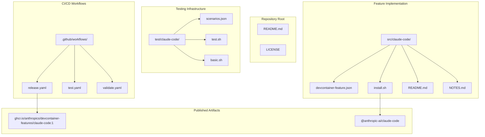
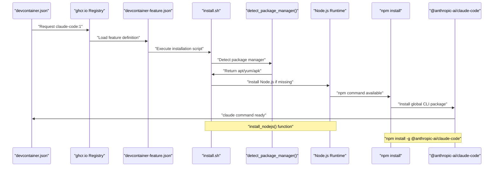

<!-- source: DeepWiki mcp.deepwiki.com · repo anthropics/devcontainer-features · page 1 Overview · fetched 2026-10-26 -->

# Overview

<details>
<summary>Relevant source files</summary>

The following files were used as context for generating this wiki page:

- [README.md](README.md)
- [src/claude-code/README.md](src/claude-code/README.md)

</details>


## Purpose and Scope

This document provides technical documentation for the `anthropics/devcontainer-features` repository, which contains Dev Container Features for development environments. The repository's primary component is the `claude-code` feature that automates installation of the Claude Code CLI tool in development containers.

This overview covers the repository architecture, core components, and system relationships. For detailed information about the claude-code feature implementation, see [Claude Code Dev Container Feature](#2). For release automation workflows, see [Release and Publication System](#3). For testing infrastructure details, see [Testing and Validation](#4).

## Repository Architecture

The repository implements a complete Dev Container Features ecosystem with automated testing, release workflows, and multi-platform support. The architecture centers around the `claude-code` feature with supporting infrastructure for publication and validation.

### Repository Structure to Code Mapping



Sources: [README.md:1-38](), [src/claude-code/README.md:1-68]()

### Feature Installation and Execution Flow



Sources: [src/claude-code/devcontainer-feature.json](), [src/claude-code/install.sh](), [src/claude-code/README.md:30-36]()

## Core Components

### Dev Container Feature Definition

The repository's main deliverable is defined in [src/claude-code/devcontainer-feature.json](), which specifies:
- Feature metadata and versioning
- Installation script reference (`install.sh`)
- VS Code extension customizations (`anthropic.claude-code`)
- Documentation auto-generation settings

### Installation System

The [src/claude-code/install.sh]() script implements multi-platform Node.js dependency management:
- `detect_package_manager()` function for platform detection
- `install_nodejs()` function with distribution-specific logic
- Automatic installation of `@anthropic-ai/claude-code` via npm
- Support for Debian/Ubuntu, Alpine, RHEL/CentOS/Fedora systems

### Testing Infrastructure

Comprehensive validation through:
- [test/claude-code/scenarios.json]() defining test matrix configurations
- [test/claude-code/test.sh]() and [test/claude-code/basic.sh]() for execution validation
- Multi-platform testing across `debian:latest`, `ubuntu:latest`, and Microsoft base images

## System Integration Points

### Publication Workflow

The [.github/workflows/release.yaml]() workflow automates:
- Feature publication to `ghcr.io/anthropics/devcontainer-features`
- Documentation generation and pull request creation
- Version management and release tagging

### User Integration

End users integrate the feature via `devcontainer.json` configuration:

```json
"features": {
    "ghcr.io/anthropics/devcontainer-features/claude-code:1": {}
}
```

The feature automatically handles Node.js dependencies or can be combined with explicit Node.js features as documented in [src/claude-code/README.md:42-47]().

### Dependency Management

The installation system supports multiple Node.js provisioning strategies:
1. Auto-installation via distribution package managers
2. Integration with existing Node.js installations
3. Compatibility with `nvm`-managed environments
4. Explicit Node.js feature dependencies

Sources: [src/claude-code/README.md:28-62](), [README.md:20-22]()

## Repository Maintenance

The repository maintains itself through automated workflows:
- **Validation**: [.github/workflows/validate.yaml]() ensures feature definitions are valid
- **Testing**: [.github/workflows/test.yaml]() runs comprehensive platform testing
- **Release**: [.github/workflows/release.yaml]() publishes features and updates documentation

This automation ensures consistent feature availability and up-to-date documentation without manual intervention.

Sources: [README.md:24-34](), [src/claude-code/README.md:65-67]()

---

