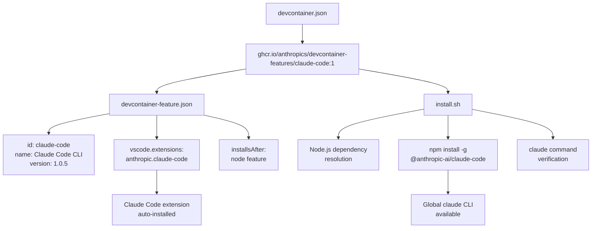
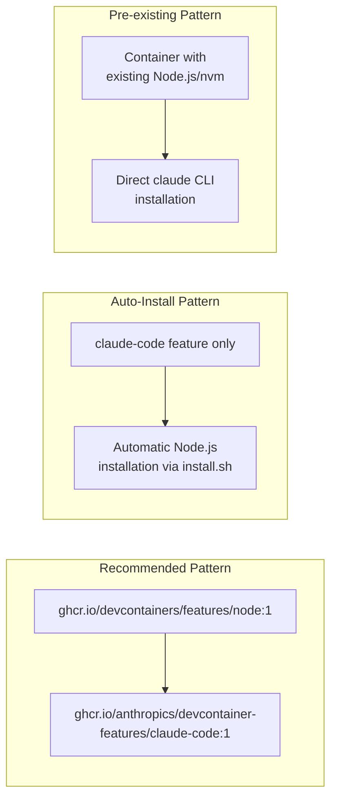
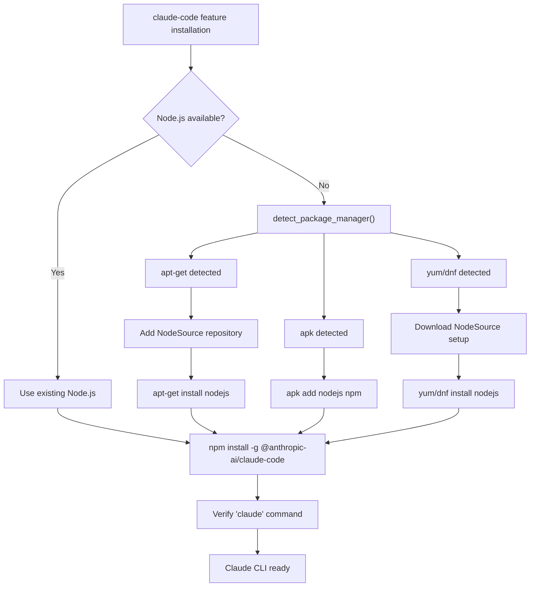
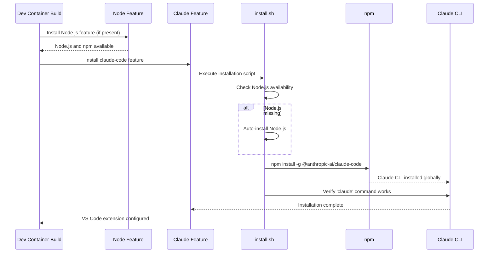

<!-- source: DeepWiki mcp.deepwiki.com · repo anthropics/devcontainer-features · page 2 Claude Code Dev Container Feature · fetched 2026-10-26 -->

# Claude Code Dev Container Feature

<details>
<summary>Relevant source files</summary>

The following files were used as context for generating this wiki page:

- [src/claude-code/README.md](src/claude-code/README.md)
- [src/claude-code/devcontainer-feature.json](src/claude-code/devcontainer-feature.json)

</details>


This document covers the `claude-code` Dev Container Feature, which is the primary component of this repository. The feature installs the Claude Code CLI tool globally in Dev Container environments and automatically configures the associated VS Code extension.

For information about the release and publication system that distributes this feature, see [Release and Publication System](#3). For details about testing this feature across platforms, see [Testing and Validation](#4).

## Feature Overview

The `claude-code` feature provides a streamlined way to install the Claude Code CLI tool in Dev Container environments. It handles Node.js dependency resolution automatically and integrates with VS Code through extension installation.

### Feature Definition

The feature is defined in [src/claude-code/devcontainer-feature.json:1-19]() with the following key properties:

| Property | Value | Purpose |
|----------|-------|---------|
| `id` | `claude-code` | Unique identifier for the feature |
| `name` | `Claude Code CLI` | Human-readable name |
| `version` | `1.0.5` | Current feature version |
| `description` | `Installs the Claude Code CLI globally` | Brief description |
| `options` | `{}` | No configurable options |
| `installsAfter` | `["ghcr.io/devcontainers/features/node"]` | Dependency ordering |

**Feature Architecture**


Sources: [src/claude-code/devcontainer-feature.json:1-19]()

### Usage Configuration

Users add the feature to their Dev Container configuration using the feature reference:

```json
"features": {
    "ghcr.io/anthropics/devcontainer-features/claude-code:1": {}
}
```

The feature requires no configuration options, as specified in [src/claude-code/devcontainer-feature.json:6]() where `options` is an empty object.

**Installation Dependency Patterns**


Sources: [src/claude-code/README.md:40-47](), [src/claude-code/README.md:49-57](), [src/claude-code/README.md:59-62]()

## Node.js Dependency Management

The feature implements sophisticated Node.js dependency resolution to ensure the Claude CLI can be installed regardless of the base container environment.

### Dependency Resolution Strategy

As documented in [src/claude-code/README.md:30-36](), the feature supports three approaches:

1. **Base Container with Node.js**: Uses existing Node.js installation
2. **Explicit Node.js Feature**: Relies on the official Node.js Dev Container feature  
3. **Automatic Installation**: Best-effort Node.js installation for supported platforms

The automatic installation targets Node.js 18.x LTS and supports Debian/Ubuntu, Alpine, Fedora, RHEL, and CentOS distributions.

**Node.js Resolution Flow**


Sources: [src/claude-code/README.md:30-36]()

## VS Code Integration

The feature automatically configures VS Code integration through the `customizations` property in [src/claude-code/devcontainer-feature.json:9-15]().

### Extension Installation

The feature automatically installs the `anthropic.claude-code` VS Code extension, as defined in [src/claude-code/devcontainer-feature.json:11-13]():

```json
"customizations": {
    "vscode": {
        "extensions": [
            "anthropic.claude-code"
        ]
    }
}
```

This ensures that users have both the CLI tool and the VS Code extension available immediately after container creation.

## Installation Order Dependencies

The feature specifies installation ordering through the `installsAfter` property in [src/claude-code/devcontainer-feature.json:16-18](), which ensures that if the official Node.js feature is present, it installs before the Claude Code feature.

**Feature Installation Sequence**


Sources: [src/claude-code/devcontainer-feature.json:16-18]()

## Documentation and Versioning

The feature maintains documentation through auto-generated README files. As noted in [src/claude-code/README.md:67](), the main documentation is generated from the feature definition and can be supplemented with additional notes.

The current version `1.0.5` from [src/claude-code/devcontainer-feature.json:4]() is automatically managed through the release system described in [Release and Publication System](#3).

Sources: [src/claude-code/README.md:67](), [src/claude-code/devcontainer-feature.json:4]()

---

