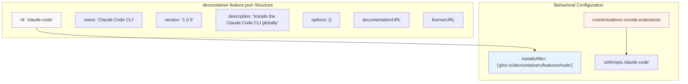
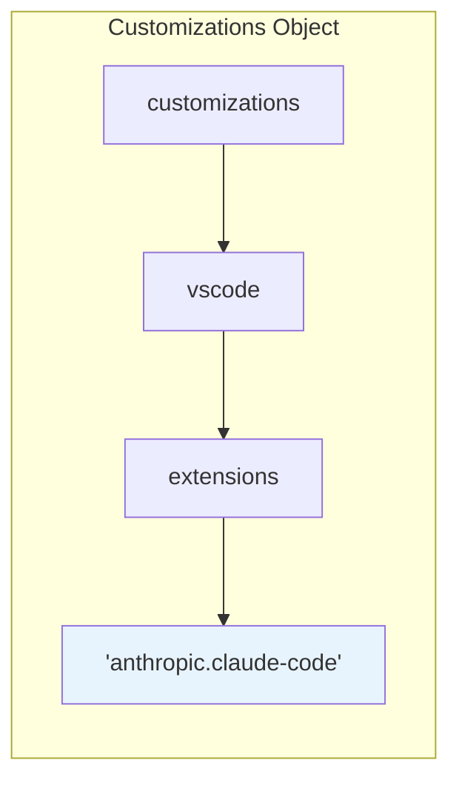
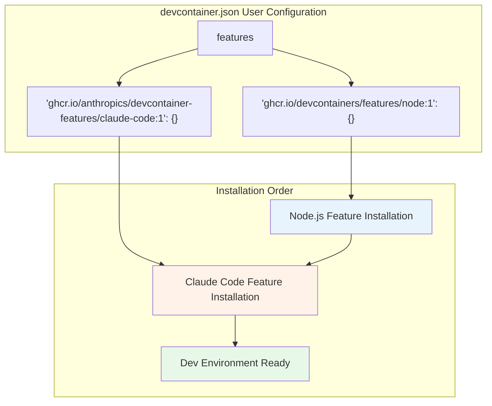
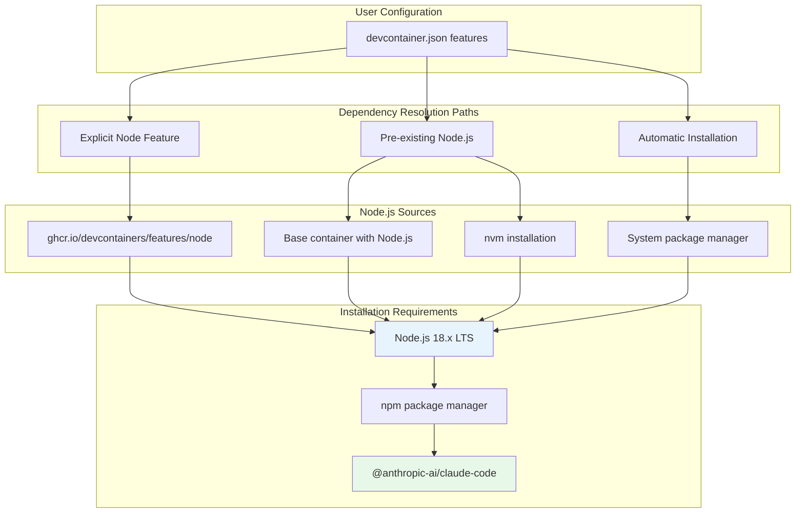

<!-- source: DeepWiki mcp.deepwiki.com · repo anthropics/devcontainer-features · page 2.1 Feature Configuration · fetched 2026-10-26 -->

# Feature Configuration

Relevant source files

The following files were used as context for generating this wiki page:

- [src/claude-code/NOTES.md](src/claude-code/NOTES.md)
- [src/claude-code/devcontainer-feature.json](src/claude-code/devcontainer-feature.json)

This document covers the configuration aspects of the claude-code Dev Container feature, including its feature definition structure and how users configure it in their development containers. This focuses specifically on the declarative configuration files and their relationships. For details about the installation process itself, see [Installation System](#2.2). For practical usage examples and patterns, see [Usage and Configuration Options](#2.3).

## Feature Definition Structure

The claude-code feature is defined through a standard Dev Container feature definition file that specifies metadata, dependencies, and default behaviors.

### Core Feature Metadata

The feature definition is contained in [src/claude-code/devcontainer-feature.json:1-19]() and establishes the basic identity and behavior of the feature.

**Feature Definition Elements**
- `id`: The unique identifier `claude-code` used in feature references
- `name`: Human-readable display name "Claude Code CLI"
- `version`: Semantic version `1.0.5` for this feature release
- `options`: Empty object `{}` indicating no user-configurable options
- `installsAfter`: Dependency ordering that ensures Node.js features install first

*Sources: [src/claude-code/devcontainer-feature.json:1-19]()*

### Dependency Declaration

The feature declares an explicit dependency relationship through the `installsAfter` property, which ensures proper installation ordering when multiple features are present.

| Property | Value | Purpose |
|----------|-------|---------|
| `installsAfter` | `["ghcr.io/devcontainers/features/node"]` | Ensures Node.js feature installs before claude-code |
| `options` | `{}` | No user-configurable parameters currently supported |

*Sources: [src/claude-code/devcontainer-feature.json:16-18]()*

### VS Code Integration

The feature includes automatic VS Code customizations that install the corresponding editor extension alongside the CLI tool.

*Sources: [src/claude-code/devcontainer-feature.json:9-15]()*

## User Configuration Patterns

Users configure the claude-code feature in their `devcontainer.json` through the `features` property, with several recommended patterns depending on their environment setup.

### Recommended Configuration with Explicit Node.js

The standard recommended configuration explicitly includes both the Node.js feature and the claude-code feature to ensure reliable dependency management.

*Sources: [src/claude-code/NOTES.md:15-22]()*

### Configuration for Pre-existing Node.js Environments

When the container already includes Node.js (through base image or nvm), users can configure only the claude-code feature directly.

| Scenario | Configuration | Node.js Source |
|----------|---------------|----------------|
| Node.js base image | `"ghcr.io/anthropics/devcontainer-features/claude-code:1": {}` | Container base image |
| nvm pre-installed | `"ghcr.io/anthropics/devcontainer-features/claude-code:1": {}` | Existing nvm installation |
| Automatic installation | `"ghcr.io/anthropics/devcontainer-features/claude-code:1": {}` | Feature auto-installs Node.js |

*Sources: [src/claude-code/NOTES.md:24-36]()*

## Configuration Dependencies and Requirements

The feature has specific Node.js requirements that can be satisfied through multiple configuration approaches.

### Node.js Dependency Resolution

**Node.js Requirements:**
- Node.js 18.x LTS when auto-installing
- npm package manager for CLI installation
- Compatible with existing Node.js installations including nvm

*Sources: [src/claude-code/NOTES.md:3-11]()*

### Configuration Validation

The feature definition structure ensures proper validation during Dev Container processing:

| Element | Validation | Impact |
|---------|------------|--------|
| `installsAfter` | Ensures dependency ordering | Prevents installation failures |
| `options: {}` | No user parameters to validate | Simplified configuration |
| `customizations` | VS Code extension compatibility | Automatic editor integration |

*Sources: [src/claude-code/devcontainer-feature.json:6](), [src/claude-code/devcontainer-feature.json:16-18]()*

---

