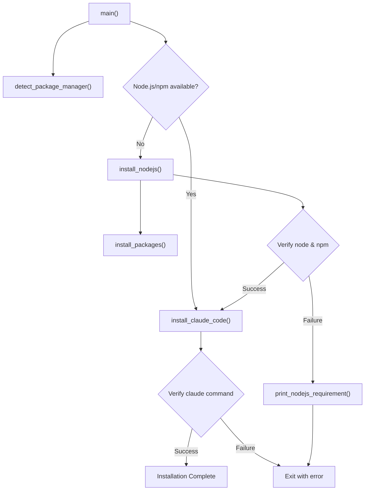
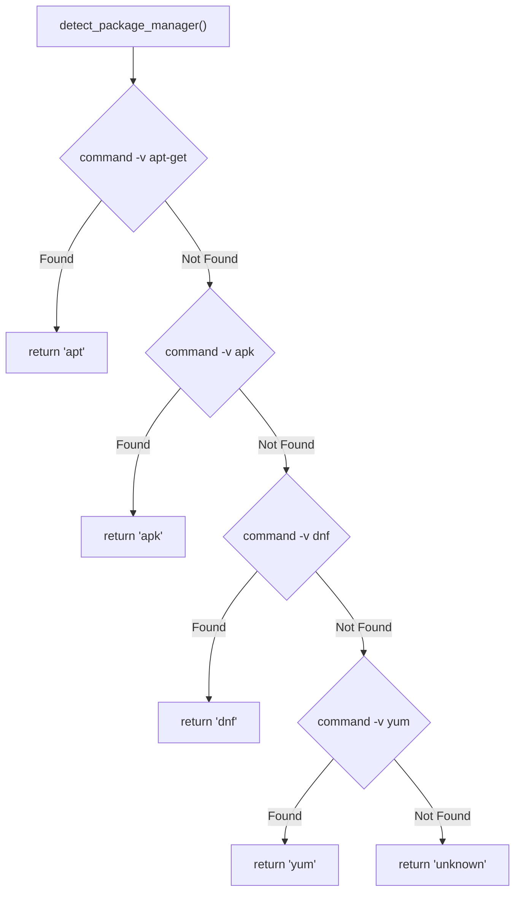
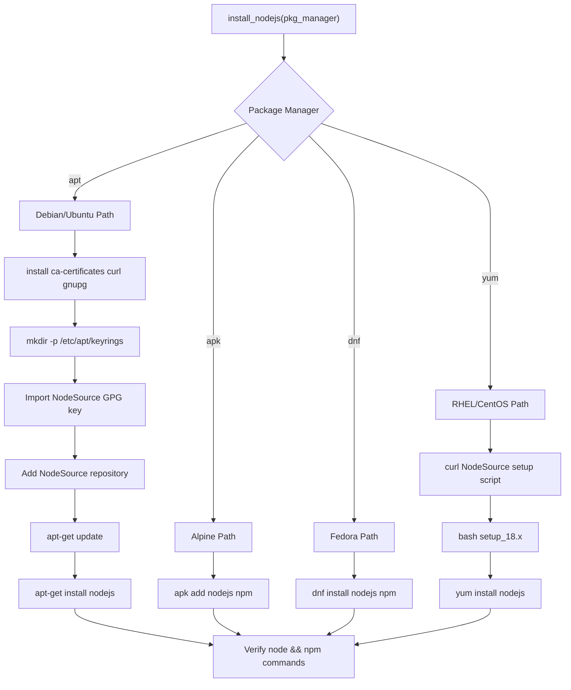
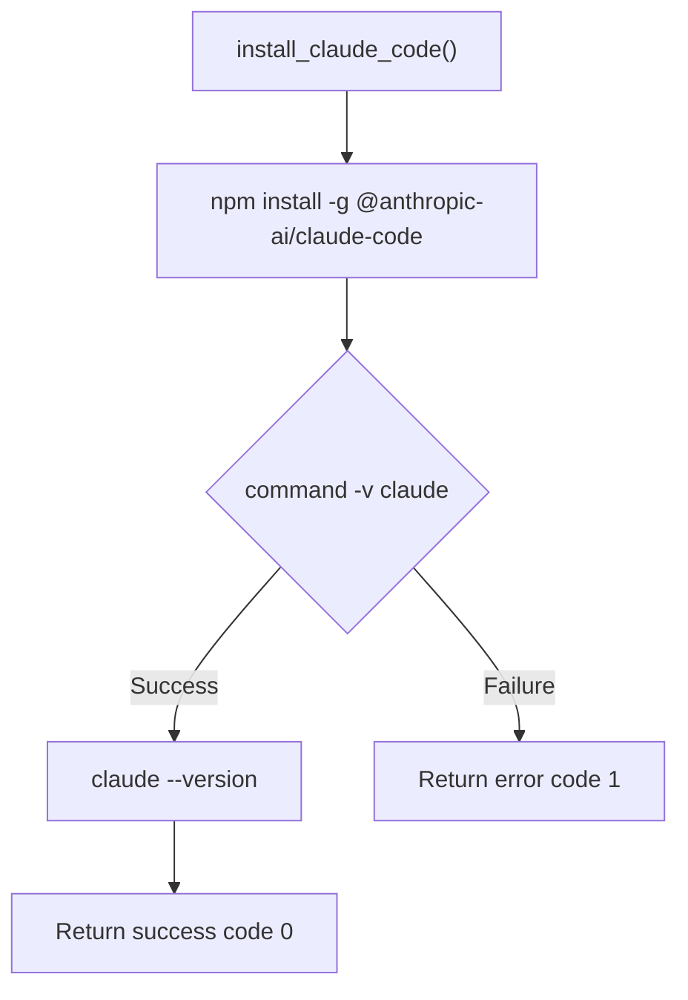

<!-- source: DeepWiki mcp.deepwiki.com · repo anthropics/devcontainer-features · page 2.2 Installation System · fetched 2026-10-26 -->

# Installation System

<details>
<summary>Relevant source files</summary>

The following files were used as context for generating this wiki page:

- [src/claude-code/NOTES.md](src/claude-code/NOTES.md)
- [src/claude-code/install.sh](src/claude-code/install.sh)

</details>


This document provides a detailed examination of the installation system that powers the claude-code Dev Container Feature. The installation system is implemented through the `install.sh` script, which handles cross-platform dependency management and Node.js installation strategies.

For information about feature configuration and how users specify the claude-code feature in their devcontainer.json, see [Feature Configuration](#2.1). For usage patterns and configuration options available to users, see [Usage and Configuration Options](#2.3).

## Installation Architecture Overview

The installation system operates through a layered architecture that handles platform detection, dependency management, and CLI installation in a systematic way.

**Installation System Architecture**


Sources: [src/claude-code/install.sh:122-140](), [src/claude-code/install.sh:46-88](), [src/claude-code/install.sh:91-103]()

## Package Manager Detection System

The installation system uses a universal package manager detection strategy that supports the major Linux distribution families.

**Package Manager Detection Flow**


The `detect_package_manager()` function iterates through package managers in priority order: `apt-get`, `apk`, `dnf`, `yum`. It uses the `command -v` test to check for availability and maps `apt-get` to the canonical name `apt`.

| Package Manager | Distribution Family | Detection Command |
|-----------------|-------------------|-------------------|
| `apt` | Debian, Ubuntu | `command -v apt-get` |
| `apk` | Alpine Linux | `command -v apk` |
| `dnf` | Fedora, newer RHEL | `command -v dnf` |
| `yum` | CentOS, older RHEL | `command -v yum` |

Sources: [src/claude-code/install.sh:5-17]()

## Platform-Specific Node.js Installation

The `install_nodejs()` function implements distinct installation strategies for each supported platform, optimizing for the most reliable Node.js distribution method available.

**Node.js Installation Strategies by Platform**


### Debian/Ubuntu Strategy

For Debian and Ubuntu systems, the installation uses the NodeSource repository to ensure a recent LTS version (Node.js 18.x):

1. Install prerequisite packages: `ca-certificates`, `curl`, `gnupg`
2. Create APT keyrings directory: `/etc/apt/keyrings`
3. Import NodeSource GPG key from `https://deb.nodesource.com/gpgkey/nodesource-repo.gpg.key`
4. Add NodeSource repository to `/etc/apt/sources.list.d/nodesource.list`
5. Update package lists and install `nodejs`

### Alpine Strategy

Alpine Linux uses its built-in package repository, installing `nodejs` and `npm` packages directly via `apk add --no-cache`.

### Fedora Strategy  

Fedora systems use the distribution's native `nodejs` and `npm` packages via `dnf install`.

### RHEL/CentOS Strategy

For RHEL and CentOS systems using `yum`, the installation downloads and executes the NodeSource setup script for Node.js 18.x, then installs via `yum install nodejs`.

Sources: [src/claude-code/install.sh:46-88](), [src/claude-code/install.sh:52-60](), [src/claude-code/install.sh:61-64](), [src/claude-code/install.sh:69-73]()

## Package Installation Abstraction

The `install_packages()` function provides a unified interface for package installation across different package managers.

| Package Manager | Update Command | Install Command |
|-----------------|----------------|-----------------|
| `apt` | `apt-get update` | `apt-get install -y $packages` |
| `apk` | N/A | `apk add --no-cache $packages` |
| `dnf` | N/A | `dnf install -y $packages` |
| `yum` | N/A | `yum install -y $packages` |

The function handles the platform-specific package manager invocation patterns and includes appropriate flags for non-interactive installation (`-y` for apt/dnf/yum, `--no-cache` for apk).

Sources: [src/claude-code/install.sh:20-43]()

## Claude CLI Installation Process

The `install_claude_code()` function handles the final step of installing the Claude Code CLI via npm and verifying the installation.

**Claude CLI Installation Flow**


The installation process:

1. Executes `npm install -g @anthropic-ai/claude-code` to install the CLI globally
2. Verifies installation by checking if the `claude` command is available
3. Displays version information on successful installation
4. Returns appropriate exit codes for success (0) or failure (1)

Sources: [src/claude-code/install.sh:91-103]()

## Error Handling and Fallback Strategy

When automatic Node.js installation fails, the system provides clear guidance to users through the `print_nodejs_requirement()` function.

The error message includes a complete example devcontainer.json configuration showing how to explicitly add the Node.js feature alongside the claude-code feature:

```json
"features": {
  "ghcr.io/devcontainers/features/node:1": {},
  "ghcr.io/anthropics/devcontainer-features/claude-code:1": {}
}
```

This fallback strategy ensures users have a reliable path forward even when the automatic installation cannot handle their specific environment.

Sources: [src/claude-code/install.sh:106-119](), [src/claude-code/NOTES.md:15-22]()

## Installation Verification System

The installation system implements verification at multiple stages:

1. **Package Manager Verification**: The `detect_package_manager()` function returns error code 1 when no supported package manager is found
2. **Node.js Verification**: After installation, both `node` and `npm` commands are verified using `command -v`
3. **Claude CLI Verification**: The `claude` command availability is verified and version information is displayed

This multi-stage verification ensures that each dependency is properly installed before proceeding to the next step, providing clear failure points for debugging installation issues.

Sources: [src/claude-code/install.sh:81-87](), [src/claude-code/install.sh:95-102]()

---

