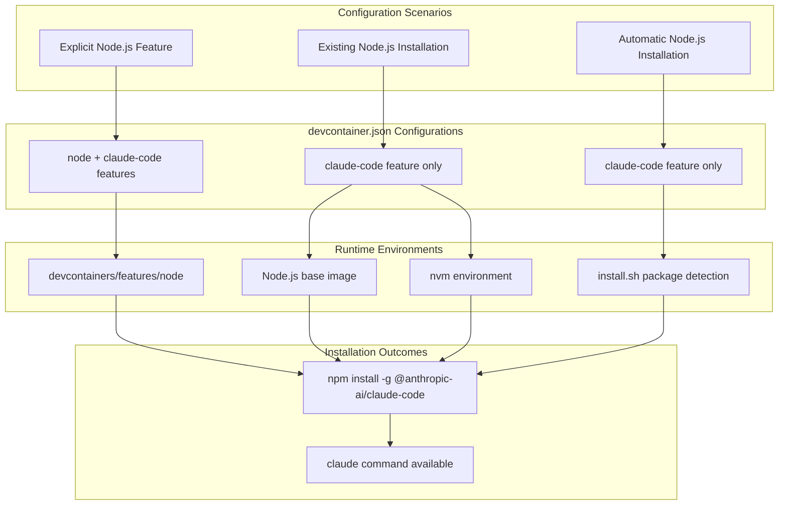
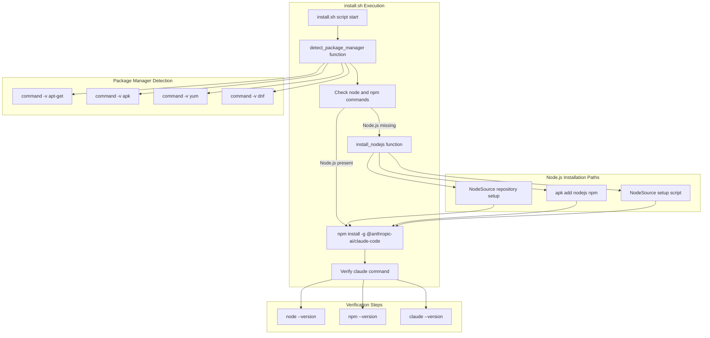

<!-- source: DeepWiki mcp.deepwiki.com · repo anthropics/devcontainer-features · page 2.3 Usage and Configuration Options · fetched 2026-10-26 -->

# Usage and Configuration Options

<details>
<summary>Relevant source files</summary>

The following files were used as context for generating this wiki page:

- [src/claude-code/NOTES.md](src/claude-code/NOTES.md)
- [src/claude-code/README.md](src/claude-code/README.md)

</details>


This document covers how to configure and use the claude-code Dev Container Feature in different environments and scenarios. It provides practical guidance for integrating the Claude Code CLI into your development containers, including Node.js dependency management strategies and configuration patterns.

For information about the underlying installation system mechanics, see [Installation System](#2.2). For feature definition details, see [Feature Configuration](#2.1).

## Basic Feature Configuration

The claude-code feature installs the Claude Code CLI globally using npm. The minimal configuration requires only adding the feature to your `devcontainer.json`:

```json
{
  "features": {
    "ghcr.io/anthropics/devcontainer-features/claude-code:1": {}
  }
}
```

The feature currently has no configurable options, as shown in the empty options table in [src/claude-code/README.md:16-17](). The installation automatically includes the `anthropic.claude-code` VS Code extension as a customization [src/claude-code/README.md:24]().

**Sources:** [src/claude-code/README.md:8-12](), [src/claude-code/README.md:14-18]()

## Node.js Dependency Management Scenarios

The claude-code feature requires Node.js and npm to function. The installation system supports three primary dependency management scenarios:

### Configuration Scenarios Overview



**Sources:** [src/claude-code/NOTES.md:3-11](), [src/claude-code/README.md:28-36]()

### Scenario 1: Explicit Node.js Feature (Recommended)

The recommended approach explicitly includes both the Node.js feature and claude-code feature:

```json
{
  "features": {
    "ghcr.io/devcontainers/features/node:1": {},
    "ghcr.io/anthropics/devcontainer-features/claude-code:1": {}
  }
}
```

This configuration ensures Node.js is available before claude-code installation begins and provides the most reliable setup across different base images.

**Sources:** [src/claude-code/NOTES.md:13-22](), [src/claude-code/README.md:38-47]()

### Scenario 2: Existing Node.js Installation

For containers with Node.js already available (Node.js base images, nvm environments), use only the claude-code feature:

```json
{
  "features": {
    "ghcr.io/anthropics/devcontainer-features/claude-code:1": {}
  }
}
```

This works with:
- Node.js-based container images
- Containers with nvm pre-installed
- Any environment where `node` and `npm` commands are available

**Sources:** [src/claude-code/README.md:49-57](), [src/claude-code/NOTES.md:24-32](), [src/claude-code/README.md:59-62]()

### Scenario 3: Automatic Node.js Installation

When Node.js is not present, the feature attempts automatic installation using the system package manager. This best-effort approach supports:

| Platform | Package Manager | Node.js Version |
|----------|----------------|-----------------|
| Debian/Ubuntu | `apt-get` | Node.js 18.x LTS |
| Alpine | `apk` | Node.js 18.x LTS |
| Fedora/RHEL/CentOS | `yum`/`dnf` | Node.js 18.x LTS |

**Sources:** [src/claude-code/NOTES.md:7-11](), [src/claude-code/README.md:32-36]()

## Installation Workflow Implementation

The installation process follows a specific sequence implemented in the `install.sh` script:

### Installation Flow Diagram



**Sources:** [src/claude-code/install.sh]() (referenced through installation system documentation)

## Configuration Patterns and Best Practices

### Feature Order Considerations

When using multiple features, Node.js-related features should be listed before claude-code to ensure proper dependency resolution:

```json
{
  "features": {
    "ghcr.io/devcontainers/features/node:1": {
      "version": "18"
    },
    "ghcr.io/anthropics/devcontainer-features/claude-code:1": {}
  }
}
```

### Base Image Compatibility

| Base Image Type | Recommended Configuration | Notes |
|-----------------|---------------------------|-------|
| `node:*` | claude-code only | Node.js already present |
| `mcr.microsoft.com/devcontainers/base:*` | node + claude-code | Clean Ubuntu environment |
| `debian:*`, `ubuntu:*` | claude-code only | Auto-install will handle Node.js |
| `alpine:*` | claude-code only | Auto-install uses apk |
| Custom images | Depends on Node.js presence | Test Node.js availability first |

### VS Code Integration

The feature automatically adds the `anthropic.claude-code` VS Code extension through the customizations property in [src/claude-code/devcontainer-feature.json](). No additional configuration is required for VS Code integration.

**Sources:** [src/claude-code/README.md:20-24]()

## Installation Verification

After feature installation, verify the claude-code CLI is available:

```bash
# Check Claude CLI installation
claude --version

# Verify Node.js (if auto-installed)
node --version
npm --version
```

The installation process includes automatic verification steps that will fail the container build if the claude command is not available after installation.

**Sources:** Installation verification logic referenced through [src/claude-code/install.sh]()

---

