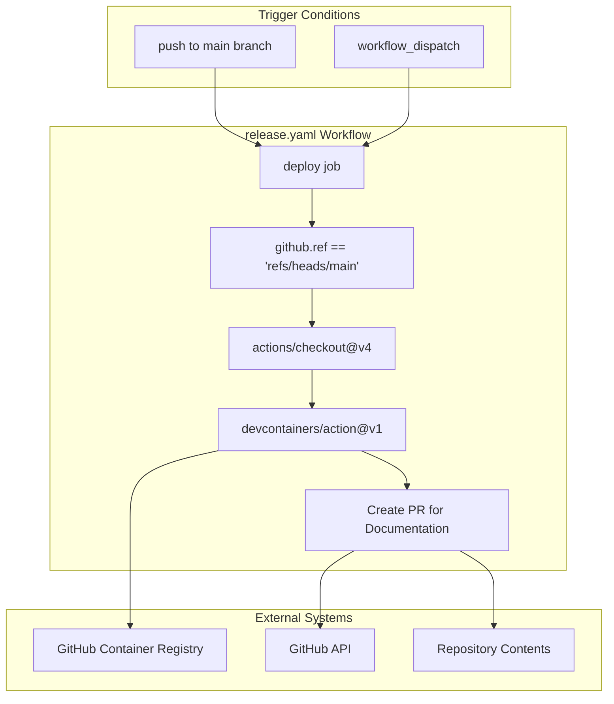
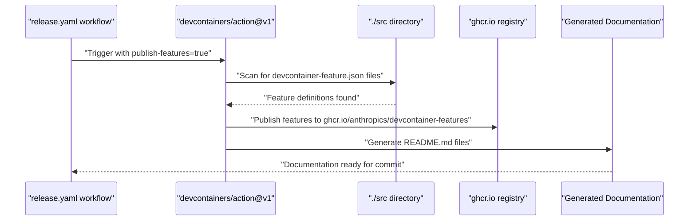
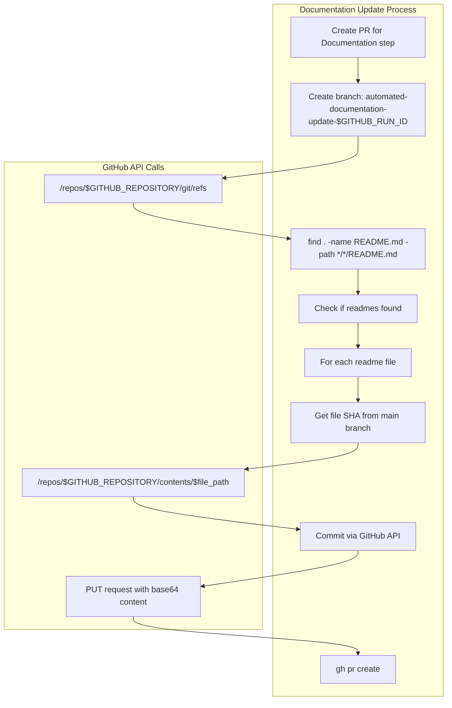
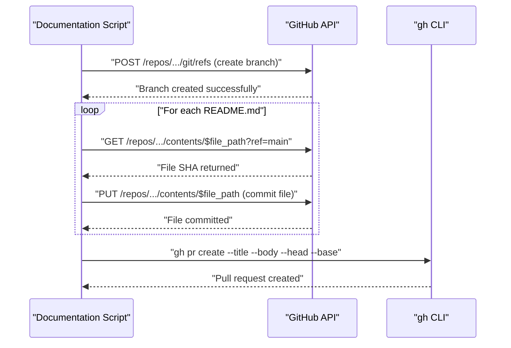

<!-- source: DeepWiki mcp.deepwiki.com · repo anthropics/devcontainer-features · page 3 Release and Publication System · fetched 2026-10-26 -->

# Release and Publication System

Relevant source files

The following files were used as context for generating this wiki page:

- [.github/workflows/release.yaml](.github/workflows/release.yaml)

## Purpose and Scope

The Release and Publication System is the core automation infrastructure that handles publishing Dev Container Features to GitHub Container Registry (GHCR) and maintains synchronized documentation. This system operates through a single GitHub Actions workflow that triggers on pushes to the main branch, automatically publishing features and creating pull requests for documentation updates.

This document covers the automated release workflow, feature publication mechanism, and documentation maintenance system. For information about the actual feature being published, see [Claude Code Dev Container Feature](#2). For testing and validation processes, see [Testing and Validation](#4).

## Release Workflow Architecture

The release system is implemented as a single GitHub Actions workflow defined in [.github/workflows/release.yaml:1-87](). The workflow consists of two primary phases: feature publication and documentation management.

### Workflow Architecture Diagram

**Sources:** [.github/workflows/release.yaml:3-11](), [.github/workflows/release.yaml:10-16]()

## Feature Publication Process

The feature publication is handled by the `devcontainers/action@v1` action, which processes all features in the `./src` directory and publishes them to GHCR with automatic documentation generation.

### Publication Configuration

The publication step is configured with three key parameters:
- `publish-features: "true"` - Enables feature publishing
- `base-path-to-features: "./src"` - Specifies source directory
- `generate-docs: "true"` - Enables automatic documentation generation

### Publication Flow Diagram

**Sources:** [.github/workflows/release.yaml:20-26](), [.github/workflows/release.yaml:27-28]()

## Automated Documentation System

The documentation system automatically commits updated README files and creates pull requests using the GitHub API. This process ensures documentation stays synchronized with published features without manual intervention.

### Documentation Update Process

The documentation update process follows a structured approach:

1. **Branch Creation**: Creates a uniquely named branch using `automated-documentation-update-$GITHUB_RUN_ID`
2. **File Discovery**: Locates all README.md files using pattern `*/*/README.md`
3. **Individual Commits**: Commits each README file separately via GitHub API
4. **Pull Request**: Creates a PR with the commit message `"Automated documentation update [skip ci]"`

### Documentation Workflow Diagram

**Sources:** [.github/workflows/release.yaml:30-48](), [.github/workflows/release.yaml:51-58](), [.github/workflows/release.yaml:60-86]()

## GitHub API Integration

The system makes extensive use of the GitHub API for branch management, file operations, and pull request creation. All API calls use the `GITHUB_TOKEN` secret for authentication and automatic commit signing.

### API Operations Summary

| Operation | Endpoint | Purpose |
|-----------|----------|---------|
| Branch Creation | `/repos/$GITHUB_REPOSITORY/git/refs` | Create documentation update branch |
| File Retrieval | `/repos/$GITHUB_REPOSITORY/contents/$file_path?ref=main` | Get current file SHA |
| File Update | `/repos/$GITHUB_REPOSITORY/contents/$file_path` | Commit updated README files |
| Pull Request | `gh pr create` | Create documentation PR |

### API Integration Sequence

**Sources:** [.github/workflows/release.yaml:43-47](), [.github/workflows/release.yaml:67-70](), [.github/workflows/release.yaml:75-82](), [.github/workflows/release.yaml:86]()

## File Processing and Commit Strategy

The system uses a sophisticated file processing approach that handles base64 encoding and SHA-based updates to ensure data integrity and proper version control.

### File Processing Details

- **File Discovery**: Uses `find . -name "README.md" -path "*/*/README.md"` to locate documentation files
- **Path Normalization**: Removes leading `./` prefix with `${readme:2}` parameter expansion
- **Content Encoding**: Converts files to base64 using `base64 -i $readme`
- **SHA Verification**: Retrieves current file SHA before each commit to prevent conflicts

### Commit Strategy Features

| Feature | Implementation | Purpose |
|---------|----------------|---------|
| Automatic Signing | GitHub API commits | Ensures commit authenticity |
| Skip CI Flag | `[skip ci]` in commit message | Prevents infinite workflow loops |
| Individual Commits | Separate API call per file | Granular change tracking |
| Error Handling | `|| echo "No changes..."` fallback | Graceful handling of no-op scenarios |

**Sources:** [.github/workflows/release.yaml:49](), [.github/workflows/release.yaml:52](), [.github/workflows/release.yaml:63](), [.github/workflows/release.yaml:79](), [.github/workflows/release.yaml:82]()

---

