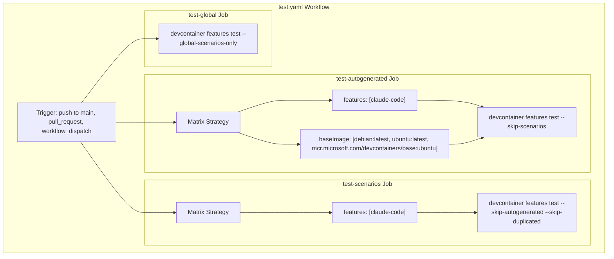
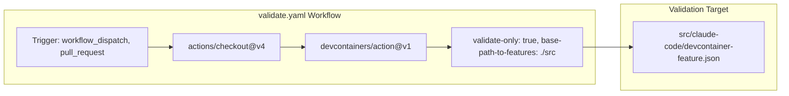
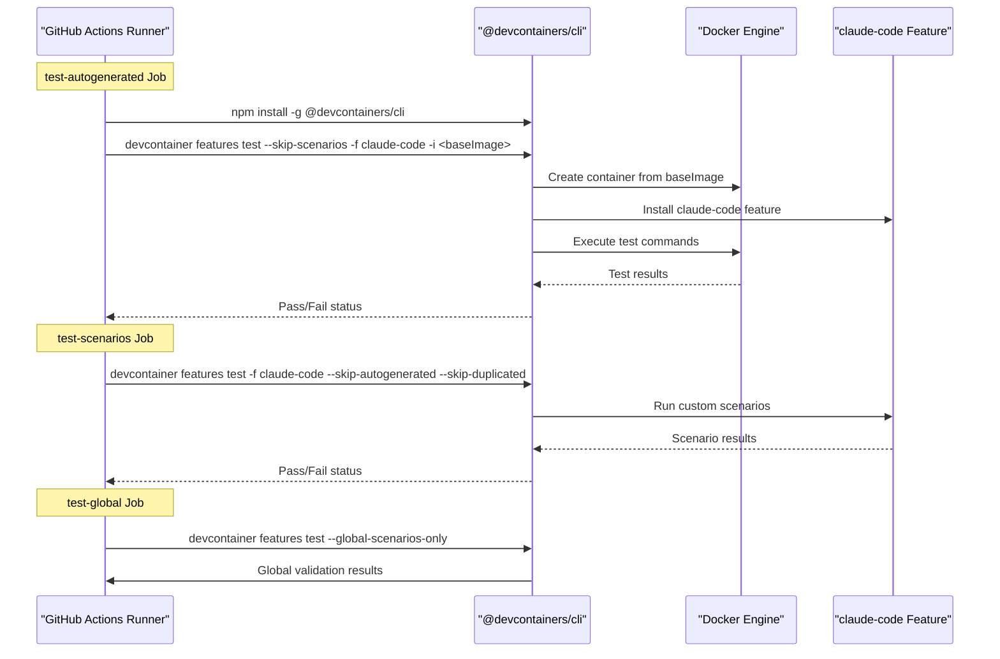

<!-- source: DeepWiki mcp.deepwiki.com · repo anthropics/devcontainer-features · page 4 Testing and Validation · fetched 2026-10-26 -->

# Testing and Validation

Relevant source files

The following files were used as context for generating this wiki page:

- [.github/workflows/test.yaml](.github/workflows/test.yaml)
- [.github/workflows/validate.yaml](.github/workflows/validate.yaml)

This document covers the comprehensive testing and validation infrastructure that ensures Dev Container features work correctly across multiple platforms and configurations. The testing system validates both the feature definitions themselves and their installation behavior across different base images and environments.

For information about the specific test configurations and scenarios, see [Test Configuration and Scenarios](#4.1). For details about the test execution scripts, see [Test Scripts and Validation](#4.2).

## Testing Infrastructure Overview

The repository implements a multi-layered testing approach through GitHub Actions workflows that validate features using the official Dev Container CLI. The testing system ensures compatibility across different Linux distributions and validates both automated test generation and custom scenarios.

### CI Testing Workflow Architecture

Sources: [.github/workflows/test.yaml:1-56]()

### Test Execution Matrix

The testing system uses a matrix strategy to validate the `claude-code` feature across multiple base images and scenarios:

| Test Job | Matrix Dimension | Values | Purpose |
|----------|------------------|--------|---------|
| `test-autogenerated` | `features` | `claude-code` | Feature under test |
| `test-autogenerated` | `baseImage` | `debian:latest`, `ubuntu:latest`, `mcr.microsoft.com/devcontainers/base:ubuntu` | Platform compatibility |
| `test-scenarios` | `features` | `claude-code` | Custom scenario testing |
| `test-global` | N/A | Global scenarios only | Repository-wide validation |

Sources: [.github/workflows/test.yaml:14-20](), [.github/workflows/test.yaml:34-37]()

## Validation Workflow

The validation system ensures that feature definitions conform to the Dev Container specification before any testing occurs.

### Feature Definition Validation

Sources: [.github/workflows/validate.yaml:1-16]()

The validation workflow performs the following operations:

1. **Schema Validation**: Validates `devcontainer-feature.json` files against the official Dev Container specification schema
2. **Structure Verification**: Ensures required fields are present and properly formatted
3. **Path Validation**: Confirms that the base path to features (`./src`) contains valid feature definitions

Sources: [.github/workflows/validate.yaml:12-16]()

## Test Execution Flow

The testing infrastructure uses the `@devcontainers/cli` package to execute tests with different strategies and flags.

### DevContainer CLI Test Commands

Sources: [.github/workflows/test.yaml:24-28](), [.github/workflows/test.yaml:40-44](), [.github/workflows/test.yaml:52-56]()

## Test Strategy Configuration

The testing system implements three distinct testing strategies:

### 1. Autogenerated Tests (`test-autogenerated`)
- **Command**: `devcontainer features test --skip-scenarios -f ${{ matrix.features }} -i ${{ matrix.baseImage }}`
- **Purpose**: Validates basic feature installation across different base images
- **Matrix**: Tests `claude-code` against `debian:latest`, `ubuntu:latest`, and `mcr.microsoft.com/devcontainers/base:ubuntu`
- **Execution**: Runs on `ubuntu-latest` with `continue-on-error: true`

### 2. Scenario Tests (`test-scenarios`)
- **Command**: `devcontainer features test -f ${{ matrix.features }} --skip-autogenerated --skip-duplicated`
- **Purpose**: Executes custom test scenarios defined in the feature's test directory
- **Focus**: Tests specific configuration options and edge cases
- **Matrix**: Single feature dimension (`claude-code`)

### 3. Global Tests (`test-global`)
- **Command**: `devcontainer features test --global-scenarios-only`
- **Purpose**: Validates repository-wide configurations and cross-feature interactions
- **Scope**: Tests scenarios that apply to the entire features collection

Sources: [.github/workflows/test.yaml:10-56]()

## Error Handling and Reliability

The testing infrastructure implements several reliability mechanisms:

- **Continue on Error**: All test jobs use `continue-on-error: true` to ensure partial failures don't block the entire pipeline
- **Matrix Isolation**: Each base image and feature combination runs independently
- **Trigger Flexibility**: Tests run on push to main, pull requests, and manual dispatch for comprehensive coverage

Sources: [.github/workflows/test.yaml:12](), [.github/workflows/test.yaml:32](), [.github/workflows/test.yaml:48]()

---

