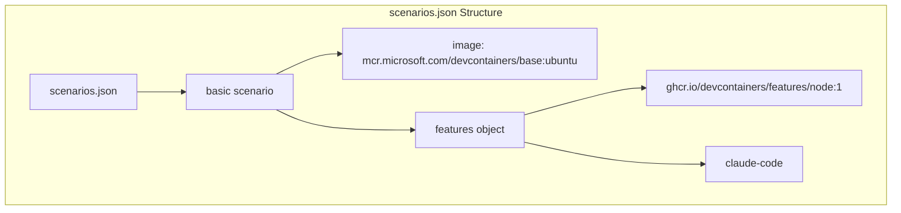
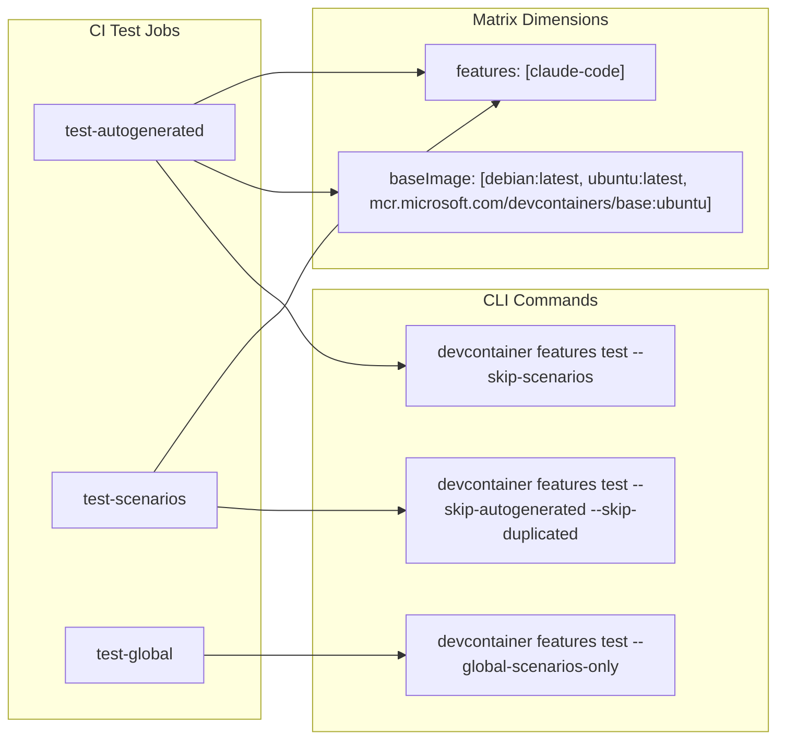
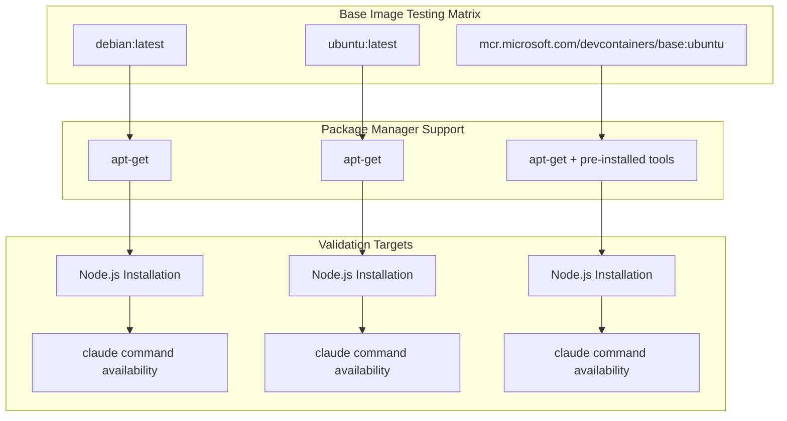
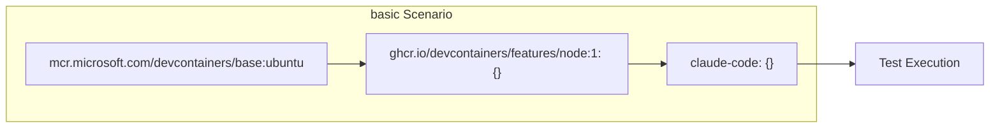

<!-- source: DeepWiki mcp.deepwiki.com · repo anthropics/devcontainer-features · page 4.1 Test Configuration and Scenarios · fetched 2026-10-26 -->

# Test Configuration and Scenarios

Relevant source files

The following files were used as context for generating this wiki page:

- [.github/workflows/test.yaml](.github/workflows/test.yaml)
- [test/claude-code/scenarios.json](test/claude-code/scenarios.json)

This document explains how test scenarios are defined and configured to validate the claude-code Dev Container Feature across different base images and environments. It covers the scenario definitions, test execution matrix, and the various testing approaches used to ensure feature compatibility.

For information about the actual test execution scripts and validation logic, see [Test Scripts and Validation](#4.2). For details about the broader testing infrastructure, see [Testing and Validation](#4).

## Test Scenario Definition

Test scenarios are defined in `scenarios.json` files that specify combinations of base images, features, and configuration options to validate. The claude-code feature uses a single scenario that tests integration with Node.js dependencies.

### Scenario Configuration Structure

The scenarios configuration follows a specific format that defines test environments:

The current scenario configuration includes:
- **Base Image**: `mcr.microsoft.com/devcontainers/base:ubuntu`
- **Dependencies**: Node.js feature from devcontainers registry
- **Target Feature**: `claude-code` feature

Sources: [test/claude-code/scenarios.json:1-9]()

## Test Execution Matrix

The CI testing system uses a matrix strategy to validate features across multiple dimensions, creating comprehensive coverage through different test types.

### Test Matrix Architecture

Sources: [.github/workflows/test.yaml:10-56]()

## Test Type Classifications

The testing framework employs three distinct test execution modes, each targeting different validation scenarios:

### Autogenerated Tests

| Property | Value |
|----------|--------|
| **Job Name** | `test-autogenerated` |
| **Matrix** | `features × baseImage` |
| **Command** | `devcontainer features test --skip-scenarios` |
| **Base Images** | `debian:latest`, `ubuntu:latest`, `mcr.microsoft.com/devcontainers/base:ubuntu` |

Autogenerated tests validate feature installation across different base operating systems without custom scenarios.

### Scenario-Based Tests

| Property | Value |
|----------|--------|
| **Job Name** | `test-scenarios` |
| **Matrix** | `features` only |
| **Command** | `devcontainer features test --skip-autogenerated --skip-duplicated` |
| **Configuration** | Uses `scenarios.json` definitions |

Scenario tests validate specific feature combinations and configurations defined in the scenarios file.

### Global Tests

| Property | Value |
|----------|--------|
| **Job Name** | `test-global` |
| **Matrix** | None |
| **Command** | `devcontainer features test --global-scenarios-only` |
| **Scope** | Repository-wide scenarios |

Sources: [.github/workflows/test.yaml:30-56]()

## Base Image Coverage Strategy

The testing matrix ensures compatibility across major Linux distributions and Dev Container base images:

The base image selection provides coverage for:
- **Pure Debian/Ubuntu**: Tests package manager detection and Node.js installation from scratch
- **Microsoft Dev Container Base**: Tests integration with pre-configured development environments

Sources: [.github/workflows/test.yaml:17-20]()

## Scenario Definition Format

The `scenarios.json` file structure defines test environments using standard Dev Container configuration syntax:

| Field | Purpose | Example Value |
|-------|---------|---------------|
| `image` | Base container image | `mcr.microsoft.com/devcontainers/base:ubuntu` |
| `features` | Feature dependencies and configuration | Object with feature references |
| Feature keys | Specific features to install | `ghcr.io/devcontainers/features/node:1`, `claude-code` |

### Current Scenario Configuration

The basic scenario tests claude-code integration with Node.js:

This configuration validates that the claude-code feature works correctly when Node.js is provided by the official devcontainers Node.js feature rather than being installed by the claude-code feature itself.

Sources: [test/claude-code/scenarios.json:2-8]()

---

