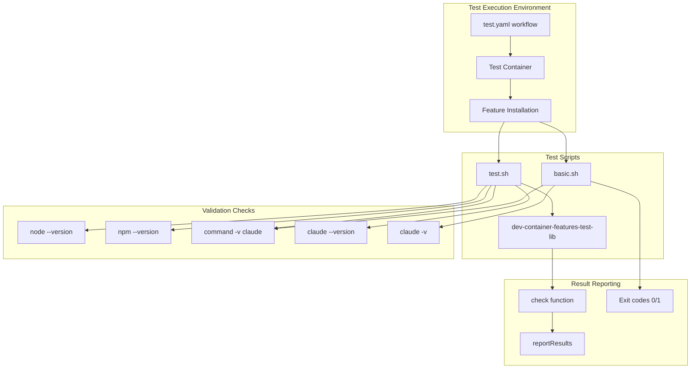
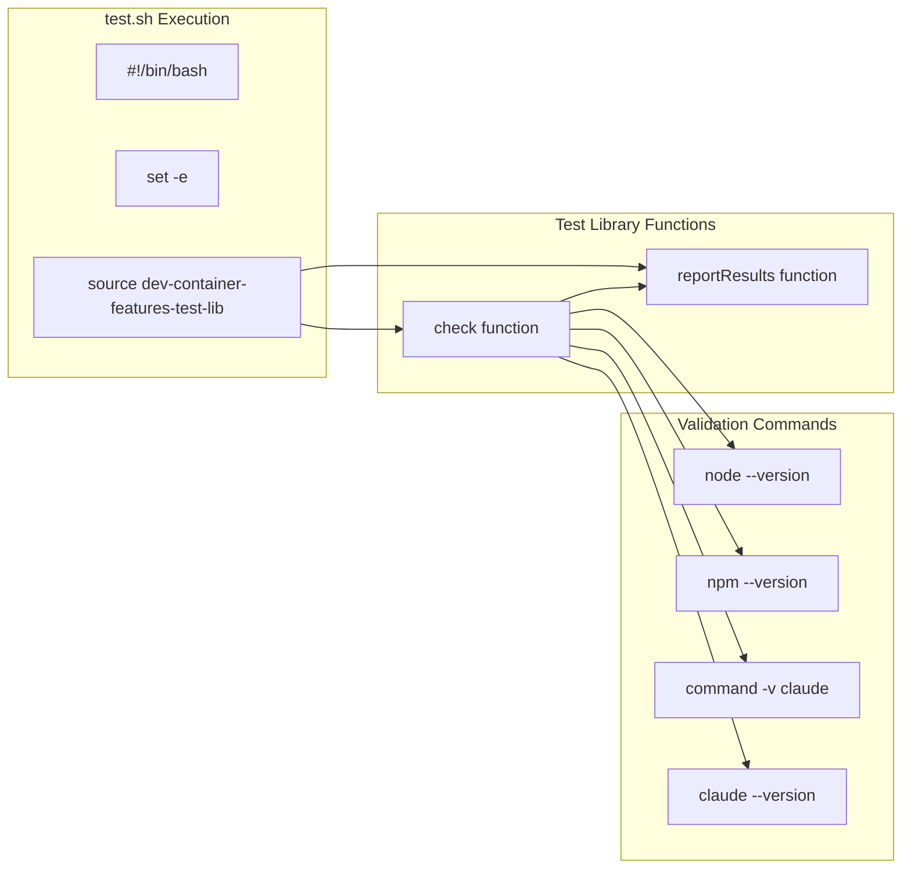
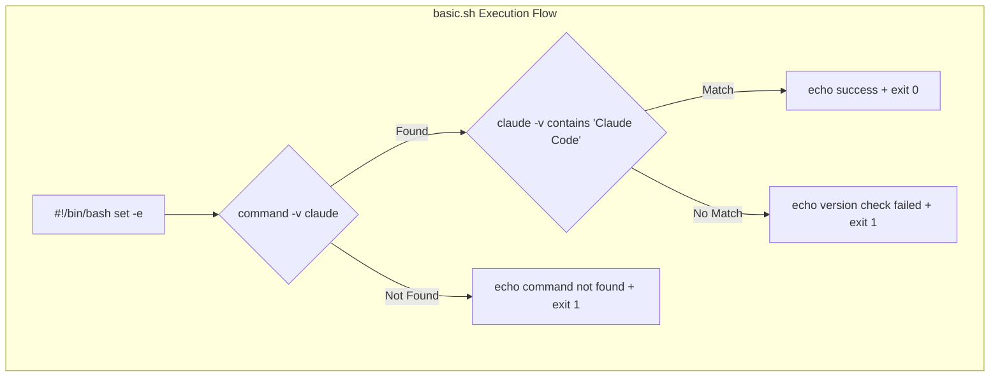

<!-- source: DeepWiki mcp.deepwiki.com · repo anthropics/devcontainer-features · page 4.2 Test Scripts and Validation · fetched 2026-10-26 -->

# Test Scripts and Validation

Relevant source files

The following files were used as context for generating this wiki page:

- [test/claude-code/basic.sh](test/claude-code/basic.sh)
- [test/claude-code/test.sh](test/claude-code/test.sh)

This document covers the test execution scripts and validation logic that verify the claude-code feature installation and functionality. These scripts are executed during the automated testing workflows to ensure the feature works correctly across different base images and environments.

For information about test configuration and scenarios, see [Test Configuration and Scenarios](#4.1). For details about the overall testing infrastructure and workflows, see [Testing and Validation](#4).

## Test Script Architecture

The claude-code feature uses two complementary test scripts that validate different aspects of the installation:

### Test Script Execution Flow

Sources: [test/claude-code/test.sh:1-15](), [test/claude-code/basic.sh:1-18]()

## Primary Test Script: test.sh

The main test script `test.sh` provides comprehensive validation using the dev-container-features-test-lib framework:

### Test Library Integration

The script performs four critical validation checks:

| Check Name | Command | Purpose |
|------------|---------|---------|
| node version | `node --version` | Verify Node.js runtime is available |
| npm version | `npm --version` | Verify npm package manager is functional |
| claude cli installed | `command -v claude` | Confirm claude command is in PATH |
| claude version | `claude --version` | Validate claude CLI responds correctly |

Sources: [test/claude-code/test.sh:6-12]()

### Test Execution Pattern

The test script follows this execution pattern:

1. **Error Handling**: Sets `set -e` to exit on any command failure [test/claude-code/test.sh:3]()
2. **Library Import**: Sources the test library for `check` and `reportResults` functions [test/claude-code/test.sh:6]()
3. **Sequential Checks**: Executes each validation check using the `check` function [test/claude-code/test.sh:9-12]()
4. **Result Reporting**: Calls `reportResults` to aggregate and report test outcomes [test/claude-code/test.sh:15]()

Sources: [test/claude-code/test.sh:1-15]()

## Basic Validation Script: basic.sh

The `basic.sh` script provides a minimal validation approach without external dependencies:

### Basic Validation Logic

The basic script implements two essential checks:

1. **Command Availability**: Uses `command -v claude` to verify the claude executable is accessible [test/claude-code/basic.sh:6]()
2. **Version Verification**: Runs `claude -v` and checks output contains "Claude Code" [test/claude-code/basic.sh:12]()

### Error Handling and Output

The script uses explicit error handling with informative messages:

- **Command Not Found**: Outputs "claude command not found" and exits with code 1 [test/claude-code/basic.sh:7-9]()
- **Version Check Failed**: Outputs "claude version check failed" and exits with code 1 [test/claude-code/basic.sh:13-15]()
- **Success**: Outputs "Claude CLI installation test passed!" and exits with code 0 [test/claude-code/basic.sh:17-18]()

Sources: [test/claude-code/basic.sh:6-18]()

## Test Script Comparison

| Aspect | test.sh | basic.sh |
|--------|---------|----------|
| Dependencies | Requires dev-container-features-test-lib | No external dependencies |
| Scope | Comprehensive (Node.js + Claude CLI) | Claude CLI only |
| Error Reporting | Structured via test library | Direct error messages |
| Result Format | Aggregated test results | Simple pass/fail exit codes |
| Use Case | Primary automated testing | Minimal validation scenarios |

## Validation Check Details

### Node.js Runtime Validation

The primary test script validates the complete Node.js stack:

- **Node Runtime**: `node --version` confirms the Node.js binary is functional
- **Package Manager**: `npm --version` verifies npm is available for package management

These checks ensure the installation script successfully installed Node.js dependencies as documented in [Installation System](#2.2).

### Claude CLI Validation

Both scripts validate the Claude CLI but with different approaches:

- **Command Existence**: `command -v claude` checks if the claude binary is in the system PATH
- **Version Output**: `claude --version` (test.sh) and `claude -v` (basic.sh) verify the CLI responds correctly
- **Content Validation**: basic.sh specifically checks that version output contains "Claude Code" string

Sources: [test/claude-code/test.sh:9-12](), [test/claude-code/basic.sh:6-15]()

## Integration with Test Infrastructure

These validation scripts are executed within the broader testing infrastructure:

- **Automated Execution**: Called by GitHub Actions workflows during feature testing
- **Multi-Platform Testing**: Run across different base images (debian, ubuntu, devcontainer base images)
- **Scenario Testing**: Used in conjunction with test scenarios defined in scenarios.json

For details about how these scripts integrate with the overall test configuration, see [Test Configuration and Scenarios](#4.1).

Sources: [test/claude-code/test.sh:1-15](), [test/claude-code/basic.sh:1-18]()

---

